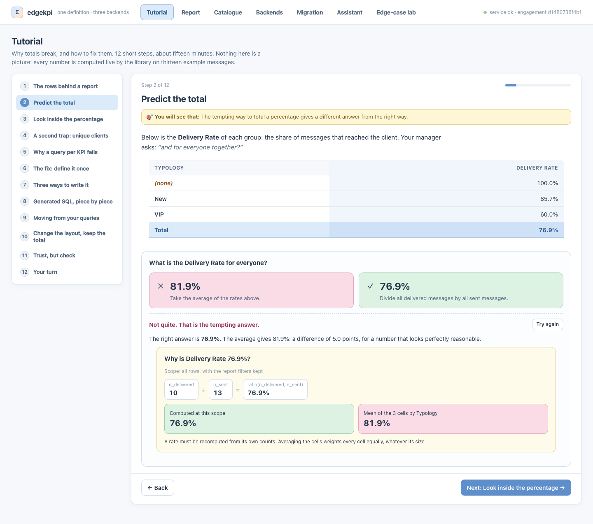
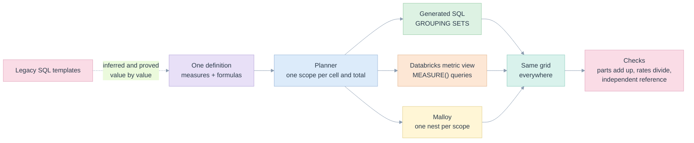
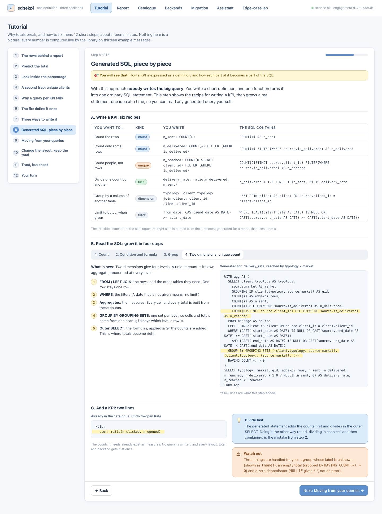
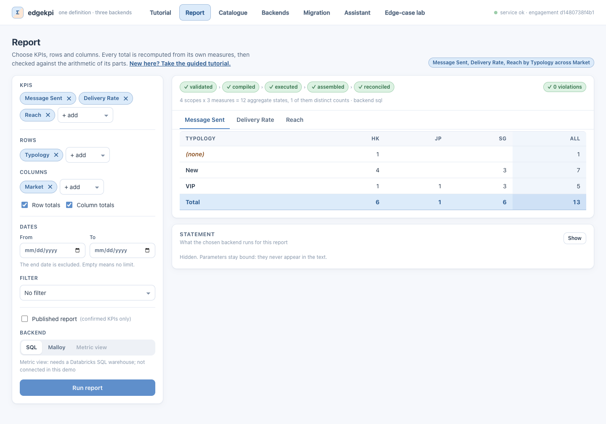
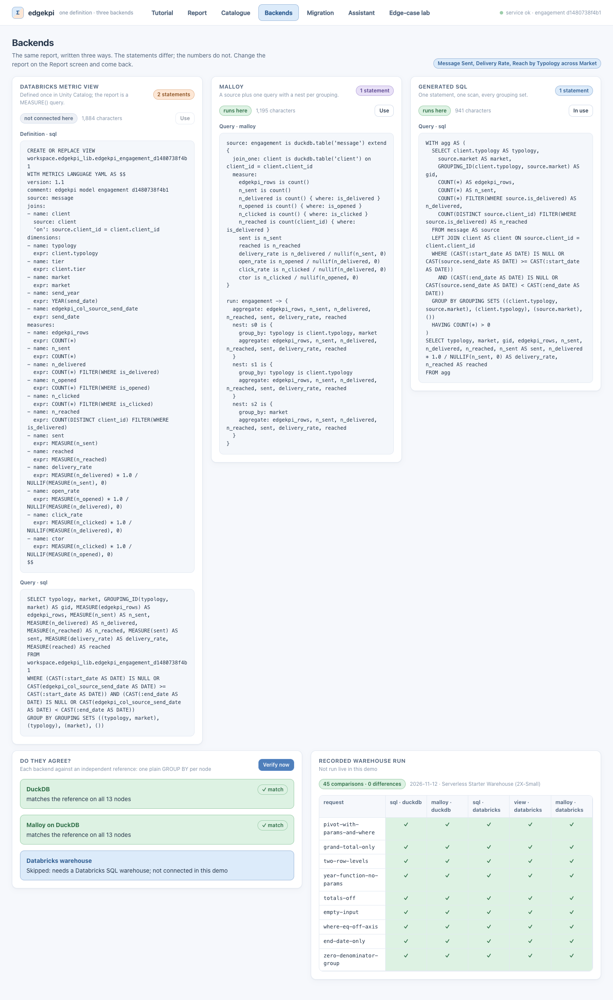
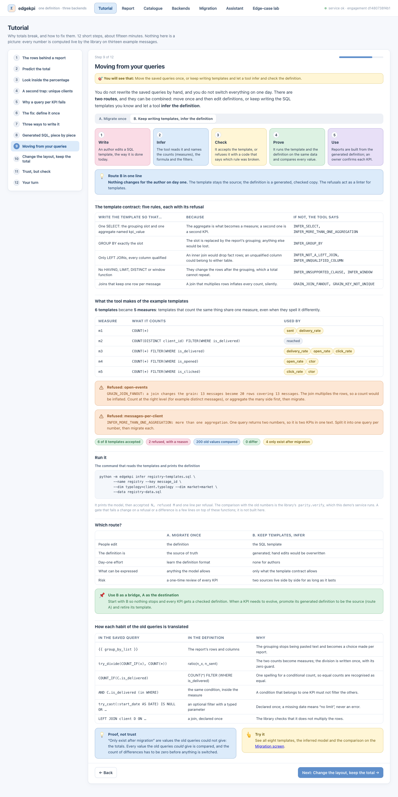
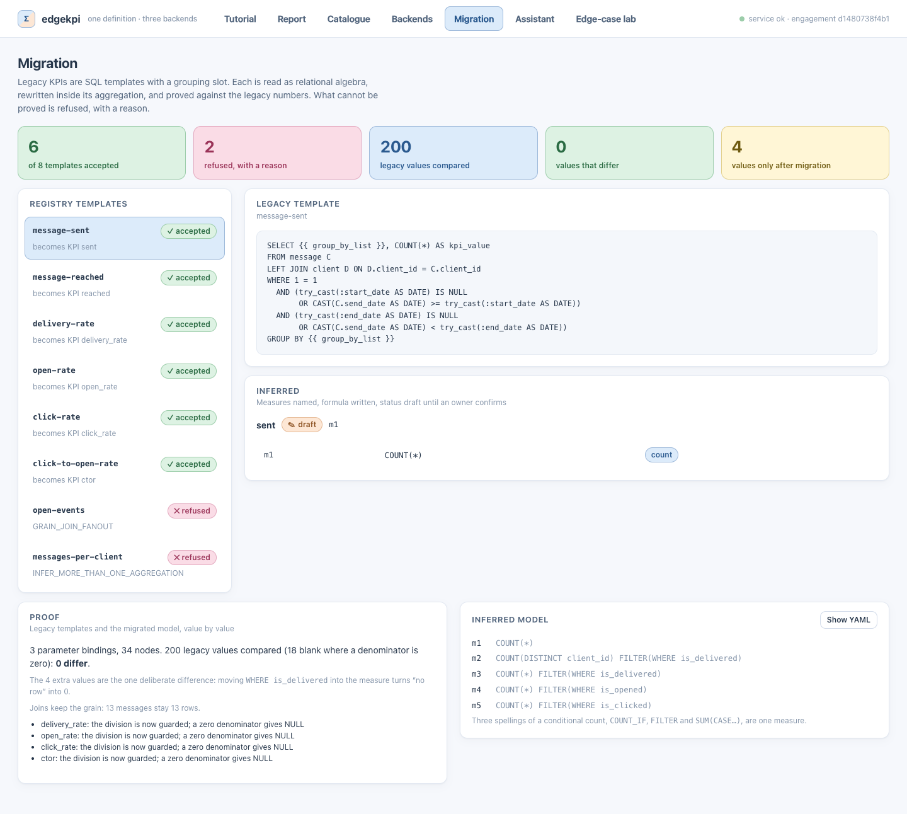

# edgekpi

> **A KPI defined as a parameterised SQL query cannot be totalled correctly. edgekpi defines each KPI as data (counts plus a formula) and generates the query for Databricks metric views, Malloy or plain SQL.**

Author: Raphael MANSUY · License: Apache-2.0 · Python 3.10+ · Node 18+ (demo and Malloy only)

## The problem this repository solves

Reporting products (CRM engagement, sales, operations) show a **pivot**: KPIs in columns, groups in rows, subtotals and a grand total. Many of them store each KPI as one SQL text with a placeholder for the grouping:

```sql
SELECT {{ group_by_list }}, try_divide(COUNT_IF(is_delivered), COUNT(*)) AS kpi_value
FROM message GROUP BY {{ group_by_list }}
```

That query returns a **finished number**, and a finished number cannot be totalled:

| | Unknown typology | New | VIP | Total |
|---|---:|---:|---:|---:|
| Delivery Rate | 100.0% (1 of 1) | 85.7% (6 of 7) | 60.0% (3 of 5) | **76.9%** (10 of 13) |
| *average of the three cells* | | | | *81.9% (wrong)* |

- **A rate** must be recomputed from its own counts: add the numerators, add the denominators, divide once. Averaging percentages weights a group of one message like a group of seven.
- **A distinct count** (unique clients) cannot be added: a client who sits in two cells is counted twice. In the example, Reach is 6 clients overall and 9 when the cells are added.
- **Every layout is another query.** Rows, columns, subtotals and grand totals multiply the number of SQL texts; each one is a chance to total wrongly, and nothing in a stored percentage says how to do it right.

The cause is structural, not a bug in one query: SQL composes *relations*, not *measures*. An aggregate is bound to the `GROUP BY` of its own statement, so a KPI written as a query cannot be reused at another grouping. The long version, with the algebra, is in the [illustrated briefing](specs/kpi/briefing/why-a-sql-query-is-not-a-kpi.pdf) and the [problem catalogue](specs/kpi/03-problem-catalogue.md).

The demo makes the trap tangible: pick the Delivery Rate for everyone, then open the number.



## The solution

Describe a KPI by **what it is made of**, not by one query that computes it:

```yaml
measures:                                   # one aggregate each
  n_sent:      COUNT(*)
  n_delivered: COUNT(*) FILTER (WHERE is_delivered)
  n_reached:   COUNT(DISTINCT client_id) FILTER (WHERE is_delivered)
kpis:                                       # a formula over measures
  delivery_rate: ratio(n_delivered, n_sent) # divides last, guards against zero
  reached:       n_reached                  # recounted at every total, never added
```

Because the library knows *which kind* of number each KPI is, it computes every cell and every total **at its own scope**, in one pass, whatever layout is requested. The same definition is rendered three ways:



| What | How |
|---|---|
| **Three backends, one grid** | Databricks metric views, Malloy (on DuckDB and on Databricks) and generated SQL return identical values for the same request (45 comparisons across five backend/engine pairs, 0 differences). |
| **Migration without a rewrite** | `edgekpi infer` reads existing templated SQL as relational algebra, proposes measures and formulas, proves them equal to the old numbers value by value, and refuses what it cannot prove, with a reason. |
| **Self-checking results** | Every result must pass arithmetic invariants (parts add up, unique counts stay in bounds, a rate equals its own division) and can be compared with a deliberately naive independent reference. |
| **Edge cases are explicit** | NULL members never collide with totals, zero denominators give NULL, optional date filters, joins that would multiply rows are refused, and more. Each case is listed, mitigated and tested. |

**Not in scope:** a BI front end, a scheduler, or approximate (sketch-based) distinct counts. The library is the correctness core that a report service would call.

## Try it in five minutes

The demo opens on a guided **tutorial**: twelve steps on the problem, how a KPI is expressed, how each backend works and how to migrate saved queries. Every number on screen is computed live by the library.

```bash
make doctor      # check python 3.10+, node 18+, npm, curl (and say how to get what is missing)
make install     # .venv, the library, the Malloy runtime, the demo's npm packages
make demo        # the service and the demo together: http://localhost:5173  (OPEN=1 opens the browser)
make             # every other target: test, e2e, check, example, mutation, stop, clean ...
```



### What you will see

**A report where every total is checked.** Totals are labelled, a NULL member is its own row, and the five-step lifecycle (validated, compiled, executed, assembled, reconciled) is shown. Click any total to see the counts it is made of and the tempting wrong answer beside it.



**One definition, three backends.** The same report as a Databricks metric view, Malloy and generated SQL, verified against an independent reference, with the recorded warehouse run.



**Migration from templated SQL.** Each legacy template is read, accepted or refused with a reason, and proved equal to the old numbers value by value. Two routes: migrate once, or keep writing templates and let the tool infer the definition.





## Command line and library

By hand:

```bash
uv venv .venv --python 3.12 && source .venv/bin/activate
uv pip install -e ".[dev]"
(cd edgekpi/backends/malloy_runtime && npm install)       # only for the Malloy backend

python -m edgekpi validate examples/registry/model.yaml
python -m edgekpi compile  examples/registry/model.yaml examples/registry/request-small.json --backend metric-view
python -m edgekpi run      examples/registry/model.yaml examples/registry/request-pivot.json \
                           --data examples/registry/data.sql
```

Against a Databricks SQL warehouse (creates `workspace.edgekpi_lib` with three small tables and one metric view per model version):

```bash
export DATABRICKS_CONFIG_PROFILE=<profile> EDGEKPI_DBX_WAREHOUSE=<warehouse id>
python -m edgekpi verify examples/registry/model.yaml examples/registry/request-pivot.json \
       --data examples/registry/data.sql --databricks
```

```
sql on duckdb                match   9 nodes  0 diffs, 0 violations
malloy on duckdb             match   9 nodes  0 diffs, 0 violations
sql on databricks            match   9 nodes  0 diffs, 0 violations
metric view on databricks    match   9 nodes  0 diffs, 0 violations
malloy on databricks         match   9 nodes  0 diffs, 0 violations
```

## Use as a library

```python
from edgekpi import load, run, GeneratedSql
from edgekpi.engines.sql import DuckDBEngine

model = load("examples/registry/model.yaml")
engine = DuckDBEngine(); engine.load(open("examples/registry/data.sql").read())
result = run(model, {"kpis": ["sent", "delivery_rate"], "rows": ["typology"], "cols": ["market"]}, GeneratedSql(), engine)
result.grid.long_rows()      # one dict per node; a NULL member and a rolled-up total never collide
result.states                # VALIDATED, COMPILED, EXECUTED, ASSEMBLED, RECONCILED
```

Swap `GeneratedSql()` for `MetricView()` (Databricks) or `Malloy()` (Malloy runtime) without touching anything else.

## Documentation

| Where | What it answers |
|---|---|
| [specs/kpi](specs/kpi/README.md) | **Why**: the problem statement, the problem catalogue, the correctness contract, the design options, probes on DuckDB, Databricks and Malloy, and the illustrated briefing |
| [specs/library](specs/library/README.md) | **What and how**: five whys and first principles, seven lenses, requirements, architecture (SOLID, DRY), the three backends, inference and migration, edge cases and state charts, test strategy, plan and evidence |
| [specs/ux-demo](specs/ux-demo/README.md) | **The demo**: requirements, screens and wireframes, edge cases, test strategy, tutorial script and the inspected screenshots |

## Repository layout

| Path | Contents |
|---|---|
| [edgekpi/](edgekpi) | the library; the core has no I/O, adapters (`backends/`, `engines/`) are replaceable |
| [tests/](tests) | unit, text-level, invariants, end-to-end matrix over five backend/engine pairs, documentation consistency |
| [examples/registry/](examples/registry) | the model, the requests, the synthetic data and the example legacy templates used by the tests |
| [examples/walkthrough/](examples/walkthrough) | the same KPI written as a metric view, as Malloy and as generated SQL, and a migration, step by step |
| [scripts/](scripts) | `record_evidence.py` (retained run record), `mutation_check.py` (do the tests notice broken rules?) |
| [demo/web/](demo/web) | the React demo (Vite, TypeScript) and its browser tests |

## Status and limits

Verified on synthetic data (13 messages) on DuckDB and on one Databricks serverless warehouse; the run record is in [specs/library/evidence](specs/library/evidence). Not covered: production volume, cost and latency, permissions, slowly changing (type-2) dimensions, several fact tables, and registries whose templates use shapes outside the [template contract](specs/library/06-inference-and-migration.md#refusal-codes). See [verification evidence](specs/library/13-verification-evidence.md#limits). Databricks runs need your own workspace; nothing in this repository contains credentials or workspace identifiers.

## License

Apache License 2.0, see [LICENSE](LICENSE) and [NOTICE](NOTICE).
