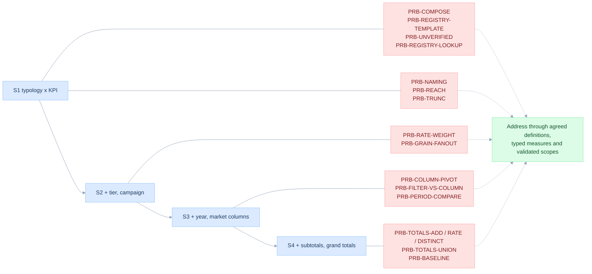

# Problem catalogue

> **Purpose.** Separate what the reporting scenarios require, which risks the SQL-template pattern carries, and what the prototype demonstrates. Read [BUSINESS-CASE](BUSINESS-CASE.md) for the business decision and [START-HERE](START-HERE.md) for a worked example.
>
> New here? Read [START-HERE](START-HERE.md) first.

Date: 2026-11-12. Lens: Product Owner, with the Database expert's numbers. Principles: [01-principles.md](01-principles.md). Each problem has an id (`PRB-*`) used by every later document.

Evidence labels: **demonstrated risk** means reproduced with synthetic data; **proposal** means behavior still to implement or accept; **open question** means a definition that owners must confirm. Existing test and benchmark reports are historical until backed by a current run record. Stable `PRB-*` ids preserve traceability.

## The four scenarios

The scenarios S1 to S4 are the reporting scenarios of this study.

| Scenario | Rows | Columns | New difficulty |
|---|---|---|---|
| S1 One row dimension | Client Typology | KPIs | None. One KPI value per typology. |
| S2 Three row dimensions | Typology -> Tier -> Campaign | KPIs | Same KPI, different value per tier and campaign. |
| S3 Year x Market columns | as S2 | Year -> Market -> KPI | One cell per row x Year x Market. |
| S4 Subtotals and grand totals | as S2 plus subtotals and grand total | as S3 plus subtotals and grand total | Totals need KPI-aware logic. |

## Scenario 1: Engagement by Client Typology

One row per typology and one column per KPI. The six registered KPIs of this study are `message-sent`, `message-reached`, `delivery-rate`, `open-rate`, `click-rate` and `click-to-open-rate`.

### PRB-NAMING: the CTR label hides two possible denominators

"CTR" is used for click-through rate, often clicked / delivered, and the registry KPI `click-to-open-rate` is clicked / opened. A report that prints one label over the other denominator is wrong without any arithmetic error, and a value alone cannot reveal which was used. Open question for the metric owner: which name and denominator is the published KPI?

Proposal: after the owner confirms click-to-open semantics and shared populations, define the KPI once as `clicked / opened` with a zero-denominator rule. `click_rate / open_rate` is equivalent only when both rates have the same nonzero denominator and context. Fix: [06-semantic-model-and-dsl.md](06-semantic-model-and-dsl.md) SEM-L1. Edge case: EC-NAMING in [15-edge-cases-and-state-charts.md](15-edge-cases-and-state-charts.md).

### PRB-REACH: Reach cannot safely be mapped to delivered

`message-reached` may count messages or recipients; this study leaves that open. Mapping it to the delivered-message count would be wrong if it counts clients reached at least once, and mapping it to distinct clients would be wrong if it counts messages. A stricter message status or a different observation window are further possibilities. On the 13-message example of [`examples/registry/data.sql`](../../examples/registry/data.sql) the two readings differ: 10 messages are delivered, but only 6 distinct clients received one. Distinct counting is one possibility, not an approved definition. Fail-closed rule: the model refuses to ship a KPI whose aggregate class is unconfirmed (SEM-GATE, EC-REACH-AMBIG).

A second observation can separate the readings: the additivity probe in [10](10-edgesql-integration.md) EDGE-PROBE compares the KPI over a period with the same KPI over its parts. A message count adds up exactly; a unique count falls below the sum as soon as one client appears in two parts.

### PRB-TRUNC: a seventh metric with no name

A registry can list a metric whose label and definition nobody has agreed, for example a conversion or count metric. A conversion metric might require a second fact or nested grain, depending on its definition. Neither is inferred here. Proposal: mark it `status: unresolved` and omit it from published replacements. The six named registry entries also require semantic confirmation; existence is not approval. EC-TRUNC.

### S1 evidence: the total row that scenario 4 adds

S1 shows typologies and no total; S4 adds one. The 13-message example (one row per message; typology New, VIP and one client missing from the dimension, hence unknown) shows what a total row must do:

| Typology | Sent | Delivered | Delivery Rate |
|---|---:|---:|---:|
| New | 7 | 6 | 85.7% |
| VIP | 5 | 3 | 60.0% |
| Unknown | 1 | 1 | 100.0% |
| *Mean of the column* | | | *81.9%* |
| **Total at its own scope** | **13** | **10** | **76.9%** |

Sent and Delivered add; the rate does not. The mean is 5.0 points above the total because the unknown typology, with one message, counts as much as New, with seven. This is a demonstrated risk on synthetic data and quantifies PRB-TOTALS-RATE; it says nothing about how any existing report computes a total.

## Scenario 2: Typology -> Tier -> Campaign

The same KPI returns a different value per tier and campaign, so every row combination needs its own evaluation. Tier and Campaign values are display groupings; their repeated labels do not imply a hierarchy.

### PRB-RATE-WEIGHT: rates require their own denominator weights

Open Rate must be weighted by **delivered messages**, and CTOR by **opened messages**, under the approved definitions. Weighting by sent can look similar when delivery rates are close but is not valid. Use underlying numerators and denominators, not rounded rates. The 90/10 campaign example in [BUSINESS-CASE](BUSINESS-CASE.md) shows 70% from averaging against 86% from the counts, and `test_mean_of_rates_is_wrong` tests the general rule on unequal denominators. Edge case: EC-RATE-WEIGHT.

### PRB-GRAIN-FANOUT: joins can change the grain

A KPI template is typically grouped by the row dimensions and joined to other sources. Joins to events (several opens per message) or to a type-2 client dimension (tier changes) change the grain and inflate counts. A click rate defined as "delivered messages generating **at least one** click" is a distinct-message condition, not an event count. Tests: `test_ec_event_fanout_inflates_open_count` (4 instead of 2), `test_ec_scd2_dimension_duplicates_facts` (3 rows for 2 messages). Fix: SEM-FACT grain and PLAN-GRAIN in [07-planner-and-sql-generation.md](07-planner-and-sql-generation.md). Edge cases: EC-FANOUT-EVENT, EC-SCD2.

## Scenario 3: Year -> Market -> KPI columns

### PRB-COLUMN-PIVOT: one cell per row x Year x Market

Conditional aggregation (`CASE WHEN`) can produce the column pivot where it is compatible with a KPI's SQL, but not universally: some KPI definitions do not support arbitrary conditional rewrites. Typed measures let the planner validate whether a grouping or predicate is compatible; nested, cross-fact or context-sensitive metrics still need specific planning rules. Universal support is not established by this prototype. Fix: SEM-L0 and PLAN-AXIS.

### PRB-FILTER-VS-COLUMN: Year is both a filter and a column

A report can constrain Year with a period filter and also display Year as column categories. A report filter `Year = 2026` plus a Year column shows one column. Year-over-year needs 2025 data that the filter removed. Test `test_ec_period_filter_and_year_column_and_prior_year`: the naive query returns prior = 0 for both markets. Widening the WHERE gives HK 350 / 250 and SG 250 / 200. Fix: PLAN-CONTEXT (the filter is split into **scope filter** and **context window**). EC-PERIOD-CTX.

### PRB-PERIOD-COMPARE: "current vs previous period" is a requirement

Reports commonly ask for current vs previous campaign, current vs previous period, and client typology vs an overall benchmark. These are context-sensitive requirements (SEM-L2), but the actual comparison must be defined. An overall benchmark might be a difference, index or rate comparison; it is not automatically a share of total. Previous campaign requires an ordering and comparable population. Define these before implementation; they may need additional scopes, windows or queries.

## Scenario 4: Flexible totals

The scenario requires detail, subtotal and grand total on each axis, plus row-subtotal x column-subtotal intersections. Each intersection is evaluated at **both** broader scopes, not as a blind sum of displayed cells.

Synthetic fixture grid (12 grouping shapes, 56 result rows before display suppression). A shape such as `(typology, year)` produces several member rows; it is not one cell. Sent and delivery % per column, reproduced by one statement (`test_s4_matches_business_case_grid`):

| Row | 2025 HK | 2025 SG | 2025 total | 2026 HK | 2026 SG | 2026 total | Grand total |
|---|---|---|---|---|---|---|---|
| New / Gold / A | 100, 80.0 | 50, 90.0 | 150, 83.3 | 200, 90.0 | 100, 80.0 | 300, 86.7 | 450, 85.6 |
| New / Gold / B | 100, 70.0 | 50, 80.0 | 150, 73.3 | 100, 90.0 | 50, 90.0 | 150, 90.0 | 300, 81.7 |
| New / Gold subtotal | 200, 75.0 | 100, 85.0 | 300, 78.3 | 300, 90.0 | 150, 83.3 | 450, 87.8 | 750, 84.0 |
| Existing / Silver / C | 50, 80.0 | 100, 70.0 | 150, 73.3 | 50, 90.0 | 100, 80.0 | 150, 83.3 | 300, 78.3 |
| Grand total | 250, 76.0 | 200, 77.5 | 450, 76.7 | 350, 90.0 | 250, 82.0 | 600, 86.7 | 1,050, 82.4 |

Display conventions of the fixture grid, and what it leaves out:

- Rate totals are recalculated at each total scope.
- Labels: a rolled-up level prints `ALL`, the subtotal row prints `SUBTOTAL` in the Campaign column, the last row prints `ALL | ALL | GRAND TOTAL`, the last column group is headed `GRAND TOTAL`.
- Only **New / Gold** has a subtotal row. Existing / Silver / C has none, and there is no typology-level subtotal for New. Both groups have a single child at that level, so the grid draws no subtotal for them. See PRB-SINGLE-CHILD-DISPLAY below.
- The optional "Market (all years)" column subtotal is not drawn.
- Only two KPIs appear (Sent, Delivery Rate). The unique-client case and the cross-KPI union are exercised by separate tests, not by this grid.

### PRB-SINGLE-CHILD-DISPLAY: draw a subtotal that equals its only child?

Computing a requested grouping is semantically valid, although every extra shape has a cost. The question is display: a subtotal over a single child repeats its parent's numbers. The planner always computes every requested node. The assembler has one option, `single_child_subtotals: show / hide`, default `hide` to match the fixture grid, **to be confirmed by the owner**. Test: the node exists in the grid (`test_ec_single_child_subtotal_duplicates_parent`). Display option: planned. EC-SINGLE-CHILD.

### PRB-TOTALS-ADD, PRB-TOTALS-RATE, PRB-TOTALS-DISTINCT: three rules

Three kinds of KPI need three total rules:

| Id | Case | Rule | Measured failure of the naive rule |
|---|---|---|---|
| PRB-TOTALS-ADD | Additive number (message sent) | Sum disjoint children, or count at total scope | None if children are disjoint. Wrong if a child is duplicated (EC-SINGLE-CHILD). |
| PRB-TOTALS-RATE | Percentage (delivery, open, click, CTOR) | Recompute numerator and denominator at the target scope | Synthetic fixture: mean of campaign delivery rates 81.9% vs total 82.4%; mean of year rates 81.7% vs 82.4%. 13-message example: mean of typology rates 81.9% vs total 76.9% (above). |
| PRB-TOTALS-DISTINCT | Non-additive count (unique clients) | Deduplicate IDs over the union in the target scope | Synthetic identities added by the fixture: campaigns A + B = 240, true 120; years 175 + 180 = 355, true 180. |

Tests: `test_mean_of_rates_is_wrong`, `test_year_total_mean_of_rates_is_wrong`, `test_unique_clients_do_not_add_up`. Fix: one rule, "compute at the node's scope" (FP-4), realised by `GROUPING SETS` ([07](07-planner-and-sql-generation.md) PLAN-ONEPASS) and the total-rule resolver ([15](15-edge-cases-and-state-charts.md) state chart SC-TOTAL).

### PRB-TOTALS-UNION: cross-KPI union is never a sum

A combined result across several client-count KPIs must count unique client ids across the KPI populations at the same intersection scope; it must not sum the counts. On the fixture the three distinct counts add up to more than the 180 true clients (`test_cross_kpi_union_is_not_a_sum`). It requires a confirmed business definition and common source ids. Proposal: SEM-UNION (exact identity union, or compatible `hll_union_agg` sketches after explicit approximation approval). The fixture uses nested populations and does not demonstrate arbitrary cross-source identity resolution. EC-DISTINCT-OVERLAP.

### PRB-BASELINE: repeated queries are a measurable risk, not a necessary design

The scenarios use six KPIs. Standard S4 prefix totals use four row grouping shapes × three column grouping shapes = twelve. A deliberately simple baseline executes one statement per KPI per shape: `6 × 12 = 72` (`test_baseline_statement_count_vs_one_pass`). Correct alternatives include one grouping-set statement per KPI, shared measures across all KPIs, a native semantic engine or split queries. Six statements are not inherently wrong. The fixture demonstrates shared aggregation; no production query count or runtime is claimed. Historical synthetic timings are retained in [08](08-complexity-and-performance.md), with provenance limits. Adding the optional `(market)` subtotal gives sixteen shapes.

## Cross-cutting problems (all scenarios)

### PRB-COMPOSE: composition must become an explicit contract

A registry that stores one query per KPI does not say whether CTOR can be expressed from other KPIs; the catalogue language may or may not support it. The proposal makes dependencies explicit and validates populations before sharing them. CTOR equals Click Rate / Open Rate only under a common nonzero denominator and context. Prototype check: `test_ctor_from_atoms_equals_click_rate_over_open_rate`.

The underlying gap is in SQL itself. SQL composes relations and has no reusable measure: an aggregate is tied to the `GROUP BY` of its statement, so a KPI stored as a query or view cannot be regrouped correctly. The registry's text slot is the usual workaround. [05](05-first-principles-solution.md) separates this language gap from the arithmetic one and compares the tools that close it, including Databricks metric views and Malloy.

Composition axes the scenarios need, mapped to the model:

| Axis | Example | Model level |
|---|---|---|
| Horizontal (KPI x KPI in one result) | six KPI columns | SEM-L0 / L1 |
| Vertical (KPI from KPI) | CTOR | SEM-L1 |
| Dimensional (grouping at read time) | S1 to S4 | PLAN-AXIS |
| Contextual (totals, prior period) | totals, "vs previous period" | SEM-L2 |
| Cross-fact | messages vs purchases (article) | PLAN-DRILL |
| Temporal | Year column and filter | PLAN-CONTEXT |

### PRB-REGISTRY-TEMPLATE: SQL string with slots

A KPI registry of this kind stores one templated SQL text per KPI, split across columns. These are typical columns, with synthetic example values for `message-sent`:

| Column | Example value for `message-sent` |
|---|---|
| `kpi_formula_text` | `COUNT(*)` |
| `formula_sql_text` | `COUNT(*)` |
| `select_sql_text` | `{{ group_by_list }}, COUNT(*) AS kpi_value` |
| `from_sql_text` | `silver.message C` |
| `join_definition_json` | `NULL` |
| `where_sql_text` | `1 = 1 AND (:start_date IS NULL OR C.send_date >= :start_date)` |
| `filter_definition_json` | `[]` (a JSON array of filter declarations) |
| `group_by_sql_text` | `{{ group_by_list }}` |

Two things follow.

1. **Such a catalogue already separates the aggregate from the rest.** `formula_sql_text` holds just `COUNT(*)`, and `from_sql_text`, `where_sql_text`, `filter_definition_json` and `group_by_sql_text` are separate columns. Turning such a row into an atom is nearly mechanical (EDGE-MAP in [10](10-edgesql-integration.md)). What a row alone cannot tell is what the formula columns contain for the other KPIs, in particular whether a rate already stores a ratio or references other KPIs. They must be read from the catalogue, not guessed.
2. **Grouping is parameterized through text**, with a Jinja-style slot used twice (`select_sql_text` and `group_by_sql_text`), and an optional-filter pattern in `where_sql_text`.

Risk to test: a filter without a matching placeholder could be silently ignored (EC-FILTER-NOPLACEHOLDER), and identifier substitution needs structural validation (WHY-B4). These are risks of the template pattern, to be checked in any actual implementation. The exact SQL of each KPI depends on its registry definition, and each KPI must preserve its calculation logic at every row x Year x Market intersection, which is why migration is gated by parity at leaf nodes (PRB-PRESERVE-LOGIC below).

Fix: [10-edgesql-integration.md](10-edgesql-integration.md).

### PRB-PRESERVE-LOGIC: the new model must not change what a KPI means

Every KPI must keep its calculation logic at each row-group x Year x Market intersection. Migration must preserve approved source semantics and reconcile every difference. Matching an existing number is insufficient if its definition is unapproved; a corrected total must have an explicit explanation and acceptance. Fix: parity harness in [10](10-edgesql-integration.md) EDGE-MIGRATE, tested at leaf nodes first.

### PRB-REGISTRY-LOOKUP: lookup by name with `like`

A registry that is queried by display name (for example `kpi_name LIKE 'Message Sent'`) and only then by id (`kpi_id = 'message-sent'`) depends on text that can change or collide. Ids (`message-sent`) are stable. The model keys on id and treats the name as a label (EC-NAMES).

### PRB-UNVERIFIED: definitions are unverified against production

Registry semantics, source SQL and the numbers of a real report are not available to this study. This repository therefore builds its own synthetic fixture, including a grid for S4 ([fixtures/s4_messages.sql](fixtures/s4_messages.sql)), and states which claims are demonstrated on it and which are proposals. Any production use needs the confirmation steps in [BUSINESS-CASE](BUSINESS-CASE.md).

## Priority (Product Owner view)

| Id | Impact | Fix size | MoSCoW | Phase ([13](13-implementation-plan.md)) |
|---|---|---|---|---|
| PRB-TOTALS-RATE / DISTINCT / ADD | Risk of incorrect published totals | M | Must | 1 |
| PRB-COMPOSE | Blocks reuse | M | Must | 1 |
| PRB-BASELINE | Potential repeated work; measure current baseline | M | Must | 1 |
| PRB-GRAIN-FANOUT | Silent inflation | M | Must | 2 |
| PRB-FILTER-VS-COLUMN | Wrong YoY | S | Must | 2 |
| PRB-COLUMN-PIVOT | UX parity with the scenarios | S | Must | 3 |
| PRB-REGISTRY-TEMPLATE | Migration | L | Must | 2 |
| PRB-TOTALS-UNION | Rare, needs a business definition | M | Should | 4 |
| PRB-PERIOD-COMPARE | Commonly requested | M | Should | 4 |
| PRB-NAMING / REACH / TRUNC | Business decision, not code | S | Must (decision) | 0 |
| PRB-REGISTRY-LOOKUP | Hygiene | S | Should | 2 |
| PRB-PRESERVE-LOGIC | A migration that changes meanings | M | Must | 2 |
| PRB-SINGLE-CHILD-DISPLAY | Display only | S | Could | 3 |

## Open business questions

These gate the affected definitions or options; they need not block unrelated measures. Proposed decision owner: CRM / marketing for metric meaning; report owner for display options. Full decision table and value model: [BUSINESS-CASE](BUSINESS-CASE.md).

1. Is the metric labelled CTR clicked / delivered or clicked / opened (CTOR)? (PRB-NAMING)
2. What exactly is Reach: distinct clients, distinct messages, or delivered? (PRB-REACH)
3. What is the seventh metric? (PRB-TRUNC)
4. Does the column-total mode include "Market (all years)"? It is an optional column subtotal, and Year scope is broadened only if that mode is required.
5. Is a cross-KPI union requested at all?
6. Are subtotals drawn when a group has a single child? The fixture grid omits them; the scope list includes them. (PRB-SINGLE-CHILD-DISPLAY)
