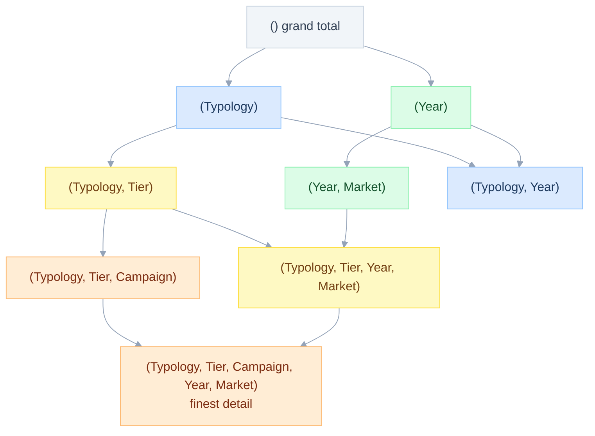
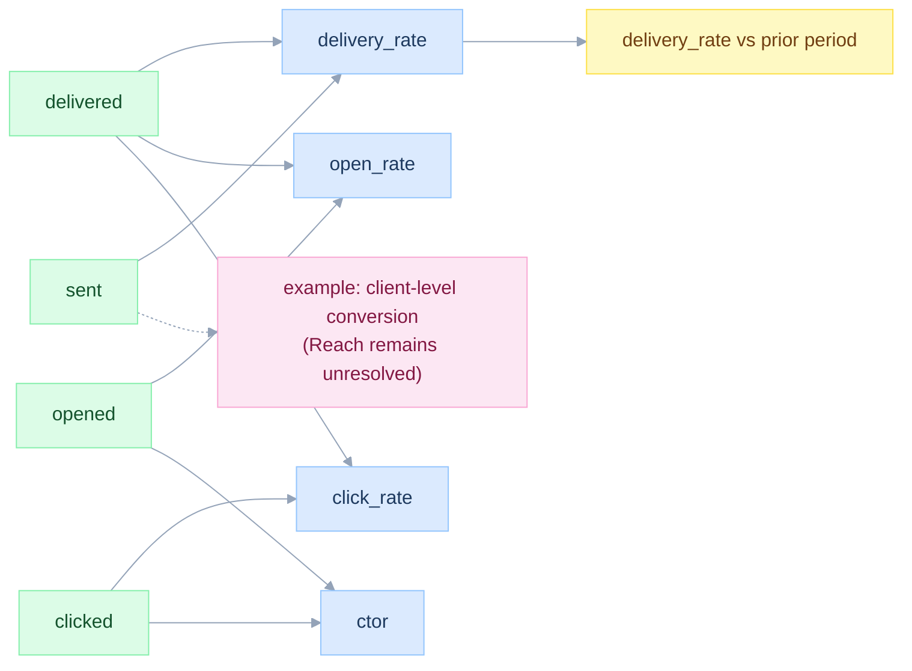

# The article, reformulated

> **Reading note.** This page summarises a background article and relates it to the problems of this study. Article attributions are the article's own claims and were not independently verified; they do not establish product behavior.
>
> New here? Read [START-HERE](START-HERE.md) first.

Date: 2026-11-12. Background: the article "Why one query per KPI breaks, and how to compute every KPI in one pass". This page restates it in plain terms and ties every idea to the problems in [03-problem-catalogue.md](03-problem-catalogue.md). Ids `ART-*` are used by later documents.

## The idea in four sentences

Treat a KPI as a business calculation over declared measures and context. Evaluate it at the requested scope rather than combining rounded display values. Exposing measure dependencies enables reuse across compatible scopes and definitions. A native semantic engine or generated SQL can implement this contract; a single scan is an optimization to verify, not the definition of correctness.

## ART-FAIL: the five failures

| # | Failure (article Table 1) | Kind | Seen in this study |
|---|---|---|---|
| 1 | Scans multiply with the number of definitions | Cost | PRB-BASELINE (72 statements) |
| 2 | Text substitutions obscure grouping structure | Maintenance | PRB-REGISTRY-TEMPLATE already has dynamic `{{ group_by_list }}` |
| 3 | Totals are ambiguous (double count, bias) | Correctness | PRB-TOTALS-ADD / RATE / DISTINCT |
| 4 | Comparisons and shares need extra requests | Correctness | PRB-PERIOD-COMPARE, PRB-FILTER-VS-COLUMN |
| 5 | Dependencies have no levels | Correctness | PRB-COMPOSE (CTOR), PRB-TOTALS-UNION |

The article's point: failures 1 and 2 are absorbed with bigger warehouses. Failures 3 to 5 cannot be fixed with compute, because the definition does not say how to compute the number at a coarser grain.

## ART-REQ: the five requirements

| Id | Requirement | Specified in |
|---|---|---|
| R1 | Article objective: share compatible work across KPIs; this design treats one pass as a measured optimization | [07](07-planner-and-sql-generation.md) PLAN-ONEPASS |
| R2 | Validated supported grouping sets chosen at query time | PLAN-AXIS, PLAN-ONEPASS |
| R3 | Totals computed from sufficient state at the requested scope, including valid disjoint-state rollups | SEM-L1, PLAN-TOTAL |
| R4 | Comparisons and shares in the definition, evaluated after aggregation | SEM-L2, PLAN-CONTEXT |
| R5 | KPIs on KPIs, and KPIs across facts, with no row multiplication | SEM-L1, SEM-L3, PLAN-DRILL |

## ART-LATTICE: the lattice of groupings

For ordered axis prefixes, each axis contributes one retained prefix or its all-state. The requested shapes form a product of these chains. With `r` row levels and `c` column levels, the standard prefix set has `(r+1)(c+1)` shapes. Arbitrary dimension subsets instead form a cube of up to `2^(r+c)` shapes. A shape can yield many member rows.

For S4: rows Typology -> Tier -> Campaign (3 levels, plus all-state, but only the rollup prefixes are used: 4 row grouping shapes) and columns Year -> Market (3 column grouping shapes). Requested grouping shapes: 4 x 3 = 12. The full cube over 5 dimensions would be 2^5 = 32 grouping shapes if every subset were allowed. The pivot asks only for rollup prefixes, which is why 12 is enough (EC-GSET-EXPLOSION in [15](15-edge-cases-and-state-charts.md)).



Excerpt: 9 of the 12 requested grouping shapes are drawn. Every shape defines a valid aggregate query. Every path down is a drill. A grouping-set adapter can compute these shapes in one statement; the physical scan and aggregation work depend on its verified plan.

## ART-MEASURE and ART-LEVELS: measures, KPIs, four levels

- A **measure** is `m = (F, e, p, phi)`: a fact `F`, a per-row expression `e`, a predicate `p`, an aggregate function `phi`.
- A **KPI** is `k = h(m1, ..., mj)`: a function `h` applied **after** aggregation. For a ratio of totals, finalization follows aggregation. A deliberately specified average of entity-level ratios is a different metric with a different grain.

| Level | Name | Example | Specified in |
|---|---|---|---|
| L0 | Atomic | `sent = COUNT(*)`, `delivered = COUNT(*) FILTER (WHERE is_delivered)` | SEM-L0 |
| L1 | Composed | `delivery_rate = delivered / sent`, `ctor = clicked / opened` | SEM-L1 |
| L2 | Context modified | "vs previous period", "vs overall benchmark" | SEM-L2 |
| L3 | Nested grain | Conversion first evaluated per client, then aggregated; Reach remains unresolved | SEM-L3 |



## ART-CLASS: how aggregates roll up

| Class | Examples | Merge | Pre-aggregate survives rollup | Rule here |
|---|---|---|---|---|
| Distributive | SUM, COUNT, MIN, MAX | SUM for counts; corresponding merge for others | Yes, from compatible disjoint partitions | Preserve population and merge rule |
| Algebraic | AVG, VARIANCE | Sufficient fixed-size state; variance needs more than sum/count | Yes if complete compatible state is stored | Finalize after merge |
| Holistic | COUNT DISTINCT, exact median, exact p95 | Exact state is not bounded independently of input | Scalar results do not support arbitrary rollup | Retain exact identities/values or recompute; HLL approximates distinct only |

The class decides the plan. Each atom in the model declares its class (SEM-CLASS). This is the Lenz and Shoshani summarizability condition applied: a rollup is correct only when the aggregate type supports merging.

## ART-WORKED: the article's numbers, re-run

The numbers below were re-run in DuckDB on a dataset modelled on the article's ([fixtures/retail_poc.sql](fixtures/retail_poc.sql)). The tests are in [fixtures/test_fixtures.py](fixtures/test_fixtures.py).

| Idea | Article number | Re-run | Test |
|---|---|---|---|
| Average of averages | HK basket 1,300 vs true 1,200 | 1,300 / 1,200 | `test_article_wrong_totals` |
| Summed distinct clients | 4 vs true 3 (HK) | 4 | `test_article_wrong_totals` |
| Fan-out | 5 messages join 5 transactions to 25 rows, sales 30,000 vs 6,000 | 25 rows, 30,000 | `test_article_fanout` |
| Distinct union | channels 5 + 2 + 2 = 9, true 6 | 5, 2, 2 and 6 | `test_article_distinct_union_and_conversion` |
| Nested grain | conversion 5 of 6 = 0.833, summed rows 8 of 9 = 0.889 | same | `test_article_distinct_union_and_conversion` |
| YoY by market | HK 6,000 vs 6,000, SG 5,000 vs 4,000, total 11,000 vs 10,000 | same | `test_article_yoy_table` |

Not reproduced here: the article's "40 KPIs over 3 facts = 240 scans" (an arithmetic example from its own setup), Yardstick, Malloy, and the semantic-layer LLM benchmark. They are quoted as the article's claims. One Malloy capability was probed directly: a Malloy model reproduced the 56 scenario 4 groups on local DuckDB ([validation](validation/2026-11-12-malloy/README.md)). That probe tests this study's pivot, not the article's statements about Malloy.

## ART-COST: the cost model, and its honest second term

```
C_baseline ~ |K| x |G| x (scan + join)
C_shared   ~ sum over fact/context groups f of (scan(f) + |F_f| x |G_f| x |A_f| x state_cost)
```

The first formula models a deliberately simple per-KPI/per-shape baseline. The second includes distinct state expressions `A_f`, grouping shapes `G_f`, and fact rows `F_f`. It is a conceptual work model, not an optimizer estimate. Adding KPIs can introduce new measures, predicates, joins, contexts or facts, so cost need not be independent of KPI count. The article emphasises the second term: expanding grouping sets still touches every fact row once per requested set, unless the engine reuses an order. Historical benchmark notes illustrate that tradeoff: on Databricks at 100 M rows the second term is what makes an exact `COUNT(DISTINCT)` in one pass as slow as 72 separate statements. [08-complexity-and-performance.md](08-complexity-and-performance.md) records the historical measurements and covers the two-stage plan (aggregate once to the finest grain, derive coarser nodes from cells) and the split plan.

## ART-ENGINE: the four speed layers

| Layer | Idea | Caveat from the article | Here |
|---|---|---|---|
| Pre-aggregates | Materialize frequently reused compatible state | Preserve caller permissions, available filter dimensions, attribution and freshness; verify any native feature behavior | [09](09-data-model-and-databricks.md) DB-PREAGG, EC-ABAC |
| Sketches | Compatible HLL state supports approximate distinct union | Error is statistical, not a fixed bound; use only after business approval and label results | SEM-CLASS, EC-HLL-LGK |
| Incremental refresh | For insertions, merge compatible states: `S(F ∪ ΔF) = S(F) ⊕ S(ΔF)` | MIN, MAX and sketches also have insertion merges; deletions and corrections can require retained state or recomputation. Verify native refresh behavior. | KILL-5, [08](08-complexity-and-performance.md) |
| Intent cache | Key on `sigma(q) = (K, G, P, T, O)`, not on text | A cache hit must be invalidated when the data changes | [11](11-api-system-and-ai.md) SYS-CACHE, EC-CACHE-STALE |

## ART-GROUND: agents use the same definitions

The article reports (from a 2026 benchmark it cites) a 17 to 23 point accuracy gain when a model queries a governed semantic layer instead of raw tables. This is the article's claim and was not reproduced here. No accuracy estimate is inferred for this product. The proposed design rule is: an AI assistant produces an **intent** over named atoms, KPIs and dimensions. It never writes SQL that runs unchecked (KILL-3). See [11-api-system-and-ai.md](11-api-system-and-ai.md).

## ART-READ: what the article recommends reading

Ranked by the article (Table 2): Measures in SQL (arXiv:2406.00251), Yardstick, Gray et al. Data Cube (1997), Lenz and Shoshani summarizability (1997), Agarwal et al. (1996), Harinarayan, Rajaraman, Ullman (1996), Mergeable Summaries (PODS 2012), DBSP (2023), QDAG at LinkedIn (arXiv:2606.05662), Semantic caching (arXiv:2602.19811). Treat this as a historical bibliography to verify before relying on a cited result. The decision in [05](05-first-principles-solution.md) rests on the KPI contracts and adapter evaluation, rather than an unverified ranking.
