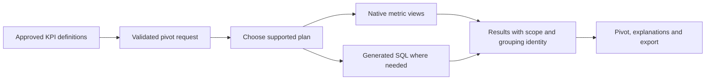

# Solution: one KPI meaning, several valid execution plans

Date: 2026-11-12. Architecture decision ADR-001.

**Recommendation:** establish a governed KPI contract and use Databricks metric views as the preferred first implementation, with generated SQL for demonstrated gaps. The native S4 fixture probe now passes; production adoption still requires the remaining contract gates. Choose execution by correctness, cost and maintainability. A single query is a useful optimisation; correctness is the requirement.

**Why this shape of solution:** part of the problem is arithmetic and part is that SQL has no reusable, grouping-free measure. The section [Is the root cause that SQL is not composable?](#is-the-root-cause-that-sql-is-not-composable) separates the two and assesses Malloy against them.

Read [BUSINESS-CASE](BUSINESS-CASE.md) for the business decision, [START-HERE](START-HERE.md) for the worked example, and [16](16-correctness-contract.md) for the algebra.

## Derive the solution from the problem

The scenarios ask for the same engagement KPIs across four increasingly flexible pivots. The fixtures demonstrate how a naïve implementation can fail ([03](03-problem-catalogue.md)); no production behavior is claimed.

| Step | What follows | Design consequence |
|---|---|---|
| D1 | A total describes its own population of messages or clients. | Define population, filters, time basis and grain explicitly. |
| D2 | Different KPIs need different information to compute a total. | A rate needs numerator and denominator counts; unique clients need identity overlap information or a fresh distinct calculation. |
| D3 | Finished percentages and distinct-count scalars lose information. | Retain reusable aggregate definitions and, when materialised, sufficient mergeable state. |
| D4 | One definition must work at every supported grouping. | Separate KPI definitions from row/column choices. |
| D5 | Related KPIs often share inputs and filters. | Reuse compatible aggregates, then evaluate formulas. |
| D6 | Correctness does not choose a physical plan. | Compare native measures, fused grouping sets, per-grouping queries and staged aggregation against the same oracle. |
| D7 | Queries may involve different facts or snapshots. | Aggregate facts at supported dimensions; align keys, time basis and versions before combining results. |
| D8 | The business needs a trustworthy report. | Build the orchestration and missing execution features justified by a capability test. |



## Fix the semantics; allow the plan to vary

The **semantic contract** fixes grain, population predicates, formula, identity key, filter applicability, time zone, missing-value policy and definition version. A delivery rate is delivered messages divided by sent messages at each cell and total. Unknown definitions fail validation.

The **execution plan** can fuse compatible aggregates, compute several groupings together, split costly exact distincts, read a stored state, or evaluate native measures. Each exact plan must produce the same result for the same population and snapshot. Approximation is an explicitly approved definition with visible metadata, not a silent optimisation.

The API returns KPI values and explanations. Raw client identities and sketch states can remain inside governed tables or the engine.

## Composition has domain and grain rules

For disjoint message populations, delivery-rate state is `(delivered, sent)`. Merge by component-wise addition, then divide. For unique clients, merge identity sets by union, then count. A `COUNT(DISTINCT client_id)` scalar cannot be merged by addition.

`ratio(click_rate, open_rate)` equals `clicked/opened` only when both rates use the same delivered population and intermediate denominators are nonzero. Re-evaluating either valid formula from dependencies at a total is correct. Averaging displayed results loses the denominator weights.

Context changes and nested-grain calculations need separate rules. Client conversion needs an entity population and attribution rule; prior-year comparisons need calendar alignment when Year is displayed. They are not automatic consequences of formula composition. See [06](06-semantic-model-and-dsl.md) and [16](16-correctness-contract.md).

## Is the root cause that SQL is not composable?

**Partly. Two separate causes are at work, and only the second is about SQL.**

| Layer | Cause | Language-dependent? | Remedy |
|---|---|---|---|
| 1. Arithmetic | A displayed rate or unique count does not contain enough information to compute its total. The same child values are compatible with several different totals ([16](16-correctness-contract.md) C-FORMULA, C-STATE) | No. True in SQL, in Malloy, in a spreadsheet and by hand | Keep numerator and denominator, or identities, and evaluate at the total's scope |
| 2. Reuse | SQL composes **relations**: a query can read another query. It does not compose **measures**: an aggregate expression is bound to the `GROUP BY` of the statement that contains it | Yes | A layer in which a measure is a named definition with no grouping in it |

Layer 2 on the eight messages of [START-HERE](START-HERE.md):

```sql
CREATE VIEW kpi_delivery AS
SELECT typology, market,
       COUNT(*) FILTER (WHERE is_delivered) * 1.0 / COUNT(*) AS delivery_rate
FROM message GROUP BY typology, market;

-- Reusing the view at a coarser grain has no correct form:
SELECT typology, AVG(delivery_rate) FROM kpi_delivery GROUP BY typology;   -- New: 83.3%. Correct: 75.0%
```

The view froze the grouping and discarded the denominator, so layer 2 forces the layer 1 error. Getting another grouping means rewriting the statement's text. That is what the registry's `{{ group_by_list }}` slot does ([03](03-problem-catalogue.md) PRB-REGISTRY-TEMPLATE): a text template is the usual workaround for a missing measure abstraction. It restores dynamic grouping for one KPI at one grain per statement. It cannot return a total together with its details, and it cannot let two KPIs share work. Test: `test_tutorial_step8_a_view_of_a_rate_cannot_be_regrouped`.

SQL is able to compute the right answer; the `GROUPING SETS` statement in [07](07-planner-and-sql-generation.md) does. What SQL lacks is a way to *state the KPI once*. Every composable-measure layer closes the gap the same way: the definition holds the aggregates and the formula, and the request supplies the grouping.

| Approach | Where the measure lives | Scenario 4 fixture probe |
|---|---|---|
| Databricks metric view | Unity Catalog object, read with `MEASURE()` | 56 of 56 groups on the target warehouse ([evidence](validation/2026-11-12/README.md)) |
| Malloy | `measure:` in a Malloy source, compiled to SQL | 56 of 56 groups on local DuckDB ([evidence](validation/2026-11-12-malloy/README.md)) |
| Own typed definitions and planner | Catalog tables, generated SQL | 56 of 56 groups, prototype ([fixtures](fixtures/)) |

Three independent implementations agree on every group. The solution is therefore the contract in [16](16-correctness-contract.md), and the tool is a choice of cost and fit.

### What Malloy would and would not solve

Malloy removes layer 2 and, in the tested case, respects layer 1: nine measures are written once and one nested query returns every detail, subtotal and grand total, including unique clients that overlap across years. It is a credible implementation of this specification.

It leaves four things unchanged:

1. **Owner decisions.** Reach, the CTR/CTOR denominator, the seventh metric and event windows are business definitions. No language supplies them.
2. **Cost.** Malloy compiled the pivot to one statement that repeats each fact row once per grouping shape (`CROSS JOIN GENERATE_SERIES(0,11,1)`) and evaluates `count(distinct)` twelve times. That is the row expansion of `GROUPING SETS` written by hand, so the exact-distinct cost question in [08](08-complexity-and-performance.md) remains.
3. **Zero denominators.** Malloy added no guard: an unguarded ratio returned `NaN` on DuckDB. Each ratio measure must write `nullif(denominator, 0)`. The retained metric-view probe also writes each guard by hand; the custom planner generates it in one place ([06](06-semantic-model-and-dsl.md) SEM-L1).
4. **Platform fit.** The target is Databricks. Metric views are native, governed by Unity Catalog and already probed on the target warehouse. Malloy adds a second modelling language and a Node runtime. Its Databricks connector exists (`@malloydata/db-databricks` 0.0.437) and was not run here; behaviour under row filters, masks and ANSI mode is unknown.

**Decision.** For a Databricks-only product, metric views stay the preferred starting backend. Evaluate Malloy in P0 under the same acceptance suite if one of these becomes a requirement: the same definitions must run on more than one engine; a nested result is the natural output for the consumer; or the team already operates Malloy. Whatever the choice, keep the retained Malloy probe as an independent cross-check of the 56 reference groups.

## Compare viable alternatives

| Option | Correct totals? | Advantage | Limitation | Decision |
|---|---|---|---|---|
| A. Use displayed scalar cells | Only for supported measures over complete, disjoint partitions | Small UI change | Rates need states; distincts need overlap information; paging can omit members | Reject as the general solution |
| B. Retain templates; query source at each grouping | Yes, with correct definitions and filters | Small migration; useful reference | Repeated work and template maintenance | Keep as oracle and migration fallback |
| C. Fuse legacy KPIs per grouping | Yes | Less repeated work without a general compiler | Still needs explicit dependencies, scopes and safe joins | Include in the cost comparison |
| D. Native metric views plus thin pivot orchestration | Core synthetic S4 proven; production gates open | Governance and reusable measures; potentially less code | S4 shapes, policy behavior and latency need testing | Preferred starting implementation; finish P0 gates |
| E. Own typed definitions and SQL planner | For implemented, validated capabilities | Explicit control of split and staged plans | Highest implementation and maintenance burden | Use for demonstrated gaps |
| F. Malloy model compiled to SQL | Core synthetic S4 proven on DuckDB only | Composable measures, nested results, several engines | Second language and runtime; Databricks connector, policies and cost untested; explicit zero guards | Credible alternative; evaluate only if portability or nesting is required |

Databricks documents runtime grouping/filtering, composed measures and window calculations. These make metric views a credible candidate; they do not prove this S4 pivot works unchanged. [Query metric views](https://docs.databricks.com/aws/en/uc-semantics/metric-views/query), [Advanced techniques](https://docs.databricks.com/aws/en/uc-semantics/metric-views/advanced-techniques).

The join model documents one-to-many fact aggregation and warns about ambiguous dimension matches. Native support still requires validated cardinality, identity and attribution. Check feature availability in the actual compute environment. [Joins](https://docs.databricks.com/aws/en/uc-semantics/metric-views/joins), [Feature availability](https://docs.databricks.com/aws/en/uc-semantics/metric-views/feature-availability). Documentation checked 2026-11-12. A temporary native metric view also executed the 12 default S4 grouping shapes over the existing synthetic fixture: 56 complete rows, with all five integer atoms and four ratios matching generated SQL and the local fixture. The composed measures and exact distinct worked in this probe. SQL, API responses and replay checks are retained in [validation](validation/2026-11-12/README.md). This does not establish production filters, policies, empty/NULL-member behavior or comparative cost.

## ADR-001: capability test before custom investment

**Accepted architecture:** approved definitions, validated requests, an execution adapter and an assembler. **Preferred semantic backend:** native metric views, supported by the retained core S4 probe. Production selection remains conditional on full conformance and acceptable cost; generated SQL covers verified gaps. This replaces deferring native evaluation to P5.

Complete P0 by extending the native-versus-SQL comparison beyond the successful default S4 probe. Use one acceptance dataset and one independent per-grouping oracle:

1. S1–S4 Sent and Delivery Rate at every required grouping; genuine NULL members, subtotal intersections and stable grouping identity.
2. Rates with unequal denominators, zero denominators, absent populations and explicit predicates. Reach remains gated.
3. Exact clients across overlapping campaigns/markets, with approved identity and NULL rules.
4. Every business filter applied or explicitly rejected; period/year-column alignment if in release scope.
5. Two users with different row access, policy changes, complete exports, consistent source versions and failure handling.
6. Representative volumes and concurrency: compare per-KPI/per-grouping, fused per-grouping, fused grouping sets and relevant split plans. Record latency, warehouse cost, scans, shuffle/spill and operational effort.

Choose the lowest-maintenance candidate that meets correctness, governance and agreed service targets. If native grouping sets fail, test independent native groupings assembled with explicit shape ids. More statements alone do not disqualify a correct, affordable plan. Record each gap before implementing a custom feature. Avoid two authoritative definitions of one KPI.

Run the grid self-checks of [16](16-correctness-contract.md) C-CHECK on every candidate's output. They need no second query, so they also apply to production data, where no independent oracle exists.

## Migration and release

Keep stable registry ids, labels, owners and publication state. Read registered SQL before translating it. A parser can propose dependencies; it cannot establish business meaning. Compare leaf and total scopes, classify intentional corrections and obtain owner sign-off for published changes.

The first release implements the agreed S1–S4 scope with exact results, parameterised filters, complete exports, access enforcement and definition versions. Context comparisons, unions, sketches and stored rollups enter when their separate contract tests pass ([13](13-implementation-plan.md)).

Historical benchmark observations motivate alternative plans. They do not establish a production saving, universal row threshold, or upper bound on HLL error ([08](08-complexity-and-performance.md)).
