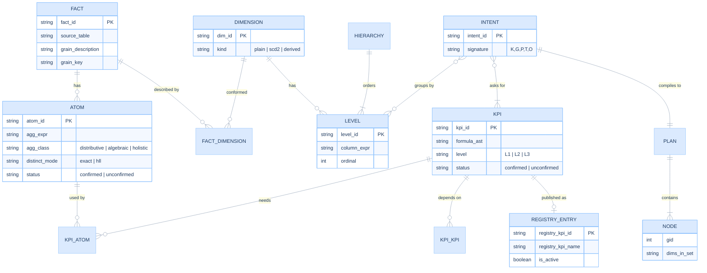

# Semantic model and definition language

> **In plain words.** How to write the ingredients (atoms) and the recipes (KPIs) so the system can check them. Example: `delivery_rate = ratio(delivered, sent)`. Includes the checks that run when a definition is saved, and the six KPIs of this study written this way.
>
> New here? Read [START-HERE](START-HERE.md) first.

Date: 2026-11-12. Lens: Full stack developer and Database expert. Implements `GOV-1` ([00](00-five-whys.md)) with the levels of [04](04-article-reformulated.md). Consumed by the planner in [07](07-planner-and-sql-generation.md). Migration from a KPI registry is in [10](10-edgesql-integration.md).

Status labels: **fixture-tested** means a named local test exercises the stated case; **specified** means a product requirement that is not implemented; **gated** needs an owner decision. Historical Databricks measurements are recorded in [08](08-complexity-and-performance.md). S4 fixture checks are retained in [14](14-test-strategy-and-traceability.md); they do not revalidate historical timings or production semantics. The normative definitions of scope, state and cell identity are in [16](16-correctness-contract.md).

## Before and after, on one KPI

A KPI registry typically stores each KPI as a templated query, so the Message Sent template is the "before". The texts of other KPIs depend on the registry and are not guessed here.

```
 BEFORE  (a typical registry template)                          AFTER  (ingredients + recipes)
 ------------------------------------------            ------------------------------------------
 KPI "Message Sent"  (message-sent)               atom   sent = COUNT(*)
   select_sql_text:                                    KPI    message-sent = sent
     {{ group_by_list }},
     COUNT(*) AS kpi_value                             The grouping is NOT in the definition.
   where_sql_text:                                     The reader picks it: by Typology, by Market,
     1 = 1 AND (:start_date IS NULL OR ...)            with or without totals.

 Grouping is injected into the template.                   New KPI "Delivery Rate", one line:
 A rate, such as Delivery Rate, would be                 atom delivered = COUNT(*) FILTER (WHERE is_delivered)
 another string returning one number,                    KPI  delivery-rate = ratio(delivered, sent)
 Its final scalar alone cannot yield a total.
                                                       New KPI "CTOR", one line:
                                                         KPI  click-to-open-rate = ratio(clicked, opened)
```

Reading guide for the rest of this document: **L0 = ingredients, L1 = recipes, L2 = "compare with another scope or period", L3 = "count people first, then compute".** Everything else is checking that the definitions are consistent.

## SEM-ER: entities



## SEM-FACT: a fact declares its grain

A fact declares exactly what one row represents and the key that identifies it. For this case, the message fact has one row per message sent. Other facts may have a different grain; sharing a column name does not make two grains compatible.

| Field | Meaning | Rule |
|---|---|---|
| `source` | Table or view in Unity Catalog | Resolved by name, never by string concatenation (FP-9) |
| `grain` | Meaning, key columns, uniqueness and null rules | Enrichment must preserve each fact key exactly once; a declared cardinality is checked against data (FP-6) |
| `dimensions` | Which dimensions describe it | A dimension attached as `scd2` must name its as-of column (EC-SCD2) |

Events such as opens and clicks are **reduced to the message grain before they are joined**: `is_opened` is "at least one open event for this message". A click rate defined as "delivered messages generating at least one click" needs exactly that. A raw join of messages to events counts events, not messages: 4 instead of 2 on the fixture (`test_ec_event_fanout_inflates_open_count`). Status: **specified**.

## SEM-DIM: dimensions and hierarchies

A dimension has levels. A hierarchy is an ordered list of levels on one axis. A hierarchy is a **display choice**, not a business relationship: indentation in a report does not assert one. So the model never assumes Tier is a child of Typology. It only knows each is a column of the fact. Consequence: the planner must not assume a "single child" subtotal differs from its parent (EC-SINGLE-CHILD). Status: **tested** for rollup-prefix levels.

## SEM-L0: atoms

An atom is a named aggregation contract: `(fact, grain, population, value type, state type, accumulate, merge, finalize, null policy, approximation policy)`. Its predicate selects a population **within** the request scope; it cannot replace caller access rules or report filters.

The SQL `COUNT(DISTINCT client_id)` produces a **final scalar**. That scalar cannot be added or merged into another distinct count. The corresponding mergeable exact state is the set of eligible client IDs, and finalization takes its cardinality. The direct SQL plan may compute that scalar separately at every requested scope without exposing or storing the set. These are two valid implementations of the same business definition.

For counts and sums, declare the merge operator explicitly. `SUM` merges by addition; `MIN` merges by minimum. An aggregate class alone is insufficient to choose the operator. Every stored state records its input grain, dimensions, filters, source version, identity namespace and definition version. Only compatible states can be merged ([16](16-correctness-contract.md) C-STATE).

```yaml
# specification. Business names map to physical columns in `source` (EC-NAMES).
fact: message
source: crm.silver.message_sent          # example name. Real names come from the catalogue.
grain: "one row per message sent"
dimensions: [typology, tier, campaign, year, market, channel, message_type, division_brand]   # channel, message type and division/brand are typical report filters; channel is also a drill-down level

atoms:
  sent:      { agg: "COUNT(*)",                                  class: distributive }
  delivered: { agg: "COUNT(*) FILTER (WHERE is_delivered)",      class: distributive }
  opened:    { agg: "COUNT(*) FILTER (WHERE is_opened)",         class: distributive }
  clicked:   { agg: "COUNT(*) FILTER (WHERE is_clicked)",        class: distributive }
  clients:   { agg: "COUNT(DISTINCT client_id)",                 class: holistic, distinct_mode: exact }
```

The fixture contains these five SQL aggregate expressions and four `Kpi.ratio` formulas (`ATOMS`, `KPIS`). It does **not** implement the richer state contract or its validators. Status: expressions **fixture-tested**; metadata and validation **specified**.

## SEM-L1: composed KPIs

A KPI is a scalar function of atoms (or of other KPIs) evaluated **after** aggregation (FP-2).

```yaml
kpis:
  message-sent:        { name: "Message Sent",        formula: "sent" }
  delivery-rate:             { name: "Delivery Rate",       formula: "ratio(delivered, sent)" }
  open-rate:           { name: "Open Rate",           formula: "ratio(opened, delivered)" }
  click-rate:         { name: "Click Rate",          formula: "ratio(clicked, delivered)" }
  click-to-open-rate:  { name: "Click to Open Rate (CTOR)", formula: "ratio(clicked, opened)" }
  message-reached:     { name: "Message Reached",     formula: "clients", status: unconfirmed }   # gated: PRB-REACH
```

The ids are the six registry ids of this study. `ratio(a, b)` is the only way to write a division. It generates `a * 1.0 / NULLIF(b, 0)` in one place (`Kpi.ratio`, FP-11). Why it matters on Databricks: ANSI mode is the default there, and a bare `/ 0` raises `DIVIDE_BY_ZERO` (observed on a Databricks serverless SQL warehouse, `test_dbx_ansi_mode_raises_on_division_by_zero_and_the_guard_returns_null`). DuckDB returns `inf` for `1.0/0` (observed in this repository). The mutation test that removes the guard fails (`test_ec_zero_denominator_in_a_non_empty_node_gives_null_rates_through_the_planner`).

A KPI may reference another KPI through an acyclic dependency graph (SEM-ACYCLIC). Each reference is evaluated at the same declared scope unless it carries an explicit context modifier. Re-evaluating `click_rate / open_rate` from its atoms at every total is valid on its defined domain; averaging cell CTORs is the operation that fails.

Cancellation has a domain condition: `(clicked / delivered) / (opened / delivered) = clicked / opened` when `delivered > 0` and `opened > 0`. The named fixture test checks only that domain. If `delivered = 0`, the guarded ratio-of-ratios is NULL; replacing it with `clicked / opened` could produce a value for inconsistent source flags. Preserve NULL semantics when normalizing formulas. Prefer the direct business formula `ratio(clicked, opened)` for CTOR.

Each formula also declares its unit (messages, clients, currency, proportion) and its population. A compiler can prove expression shape, but only the owner can approve that the numerator and denominator answer the intended business question. Use decimal arithmetic with sufficient precision, keep unrounded values through calculation, and round once for display.

## SEM-L2: context modifiers

A context modifier keeps the KPI and changes where it is evaluated.

| Modifier | Meaning | Typical request | Plan effect |
|---|---|---|---|
| `share(kpi, over=dim)` | Additive amount at this scope divided by the same amount at an explicitly named parent scope | Candidate interpretation; not a confirmed benchmark definition | Adds the denominator grouping if absent; retains report and access filters |
| `benchmark(kpi, scope, mode)` | Compare a KPI to a named benchmark: value, percentage-point difference, or relative index | "client typology vs overall benchmark" | Computes both scopes; a rate divided by an overall rate is an index, not an audience share |
| `prior(kpi, shift=P)` | KPI over an explicitly shifted calendar period, aligned to the displayed period | "current vs previous period" | Widen read window and align comparison keys before combining; preserve non-time filters (PLAN-CONTEXT) |
| `previous_campaign(kpi)` | KPI of the preceding member of an ordered dimension | "current vs previous campaign" | Self-join on the ordered level in the assembler, after aggregation |

Status: **specified**. `test_ec_period_filter_and_year_column_and_prior_year` tests window widening while grouping by Market; it does not display Year or prove period alignment. Calendar, timezone, leap-day handling, campaign order and benchmark scope require explicit definitions and tests. No modifier may widen the caller's authorized rows.

## SEM-L3: nested grain and union

A nested-grain KPI establishes entity membership before aggregating. For conversion, retain the eligible client IDs, match purchase eligibility with a semi-join or one-row-per-client summary, then count clients at each requested scope. Independent totals of reached clients and buyers cannot tell how many clients belong to both populations. Attribution period, identity namespace and channel membership are part of the definition. Example: `reached` and `converted` at client grain, then a ratio at each node. The article's example yields 5 of 6 = 0.833 at the total while the three channel rows sum to 8 of 9 = 0.889 (`test_article_distinct_union_and_conversion`).

**SEM-UNION** (the cross-KPI union): the union of the three client populations at the same scope is `COUNT(DISTINCT client_id)` over rows satisfying any of the populations. It is never the sum of the three counts (`test_cross_kpi_union_is_not_a_sum`: three counts add to more than 180). Union requires compatible client identities and eligible source populations. If those populations live in different facts, union their ID relations before counting; do not OR predicates over an unrelated table. Compatible sketches can use `hll_union_agg` for union. HLL does not by itself define an exact intersection or attribution rule. Status: **gated** (it requires a confirmed business definition and source ids).

## SEM-CLASS: aggregate class and distinct mode

Every atom declares a class. The class drives the plan.

| Aggregate / mode | Mergeable state | Stored-rollup rule |
|---|---|---|
| Distributive count, sum, min, max | Scalar plus any required presence metadata | Use the declared operator over complete compatible child partitions |
| Algebraic average or rate | A fixed-size tuple, e.g. `(sum, count)` or `(numerator, denominator)` | Merge each state component, then finalize; other algebraic aggregates may need more than two components |
| Exact distinct | ID set, or deduplicated `(group, ID)` relation of unbounded size | An integer distinct count cannot roll up. Recompute at scope, or retain and union exact IDs when cost and access rules permit |
| HLL distinct | Fixed-configuration sketch | Union compatible sketches, then estimate; never sum estimates |

The class drives candidate generation; measured workload cost selects the physical plan ([07](07-planner-and-sql-generation.md) PLAN-SPLIT). One query is an optimization, not a correctness condition.

Exact is the default. Approximation is a versioned, owner-approved definition with a visible label and an error budget. A single sample error is not a bound. Earlier measurements report 2.47% error at lgK 12 and 0.47% at lgK 14 on one synthetic population; they have no retained raw execution record. Validate accuracy across representative cardinalities and partitions before acceptance ([08](08-complexity-and-performance.md)).

## SEM-GATE: unconfirmed definitions fail closed

A KPI or atom with `status: unconfirmed` is visible in the catalogue and refused by the planner on a published dashboard (error `SEM_UNCONFIRMED`). It stays usable in a sandbox with a visible badge ([12](12-ux-and-wireframes.md)). Applies today to `message-reached` (PRB-REACH), the unnamed seventh metric (PRB-TRUNC) and the CTR label (PRB-NAMING). Status: **specified**.

## SEM-AST: typed definitions, no string SQL

Definitions are stored as a typed tree. SQL fragments in atoms are parsed into EdgeSQL expressions at load time, then rendered by the dialect writer. The spike uses strings for brevity and is a **deliberate simplification** (see header of [fixtures/mini_planner.py](fixtures/mini_planner.py)).

```python
# design sketch of the typed model; the implemented library (`edgekpi/`) differs in detail.
from __future__ import annotations
from dataclasses import dataclass
from enum import Enum

class AggClass(Enum):
    DISTRIBUTIVE = "distributive"
    ALGEBRAIC = "algebraic"
    HOLISTIC = "holistic"

@dataclass(frozen=True)
class Atom:                      # SEM-L0
    atom_id: str
    fact_id: str
    expr: "SqlExpr"              # parsed by EdgeSQL. Never a raw string.
    agg_class: AggClass
    state_contract: "StateContract"  # type, accumulate, merge, finalize, compatibility
    population: "Population"          # predicate, entity namespace, null policy, unit
    distinct_mode: str = "exact" # "exact" | "hll"
    status: str = "unconfirmed"
    version: int = 1

@dataclass(frozen=True)
class Ref:   atom_or_kpi: str    # a leaf of a formula
@dataclass(frozen=True)
class Ratio: num: "Formula"; den: "Formula"   # SEM-L1, emits NULLIF once
@dataclass(frozen=True)
class At:    kpi: "Formula"; ctx: "Context"   # SEM-L2
Formula = Ref | Ratio | At

@dataclass(frozen=True)
class Kpi:
    kpi_id: str
    label: str
    formula: Formula
    status: str = "unconfirmed"
```

## SEM-VALIDATE: load-time checks

Run once when the catalogue is loaded and again on every edit in the UI. All errors name the offending id (FP-7).

| Id | Check | Error |
|---|---|---|
| V-01 | Every `Ref` resolves to an atom or KPI | `SEM_UNKNOWN_REF` (`test_ec_unknown_atom_fails_closed`) |
| V-02 | KPI graph is acyclic | `SEM_CYCLE` |
| V-03 | Every atom declares a class | `SEM_NO_CLASS` |
| V-04 | Every requested grouping **and filter** has a conformed mapping for every required fact; unsupported combinations are refused | `SEM_NO_CONFORMED_DIM` / `SEM_UNSUPPORTED_FILTER` |
| V-05 | A dimension marked `scd2` names its as-of column | `SEM_SCD2_NO_ASOF` |
| V-06 | Declared enrichment cardinality, key uniqueness, temporal range uniqueness and unmatched-row policy preserve each fact key | `SEM_GRAIN_CHANGE` |
| V-07 | `status: unconfirmed` is refused on published reports | `SEM_UNCONFIRMED` |
| V-08 | All HLL atoms in one rollup share `lgK` | `SEM_HLL_LGK_MISMATCH` |
| V-09 | KPI id is unique and stable, label is free text | `SEM_DUP_ID` |
| V-10 | State types, merge operators, source/definition versions and populations are compatible | `SEM_STATE_MISMATCH` |
| V-11 | Formula units, denominator meaning and NULL behavior are declared; optimizations preserve the domain | `SEM_FORMULA_DOMAIN` |
| V-12 | Entity key namespace and missing-ID policy are declared for distinct/union/cohort metrics | `SEM_IDENTITY_UNDEFINED` |
| V-13 | Context has an explicit benchmark, calendar, alignment and retained-filter policy | `SEM_CONTEXT_UNDEFINED` |
| V-14 | Each requested dimension is declared rollup-compatible for the metric; no invalid time rollup of snapshot balances | `SEM_UNSUPPORTED_ROLLUP` |

All checks above are **specified**, except the narrow unknown-atom fixture check named in V-01. They are not proof that production data satisfies the declarations. Runtime data checks and publication gates are required ([09](09-data-model-and-databricks.md) DB-DQ).

## Mapping the six KPIs of this study

| Registry id | Label | Proposed formula | Atoms | Publication status |
|---|---|---|---|---|
| `message-sent` | Message Sent | `sent` | sent | proposed; owner verification required |
| `message-reached` | Message Reached | `clients` (to confirm) | clients | **unconfirmed** |
| `delivery-rate` | Delivery Rate | `ratio(delivered, sent)` | delivered, sent | proposed; owner verification required |
| `open-rate` | Open Rate | `ratio(opened, delivered)` | opened, delivered | proposed; owner verification required |
| `click-rate` | Click Rate | `ratio(clicked, delivered)` | clicked, delivered | proposed; owner verification required |
| `click-to-open-rate` | CTOR | `ratio(clicked, opened)` | clicked, opened | **unconfirmed label and denominator** |

These are proposed mappings, not publication approvals. A passing synthetic fixture does not confirm production SQL, attribution windows or identities. New product definitions default to `unconfirmed`; an owner-approved, versioned source contract is required to publish ([10](10-edgesql-integration.md)).
