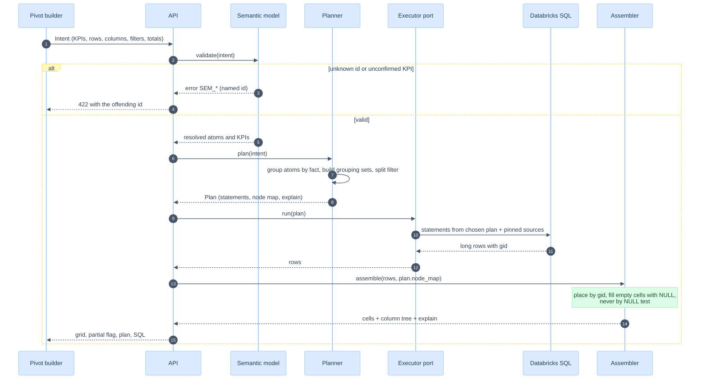

# Planner and SQL generation

> **In plain words.** Compute each requested cell and total over its own eligible rows, then apply its KPI formula. `GROUPING SETS` can share the work. Exact distinct counts, context comparisons or native metric views may need a different plan.
>
> New here? Read [START-HERE](START-HERE.md) first. The mathematical contract is in [16](16-correctness-contract.md).

Date: 2026-11-12. Target: Databricks SQL, with DuckDB as a local test engine. [fixtures/mini_planner.py](fixtures/mini_planner.py) is a restricted SQL prototype, not the product planner. Earlier Databricks executions and timings are recorded, but retained result logs, statement IDs and plan artifacts are absent; those timings remain unverified. S4 fixture parity is retained in [14](14-test-strategy-and-traceability.md). Named local tests demonstrate the particular fixture cases they execute. General context, split, nesting, security and snapshot rules below remain **specified**.

## PLAN-ONEPASS: the statement

For an intent `(KPIs, row dims, column dims, totals, filters)`, resolve definitions and compatible scopes first. Collect only needed atoms, add context scopes, then choose an execution backend and physical plan. The default custom-SQL candidate shares compatible aggregates per fact. Native metric views are evaluated in P0 against the same oracle; support for the exact S4 shape is a capability test, not an assumption.

Grain in this example: **one row per message sent**, so each conditional count counts messages, not open/click events. S4 has 12 grouping sets. The following illustrates the prototype SQL (formatting shortened):

```sql
WITH agg AS (
  SELECT typology, tier, campaign, yr, market,
    GROUPING_ID(typology, tier, campaign, yr, market) AS gid,
    COUNT(*) AS sent,
    COUNT(*) FILTER (WHERE is_delivered) AS delivered,
    COUNT(*) FILTER (WHERE is_opened) AS opened,
    COUNT(*) FILTER (WHERE is_clicked) AS clicked,
    COUNT(DISTINCT client_id) AS clients
  FROM message
  WHERE TRUE
  GROUP BY GROUPING SETS (
    (typology, tier, campaign, yr, market), (typology, tier, campaign, yr), (typology, tier, campaign),
    (typology, tier, yr, market), (typology, tier, yr), (typology, tier),
    (typology, yr, market), (typology, yr), (typology),
    (yr, market), (yr), ())
  HAVING COUNT(*) > 0
)
SELECT typology, tier, campaign, yr, market, gid, sent, delivered, opened, clicked, clients,
  delivered * 1.0 / NULLIF(sent, 0)  AS delivery_rate,
  opened    * 1.0 / NULLIF(delivered, 0) AS open_rate,
  clicked   * 1.0 / NULLIF(delivered, 0) AS click_rate,
  clicked   * 1.0 / NULLIF(opened, 0)  AS ctor
FROM agg
```

Properties, each with a test:

| Property | Test |
|---|---|
| Reproduces every cell of the synthetic S4 grid (sent and delivery rate) | `test_s4_matches_business_case_grid` |
| 12 grouping sets, 56 result rows on the fixture | `test_s4_is_12_grouping_sets_and_56_rows` |
| Equals one independent `GROUP BY` per node, atom by atom | `test_single_statement_equals_one_query_per_node` |
| One base-table reference in the generated SQL text | `test_baseline_statement_count_vs_one_pass` |
| Fails closed on an unknown atom | `test_ec_unknown_atom_fails_closed` |

One table reference does not prove one physical scan. Verify the engine plan and query profile for performance claims; SQL correctness comes from comparison with the independent aggregation oracle.

## PLAN-AXIS: rows and columns are independent axes

Each axis is a list of levels, shown as a hierarchy. With totals on, an axis contributes its **rollup prefixes**: `(a,b,c)`, `(a,b)`, `(a)`, `()`. The requested grouping sets are the cross product of row prefixes and column prefixes: 4 x 3 = 12 for S4. A grouping set is a **shape**, such as `(typology, market)`. A member node is one result row of that shape, such as `(New, HK)`. A KPI cell is one KPI value on that row. Thus 12 grouping sets, 56 result rows and 336 cells for six KPIs are different quantities.

```python
# tested (mini_planner.py)
def axis_levels(dims, totals):   # (a,b,c), (a,b), (a), ()   or only (a,b,c)
def grouping_sets(row_dims, col_dims, row_totals=True, col_totals=True)  # product of the two
```

Picture of the 12 grouping shapes of scenario 4. Each box is one `GROUPING SETS` entry, and the number is its `gid` (observed on the fixture, see PLAN-GID below):

```
                              COLUMN SCOPE  ►   (year, market)      (year)        ()
  ROW SCOPE  ▼                                  "2025 HK"           "2025 total"  "all years"
 ------------------------------------------   ---------------   ------------  ------------
  (typology, tier, campaign)  "detail row"      gid  0            gid  1        gid  3
  (typology, tier)            "Total Gold"      gid  4            gid  5        gid  7
  (typology)                  "Total New"       gid 12            gid 13        gid 15
  ()                          "Total"           gid 28            gid 29        gid 31
```

Read it like this: the cell "Total Gold, 2025 total" is the node `(typology, tier, year)`, computed from the rows themselves with `gid` 5. It is never the sum of the cells next to it.

KPIs are **not** an axis of the SQL. They are columns of the long result. The UI pivots them under Year -> Market if the user asked for "Year -> Market -> KPI". This keeps one result shape for every scenario.

| Scenario | Row dims | Col dims | Totals | Grouping sets |
|---|---|---|---|---|
| S1 | Typology | none | off | 1 |
| S2 | Typology, Tier, Campaign | none | off | 1 |
| S3 | as S2 | Year, Market | off | 1 |
| S4 | as S2 | Year, Market | on | 12 |

An optional **column subtotal by Market (all years)** requires grouping shapes that keep Market while dropping Year; these are not rollup prefixes of `(year, market)`. It is optional. The product planner is specified to accept explicit extra grouping sets (`extra_sets`), combined with the required row prefixes and validated against the requested dimensions. Status: **specified**, not in the spike.

## PLAN-GID: identity of a node

`GROUPING_ID(d1, ..., dn)` is a bit mask. The **first listed column is the highest bit**, and a bit is 1 when that column is rolled up. Observed on the S4 fixture (DuckDB):

| gid | Binary (typology, tier, campaign, yr, market) | Node | Rows |
|---|---|---|---|
| 0 | 00000 | detail | 12 |
| 3 | 00011 | typology, tier, campaign | 3 |
| 7 | 00111 | typology, tier | 2 |
| 15 | 01111 | typology | 2 |
| 28 | 11100 | year, market | 4 |
| 31 | 11111 | grand total | 1 |

A member node key is `(ordered dimension schema, gid, typed member values for retained dimensions)`. The assembler uses this key, never a NULL test alone (FP-8). `gid` identifies the grouping shape only within that ordered schema; it is not a globally stable member ID. A NULL member and a subtotal have the same NULL but different gid (`test_ec_null_member_looks_like_subtotal`). Earlier Databricks runs record the same bit order and `bigint` result (`test_dbx_grouping_id_type_is_wide_enough`); the retained S4 responses in [14](14-test-strategy-and-traceability.md) expose `gid` as `BIGINT` with the expected masks. The planner still caps one request at 8 dimensions (31 absolute) because the result size, not the bit width, is the limit (EC-GSET-EXPLOSION).

## PLAN-TOTAL: the total-rule resolver

There are three total rules (additive counts, rates, distinct counts). In the model they are one rule: **compute at the node's scope**. The three cases are consequences of the atom's class, and the resolver is used when a node is **derived** from finer nodes (a stored rollup, see [08](08-complexity-and-performance.md)) instead of being computed from rows.

| Atom class | Computing a node from rows | Deriving a node from finer nodes |
|---|---|---|
| distributive (additive count) | Aggregate rows | `SUM` / `MIN` / `MAX` of the disjoint children |
| algebraic (rates) | Aggregate rows, formula after | Merge states, then formula. Never merge ratios. |
| holistic exact (distinct count) | `COUNT(DISTINCT ...)` at the node | Cannot derive from scalar counts. Recompute from source IDs, or union retained exact ID sets; approximation needs separate approval |
| holistic hll | `hll_sketch_agg` then estimate | `hll_union_agg` then `hll_sketch_estimate` |

State chart SC-TOTAL in [15](15-edge-cases-and-state-charts.md) shows the decision. For count/sum states, derivation is allowed only from **disjoint and complete fact-row partitions** with compatible filters and versions. Set union and sketch union tolerate repeated identities, but still require complete compatible population coverage. Never combine detail rows and their subtotals as if they were siblings. Single-child and sparse subtotals are guarded (EC-SINGLE-CHILD, EC-SPARSE).

## PLAN-CONTEXT: scope filter vs context window

A report can constrain Year with a period filter and also display Year as column categories. The planner splits a filter into two roles:

| Role | Meaning | Example |
|---|---|---|
| Scope filter | Rows that exist for the whole report | Market in (HK, SG) |
| Context window | The time span that prior-period modifiers may read | Year in (2025, 2026) when the user asked for 2026 and "vs previous year" |

The read window may include both current and prior periods. That alone is insufficient when Year is a displayed dimension: grouping source rows by their original Year puts 2025 and 2026 in separate rows, so a 2026 row still has no 2025 records.

**Required alignment:** compute current nodes with `display_year = source_year`; compute prior nodes with `display_year = source_year + 1` for a calendar-year comparison, then join on display year plus the full member-node key. A tagged-period relation can share a scan where the engine supports it. A general date shift needs an approved calendar mapping, timezone and leap-day rule; integer year addition is only this example.

Example: the displayed `(2026, HK)` cell pairs current count 350 with the prior 2025 HK count 250. `(2026, SG)` pairs 250 with 200. Keep the source years in provenance, but display the comparison beside 2026. Each subtotal and grand total must evaluate its own current and prior population; do not sum overlapping rolling windows.

`test_ec_period_filter_and_year_column_and_prior_year` verifies 350/250 and 250/200 **grouped by Market only**. It does not exercise a Year output column. Window widening is fixture-tested; generalized planning and time-key alignment remain specified. [fixtures/test_correctness_contract.py](fixtures/test_correctness_contract.py) adds a pure mathematical alignment counterexample, not a Databricks planner implementation.

Scope rules: keep all non-time report filters, fact mappings and Unity Catalog restrictions. A benchmark or prior-period operation may alter only the filters named in its definition. Add a context grouping even if the user has hidden that subtotal. Explain the displayed period, read window, alignment and benchmark scope in the response.

## PLAN-DRILL: facts with different grain

When independent measures come from two facts, aggregate each over supported conformed dimensions and combine the results by member-node identity. This may be one SQL statement with several CTEs or several executions, depending on the selected backend. Each required grouping **and filter** must have an explicit equivalent mapping on each fact. A dimension name match is insufficient; never drop an unsupported filter or broadcast a fact total into unsupported detail cells. Unsupported mixed-fact requests fail validation.

This example has one row per message in `message_sent` and one row per transaction in `sales_txn`. Both facts support the Market grouping and the same requested period meaning:

```sql
WITH msg AS   (SELECT market, GROUPING_ID(market) AS gid, COUNT(*) AS messages
               FROM message_sent WHERE ... GROUP BY GROUPING SETS ((market), ())),
     sales AS (SELECT market, GROUPING_ID(market) AS gid, SUM(net_amount) AS net_sales
               FROM (SELECT s.*, b.market FROM sales_txn s JOIN boutique b USING (boutique_id))
               WHERE ... GROUP BY GROUPING SETS ((market), ())),
     node AS  (SELECT market, gid FROM msg UNION SELECT market, gid FROM sales)
SELECT node.market, node.gid, msg.messages, sales.net_sales
FROM node
LEFT JOIN msg   ON msg.gid   = node.gid AND msg.market   IS NOT DISTINCT FROM node.market
LEFT JOIN sales ON sales.gid = node.gid AND sales.market IS NOT DISTINCT FROM node.market
```

Result on the article's data (`test_drill_across_matches_per_fact_oracle_and_avoids_fanout`): HK 5 messages and 6,000 net sales, SG 5 and 5,000, total 10 and 11,000. A row-level join gives 25 rows and 30,000 for HK. Notes:

- `IS NOT DISTINCT FROM` is used instead of `<=>`. In DuckDB `<=>` is a vector distance operator (observed: it fails to bind on strings). The ANSI form works on both engines, and on Databricks both spellings are null-safe (`test_dbx_null_safe_equality_both_spellings`), so the portable form costs nothing.
- A `node` CTE from the union of keys makes a missing node on one side show as NULL, not vanish (EC-SPARSE).
- The join key must include `gid`. Joining on the dimension values alone merges a NULL member with a subtotal.

Status: **fixture-tested** for two facts at one conformed dimension. This proves fan-out avoidance for independent counts and sums, not conversion attribution. A KPI such as "reached clients who purchased" needs entity-level intersection before aggregation (SEM-L3), because two independent scalar totals lose the overlap information.

## PLAN-GRAIN: fan-out guards

The planner never joins a fact to an event or to a type-2 dimension at row level unless the model declares a grain-preserving rule:

| Join | Rule | Guard |
|---|---|---|
| Fact to events | Reduce events to fact grain first (`is_opened` = at least one open) | V-06 `SEM_GRAIN_CHANGE` |
| Fact to SCD2 dimension | Join on key **and** as-of date (`fact_time >= valid_from AND fact_time < valid_to`) | V-05 `SEM_SCD2_NO_ASOF`. Test: naive 3 rows, as-of 2 rows (`test_ec_scd2_dimension_duplicates_facts`) |
| Fact to many-to-many bridge | Unsupported in v1 unless an explicit, tested membership/allocation policy is added; distinctness alone does not define allocation for sums | EC-M2M |

## PLAN-SPLIT: compare combined and split exact execution

Earlier measurements record 140.5 s for a combined exact plan and 62.3 s for 12 exact-distinct queries on one synthetic 100 M-row workload ([08](08-complexity-and-performance.md) F6/F7). No retained raw runs or query profiles accompany these numbers. They justify testing a split candidate; they do not establish a production threshold or isolate the distinct operator's elapsed cost.

Candidate plans, all with the same exact semantics:

| Candidate | Work shared | Admission rule |
|---|---|---|
| Combined | Compatible atoms in `GROUPING SETS` | Default baseline to measure |
| Split exact distinct | Compatible counts/rates together; one exact-distinct aggregation per grouping set, or batched compatible sets | Enable only after end-to-end parity and representative cost measurements |
| Two-stage | Aggregate compatible states to a finer grain, then merge | Require complete state coverage and a measured benefit |
| Native metric view | Delegate supported semantics to the engine | Pass the P0 capability and correctness suite |

Select by the measured workload shape: filtered rows, distinct cardinality, grouping cardinalities, skew, memory/spill, warehouse, concurrency and scheduling overhead. Row count alone is not a reliable crossover rule. A split plan can run several distinct atoms in the same query; the number of statements is not necessarily one per atom.

Invariants: identical member-node keys and formula values at the **same source-version manifest**, compared with an independent per-grouping oracle. The existing `test_single_statement_equals_one_query_per_node` tests combined-plan equivalence on its fixed fixture; it does not test a product split executor or cross-statement snapshots. `explain` lists the chosen strategy, statements and source versions. All split execution remains **specified**.

### PLAN-SNAPSHOT: keep a report internally consistent

Before any multi-statement execution, resolve and pin an immutable version for every source relation and every definition. Reuse that manifest in every statement, retry and page. If the backend cannot provide that guarantee, refuse a report requiring snapshot consistency or label it explicitly as non-atomic where the product permits it. Do not present exact-looking rates assembled from counts read before and after an ingestion update.

A map of table versions is reproducible, but not automatically a common business snapshot across facts. Mixed-fact KPIs also require a common committed batch/as-of contract or an agreed completeness watermark. Verify the chosen Databricks route and its time-travel/security behavior in P0; never assume a shared session makes separate statements transactional. Cache and exports retain the manifest and completeness status ([11](11-api-system-and-ai.md)).

## PLAN-SKETCH: Databricks sketches

When an atom is `holistic, hll`, the planner emits the Databricks functions listed in the article ([04](04-article-reformulated.md) ART-ENGINE):

```sql
-- stored rollup (specified, not run here)
hll_sketch_agg(client_id, 12)                       AS clients_sk      -- lgConfigK 4..21, default 12
hll_sketch_estimate(hll_union_agg(clients_sk))      AS clients_approx
```

Rules: require the same sketch family, hash/identity encoding, population semantics and `lgConfigK`; reject incompatible states. An earlier run recorded `HLL_UNION_DIFFERENT_LG_K` for a mismatch (EC-HLL-LGK); it was not re-executed. Exact is the default. Historically recorded on 400,000 distinct ids ([08](08-complexity-and-performance.md) F8): error 4.91 percent at lgK 10, 2.47 percent at lgK 12, 0.47 percent at lgK 14. The article's "about 1.6 percent" at lgK 12 is a one-standard-error figure.

## PLAN-DIALECT: one writer, two adapters

| Feature | Databricks (target) | DuckDB (test engine) | Handling |
|---|---|---|---|
| `GROUPING SETS`, `GROUPING_ID` | yes | yes | same text |
| `COUNT(*) FILTER (WHERE ...)` | yes | yes | same text |
| `NULLIF` guard | needed: ANSI mode raises `DIVIDE_BY_ZERO` | not needed: `1.0/0` gives `inf` | always emitted, so both behave the same (FP-11) |
| Null-safe equality | `IS NOT DISTINCT FROM` | `IS NOT DISTINCT FROM` (`<=>` is not null-safe) | ANSI form only |
| Fixture generator | `explode(sequence(1, n))` | `LATERAL generate_series(1, n)` | two fixture variants, one expected grid ([13](13-implementation-plan.md) Phase 0) |
| HLL | `hll_sketch_agg` etc. | not available | sketch tests run on Databricks only |

The product is specified to render SQL from typed nodes and validate it through EdgeSQL for the named dialect; the prototype currently constructs trusted fixture strings. Placeholders for identifiers and predicates are typed slots, not text ([10](10-edgesql-integration.md)).

## Request lifecycle



## Assembler contract

Input: long rows with `gid`, dimension values and KPI columns. Output: cells keyed by `(row path, column path, kpi_id)`.

| Rule | Detail |
|---|---|
| Placement | Use ordered dimension schema + `gid` + typed retained member values. Include context and definition version when relevant. |
| Missing cell | A node with no row gives `null` and a `reason: "no_data"`. It does not give 0. |
| Subtotal label | Derived from `gid`, labelled "Total <level>" in the UI, never from a NULL. |
| Order | Explicit `ORDER BY` from the intent. Default: row path ascending, totals last (EC-ORDER). |
| Cell cap | Estimate member rows across grouping sets, multiply by KPIs/contexts, and bound bytes too. Enforce limits at execution as estimates can be wrong. Return `422 CELL_CAP` before execution when already over budget (EC-LARGE-RESULT). |
| Cell state | Distinguish numeric zero, zero denominator, no matching rows, unavailable fact, failed execution, and suppressed data. Only the first is numeric 0. |
| Member encoding | Use typed structured paths; delimiter-concatenated strings can collide when a member contains `/` or an empty value. |
| Reconciliation | On the complete result, before paging or hiding, verify the invariants of [16](16-correctness-contract.md) C-CHECK: additive atoms sum along every parent/child shape pair, each rate equals its node's numerator over denominator, unique counts stay within bounds. A violation names the node and fails or flags the report. It is the runtime symptom check for mixed snapshots, truncated results and misplaced nodes; it does not replace source grain checks. **Specified**; prototype in [fixtures/grid_checks.py](fixtures/grid_checks.py). |

## Planner API (specified)

```python
# design sketch of the planner API
@dataclass(frozen=True)
class Intent:
    kpis: tuple[str, ...]              # kpi ids
    rows: tuple[str, ...]              # dimension ids, ordered
    cols: tuple[str, ...]
    scope_filters: tuple["Predicate", ...]
    period: "Period"                   # includes context window
    row_totals: bool = True
    col_totals: bool = True
    extra_sets: tuple[tuple[str, ...], ...] = ()

@dataclass(frozen=True)
class Plan:
    statements: tuple["Statement", ...]   # strategy-dependent; may exceed fact count
    node_map: dict[int, tuple[str, ...]]  # gid -> dims present
    snapshot: "SourceVersionManifest"  # pinned data, definitions, completeness
    explain: "Explain"                 # strategy, grouping shapes, contexts, estimated rows/cells/bytes

def plan(model: SemanticModel, intent: Intent, dialect: str) -> Plan: ...
```

Invariant: each requested member node equals an independent aggregation over its declared eligible rows, under the same source manifest. The existing fixed single-fact fixture tests a subset of this contract; null-member oracle coverage, no-dimension requests, generalized contexts and split execution need dedicated product tests.
