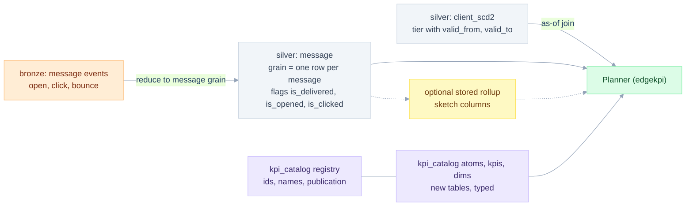

# Data model and Databricks

> **In plain words.** Which tables, views and Databricks features the design needs: a one-row-per-message table, how to handle clients who change tier, where to store definitions, and the data checks that protect the numbers.
>
> New here? Read [START-HERE](START-HERE.md) first.

Date: 2026-11-12. Lens: Database expert. Target engine: **Databricks SQL** (Unity Catalog, Delta). The semantic model is in [06](06-semantic-model-and-dsl.md), the plans in [07](07-planner-and-sql-generation.md), the cost view in [08](08-complexity-and-performance.md). Status labels: **fixture-tested** for a named local example, **specified** for product design, **verify** for target-workspace checks. The Databricks results that are retained are narrow S4 parity checks, recorded in [14](14-test-strategy-and-traceability.md); other Databricks statements here are design illustrations. Native metric views are evaluated in P0 before choosing how much semantic execution to own ([05](05-first-principles-solution.md)).

All table and column names below are **examples**. Real names come from the catalogue (EC-NAMES). The examples assume a registry view `registry.published_kpis` (one templated SQL text per KPI, see [10](10-edgesql-integration.md) EDGE-MAP), a fact alias `C` with a `Send_Date` column, and `crm.silver.*` as a placeholder for the silver layer.

## DB-LAYERS: where each thing lives



## DB-GRAIN: reduce events to message grain

The fact the planner reads has **one row per message**. Opens and clicks arrive as events (several per message). A join between the two multiplies rows (FP-6). Reduce first:

```sql
-- specified. Databricks SQL. Names are examples.
CREATE OR REPLACE VIEW crm.silver.message AS
SELECT m.message_id, m.client_id, m.campaign, m.market, m.send_date,
       m.is_delivered,
       COALESCE(e.is_opened,  FALSE) AS is_opened,    -- at least one open event
       COALESCE(e.is_clicked, FALSE) AS is_clicked    -- at least one click event
FROM crm.bronze.message_sent AS m
LEFT JOIN (
  SELECT message_id,
         BOOL_OR(event_type = 'open')  AS is_opened,
         BOOL_OR(event_type = 'click') AS is_clicked
  FROM crm.bronze.message_event
  GROUP BY message_id
) AS e USING (message_id);
```

Why: a click rate counts delivered messages that generated at least one click. Event fan-out gives 4 where the right answer is 2 (`test_ec_event_fanout_inflates_open_count`). Uniqueness of `message_id` is a data-quality check (DB-DQ).

## DB-SCD2: tier and typology change over time

`Client Tier` and `Client Typology` can change. If the client dimension is type-2, join to the fact on key **and** the message date:

```sql
-- specified
SELECT m.*, d.tier, d.typology
FROM crm.silver.message m
LEFT JOIN crm.silver.client_scd2 d
  ON d.client_id = m.client_id
 AND m.send_date >= d.valid_from
 AND m.send_date < d.valid_to;   -- half-open intervals; open-ended sentinel agreed with source
```

A join on the key alone gave 3 rows for 2 messages in the fixture (`test_ec_scd2_dimension_duplicates_facts`). Use half-open intervals so a change timestamp belongs to exactly one version. Do not silently discard unmatched messages: the left join retains them as an explicit Unknown member and raises the agreed data-quality signal. Overlap, missing intervals, timezone and backdated corrections need checks. The existing fixture uses non-overlapping closed **date** ranges and demonstrates key-only fan-out; it does not prove the proposed timestamp-boundary or unmatched-row policy. Status: simple fan-out **fixture-tested**; real mappings and these guards **specified**.

## DB-CATALOG: storing the definitions

New tables beside the KPI registry. The registry keeps ids, names, owners and publication state. These tables hold the typed definitions.

```sql
-- specified. Delta tables in Unity Catalog. Informational PK/FK. Names are examples.
CREATE TABLE kpi_catalog.atom (
  atom_id      STRING NOT NULL,
  fact_id      STRING NOT NULL,
  agg_expr     STRING NOT NULL,      -- parsed by EdgeSQL at load time, never executed as text
  agg_class    STRING NOT NULL,      -- distributive | algebraic | holistic
  state_contract_json STRING NOT NULL, -- state type, merge/finalize, compatibility
  population_json STRING NOT NULL,   -- predicate, grain, unit, identity/null policy
  version      INT NOT NULL,
  distinct_mode STRING,              -- exact | hll
  hll_lgk      INT,
  status       STRING NOT NULL,      -- confirmed | unconfirmed
  CONSTRAINT atom_pk PRIMARY KEY (atom_id, version),
  CONSTRAINT atom_class CHECK (agg_class IN ('distributive','algebraic','holistic'))
) USING DELTA;

CREATE TABLE kpi_catalog.kpi_definition (
  registry_kpi_id  STRING NOT NULL,      -- e.g. 'delivery-rate', FK to the KPI registry
  formula_json STRING NOT NULL,      -- typed AST of ratio / at / ref
  level        STRING NOT NULL,      -- L1 | L2 | L3
  status       STRING NOT NULL,
  version      INT    NOT NULL,
  CONSTRAINT kpi_pk PRIMARY KEY (registry_kpi_id, version)
) USING DELTA;

CREATE TABLE kpi_catalog.kpi_atom_dep (
  registry_kpi_id STRING NOT NULL, version INT NOT NULL, atom_id STRING NOT NULL, atom_version INT NOT NULL
) USING DELTA;
```

Rules: definitions are **versioned** (a published dashboard pins a version, see EC-DEF-DRIFT in [15](15-edge-cases-and-state-charts.md)); the registry ids stay stable; deleting an atom used by a published KPI is refused. Delta's `CHECK` constraint enforces the class list. Every dependency pins its atom/KPI version; changing an atom must not silently change an older published KPI. Referential and uniqueness checks run in the application validator; informational keys alone are not evidence of valid data (SEM-VALIDATE). These example DDL statements require validation on the chosen Databricks runtime before use.

## DB-PARAMS: parameters, not text

The common registry pattern `try_cast(:start_date AS DATE) IS NULL OR CAST(C.Send_Date AS DATE) >= try_cast(:start_date AS DATE)` uses named parameter markers. That is the right mechanism and stays. Rules for generated SQL:

| Item | Mechanism |
|---|---|
| Values (dates, members) | Named parameter markers (`:start_date`). Never string-substituted |
| Identifiers (columns, tables) | Validated against the model, rendered from typed nodes. The `IDENTIFIER()` clause is the Databricks route for a parameterised identifier (**verify** version support) |
| Dimension lists (`{{ group_by_list }}`) | Not a text slot any more. A typed list slot rendered by the dialect writer ([10](10-edgesql-integration.md) EDGE-GAP-01) |

Optional-filter pattern `:p IS NULL OR col >= :p` prevents the optimiser from pruning when the parameter is bound at run time (**verify** with `EXPLAIN` on a real table). The planner emits a filter only when the intent has it.

## DB-DATES: half-open ranges on the native column

A registry template often casts the column (`CAST(C.Send_Date AS DATE) >= ...`). A cast on the column can defeat file skipping and clustering (**hypothesis, verify with EXPLAIN and Delta file statistics**). The planner emits half-open ranges on the native column, `send_date >= :start AND send_date < :end_exclusive`, as the article's SQL does. If the source is a timestamp, the model declares the time zone used to derive the date (EC-TZ). `Year` as a dimension is `year(send_date)` in that declared zone.

## DB-ANSI: errors versus nulls

Databricks SQL runs ANSI mode by default (**observed** on one Databricks serverless SQL warehouse: a bare `1.0 / 0` raised `DIVIDE_BY_ZERO`; other runtimes are not checked). In ANSI mode a bare division by zero raises `DIVIDE_BY_ZERO`, and an invalid cast raises an error (that is why the catalogue uses `try_cast`). The planner always emits `NULLIF(den, 0)` through `Kpi.ratio` (FP-11). A DuckDB-only test cannot catch the Databricks error, so the Databricks tier includes one test that removes the guard on purpose (EC-DIV0, mutation in [14](14-test-strategy-and-traceability.md)).

## DB-PREAGG: stored rollups

Optional, off by default (KILL-5 for incremental). When used:

```sql
-- from the article's Databricks POC, adapted. specified, not run here.
CREATE OR REPLACE MATERIALIZED VIEW kpi.daily_message_rollup AS
SELECT send_date, typology, tier, campaign, market,
       COUNT(*) AS sent,
       COUNT(*) FILTER (WHERE is_delivered) AS delivered,
       hll_sketch_agg(client_id, 12) AS clients_sk
FROM crm.silver.message
GROUP BY send_date, typology, tier, campaign, market;
```

Rules:

1. A stored state is eligible only when its retained dimensions and policy design can reproduce **every** requested filter and effective access restriction. A coarser rollup that has lost a policy dimension cannot be made safe by filtering its totals. Bypass it unless equivalent governed access is demonstrated. Base-table policies do not automatically establish equivalent policy on a new relation (EC-ABAC).
2. Every sketch uses the same `lgConfigK`; the planner refuses a mix (EC-HLL-LGK).
3. Only explicitly mergeable compatible states are read from it (SC-TOTAL). Algebraic metrics retain their state tuples. Scalar exact distinct counts and finalized rates are never summed.
4. Refresh mode (incremental or full) is chosen by the platform. Measure both, do not assume (article).
5. A stored-rollup result carries `source: "rollup"`, refresh time, definition versions, covered source versions/interval, completeness and security scope. Reuse is refused when any required predicate cannot be reproduced.

## DB-ABAC: whose rows are counted

Generated SQL runs **as the end user** (or with the user's policy applied), so Unity Catalog row filters and column masks on the base table apply (**verify** for the chosen execution identity). Consequences:

| Item | Rule |
|---|---|
| Cache | Default to caller-isolated reuse with current authorization checked on every hit. Shared caches require demonstrated equivalent policy and reliable invalidation; an assumed policy hash is insufficient ([11](11-api-system-and-ai.md)) |
| Stored rollups | Bypassed whenever their retained information/governance cannot reproduce the caller's effective rows or masks (EC-ABAC) |
| Totals | A user with a row filter sees totals of **their** rows. The UI says so ("Scope: filtered by your access") |

## DB-DQ: data quality checks that protect the model

Run before publication and monitor at the agreed freshness cadence. Distinguish hard contract violations from tracking anomalies. An owner-approved hard-check failure blocks affected publication; a diagnostic may instead add a visible quality warning. Never clamp anomalous rates to 100% or silently discard records to make them look consistent.

| Check | SQL idea | Protects |
|---|---|---|
| Message key is non-null and unique | Null-key count plus duplicate-key groups | One row per sent message (FP-6) |
| Flags have declared null semantics | Boolean values plus null counts | Unknown tracking status is not silently treated as false unless approved |
| Click without recorded open | Diagnostic count/rate, with approved tolerance and population rule | Tracking anomalies can produce CTOR above 100%; do not assume logical nesting from event names (EC-CTOR-GT-ONE) |
| Open without recorded delivery | Diagnostic unless the approved definition requires a delivered-only population | Formula population and tracking completeness |
| SCD2 enrichment preserves message keys | Overlap/boundary/unmatched checks before and after join | EC-SCD2 and explicit Unknown handling |
| Client identity policy | Null IDs, duplicate identity mappings, namespace consistency | `COUNT(DISTINCT)` ignores NULL: unknown clients need an explicit exclusion, error or separate-count policy |
| Common completeness boundary | Source/batch manifest and late-update checks | Reproducible mixed-fact and split reports (PLAN-SNAPSHOT) |

## DB-FIXTURE: the same grid on Databricks

The DuckDB fixture [fixtures/s4_messages.sql](fixtures/s4_messages.sql) builds 12 cells and 1,050 messages with `LATERAL generate_series`. For Databricks the generator becomes:

```sql
-- existing fixture file: s4_messages_databricks.sql; execution must be reverified in P0.
... FROM cell c LATERAL VIEW explode(sequence(1, c.sent)) g AS i
```

`TIER-DBX` runs the same `CASE_GRID` assertions. A successful Databricks run demonstrates that Databricks reproduces the fixture's sent/delivery grid ([14](14-test-strategy-and-traceability.md)).

## DB-SNAPSHOT: data time and tracking time

A report records the message send-period, event-observation cutoff and ingestion completeness. Late opens or clicks can change the same historical send-period result. A report on November 12 and one on November 13 are not necessarily contradictory; their data versions and observation windows may differ. Agree the attribution window before calling a KPI final.

Resolve a source-version manifest before multi-statement execution; reuse it in split queries, retries, cache entries and exports. Per-table pinning is reproducible, while cross-fact business consistency also requires an agreed common batch/as-of boundary ([07](07-planner-and-sql-generation.md) PLAN-SNAPSHOT). Real source names and column mappings must be inspected before any execution; the SQL above is design illustration only.
