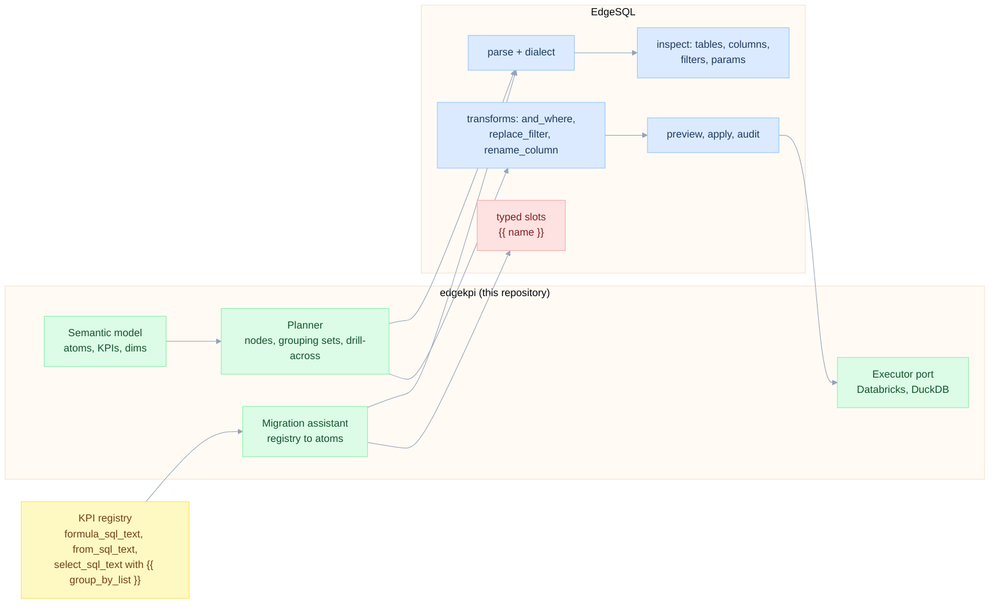
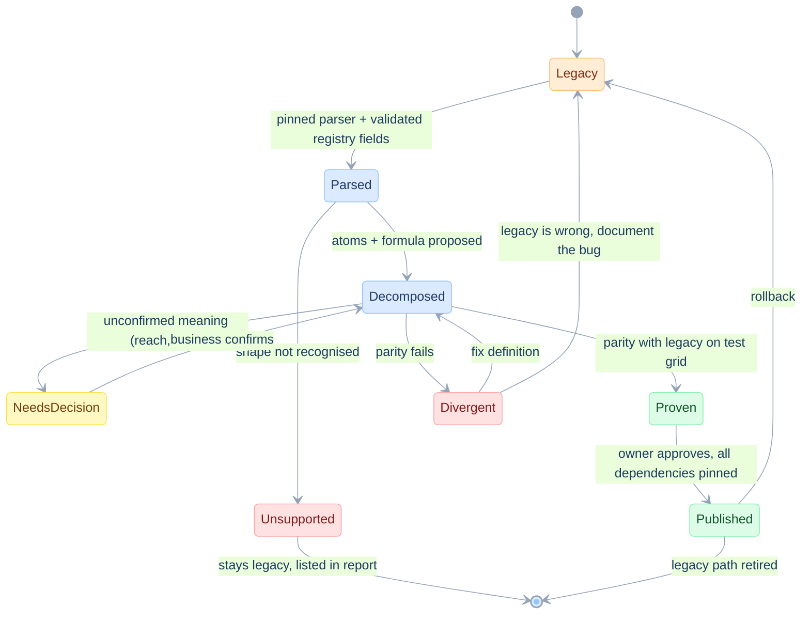

# EdgeSQL integration and registry migration

> **In plain words.** How the SQL toolkit EdgeSQL helps (check generated SQL, edit existing SQL safely), what it cannot do yet (it loses the name of a `{{ placeholder }}`), how legacy registry KPIs are migrated step by step, and a two-query probe that shows whether an unexplained KPI such as Reach behaves as a count, a rate or a unique count.
>
> New here? Read [START-HERE](START-HERE.md) first.

Date: 2026-11-12. Lens: AI engineer (typed tools), Full stack, Database expert. EdgeSQL: <https://github.com/raphaelmansuy/EdgeSQL>, inspected at commit `8777868` (Python on sqlglot). This document does not assert the current upstream package behavior; pin a reproducible revision and run the capability tests before depending on it. Model in [06](06-semantic-model-and-dsl.md), planner in [07](07-planner-and-sql-generation.md). Principle FP-9 ([01](01-principles.md)).

## EDGE-BOUNDARY: who does what

EdgeSQL is a typed SQL tree toolkit: parse, inspect, small named transforms, preview before apply, fail-closed errors. It has **no planner** by design. So the planner lives here (KILL-2).



| Concern | Owner |
|---|---|
| Which atoms, which formulas, which grouping sets | edgekpi |
| Parse, validate and render SQL for a named dialect | EdgeSQL |
| Safe edits of existing SQL (filters, renames) with preview and audit | EdgeSQL |
| Reading legacy `formula_sql_text`, `kpi_formula_text`, filters into atoms | edgekpi (classifier) on EdgeSQL's inspection |
| Running SQL, paging, cancel | edgekpi executor port |

## EDGE-VERIFIED: fixture checks and observations

Tested in [fixtures/test_fixtures.py](fixtures/test_fixtures.py) (skipped if EdgeSQL is not installed):

| Id | Fact | Test |
|---|---|---|
| EDGE-OK-01 | EdgeSQL parses the planner's `GROUPING SETS`, `GROUPING_ID`, `FILTER (WHERE ...)`, `IS NOT DISTINCT FROM` for `databricks`. Its writer is stable: parse, emit, parse, emit gives the same text. Holds for the single-fact S4 statement and the drill-across statement. | `test_edge_parses_and_round_trips_planner_sql_for_databricks` |
| EDGE-OK-02 | `tables()` returns `['message']`, `ctes()` returns `['agg']`. `cte("agg").and_where(col("yr").gte(param("start_year")))` adds a bound `:start_year`. | `test_edge_can_inspect_tables_and_inject_a_typed_filter_into_the_agg_scope` |

Consequence: the planner can render text for the named dialect and pass it through EdgeSQL as a **validation gate** (parse, emit, compare) before any execution. Filters from the intent are added with typed `and_where` on the right scope, never by string concatenation.

At the inspected revision these gaps exist: `rewrite` and `inline_cte` return `NOT_IN_V1`, `migrate` is a stub, and there is no builder for `GROUPING SETS`. So the planner builds SQL with sqlglot nodes (the same pinned sqlglot as EdgeSQL) and uses EdgeSQL for the gate, inspection and edits. A grouping-sets builder in `edgesql.build` is a welcome upstream addition, not a blocker (EDGE-GAP-04).

## EDGE-GAP: proposed compatibility requirements

Treat the following as proposed requirements; no upstream commitment is assumed. They block full legacy-template round-tripping, not the ability to build a new typed KPI definition from separated registry fields. The failing behaviour is reproduced as `xfail(strict=True)` tests, so the day EdgeSQL is fixed the test run turns red until the markers are removed.

### What happens today (commit `8777868`)

```python
q = Query.parse("SELECT {{ group_by_list }}, COUNT(*) AS kpi_value FROM message", dialect="databricks")
q.to_sql()   # 'SELECT {?}, COUNT(*) AS kpi_value FROM message'    the slot name is lost
q.params()   # [{'param': 'group_by_list'}, {'param': 'group_by_list'}]   listed twice
```

The emitted `{?}` cannot be parsed again (`MIXED_MARKERS`). A registry that stores one templated SQL text per KPI has exactly this shape, so the migration cannot round-trip a legacy template through EdgeSQL today.

### Requirements

| Id | Requirement | Acceptance |
|---|---|---|
| EDGE-GAP-01 | `{{ name }}` parses to a typed slot node and is emitted unchanged. Parse, emit, parse, emit is stable. | `test_edge_gap_01_template_slot_keeps_its_name` passes |
| EDGE-GAP-02 | `params()` lists each `:name` and each slot once per distinct name. A separate `slots()` returns `{name, kind, scope}`. | `test_edge_gap_02_slot_is_listed_once` passes |
| EDGE-GAP-03 | Slot kind is inferred from position: select or group-by list is `column_list`, a boolean position is `predicate`, any other is `expr`. A kind mismatch on bind is an error. | New tests, one per kind, plus one for mismatch |
| EDGE-GAP-04 | Optional: builder for `GROUPING SETS` and `GROUPING_ID`. | Parity with `plan_sql` text |
| EDGE-GAP-05 | `bind(name, value)` fills a slot from a **typed** value only: a validated identifier list, an EdgeSQL predicate, an EdgeSQL expression. A raw string is refused. Unknown slot, wrong kind and unbound slot at emit time are named errors (`SLOT_UNKNOWN`, `SLOT_KIND`, `SLOT_UNBOUND`). | New tests. A test that passes `"x; DROP TABLE y"` and expects refusal |
| EDGE-GAP-06 | A slot inside a string literal or comment is not a slot. | New test |

An unbound declared slot and an ignored requested filter are different failures. `SLOT_UNBOUND` catches the first. The migration/planner must also account for **every requested filter**: emit it in the correct scope or return `SEM_UNSUPPORTED_FILTER`. A template with no filter slot does not by itself prove that the report filter was applied (EC-FILTER-NOPLACEHOLDER, FP-7).

Out of scope for EdgeSQL: T-SQL or Fabric dialect (KILL-1). Not needed for the Databricks target.

## EDGE-MAP: registry columns to the model

A registry row of this common pattern (a synthetic example for `message-sent`; the column names are typical, the values are invented; see [03](03-problem-catalogue.md) PRB-REGISTRY-TEMPLATE) has eight definition columns. This is how each becomes part of the model:

| Registry column | Example value for Message Sent | Becomes | Note |
|---|---|---|---|
| `formula_sql_text` | `COUNT(*)` | atom `agg_expr` | The cleanest source of the aggregate. Already separated from the rest. |
| `kpi_formula_text` | `COUNT(*)` | atom or KPI formula, to be read | For a rate KPI it may hold a ratio or reference other KPIs. **Must be read from the registry** |
| `from_sql_text` | `crm.silver.message` | `fact.source` | The silver-layer table (an example name) |
| `select_sql_text` | `{{ group_by_list }}, COUNT(*) AS kpi_value` | nothing new | Its aggregate is already in `formula_sql_text`. The slot and the `kpi_value` alias are dropped (grouping is read-time, WHY-4) |
| `join_definition_json` | `NULL` | declared grain-preserving join (V-06) | `NULL` means no join. Non-null values are flagged for grain review |
| `where_sql_text` | `1 = 1 AND (try_cast(:start_date AS DATE) IS NULL OR CAST(C.Send_Date AS DATE) >= try_cast(:start_date AS DATE))` | scope filter with bound params | `C` is the alias of the fact. The `:p IS NULL OR ...` pattern becomes "emit the filter only when the intent has it" |
| `filter_definition_json` | `[{"scope":"main","predicate":"channel = 'email'"}]` | atom predicate (`FILTER`) when it defines the KPI's population, otherwise a scope filter | A typed array with a `scope`. How its `scope` names map to EdgeSQL scopes (`root`, `cte:<name>`) is to be inspected |
| `group_by_sql_text` | `{{ group_by_list }}` | kept only in the parity harness | Not in the model |
| registry `kpi_id`, `kpi_name` | `message-sent`, "Message Sent" | `registry_kpi_id` and label | Ids stable. Names are labels (EC-NAMES) |

What this changes in the plan: because `formula_sql_text` and `from_sql_text` are separate columns, the migration assistant does **not** need to parse a whole SELECT to find the aggregate for a KPI like Message Sent. It parses one expression. EdgeSQL is still needed for the expression itself and for the typed filters.

Rows other than this example must be read by the migration assistant from the real registry. This document does not guess them (PRB-UNVERIFIED).

## EDGE-MIGRATE: migration state chart

Each legacy KPI moves through these states. A KPI is **retired from the legacy path only when parity is proven**.



**Divergent** is not always a bug in the new model. For rates and distincts, the legacy answer at a total node may be the wrong one (that is the whole problem). The parity harness starts with **leaf scopes**, then checks totals independently against the approved source-row calculation. When the legacy path has a confirmed bug, equality is not the acceptance target; the corrected definition and the owner decision are recorded explicitly.

### Parity harness (specified)

1. Choose the node set (S1 to S4).
2. Run the legacy SQL once per KPI and node. Fill `{{ group_by_list }}` with a trusted list in the harness only (a string replace, confined to a test on a trusted catalogue, until EDGE-GAP-05 lands). It never ships.
3. Pin the same data versions, dates, access scope and source populations for both paths. Run the candidate backend/plan for the same intent.
4. Compare **final KPI values** at leaf scopes. Legacy SQL returns `kpi_value`; it does not necessarily expose atoms. Validate proposed atom states against an independent source-row oracle where those ingredients are available. Equal rounded values alone are insufficient.
5. At total scopes, compare both paths with the approved business formula over eligible source rows. Classify each difference as a confirmed legacy bug, a candidate bug, an ambiguity or a data-version mismatch. Leaf equality alone does not prove total correctness.
6. Persist exact SQL/parameters, source and definition versions, tolerances, result checksums and owner decisions with the migration report. Unsupported semantics stay on the legacy path with a visible limitation.

## EDGE-PROBE: learn how a legacy KPI behaves before reading its SQL

A legacy KPI returns one number per group. Running it at a broad scope and again over a partition of that scope shows which kind of number it is. This needs only the registry and takes two executions per partition.

| Observation | Reading | What it rules out |
|---|---|---|
| Whole = sum of the parts | Additive on this partition | A rate, unless every value is zero. It does **not** prove a plain count: a unique count also adds up when no entity appears in two parts |
| Largest part < whole < sum of the parts | Deduplicating, such as unique clients | A plain count and a rate |
| Smallest part ≤ whole < largest part | Intensive, such as a rate or an average | Any count |
| Whole = largest part, below the sum | Ambiguous: one part contains the others, or the parts have equal rates | A plain count |
| None of the above | Whole and parts do not describe the same population | Check filters, dates and data versions before going further |

Rules for using it:

1. Probe several partitions, and include one where entities are likely to recur, such as months within a quarter or campaigns within a market. A unique count looks additive across a dimension that separates clients.
2. Pin the same data version, filters and access scope for the whole and its parts.
3. Treat the result as evidence for the owner's decision. Behaviour can refute a proposed definition; it cannot establish business meaning.

First use: `message-reached`, whose meaning is not confirmed ([03](03-problem-catalogue.md) PRB-REACH). If quarterly Reach is lower than the sum of monthly Reach, it deduplicates recipients, and its totals need the unique-count rule. If the two are equal on the monthly split and on a campaign split, it behaves as a message-level count, and the gap to delivered messages points to a stricter status or a different window.

`relation()` in [fixtures/grid_checks.py](fixtures/grid_checks.py) implements the table. On the synthetic fixture it reads Sent as additive, Delivery Rate as intensive, and unique clients as additive across typologies but deduplicating across the 2025 markets (`test_additivity_probe_separates_counts_rates_and_distincts`). Status: **fixture-tested** on synthetic data; **not run** against a real registry.

## Failure modes

| Mode | Behaviour |
|---|---|
| EdgeSQL rejects planner SQL (should not happen) | The request fails with `PLAN_INVALID` and the SQL is logged. This is a bug in the planner, never silently retried |
| A legacy template has two slots with the same name | One slot, one binding (EDGE-GAP-02) |
| A legacy template is for a dialect we do not support | `MIGRATE_UNSUPPORTED` |
| EdgeSQL changes its writer | Round-trip test catches it on upgrade. EdgeSQL version and sqlglot version are pinned together |

## EDGE-P0: choose the smallest supported dependency

Before committing the implementation, run a pinned EdgeSQL/sqlglot capability check and the native metric-view spike from [05](05-first-principles-solution.md). Parsing SQL verifies syntax structure; it does not verify grain, population, permissions or the business meaning of a measure. Do not make every product feature depend on an upstream placeholder enhancement if the separated `formula_sql_text`, source and filter metadata already support a validated migration path.
