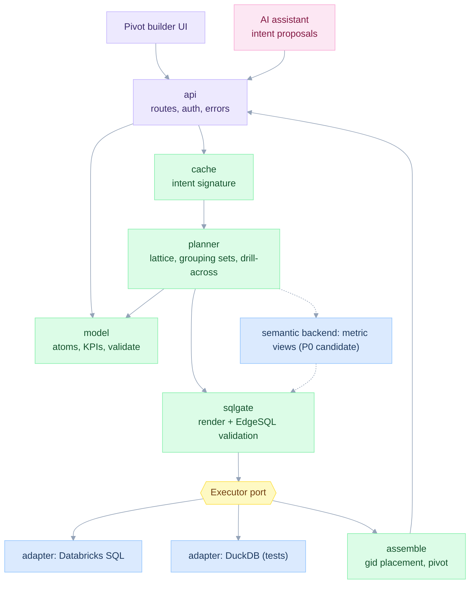
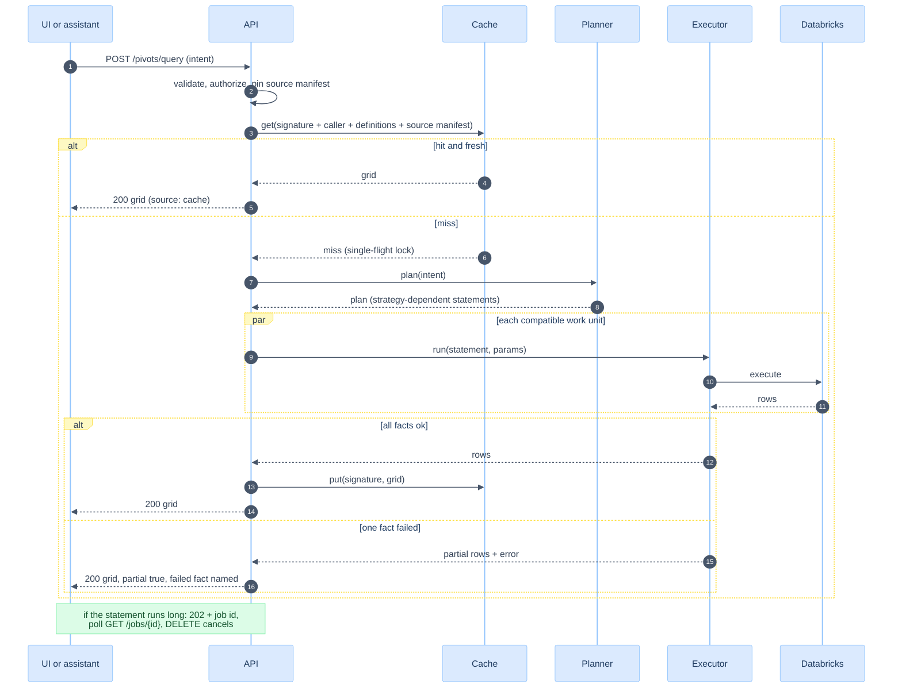
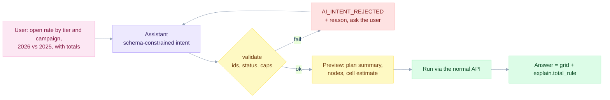

# API, system design and the AI assistant

> **In plain words.** The building blocks, the web calls, the cache and the AI assistant. The assistant only proposes a request; the system validates it and builds the SQL itself. It never runs SQL written by a model.
>
> New here? Read [START-HERE](START-HERE.md) first.

Date: 2026-11-12. Lenses: System design, Full stack, AI engineer. Builds on [06](06-semantic-model-and-dsl.md), [07](07-planner-and-sql-generation.md), [09](09-data-model-and-databricks.md), [10](10-edgesql-integration.md). Screens are in [12](12-ux-and-wireframes.md). Everything here is **specified**, not coded. The code that exists is the evidence layer in [fixtures/](fixtures/).

Start with four responsibilities: definitions, planning, execution and presentation. Add cache and AI only after the pivot contract passes. Native metric views are a **semantic execution backend** to evaluate in P0, not merely a connection adapter: they may change what SQL and definition publishing are needed ([05](05-first-principles-solution.md)). The smaller transport port can still have Databricks and DuckDB adapters.

## SYS-MODULES: deep modules, one reason to change each



| Module | Interface (small) | Hides | Single reason to change |
|---|---|---|---|
| `model` | `load()`, `validate(intent)`, `resolve(ids)` | Typed definitions, SEM-VALIDATE, pinned dependencies and support matrix | The definition language |
| `planner` | `plan(model, intent, capabilities) -> Plan` | Supported backend, grouping sets, context alignment, shared/split work and source manifest | How we compute |
| `sqlgate` | `render(plan) -> Statement` | sqlglot nodes, dialect writer, EdgeSQL parse-emit gate | SQL text and dialect |
| `executor` (port) | `run(statement, params) -> Rows`, `cancel(id)` | Connections, paging, retries | Where it runs |
| `assemble` | `assemble(rows, node_map) -> Grid` | `gid` placement, NULL cells, ordering | Result shape |
| `cache` | `get(sig, caller)`, `put(sig, grid)` | Caller isolation, authorization checks, source versions and invalidation | Freshness rules |
| `api` | HTTP routes | Auth, serialisation, error mapping | Transport |
| `ai` | `propose(text) -> Intent` | Prompting, tool schemas | Model choice |

Deletion test: delete `planner` and the same complexity reappears in every caller (each report would rebuild grouping sets). Delete `cache` and nothing else changes except latency, so it stays optional. That asymmetry is the sign of a good boundary.

## SYS-SOLID: how each principle shows up

| Principle | Where | Check |
|---|---|---|
| Single responsibility | One reason to change per module (table above) | Review checklist in [13](13-implementation-plan.md) |
| Open / closed | New KPI = data. New aggregate class = new strategy in `planner`, no edit to callers. New engine = new adapter | A KPI added in a test without touching code |
| Liskov | Every `Executor` adapter returns the same row shape and the same errors | One contract test suite run against each adapter ([14](14-test-strategy-and-traceability.md)) |
| Interface segregation | `Executor` has `run` and `cancel` only. Read-only introspection is a separate `Catalog` port | No adapter implements unused methods |
| Dependency inversion | `planner` and `api` depend on ports, not on the Databricks SDK | Import-linter rule: `planner` may not import `executor.databricks` |
| DRY | One `grouping_sets` function used by planner, assembler and the UI cell estimator. One `Kpi.ratio` guard. One error catalogue. One cell-address rule | Grep test: `NULLIF(` appears in one file |

## SYS-API: HTTP contract (v1)

| Method and path | Purpose | Idempotent |
|---|---|---|
| `GET /v1/kpis` | Catalogue with status, level, atoms, version | yes |
| `GET /v1/dimensions` | Dimensions and levels per fact | yes |
| `POST /v1/intents/validate` | Validate and explain an intent without running it. Returns plan, node count, cell estimate | yes |
| `POST /v1/pivots/query` | Run an intent. Returns a grid or a job id | Use explicit idempotency key for job creation; reuse is tied to pinned sources |
| `GET /v1/jobs/{id}` | Poll an async query | yes |
| `DELETE /v1/jobs/{id}` | Cancel | yes |
| `POST /v1/migrations/{registry_kpi_id}/propose` | Create a versioned migration proposal | Use explicit idempotency key; persist proposal and source revision |

Request (the intent replaces the SQL string):

```json
{
  "kpis": ["message-sent", "delivery-rate", "open-rate", "click-to-open-rate"],
  "rows": ["typology", "tier", "campaign"],
  "cols": ["year", "market"],
  "totals": { "rows": true, "cols": true },
  "scope_filters": [{ "dim": "market", "op": "in", "values": ["HK", "SG"] }],
  "period": { "from": "2026-01-01", "to_exclusive": "2027-01-01", "compare": "prior_year" },
  "order": [{ "by": "message-sent", "dir": "desc" }]
}
```

Response (shape):

```json
{
  "partial": false,
  "columns": [{ "path": [2026, "HK"], "kpi": "delivery-rate" }],
  "rows": [{
    "path": ["New", "Gold", "A"], "gid": 0,
    "cells": [{ "column_path": [2026, "HK"], "kpi": "delivery-rate", "state": "value", "value": 0.9, "num": 180, "den": 200 }]
  }],
  "explain": {
    "strategy": "combined", "statements": 1, "facts": ["message"], "grouping_sets": 12, "gids": [0, 1, 3, 4, 5, 7, 12, 13, 15, 28, 29, 31],
    "context_widened": { "year": [2025, 2026], "reason": "compare=prior_year" },
    "total_rule": { "delivery-rate": "ratio_of_totals" },
    "source": "base", "source_manifest_id": "snapshot-123", "complete": true
  }
}
```

Use typed structured member paths, never slash-concatenated cell keys. A slash, empty string and SQL NULL are legitimate distinct member values. A cell key also identifies the grouping shape and context. Cells of a rate carry `num` and `den` when permitted by the caller's access, so a client can show or check the ratio (FP-1). `explain.total_rule` is what the AI assistant and the UI quote when a user asks why a total is not the average of the cells.

Cell states are explicit: `value`, `no_data`, `zero_denominator`, `unavailable`, `failed`, or `suppressed`. Numeric zero is `value: 0`. A failed fact is not an empty population. A derived KPI is unavailable if any required dependency is unavailable; never compute a ratio using only the successful side. SQL debugging output is exposed separately to authorized technical users and stripped from assistant-facing tool responses.

### Error catalogue

Every error has a stable code, an HTTP status, the offending id, and a hint. Codes are shared with the model (V-xx) and the edge cases ([15](15-edge-cases-and-state-charts.md)).

| Code | HTTP | When |
|---|---|---|
| `SEM_UNKNOWN_REF` | 422 | Intent or formula names an unknown KPI, atom or dimension |
| `SEM_UNCONFIRMED` | 422 | KPI is unconfirmed and the report is published |
| `SEM_NO_CONFORMED_DIM` | 422 | A requested grouping has no equivalent supported mapping on a required fact |
| `SEM_UNSUPPORTED_FILTER` | 422 | A required fact cannot apply the requested filter semantics |
| `SEM_CONTEXT_UNDEFINED` | 422 | Benchmark scope, calendar or comparison alignment is unresolved |
| `SNAPSHOT_UNAVAILABLE` | 409 | Required source consistency or completeness cannot be provided |
| `PLAN_TOO_MANY_DIMS` | 422 | More dimensions than the cap |
| `CELL_CAP` | 422 | Estimated cells above the cap |
| `PLAN_INVALID` | 500 | Planner SQL rejected by the EdgeSQL gate (a bug) |
| `EXEC_TIMEOUT` | 504 | Warehouse did not answer in time |
| `EXEC_PARTIAL` | 200 with `partial: true` | One fact of several failed. The grid shows what succeeded, the rest is marked |
| `POLICY_DENIED` | 403 | User may not read the fact or the dimension |
| `AI_INTENT_REJECTED` | 422 | Assistant output failed validation |

## SYS-FLOW: request with cache and async



## SYS-CACHE: key and freshness

Cache is optional and disabled until correctness, source freshness and authorization checks are implemented. The same intent can produce a different answer after a source correction, policy change or definition update.

| Key / admission input | Requirement |
|---|---|
| Canonical intent | KPI IDs/versions, ordered dimensions, requested grouping shapes, typed filters, period/calendar/timezone, contexts, order and limits |
| Definition dependencies | Pin the transitive atom/KPI/dimension/source-mapping versions, not just display KPI versions |
| Source-version manifest | Immutable versions for every relation, rollup coverage and completeness/as-of contract |
| Caller isolation | Default to user/principal isolation; check current authorization on every hit |
| Security policy | Cross-user reuse stays off unless equivalent effective policy and reliable policy-change invalidation are demonstrated |
| Output contract | Response schema version, approximation configuration and cell-state rules |

A latest-ingested-date watermark is insufficient: a backdated correction or delete can change old rows while the maximum date stays the same. Invalidate on relevant source commits or versions. If freshness cannot be verified, bypass the cache. Revoked access must not be served from a formerly valid entry.

The key is exact; no fuzzy intent reuse. Single-flight sharing uses the same caller/security and source scope. A partial/failed result is never cached as a complete result. Pin the same manifest in all constituent queries and retries (PLAN-SNAPSHOT); exports retain it. TTL may limit staleness but does not establish correctness or current permission.

## SYS-SEC: threat model in six lines

| Threat | Control |
|---|---|
| SQL injection through filter values | Values are bound parameters. Identifiers come from the model |
| SQL injection through dimension lists | Typed list slot, validated identifiers (EDGE-GAP-05) |
| Model output executed unchecked | Assistant returns an intent. `model.validate` then `planner`. No SQL path (KILL-3) |
| Prompt injection via KPI labels or descriptions | Catalogue text is passed as data in a delimited field. The assistant has no write tools |
| Cross-user leak | Caller isolation, current authorization on cache hits, demonstrated equivalent policies for any future sharing (DB-ABAC) |
| PII in logs | `client_id` is never logged. Logs hold the intent signature and node counts |

## AI-LENS: the assistant proposes intents



Tools the assistant can call (read only, with SQL/debug fields removed from their responses): `list_kpis`, `list_dimensions`, `validate_intent`, `run_pivot`, `explain_total(kpi, node)`. **No tool returns or accepts SQL.**

Behaviour rules:

| Rule | Reason |
|---|---|
| Output is JSON constrained by the intent schema | A parse failure is cheap and visible |
| Ambiguous name ("CTR") returns a question, not a guess | PRB-NAMING. EC-AI-AMBIGUOUS |
| Unconfirmed KPI is refused with the reason | SEM-GATE |
| The assistant never computes a total itself | FP-4. It quotes `explain.total_rule` |
| Row data is not sent to the model beyond aggregated cells the user already sees | Privacy |
| Cost preview before running anything above a cell threshold | EC-LARGE-RESULT |

Evaluation (a test tier, TIER-AI in [14](14-test-strategy-and-traceability.md)): a golden set of questions written from the reporting scenarios (S1 to S4 phrasings, "why is the total 82.4 and not 81.9", "union of reached clients") with expected intents or expected refusals. Metrics: exact validated intent match, correct refusal and clarification, correct filter/context coverage, correct explanation of totals and cell states, and zero SQL submitted by the assistant. The article cites a benchmark where a governed semantic layer lifts LLM answer accuracy by 17 to 23 points. That is the article's claim and is **not reproduced here**. The golden set is our own measurement, not a reproduction.

## SYS-CONSISTENCY: complete answers and partial answers

The request carries a consistency requirement. The response includes the source/definition manifest, observation cutoff and completeness. A pinned collection of versions is reproducible; a common committed batch or approved as-of contract is additionally required when a mixed-fact KPI claims a shared business snapshot.

If one work unit fails, independent successful cells may be shown with `partial: true`. Every affected dependent KPI is marked `failed` or `unavailable`, with its missing dependency named. Published comparisons that require a complete report fail as a whole unless the product explicitly supports a visible partial view. Cancellation and retries retain the same manifest; a retry with refreshed data creates a new report identity.
