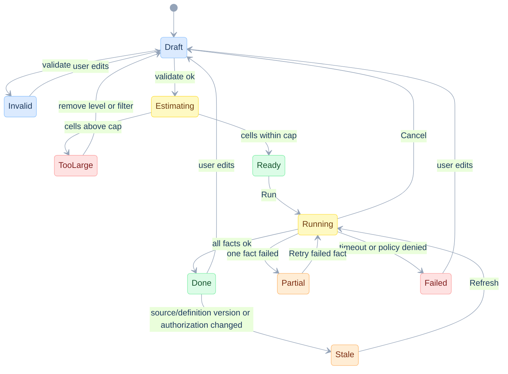
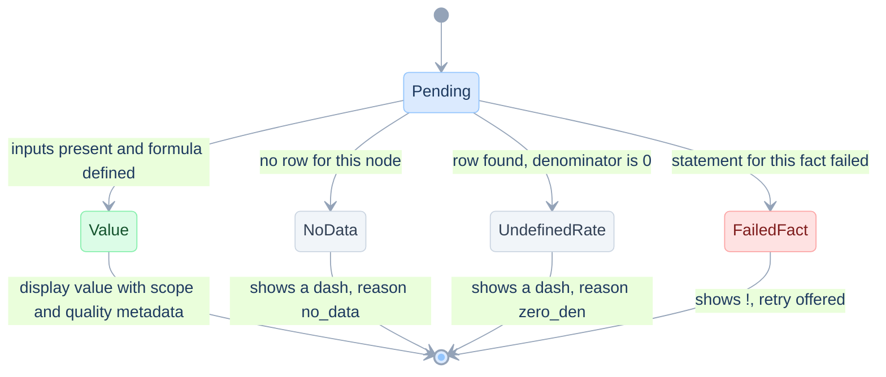

# UX and wireframes

> **In plain words.** Screens: the pivot builder, the result table with totals, a popover that explains why a total is not an average, the KPI editor, the migration assistant, and the empty, loading, partial and error states. All drawn in text, with the study's own labels and the synthetic grid values.
>
> New here? Read [START-HERE](START-HERE.md) first.

Date: 2026-11-12. Lens: UX and UI designer, with the Product Owner's acceptance criteria. Sent and Delivery Rate use the illustrative synthetic S4 grid. Unique-client values come from the synthetic fixture, whose client identities were invented to exercise overlap. The API they call is in [11](11-api-system-and-ai.md). The rules they enforce come from [01](01-principles.md) and [15](15-edge-cases-and-state-charts.md). Status: **specified** (no UI code exists).

Design stance, derived from the problems of [03](03-problem-catalogue.md):

1. A total is a different kind of cell. It looks different, says what it is, and can explain itself (PRB-TOTALS-*).
2. A missing value is never a zero (FP-11).
3. The screen shows the scope it used, including anything widened behind the scenes (EC-PERIOD-CTX).
4. Anything unconfirmed carries a visible badge (SEM-GATE).

## The user journey

A CRM analyst selects confirmed KPIs, chooses a period and two grouping axes, then runs the report. The result must answer three questions without opening SQL: **what population is included, how was this total calculated, and can I use this value?** A KPI owner separately confirms definitions and publishes versions.

The first release supports Sent and Delivery Rate across S1–S4. The wireframes below also show the wider target design; unavailable controls stay disabled. Other catalogue KPIs can join that release after their definitions and source mappings pass the same checks. Prior-period comparisons, cross-KPI unions and approximate audiences remain separately enabled capabilities; their controls must not appear as available before their planner support exists.

## NAV: navigation map

```
┌─ Navigation map ─────────────────────────────────────────────────────────────────────────────────────┐
│             +----------------------+                                                                 │
│             |  Reports (list)      |                                                                 │
│             +----------+-----------+                                                                 │
│                        | open / new                                                                  │
│                        v                                                                             │
│             +----------------------+  Explain   +---------------------+                              │
│             |  Pivot builder       |----------->|  Explain a total    |                              │
│             |  (SCR-1)             |<-----------|  (SCR-3, popover)   |                              │
│             +----+-------------+---+            +---------------------+                              │
│                  | Run         | KPI name click                                                      │
│                  v             v                                                                     │
│        +-----------------+  +----------------------+  Propose   +----------------------+             │
│        |  Result grid    |  |  KPI definition      |----------->|  Migration assistant |             │
│        |  (SCR-2)        |  |  (SCR-4)             |<-----------|  (SCR-5)             |             │
│        +--------+--------+  +----------------------+            +----------------------+             │
│                 | cell / row click                                                                   │
│                 v                                                                                    │
│        +-----------------+                                                                           │
│        |  Drill-down     |   Typology > Campaign > Channel > Message / Creative                      │
│        +-----------------+                                                                           │
└──────────────────────────────────────────────────────────────────────────────────────────────────────┘
```

## SCR-1: Pivot builder

Replaces the "pick a KPI, pick a SQL" flow. The user picks KPIs once and shapes rows, columns, totals and filters. Rows and columns are independent axes. KPIs sit under the column hierarchy, as in "Year -> Market -> KPI".

```
┌─ Pivot builder ─────────────────────────────────────────────────────────────────────────────────┐
│ FIELDS                         │ LAYOUT              Estimate: 12 grouping sets               │
│                                │                                                                │
│ Measures (KPIs)                │ Rows     [Typology] > [Tier] > [Campaign]          [+ level]   │
│  [x] Message Sent              │ Columns  [Year] > [Market] > KPIs                  [+ level]   │
│  [x] Delivery Rate             │                                                                │
│  [x] Open Rate                 │ Totals   Rows:    (x) detail + subtotals + grand total         │
│  [ ] Click Rate                │                   ( ) detail only                              │
│  [x] CTOR                      │          Columns: (x) detail + subtotals + grand total         │
│  [!] Message Reached (unconf)  │                   ( ) detail only                              │
│                                │                                                                │
│ Dimensions                     │ Filters  Period [2025-01-01] to [2027-01-01)                   │
│  Client Typology               │          Market [HK, SG v]    Channel [all v]    [+ filter]    │
│  Client Tier                   │          (also: campaign, message type, division/brand)        │
│  Campaign Name                 │          Compare [none v]                                      │
│  Year                          │                                                                │
│  Market                        │ Note     Compare = prior year also reads earlier rows.         │
│  Channel                       │          The grid still shows the chosen period only.          │
│  Message type                  │                                                                │
│  Division / brand              │          [ Preview plan ]    [ Run ]                           │
└─────────────────────────────────────────────────────────────────────────────────────────────────┘
```

| Element | Behaviour | Spec |
|---|---|---|
| KPI list | Shows status badge. Unconfirmed KPIs are listed, marked `[!]`, and cannot be dragged onto a published report | SEM-GATE |
| Level order | Reordering dimensions changes the subtotal scopes. A KPI for an unchanged population keeps its value | FP-3 |
| Totals radio | Two independent switches, one per axis | PLAN-AXIS |
| Estimate | Calls `POST /v1/intents/validate`. Distinguishes grouping sets, populated node rows and KPI values; a cardinality estimate is labelled as an estimate | EC-LARGE-RESULT |
| Compare | Choosing "prior year" shows a note that earlier rows are read | PLAN-CONTEXT |
| Preview plan | Shows the chosen strategy and statement count, with SQL available for technical users. One statement per fact is a candidate plan, not a promise | R1, PLAN-SPLIT |

For the full synthetic S4 result, **12 grouping sets produce 56 populated node rows** before hiding redundant subtotals. Four selected KPIs produce 224 KPI values at those nodes. Grouping sets, result rows and visible values are different counts. The shown grid is a compact excerpt, not all 56 rows.

## SCR-2: Result grid (scenario 4)

The grid is the illustrative S4 grid, built from the fixture. Row and column totals are computed at their own scope. The Grand total column and the Total row are not sums of the cells next to them.

```
┌─ Result grid, scenario 4 ───────────────────────────────────────────────────────────────────────────────────────┐
│ Engagement by Client Typology     Scope: 2025-2026, Market HK+SG     Source: base   [Explain] [CSV]             │
│                                                                                                                 │
│ Typology │Tier   │Campaign    │    2025 HK    │    2025 SG    │   2025 TOTAL  │   2026 TOTAL  │  GRAND TOTAL  │ │
│          │       │            │   Sent · DR   │   Sent · DR   │   Sent · DR   │   Sent · DR   │   Sent · DR   │ │
│ ─────────┼───────┼────────────┼───────────────┼───────────────┼───────────────┼───────────────┼───────────────┤ │
│ New      │Gold   │A           │   100 · 80.0% │    50 · 90.0% │   150 · 83.3% │   300 · 86.7% │   450 · 85.6% │ │
│ New      │Gold   │B           │   100 · 70.0% │    50 · 80.0% │   150 · 73.3% │   150 · 90.0% │   300 · 81.7% │ │
│ New      │Gold   │SUBTOTAL    │   200 · 75.0% │   100 · 85.0% │   300 · 78.3% │   450 · 87.8% │   750 · 84.0% │ │
│ ─────────┼───────┼────────────┼───────────────┼───────────────┼───────────────┼───────────────┼───────────────┤ │
│ Existing │Silver │C           │    50 · 80.0% │   100 · 70.0% │   150 · 73.3% │   150 · 83.3% │   300 · 78.3% │ │
│ ─────────┼───────┼────────────┼───────────────┼───────────────┼───────────────┼───────────────┼───────────────┤ │
│ ALL      │ALL    │GRAND TOTAL │   250 · 76.0% │   200 · 77.5% │   450 · 76.7% │   600 · 86.7% │ 1,050 · 82.4% │ │
│                                                                                                                 │
│ ALL = rolled-up level.  Totals are recalculated at their own scope, never summed from cells.                    │
│ Single-child subtotals are hidden (option single_child_subtotals = hide).                                       │
│ Grey = total   Yellow = widened context   Dash = no data   ! = failed or partial                                │
└─────────────────────────────────────────────────────────────────────────────────────────────────────────────────┘
```

| Rule | Detail |
|---|---|
| Total styling | Grey background and bold label. The label is derived from `gid`, never from a NULL (FP-8). Colour is never the only cue: totals also carry the word "Total" |
| Number format | Counts with thousands separator. Rates with one decimal. A rate with a zero denominator shows an em dash, not 0.0% (EC-DIV0) |
| Single-child subtotal | Default `hide`; `show` displays it with "same as above". Both modes preserve the computed node and every other value. Owner confirmation is still required (EC-SINGLE-CHILD) |
| Sorting | Sorting reorders siblings only. Totals stay pinned at the end of their group |
| Sticky headers | First column and both header rows stay visible |
| Conditional formatting | Thresholds come from the owner, agreed with the business. When conditional formatting is enabled, its configuration requires an agreed threshold; a report may be saved without conditional formatting |
| Drill-down | Click a row path to continue down `Typology -> Campaign -> Channel -> Message / Creative` |
| Export | CSV carries node identity, scope, KPI id/version, data snapshot, exact/approximate mode, value status and rate numerator/denominator. It does not expose client identities. This preserves the meaning of totals outside the UI |

## SCR-3: Explain a total

This is how the UI answers PRB-TOTALS-RATE ("why is the total not the average?"). The numbers are those of the fixture: 865 delivered of 1,050 sent is 82.4 percent, where the mean of the three campaign rates gives 81.9 percent (`test_mean_of_rates_is_wrong`). The text comes from `explain.total_rule` returned by the API. It is not written by a model.

```
┌─ Explain a total ────────────────────────────────────────────────────────────────┐
│ Why is the grand total delivery rate 82.4% and not 81.9%?                        │
│                                                                                  │
│ Total scope : all selected types/campaigns, selected years and markets                  │
│ Rule        : ratio of totals  (rate)                                            │
│ Numerator   : delivered   865                                                    │
│ Denominator : sent       1,050                                                   │
│ Result      : 865 / 1,050 = 82.4%                                                │
│                                                                                  │
│ Mean of the 3 campaign rates would give 81.9%  (not used, it ignores cell sizes) │
│                                                                                  │
│ Node        : gid 31  (all dimensions rolled up)                                 │
│ [ Copy SQL ]   [ Show plan ]   [ Close ]                                         │
└──────────────────────────────────────────────────────────────────────────────────┘
```

For a distinct count, the same popover says "Rule: distinct at scope" and shows both the true value and the sum of the visible children, for example "180 unique clients. The two year cells (175 and 180) add to 355, which counts clients twice" (`test_unique_clients_do_not_add_up`).

## SCR-4: KPI catalogue and definition

This mock-up shows a future owner-approved catalogue. Every definition and source mapping needs source verification and owner sign-off.

A KPI is edited as a formula over atoms. The composition graph is the visible answer to PRB-COMPOSE: CTOR is `ratio(clicked, opened)`, not another query.

```
┌─ KPI definition ──────────────────────────────────────────────────────────────────────────────────────┐
│ KPI CATALOGUE                          │ delivery-rate  Delivery Rate               v3  confirmed      │
│                                        │                                                              │
│  message-sent        confirmed    │ Formula    ratio( delivered , sent )                         │
│  delivery-rate             confirmed    │ Level      L1 composed    Result: algebraic (num, den)       │
│  open-rate           confirmed    │                                                              │
│  click-rate         confirmed    │ Atoms used                                                   │
│  click-to-open-rate  confirmed    │   delivered  COUNT(*) FILTER (WHERE is_delivered) distrib.   │
│  message-reached     UNCONFIRMED  │   sent       COUNT(*)                             distrib.   │
│                                        │                                                              │
│ [ + New KPI ]                          │ Used by    2 dashboards (published, pinned to v3)            │
│                                        │ Checks     V-01 ok   V-02 ok   V-03 ok   V-06 ok             │
│                                        │                                                              │
│                                        │ Composition graph                                            │
│                                        │    [sent] ─────┐                                             │
│                                        │    [delivered] ┴──> (delivery_rate)                          │
│                                        │                                                              │
│                                        │ [ New version ]  [ Compare v2/v3 ]  [ Preview at S4 ]        │
└───────────────────────────────────────────────────────────────────────────────────────────────────────┘
```

| Element | Behaviour |
|---|---|
| Formula | A typed editor. Only atoms, KPIs and `ratio`, `at`, `share` are offered. Free SQL is not accepted in a formula (FP-9) |
| Checks | V-01 to V-09 run live, each with the offending id on failure |
| Used by | Count of published dashboards and the pinned version. Editing creates a new version (EC-DEF-DRIFT) |
| Preview at S4 | Runs the S4 fixture grid for this KPI so the owner sees its totals |
| Status | A KPI becomes `confirmed` only through the owner action. The open questions of [03](03-problem-catalogue.md) start as `unconfirmed` |

## SCR-5: Migration assistant

Used by the data team to move a registry entry to atoms ([10](10-edgesql-integration.md) EDGE-MIGRATE). The example is a synthetic Message Sent entry.

```
┌─ Migration assistant (mock-up values) ───────────────────────────────────────────────┐
│ Legacy KPI   message-sent  (Message Sent)                    State: Decomposed       │
│                                                                                      │
│ formula_sql_text         COUNT(*)                                                    │
│ kpi_formula_text         COUNT(*)                                                    │
│ from_sql_text            crm.silver.message                                          │
│ join_definition_json     NULL                                                        │
│ where_sql_text           1 = 1 AND (try_cast(:start_date AS DATE) IS NULL OR ...)    │
│ filter_definition_json   [{"scope":"main","predicate":"channel = 'email'"}]          │
│ select / group_by        {{ group_by_list }}                                         │
│                                                                                      │
│ Proposed   atom  sent = COUNT(*)            class: distributive                      │
│            fact  crm.silver.message  one row per message (to confirm)                │
│            scope filter  send_date >= :start_date   (typed, bound)                   │
│            grouping      dropped (chosen at read time)                               │
│                                                                                      │
│ Parity at leaf nodes      mock-up: cells compared 12, equal 12, different 0          │
│ Parity at total nodes     required for counts and rates                              │
│                                                                                      │
│ Blocked by   EDGE-GAP-01 (slot name lost on emit). Harness uses a trusted text fill. │
│                                                                                      │
│ [ Mark Proven ]   [ Request owner approval ]   [ Keep legacy ]                       │
└──────────────────────────────────────────────────────────────────────────────────────┘
```

## SCR-6: Empty, loading, partial, error

```
┌─ Empty, loading, partial, error ──────────────────────────────────────────────────────────────┐
│ EMPTY              LOADING                 PARTIAL                      ERROR                 │
│ +--------------+   +-----------------+     +------------------------+   +-------------------+ │
│ | No rows for  |   | Running 1 stmt  |     | Grid shown, fact       |   | CELL_CAP          | │
│ | this scope.  |   | Preparing       |     | 'sales' failed (!).    |   | ~180,000 cells.   | │
│ | [Widen]      |   | [Cancel]        |     | [Retry sales]          |   | Remove a level or | │
│ +--------------+   +-----------------+     +------------------------+   | filter. [Edit]    | │
│                                                                         +-------------------+ │
└───────────────────────────────────────────────────────────────────────────────────────────────┘
```

Every state tells the user what to do next. Partial results name the failed fact and keep independently successful KPIs on screen (`EXEC_PARTIAL`). A KPI depending on the failed part shows `dependency_failed`, never a partial ratio. Retry preserves the original snapshot and definition versions, or refreshes the entire report and labels the new snapshot.

## State chart: the builder



## State chart: one cell



A cell's value state is independent of its presentation metadata. A valid value can be a **total**, **approximate**, and **stale** at the same time. `no_data`, `zero_den`, `dependency_failed` and `policy_denied` remain distinct reasons; a dash alone is not enough for screen readers or exports. Ordinary counts need no denominator.

## Acceptance criteria (Product Owner)

Each line is a planned end-to-end check in [14](14-test-strategy-and-traceability.md). No UI test currently exists. UX-01, UX-03, UX-05–06, UX-08–10 and UX-12 gate the initial release. Unique-client, comparison, multi-fact and approximate-mode checks apply when their feature is enabled.

| Id | Given / When / Then | Problems closed |
|---|---|---|
| UX-01 | Given S4 with totals, when I run, then the Grand total delivery rate is 82.4 percent and equals the ratio of the total numerator and denominator | PRB-TOTALS-RATE |
| UX-02 | Given unique clients, when I open the Grand total cell, then it shows the true audience (180) and explains why the year cells (175, 180) do not add up | PRB-TOTALS-DISTINCT |
| UX-03 | Given an unconfirmed KPI, when I drag it onto a published report, then it is refused with the reason | PRB-REACH |
| UX-04 | Given Compare = prior year, when I run, then the widened window is shown | PRB-FILTER-VS-COLUMN |
| UX-05 | Given a node with no rows, when the grid renders, then the cell shows a dash and not 0 | EC-SPARSE |
| UX-06 | Given a very large request, when I press Run, then I see the cell estimate and the cap before any query | EC-LARGE-RESULT |
| UX-07 | Given one failed fact, when the grid renders, then the successful part stays and the failed fact is named | EC-PARTIAL |
| UX-08 | Given two KPIs named alike, when I search, then I pick by id and see both ids | EC-NAMES |
| UX-09 | Given a KPI used on published dashboards, when I edit it, then a new version is created and the dashboards stay on the old version until approved | EC-DEF-DRIFT |
| UX-10 | Given a single-child subtotal, when I switch `hide`/`show`, then only visibility changes; the computed node and all other values stay the same | EC-SINGLE-CHILD |
| UX-11 | Given Year → Market, when I request Market across all years, then the UI explains that this is an additional scope and either runs the supported extra grouping or clearly refuses it | PRB-COLUMN-PIVOT |
| UX-12 | Given selected years and markets, when I explain the grand total, then it retains those filters and says "all selected values" | EC-FILTER-SCOPE |
| UX-13 | Given an approximate audience, when I view or export it, then approximate mode and the approved accuracy policy remain visible | EC-HLL-ERROR |
| UX-14 | Given a failed dependency, when a composed KPI is displayed, then it is unavailable with a reason; retry never combines different snapshots | EC-PARTIAL, EC-SNAPSHOT |

## Accessibility and copy

- Keyboard: arrow keys move across cells. Enter on a total opens SCR-3. Escape closes.
- Contrast: AA for text and for the grey of totals. Colour is never the only cue.
- Screen readers: each cell announces row path, column path, KPI and "total" or "detail".
- Copy: use the business vocabulary (Typology, Tier, Campaign, Delivery Rate). Use "CTOR" for Click to Open Rate and show the old label "CTR" as an alias only after the owner confirms (PRB-NAMING).
