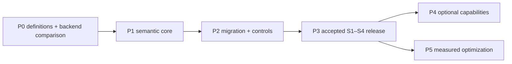

# Implementation plan

> Deliver a report whose totals remain correct when users change the layout. Prove the business definitions first, select the smallest backend that meets the contract, then release an auditable S1–S4 workflow.

Date: 2026-11-12. Start with [BUSINESS-CASE](BUSINESS-CASE.md) for the decision and [16](16-correctness-contract.md) for correctness. The fixtures are a prototype, not product code. Phase numbers below describe dependencies, not dates or staffing commitments.

## What exists and what is recorded

The local prototype implements aggregate formulas, axis-prefix grouping sets and a small drill-across example. The supported S4 parity claim concerns **Sent and Delivery Rate** in the illustrative grid. Synthetic unique clients and event flags exercise additional mathematical cases; they do not validate production definitions or real client identities.

Local suite: 64 passes, 52 skips (Databricks-tier variants) and two expected failures; native metric views and generated SQL each match the local 56-group S4 fixture on a Databricks serverless SQL warehouse, and a Malloy model matches the same 56 groups on local DuckDB. Exact SQL, responses and limitations are retained in [validation](validation/2026-11-12/README.md) and [validation/2026-11-12-malloy](validation/2026-11-12-malloy/README.md). These are core calculation probes, not full production conformance. The prototype also has grid self-checks and an additivity probe ([fixtures/grid_checks.py](fixtures/grid_checks.py)); neither is product code.

Benchmark timings and the mutation report (seven killed mutants) are recorded in [08](08-complexity-and-performance.md) and [14](14-test-strategy-and-traceability.md). Raw warehouse run logs and a locked environment for them are not retained, so they are observations, not release evidence. Current checks and the limits of each proof belong in [14](14-test-strategy-and-traceability.md).

## P0: agree the contract and choose the backend

**Outcome:** a bounded first release and an evidence-based build decision.

| Work | Required evidence |
|---|---|
| Confirm message grain, sent/delivered populations, date role, timezone, null-identity policy and source mappings | Owner-approved definitions and source grain/uniqueness checks |
| Resolve CTR/CTOR, Reach, any unnamed metric, Market-only subtotal and cross-KPI union | Written decision, or the affected capability remains unconfirmed and excluded |
| Probe unexplained KPIs before reading their SQL | Additivity probe results for Reach, and for any other unexplained KPI, over at least two partitions at pinned data versions ([10](10-edgesql-integration.md) EDGE-PROBE). Input to the owner decision, not a substitute for it |
| Compare a Databricks metric-view implementation with the custom planner | Run the same S1–S4 semantic conformance cases; record supported scopes, permissions, integration limits, latency and maintenance effort. Add Malloy to the comparison only if multi-engine portability or nested output is a requirement ([05](05-first-principles-solution.md)) |
| Inspect the legacy registry | Read real SQL and its parameters; distinguish existing reusable fragments from opaque definitions |
| Establish a reproducible baseline | Dependency versions, fixture hash, exact intent, expected rows and execution evidence |

The native candidate is evaluated **before** investing in a general compiler. Choose it if it satisfies the required contract and integration at lower lifecycle cost. Otherwise build only the missing planner behavior behind the same execution interface. Current third-party documentation alone is not conformance evidence.

> **The comparison is executable.** The library in [/edgekpi](../../edgekpi) implements all three approaches behind one definition and runs them on DuckDB and on a Databricks warehouse; see [specs/library](../library/README.md). On a synthetic example, the nine request shapes of its matrix return identical grids on five backend/engine pairs (45 comparisons, 0 differences). That is evidence of semantic agreement on that data; the cost, latency, permissions and real-registry questions of this phase remain open ([library 12](../library/12-implementation-plan.md#phases), [library 13](../library/13-verification-evidence.md#limits)).

Exit: the backend decision cites a comparison; Sent and Delivery Rate have confirmed definitions and a testable mapping; unsupported KPIs are visibly gated. Ambiguous Reach does not block a release limited to confirmed measures.

## P1: implement the smallest semantic core

**Outcome:** confirmed S1–S4 requests produce the same values at every requested scope.

For a custom backend, promote the useful parts of the prototype rather than its string-based interfaces:

| Prototype | Product responsibility |
|---|---|
| `Atom`, `Kpi` | Typed references, aggregate-state contract, formula validation and versioned definitions |
| `axis_levels`, `grouping_sets` | One scope model used by planning, result assembly and estimates |
| `plan_sql` | Trusted AST construction and SQL validation; physical plan chosen independently of meaning |
| `drill_across_sql` | Independently aggregate compatible facts, then align on complete node identity |
| Test `run()` helpers | Executor interface with complete-result retrieval and explicit failure states |
| No assembler | Stable node keys, total labels, `no_data`, deterministic display order, and the reconciliation checks of [16](16-correctness-contract.md) C-CHECK on every complete result |

A native backend must pass the same contract through its adapter. Neither backend is required to emit exactly one statement. Fused grouping sets, split exact-distinct work and two-stage aggregation are eligible only when they preserve the contract and improve measured cost.

Exit:

1. S1–S4 Sent/Delivery results match an independent per-scope oracle, including totals and retained filters.
2. Unknown references, unsupported scopes and unconfirmed KPIs fail with named reasons.
3. Empty input, zero denominator, real NULL members and duplicate source keys have explicit behavior.
4. Result retrieval is complete; no silently truncated response can pass parity.
5. Every returned grid passes the C-CHECK invariants; a violation fails or flags the report and names the node.
6. Product code does not import fixtures. Validation applicable to enabled features has tests; future sketch/context checks remain feature-gated.

## P2: migrate confirmed definitions and establish release controls

**Outcome:** migrated definitions are proven at source grain and at total scope.

| Work | Exit evidence |
|---|---|
| Read-only registry connector and migration classifier | Exact source SQL, parameters and proposed state/formula mapping retained in a parity report |
| Event reduction and dimension joins | Cardinality, uniqueness and SCD2 as-of checks; no fanout at message grain |
| Definition ownership and version pins | Published reports retain the approved version when a new draft is created |
| Typed filters and source mappings | Filters are bound and applied at the declared scope; an unbound required slot fails |
| Data quality and cell limits | Duplicates, invalid identities, sparse results and excess cardinality are visible |
| Permissions and execution identity | Warehouse/Unity Catalog authorization is respected for every enabled path |

Compare leaf and total nodes for additive measures too: grain changes, missing filters and duplicate rows can make a count wrong. A changed legacy total requires an owner-reviewed reconciliation against the independent oracle. Do not require all six business labels to migrate before confirmed measures can ship.

EdgeSQL template-slot work is a dependency of migration paths that use those templates, not of every possible backend. A trusted, isolated parity harness is not a production substitute for typed binding.

## P3: release the S1–S4 workflow

**Outcome:** an analyst can build, understand and export a correct report.

Implement the first-release controls in [12](12-ux-and-wireframes.md), including total explanations, filter scope, single-child subtotal visibility, version pins and explicit failure reasons. Follow the backend capability manifest: do not show prior-period, union or sketch controls as enabled merely because their wireframes exist.

Published use requires all of the following:

- First-release UX criteria and API contract tests pass on the target backend.
- Row-level permissions are checked on execution. Any enabled cache or stored rollup has policy-equivalence and invalidation tests; otherwise that optimization stays disabled.
- All parts of a report use compatible source snapshots and definition versions. Retry preserves them or refreshes the whole report.
- A failed fact invalidates every dependent KPI; independently successful values can remain visible.
- Representative target-warehouse measurements meet an owner-agreed latency and cost budget. Statement count is diagnostic evidence, not a release objective.
- A business owner reviews the report against the reporting scenarios and accepts known differences in labels or presentation.

Exit: the scope-limited workflow is accepted with an evidence pack. An AI assistant is optional and does not block the deterministic report workflow.

## P4: add capabilities one at a time

| Capability | Evidence required before enabling it |
|---|---|
| Market across all selected years | Extra grouping-set oracle and UX-11; not inferred from axis prefixes |
| Prior-year / prior-campaign comparisons | Calendar alignment, filter retention, partial-period and missing-period tests |
| Share, nesting and distinct unions | Explicit denominator/population scope, identity domain and null-policy tests |
| General drill-across | Conformed dimensions, snapshot compatibility and unsupported-dimension refusal |
| HLL audiences | Approved statistical accuracy policy, compatible sketch configuration, exactness metadata and empirical multi-cardinality evaluation |
| AI intent proposals | Known-id resolution, ambiguity handling and untrusted text tests; execution remains validated |

The article's handwritten calculations are useful oracles. They are not evidence that the generic planner supports these operators.

## P5: optimize measured bottlenecks

Use the representative workload from P3 to compare fused grouping sets, exact-distinct splitting, two-stage aggregation, native acceleration, cache and stored rollups. Measure end-to-end latency, warehouse work, bytes/shuffle/spill where available and concurrent report behavior. Do not select a plan from row count alone: cardinality, scope count, state size and workload also matter.

Every optimization keeps oracle parity and the release controls. Approximation is an explicit owner-approved semantic choice, not a fallback for a slow exact query. Stored rollups and caches remain off for requests whose policy or snapshot semantics cannot be preserved.

## Dependencies and ownership

Business decisions, source inspection and backend comparison can run in parallel during P0. UI prototyping can proceed against a fixed contract while P1/P2 implementation runs. Security and correctness gates must close before published use; they are not deferred to P5.

| Decision owner | Responsibility |
|---|---|
| CRM/marketing KPI owner | Populations, labels, date semantics, display choices and exact/approximate acceptance |
| Data owner | Source grain, join keys, identity quality and freshness |
| Engineering lead | Backend comparison, integration design and parity evidence |
| Platform owner | Warehouse identity, permissions, policy-aware execution and operational budget |

## Decision register

| Id | Decision | Status |
|---|---|---|
| ADR-001 | Keep a backend-independent contract; prefer native metric views after the retained core S4 probe; custom planning addresses verified gaps. Malloy also met the core S4 contract on DuckDB and is held as an alternative for multi-engine or nested-output requirements | remaining production conformance and cost comparison required |
| ADR-002 | For custom SQL, use a trusted AST and SQL validation; preserve typed legacy-template slots where needed | proposed implementation |
| ADR-003 | Exact distinct is the default; approximation is explicitly declared and approved | accepted semantic rule |
| ADR-004 | Long result keyed by scope and member values; UI performs presentation pivot | proposed interface |
| ADR-005 | Databricks is the product target; DuckDB is a fast local oracle adapter | target retained |
| ADR-006 | No input population is `no_data`; prototype uses `HAVING COUNT(*) > 0` to normalize engine behavior | explicit contract; verify target behavior |
| ADR-007 | Generate guarded division and null-safe node alignment | accepted semantic rule; dialect supplied by adapter |
| ADR-008 | Permit exact-distinct splitting when measured cheaper and snapshot-consistent | candidate optimization; threshold not established |
| ADR-009 | Run reconciliation checks (parts add up, rate equals its own numerator over denominator, unique count within bounds) on every assembled grid | proposed; prototype helper tested, product check not built |

## Definition of done

For each enabled capability: owner-approved meaning, executable oracle parity, target-backend contract checks, permission/freshness evidence and a traceability entry in [14](14-test-strategy-and-traceability.md). Keep one implementation of each rule; counting literal `NULLIF` occurrences is not a meaningful DRY test. Document any remaining limitation in terms the report user can understand.
