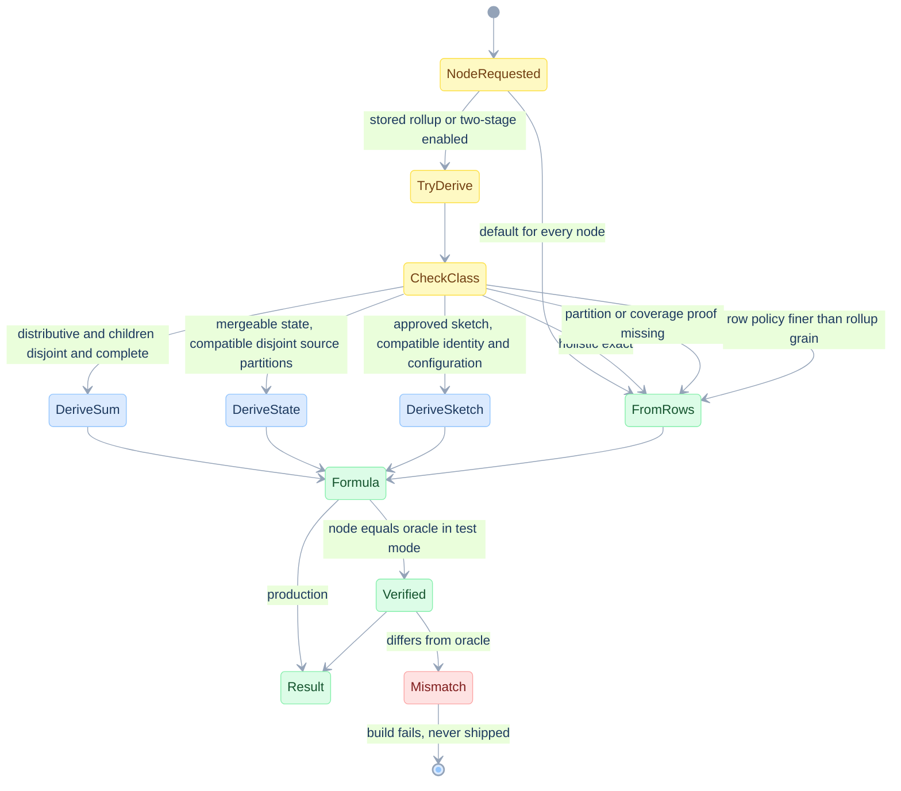
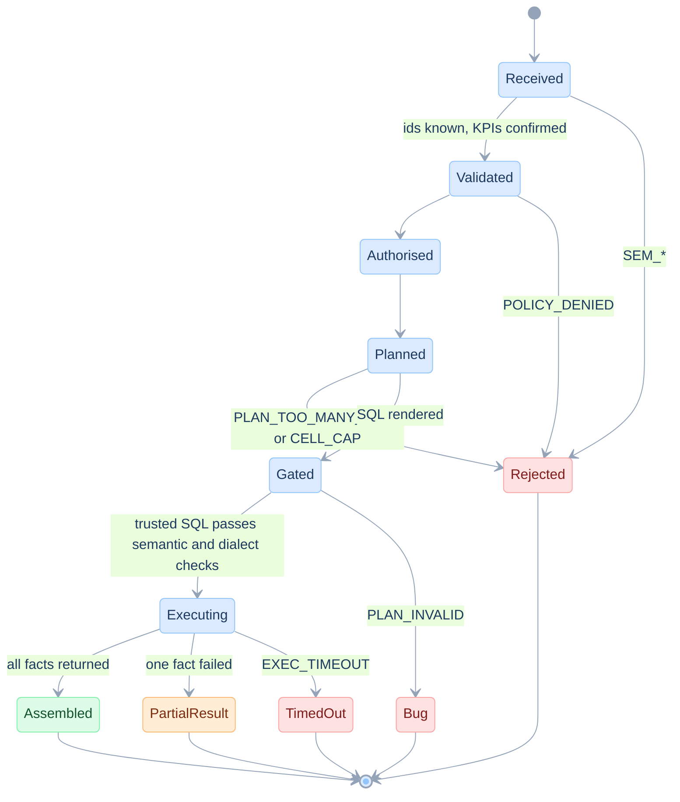
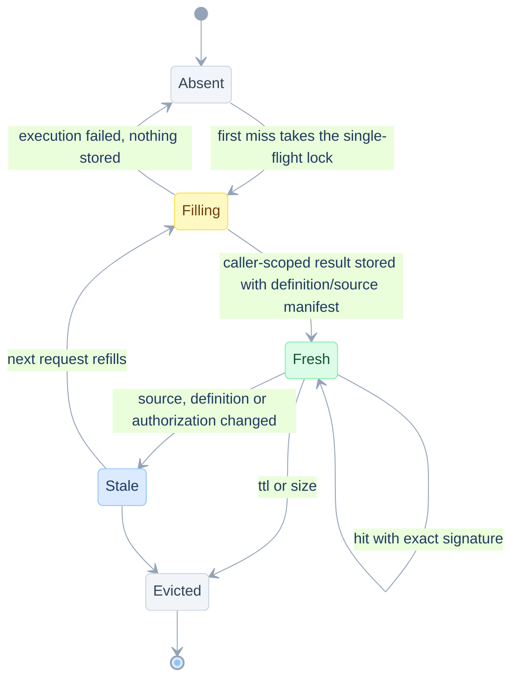

# Edge cases and state charts

> **In plain words.** Every awkward situation we found (empty cells, a client in two markets, division by zero, time zones, joins that multiply rows...), what goes wrong if ignored, what we do, and which test covers it.
>
> New here? Read [START-HERE](START-HERE.md) first.

Date: 2026-11-12. Every edge case has an id, a source, the naive failure, a mitigation, a place in the spec, and a test. Test status is stated exactly:

- **tested**: an executable fixture check exists. Target runs are reported as passing, but their raw logs and locked environments are not retained. Narrow S4 evidence and the local environment are recorded in [14](14-test-strategy-and-traceability.md). This label does not imply a Databricks run or production validation.
- **xfail**: a strict expected-failure test documents a known gap in EdgeSQL ([10](10-edgesql-integration.md)).
- **planned**: designed, with a named test to write in the phase shown in [13](13-implementation-plan.md).
- **needs-dbx**: cannot be shown on DuckDB. It belongs to the Databricks tier TIER-DBX ([14](14-test-strategy-and-traceability.md)).

Run the tested set: `uv run --with duckdb --with pytest --with edgesql pytest specs/kpi/fixtures -q`.

## A. Totals and node identity

| Id | Case | Source | Naive failure | Mitigation | Spec | Test |
|---|---|---|---|---|---|---|
| EC-NULL-MEMBER | A real NULL member (unknown market) next to a subtotal | FP-8 | Two NULL rows, indistinguishable | Identify nodes by grouping schema, `GROUPING_ID` and retained typed members | [07](07-planner-and-sql-generation.md) PLAN-GID | tested `test_ec_null_member_looks_like_subtotal` |
| EC-GID | Bit order of `GROUPING_ID` | Planner | Subtotal placed in the wrong column | First column is the highest bit. Decode from the node map, not from NULLs | PLAN-GID | tested `test_ec_gid_first_column_is_the_highest_bit`. Same test on Databricks, plus `test_dbx_grouping_id_type_is_wide_enough` (`bigint`) |
| EC-SINGLE-CHILD | A level has one child, so the subtotal equals the child (a subtotal drawn for New / Gold but not for the lone Existing / Silver row) | Display | Two identical rows read as a bug, or a sum doubles | The planner always computes the node. The assembler option `single_child_subtotals` (`hide` proposed, owner to confirm) decides display. Merge a single child only when coverage and state compatibility are proven | [03](03-problem-catalogue.md) PRB-SINGLE-CHILD-DISPLAY, [12](12-ux-and-wireframes.md) SCR-2 | tested (node exists and equals its child) `test_ec_single_child_subtotal_duplicates_parent`. Display option: planned (UX-10) |
| EC-SPARSE | A node has no rows (no VIP in 2025 HK) | Sparse data | Cell shows 0 or the row is missing | `node` key set from the union, LEFT JOIN, `no_data` reason, dash in UI | PLAN-DRILL, assembler | tested `test_ec_empty_input_yields_no_node_rows_on_every_engine`, `test_drill_across_...` (missing fact side). Sparse-grid assembly: planned (UX-05) |
| EC-EMPTY-TOTAL | The whole request matches zero rows, with a grand-total node requested | Found by running both engines | DuckDB returns a grand-total row with count 0, Databricks returns **no row** (`GROUPING SETS (..., ())` over empty input) | One semantics for every engine: a node exists only if it has input rows (`HAVING COUNT(*) > 0`). The assembler fills missing nodes as `no_data` | [13](13-implementation-plan.md) ADR-006, PLAN-DRILL | tested on both engines `test_ec_empty_input_yields_no_node_rows_on_every_engine` |
| EC-RATE-WEIGHT | Total built as the mean of displayed rates | Totals rule | 81.9 percent instead of 82.4 | Ratio of totals computed at the node | [07](07-planner-and-sql-generation.md) PLAN-TOTAL | tested `test_mean_of_rates_is_wrong`, `test_year_total_mean_of_rates_is_wrong` |
| EC-DISTINCT-OVERLAP | Distinct clients across campaigns, years, markets, KPI populations | Totals rule | 240 for 120, 355 for 180, union as a sum | `COUNT(DISTINCT)` at the node. Union as one distinct over the union | [06](06-semantic-model-and-dsl.md) SEM-UNION | tested `test_unique_clients_do_not_add_up`, `test_cross_kpi_union_is_not_a_sum`, `test_article_distinct_union_and_conversion` |
| EC-GSET-EXPLOSION | Too many dimensions, or a CUBE where rollup was meant | Article cost | `2^d` grouping sets, potentially huge result | Cap dimensions (8). Rollup prefixes per axis. Cell estimate before run | PLAN-AXIS, PERF-BUDGET | tested `test_ec_dimension_cap_and_duplicates_fail_closed`. Cell cap: planned (P2) |
| EC-DUP-DIM | The same dimension on rows and columns | UX | Ambiguous node | Refuse `PLAN_DUPLICATE_DIM` | PLAN-AXIS | tested (same test) |

## B. Arithmetic

| Id | Case | Source | Naive failure | Mitigation | Spec | Test |
|---|---|---|---|---|---|---|
| EC-DIV0 | Zero denominator in an existing population | Article, ANSI | Databricks raises `DIVIDE_BY_ZERO`. DuckDB returns `inf`. A 0 hides it | Generated `NULLIF` guard, NULL result, dash in UI | [06](06-semantic-model-and-dsl.md) SEM-L1, FP-11 | tested `test_ec_zero_denominator_in_a_non_empty_node_gives_null_rates_through_the_planner` (mutation: removing the guard fails it), `test_ec_empty_cell_ratio_is_null_not_zero`. Databricks error behaviour: tested `test_dbx_ansi_mode_raises_on_division_by_zero_and_the_guard_returns_null` |
| EC-CTOR-GT-ONE | Click without open (image blocking) | Tracking data | CTOR above 100 percent | Data-quality check DB-DQ. The UI shows the value and a data-check badge, it does not clamp | [09](09-data-model-and-databricks.md) DB-DQ | tested (shape) `test_ec_ctor_above_one_when_a_click_has_no_open`. Production check: planned (P2) |
| EC-HLL-LGK | Sketches with different lgConfigK combined | Article, Databricks | `HLL_UNION_DIFFERENT_LG_K` | V-08 refuses a mixed rollup | SEM-CLASS | tested on Databricks (the error is raised) `test_dbx_hll_sketch_tracks_exact_distinct_and_mismatched_lgk_fails`. The validator V-08: planned (P4) |
| EC-DISTINCT-COST | Exact distinct with many grouping sets | Benchmark, [08](08-complexity-and-performance.md) F6/F7 | A combined plan can be slower; subtracting whole-query times does not isolate operator cost | Compare combined and split exact plans on representative workloads; pin the same sources. Approximation requires approval | PLAN-SPLIT | Selection and split execution: planned B6; no established row threshold |
| EC-HLL-ERROR | An approximate distinct count is shown as if exact | Measured, F8 | 2.47 percent error at lgK 12 and 0.47 percent at lgK 14 on 400,000 ids | The atom declares `distinct_mode: hll` and `lgK`. The UI marks the cell approximate. The accuracy policy, statistical interpretation and permitted uses are agreed with the owner | SEM-CLASS | measured once (100 M rows, one sample). Statistical evaluation across cardinalities and distributions, with declared confidence rather than a per-query guarantee: planned (P4) |
| EC-COMPOSE-ORDER | Averaging cell ratios or cancelling guarded expressions | Formula semantics | Biased totals or NULL converted to a number | Evaluate dependencies at total scope; preserve denominator and NULL domains | SEM-L1, C-FORMULA | tested `test_mean_of_cell_ctor_is_not_total_ctor`, `test_ratio_cancellation_has_a_nonzero_domain` |

## C. Grain and joins

| Id | Case | Source | Naive failure | Mitigation | Spec | Test |
|---|---|---|---|---|---|---|
| EC-FANOUT-EVENT | Messages joined to open events | Click definition (at least one click) | Counts events (4 for 2) | Reduce events to message grain first | [09](09-data-model-and-databricks.md) DB-GRAIN, V-06 | tested `test_ec_event_fanout_inflates_open_count` |
| EC-SCD2 | Client tier changes over time | Joins | Duplicated messages (3 for 2) | Join on key and as-of date. V-05 | DB-SCD2 | tested `test_ec_scd2_dimension_duplicates_facts` |
| EC-FANOUT-FACTS | Two facts joined row by row | Article | 25 rows, 30,000 for 6,000 | Aggregate each fact, join on `gid` and null-safe dims | PLAN-DRILL | tested `test_article_fanout`, `test_drill_across_matches_per_fact_oracle_and_avoids_fanout` |
| EC-M2M | Many-to-many bridge (a client in several segments) | Metric-view and MetricFlow documentation | First-match or double count | Not allowed in v1. Aggregate per member then merge as a distinct atom | PLAN-GRAIN | planned (P2). Fails closed with `SEM_GRAIN_CHANGE` |
| EC-NULLSAFE-EQ | Null-safe equality syntax | Planner | `<=>` is a vector operator in DuckDB, so the join fails | `IS NOT DISTINCT FROM` only | PLAN-DIALECT | tested (drill-across test binds only with the ANSI form). Databricks: tested `test_dbx_null_safe_equality_both_spellings` |

## D. Time and context

| Id | Case | Source | Naive failure | Mitigation | Spec | Test |
|---|---|---|---|---|---|---|
| EC-PERIOD-CTX | Year is a filter and column with prior-year measure | Comparison context | Prior rows excluded or placed under wrong year | Widen only time window; align prior source year to current display year | PLAN-CONTEXT | SQL examples cover window widening; math alignment tested `test_reading_prior_year_is_insufficient_without_display_alignment`; general planner planned P4 |
| EC-TZ | Year derived from a timestamp | Planner | Year depends on the session time zone (2026 vs 2027 for the same instant) | Model declares the zone. SQL uses it explicitly | [09](09-data-model-and-databricks.md) DB-DATES | tested `test_ec_time_zone_decides_the_year` |
| EC-FILTER-SCOPE | A grand total under selected market/date filters | Business total scope | Rolling up accidentally removes filters and includes unselected rows | Remove grouping predicates only; preserve request and authorization predicates | [16](16-correctness-contract.md), PLAN-CONTEXT | planned CONTRACT-SCOPE (P1/P3) |
| EC-PERIOD-ALIGN | Prior-year comparison of a partial period or leap day | Comparison semantics | Full prior year compared with partial current year, or shifted boundary | Declare calendar, timezone, date role and alignment policy; preserve non-time filters | [16](16-correctness-contract.md) | planned CONTRACT-PERIOD (P4) |
| EC-LATE-DATA | Late events or corrections change a historical period | Data | Cached results retain the latest date but stale values | Immutable source versions and observation/completeness cutoff; invalidate on commits; label provisional periods | SYS-CACHE, C-SNAPSHOT | pure counterexample tested `test_latest_date_watermark_misses_backdated_correction`; product check before cache use |
| EC-DATE-CAST | Cast on the filtered column | Registry templates | May defeat file skipping | Half-open range on the native column | DB-DATES | needs-dbx (EXPLAIN comparison) |

## E. Definitions and catalogue

| Id | Case | Source | Naive failure | Mitigation | Spec | Test |
|---|---|---|---|---|---|---|
| EC-DEP | Unknown atom or KPI, or a cycle | Model | Wrong or failing SQL | V-01, V-02 fail closed | [06](06-semantic-model-and-dsl.md) SEM-VALIDATE | tested `test_ec_unknown_atom_fails_closed`. Cycle: planned (P1) |
| EC-REACH-AMBIG | A KPI such as Reach has no confirmed definition | Definitions | A wrong audience on the dashboard | `status: unconfirmed`, refused on published reports. Additivity probe on the registry informs the owner decision | SEM-GATE, EDGE-PROBE | tested (probe on synthetic data) `test_additivity_probe_separates_counts_rates_and_distincts`. Gate: planned (P1). Registry probe: planned (P0) |
| EC-NAMING | "CTR" can mean two different rates | Naming | Two names, two definitions drift apart | One KPI id, label and alias after owner confirms | [03](03-problem-catalogue.md) PRB-NAMING | tested `test_a_ctr_label_has_two_readings_that_disagree` |
| EC-IDENTITY-DOMAIN | Distinct sets use different client namespaces or NULL identity rules | Entity semantics | Unrelated ids merged, or unknown clients silently excluded | Declare entity namespace, identity expression and null policy; reject incompatible unions | [16](16-correctness-contract.md) | planned CONTRACT-IDENTITY (P1/P4) |
| EC-TRUNC | A metric whose label and definition nobody has agreed | Definitions | A guessed KPI | Not created. Listed as unresolved | PRB-TRUNC | decision, no code |
| EC-NAMES | Business names versus physical columns, and name lookup with `like` | Registry lookup | A rename breaks a report. `like` matches several | Key on id. Map names to columns in `source` | SEM-FACT | planned (P2) |
| EC-FILTER-NOPLACEHOLDER | A filter exists but the template has no slot for it | Registry templates | Silently ignored | Typed predicates. `SLOT_UNBOUND` in EdgeSQL | [10](10-edgesql-integration.md) EDGE-GAP-05 | xfail (gap) plus planned (P2) |
| EC-DUP-SLOT | A slot used twice in a template | EdgeSQL | `params()` lists it twice | One slot, one binding | EDGE-GAP-02 | xfail `test_edge_gap_02_slot_is_listed_once` |
| EC-SLOT-NAME | Slot name lost on emit | EdgeSQL | `{?}` replaces `{{ group_by_list }}` | Typed slot node | EDGE-GAP-01 | xfail `test_edge_gap_01_template_slot_keeps_its_name` |
| EC-DEF-DRIFT | A KPI definition is edited while dashboards use it | Governance | Numbers change under a published report | Versions. Dashboards pin a version | [09](09-data-model-and-databricks.md) DB-CATALOG | planned (P2) |

## F. Platform

| Id | Case | Source | Naive failure | Mitigation | Spec | Test |
|---|---|---|---|---|---|---|
| EC-ABAC | Stored states lost a filter or access-policy dimension | Governance | Preaggregate includes unauthorized rows | Reuse only with demonstrated equivalent policy and retained predicates; otherwise bypass | DB-PREAGG, DB-ABAC | planned CONTRACT-POLICY before rollups |
| EC-CACHE-LEAK | Two users share a cached answer | SYS-CACHE | Leak after policy differences or revocation | Caller isolation and current authorization; shared reuse disabled until policy equivalence and invalidation proven | SYS-CACHE | planned CONTRACT-POLICY before cache use |
| EC-CACHE-STALE | Source or definition changes | Data | Stale result despite unchanged latest date | Pin transitive definition/source versions; invalidate on changes; bypass when freshness cannot be verified | SYS-CACHE | planned product check; mathematical watermark counterexample covered |
| EC-LARGE-RESULT | Request over the cell cap | UX | Browser freeze | Estimate before run, `CELL_CAP` | SYS-API | planned (P2) |
| EC-PARTIAL | One of several facts fails | SYS-FLOW | A cross-fact KPI is computed from incomplete inputs | Name failed fact; retain only independent KPIs, mark dependents `dependency_failed` | SYS-API | planned E2E-API-04 (P3) |
| EC-SNAPSHOT | Split queries or retries see different source versions | Multi-statement execution | Numerator and denominator describe different populations | Pin compatible snapshots and versions, or refresh the entire result with new provenance. The reconciliation check flags totals that no longer equal the sum of their parts | [16](16-correctness-contract.md) C-SNAPSHOT, C-CHECK | planned CONTRACT-SNAPSHOT (before multi-statement publication); symptom detection fixture-tested `test_reconciliation_detects_mixed_snapshots_and_truncated_results` |
| EC-RESULT-TRUNCATION | API response spans several chunks | Executor | A partial result is accepted as a complete pivot | Follow every chunk and validate manifest totals, or fail explicitly. A missing row also breaks reconciliation | executor, C-CHECK | planned CONTRACT-RESULT (P1); current fixture adapter reads initial chunk only; symptom detection fixture-tested (same test) |
| EC-ORDER | Result order not guaranteed | SQL | Rows jump between runs | Explicit `ORDER BY` from the intent. Totals last | Assembler | planned (P3) |
| EC-PLAN-INVALID | Planner emits SQL that EdgeSQL rejects | Bug class | Wrong SQL reaches the warehouse | EdgeSQL gate before execution | SYS-MODULES | tested (round trip) `test_edge_parses_and_round_trips_planner_sql_for_databricks` |
| EC-SQL-SYNTAX | Engines disagree on what is valid SQL (trailing comma in `SELECT`, `<=>`) | Found by the Databricks benchmark and by the drill-across test | DuckDB accepts a trailing comma, Databricks raises `TRAILING_COMMA_IN_SELECT` | Build the select list from a list, never by text. Run every planner test on both engines | PLAN-DIALECT | tested on both engines `test_planner_without_kpi_formulas_is_valid_sql_on_every_engine` |

## G. AI assistant

| Id | Case | Mitigation | Test |
|---|---|---|---|
| EC-AI-AMBIGUOUS | "CTR" or "reach" is ambiguous | Ask, never guess | planned (TIER-AI) |
| EC-AI-UNKNOWN-KPI | Invented KPI name | `SEM_UNKNOWN_REF`, answer lists near ids | planned (TIER-AI) |
| EC-AI-INJECTION | Instruction hidden in a KPI description | Catalogue text is data in a delimited field, no write tools | planned (TIER-AI) |
| EC-AI-SQL | The assistant is asked for SQL | No SQL tool exists (KILL-3) | planned (TIER-AI) |

## State charts

### SC-TOTAL: how a node's value is obtained

This is the single decision behind the three totals rules (add, rate, distinct) of [03](03-problem-catalogue.md) PRB-TOTALS-ADD, PRB-TOTALS-RATE and PRB-TOTALS-DISTINCT.

The default is **FromRows**. Exact derivation preserves the oracle result. Approximate sketches preserve the approved statistical contract, not exact equality. Set union can handle overlapping entity sets, while additive states require disjoint source-row partitions; these are different preconditions ([16](16-correctness-contract.md)).

### SC-DEF: life of a KPI definition

```mermaid
%%{init: {'theme':'base','themeVariables':{'primaryColor':'#dbeafe','primaryBorderColor':'#93c5fd','primaryTextColor':'#1e3a5f','lineColor':'#94a3b8','fontFamily':'Inter, sans-serif'}}}%%
stateDiagram-v2
  classDef draft fill:#dbeafe,stroke:#93c5fd,color:#1e3a5f
  classDef wait fill:#fef9c3,stroke:#fde047,color:#713f12
  classDef good fill:#dcfce7,stroke:#86efac,color:#14532d
  classDef old fill:#f1f5f9,stroke:#cbd5e1,color:#334155
  classDef bad fill:#fee2e2,stroke:#fca5a5,color:#7f1d1d

  [*] --> Draft
  Draft --> Invalid: V-01 to V-09 fail
  Invalid --> Draft: edit
  Draft --> Unconfirmed: valid, meaning not agreed
  Unconfirmed --> Confirmed: owner confirms
  Draft --> Confirmed: valid and owner confirms
  Confirmed --> Published: owner approves, version pinned
  Published --> Published: create separate draft; current version stays pinned
  Published --> Deprecated: replaced, dashboards moved
  Deprecated --> [*]
  Unconfirmed --> Draft: edit

  class Draft draft
  class Invalid bad
  class Unconfirmed wait
  class Confirmed,Published good
  class Deprecated old
```

### SC-REQ: a request fails closed

### SC-CACHE: life of a cache entry

