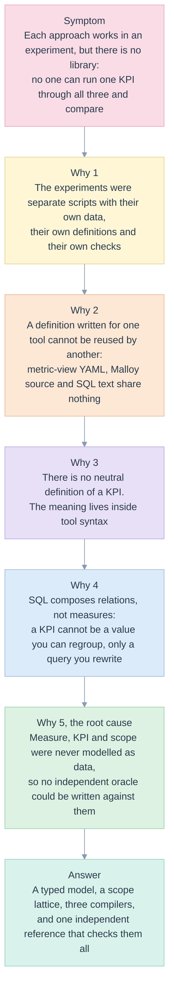

# 00. Five Whys and first principles

> The library exists because three promising approaches had each been shown to work once, and nobody could yet say they agree. A KPI that changes with the tool that computed it is the same failure as a total that changes with the layout.

Related: [README](README.md) · [kpi/00 Five Whys](../kpi/00-five-whys.md) · [kpi/05](../kpi/05-first-principles-solution.md) · next: [01 lenses](01-lenses.md), [02 requirements](02-requirements-and-traceability.md)

## The five whys

| Why | Evidence in the repository |
|---|---|
| 1. Separate experiments | [Malloy probe](../kpi/validation/2026-11-12-malloy/README.md), [native metric view and generated SQL](../kpi/validation/2026-11-12/README.md), [walkthrough examples](../../examples/walkthrough/README.md): three folders, three data sets, three sets of expected values |
| 2. Nothing reusable | [1-metric-view.sql](../../examples/walkthrough/1-metric-view.sql), [2-engagement.malloy](../../examples/walkthrough/2-engagement.malloy) and [3-definitions.yaml](../../examples/walkthrough/3-definitions.yaml) express the same three measures three ways |
| 3. No neutral definition | [kpi/05](../kpi/05-first-principles-solution.md) reaches the same conclusion for the architecture; here it becomes code: [model.py](../../edgekpi/model.py) |
| 4. SQL does not compose measures | [kpi/05, "Is the root cause that SQL is not composable?"](../kpi/05-first-principles-solution.md) |
| 5. Not modelled as data | `Measure`, `Kpi` and scope did not exist as types before [model.py](../../edgekpi/model.py) and [scopes.py](../../edgekpi/scopes.py); the independent reference is [oracle.py](../../edgekpi/oracle.py) |

## First principles

Each principle is a property the library must keep, followed by the module that keeps it and the test that would fail if it were broken.

| Id | Principle | Kept by | Fails in |
|---|---|---|---|
| FP-L-1 | A KPI is a function of the aggregate states of the **same group**. It is never an aggregate of KPIs | [expr.guard_division](../../edgekpi/expr.py), the outer `SELECT` of [sql.py](../../edgekpi/backends/sql.py), [reconcile.py](../../edgekpi/reconcile.py) C-RATE | `tests/test_engines_and_reconcile.py::test_a_rate_that_is_not_its_own_numerator_over_denominator_is_caught` |
| FP-L-2 | Scope is data. Rows and columns define a lattice of groupings, and a node is its scope plus its members | [scopes.py](../../edgekpi/scopes.py), [grid.py](../../edgekpi/grid.py) | `tests/test_requests.py::test_the_lattice_is_the_cross_product_of_two_rollups` |
| FP-L-3 | Definitions are data. SQL, YAML and Malloy are **outputs** rendered from validated trees; user text is never concatenated | [expr.py](../../edgekpi/expr.py), [model.py](../../edgekpi/model.py) | `tests/test_definitions.py::test_names_that_could_carry_sql_are_refused` |
| FP-L-4 | An independent reference exists. It is naive (one `GROUP BY` per node) and shares no grouping logic with the backends | [oracle.py](../../edgekpi/oracle.py) | `tests/test_e2e.py::test_backend_matches_the_independent_reference` |
| FP-L-5 | Fail closed. An unsupported construct, scope or engine is refused with a stable code, not approximated | [errors.py](../../edgekpi/errors.py), every `raise` | `tests/test_definitions.py::test_invalid_definitions_name_their_reason` |
| FP-L-6 | One rule, one place: guarded division, member canonicalisation, the lattice, the parameter cast | [03 DRY table](03-architecture-solid-dry.md#dry-one-rule-one-place) | the mutants of [11](11-test-strategy-and-e2e.md#mutation-check) |

### The algebra behind FP-L-1

For a group `g` with parts `g = g₁ ∪ … ∪ gₖ` (the children created by adding one dimension to the scope):

- **Additive measure** (count, sum): `m(g) = Σᵢ m(gᵢ)`. This is invariant C-PARTS.
- **Ratio** `r = n / d`: `r(g) = Σᵢ n(gᵢ) / Σᵢ d(gᵢ)`, which is **not** `(1/k) Σᵢ r(gᵢ)`. The two agree only when every `d(gᵢ)` is equal. The averaging error is the covariance form worked out in [kpi/16](../kpi/16-correctness-contract.md).
- **Distinct count** `u`: `max uᵢ ≤ u(g) ≤ Σ uᵢ`. Parts need not add up, because one client can sit in several parts. This is invariant C-BOUND.
- **Number of scopes** for `r` row and `c` column dimensions with totals: `(r + 1)(c + 1)`.

These statements are exactly what [reconcile.py](../../edgekpi/reconcile.py) checks on every grid it returns.

## What the library deliberately does not do

- It does not decide what a KPI **means**. Owners do, through the `status` field ([04](04-domain-model-and-definitions.md#kpi-status)). The library enforces the gate, not the definition.
- It does not claim to be faster than a hand-written query. Cost is analysed in [09](09-complexity-and-performance.md) and left to measurement on the owner's warehouse.
- It does not hide a backend difference. Every difference is listed in [05](05-the-three-backends.md#where-the-backends-differ).
