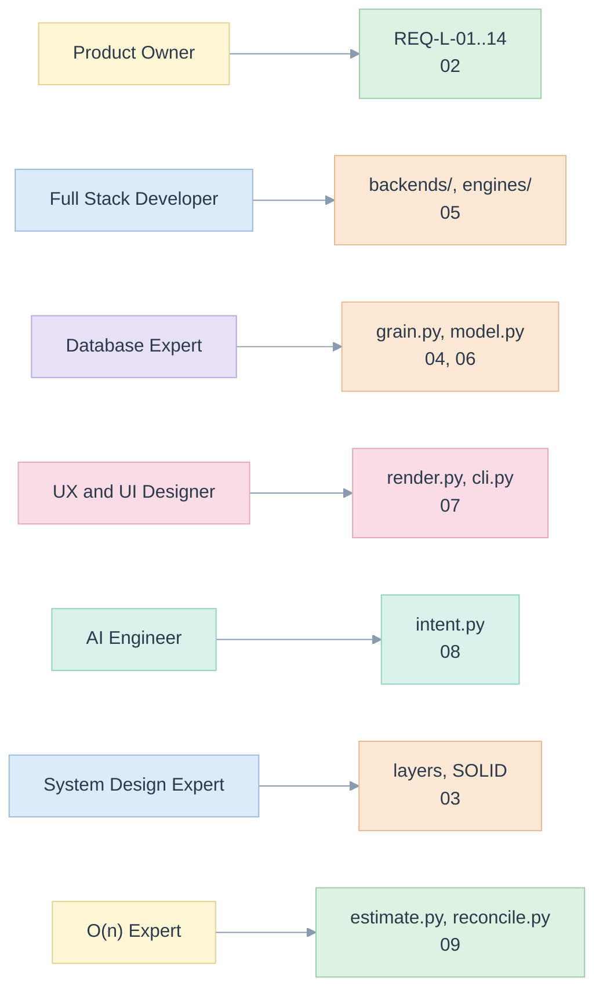

# 01. Seven lenses

> The same library read seven times. Each lens asks its own question of the code, and every finding points at a module, a test or an open item.

Related: [README](README.md) · [00 principles](00-five-whys-and-first-principles.md) · [02 requirements](02-requirements-and-traceability.md) · [10 edge cases](10-edge-cases-and-state-charts.md)

## 1. Product Owner

**Question.** Does it keep the one promise that matters: a number means the same thing wherever it is shown?

| Finding | Where | Decision |
|---|---|---|
| The promise is testable: three backends, one independent reference, nine request shapes, 45 comparisons, 0 differences | [13](13-verification-evidence.md), `tests/test_e2e.py` | Make the comparison the release gate (REQ-L-08) |
| Definitions need an owner and a status before they are published | `Kpi.status`, `ReportRequest.published` | `published=True` refuses anything not `confirmed` (EC-L-16) |
| The registry cannot all migrate; some KPIs are not expressible | [06](06-inference-and-migration.md) | Refuse with a reason and keep going; two of eight templates refused in the example |
| Real-world registries may hold template shapes the examples do not | [13 limits](13-verification-evidence.md#limits) | First acceptance task of [P2](12-implementation-plan.md#phases): run `edgekpi infer` on your own registry export |

**Success measure.** For every confirmed KPI, a published report returns values that match the independent reference at every node, with zero reconciliation violations.

## 2. Full Stack Developer

**Question.** Can a developer add a backend, a dimension or a KPI without touching the rest?

- A backend is a class with two methods, `compile(report)` and `assemble(plan, rows)` ([base.py](../../edgekpi/backends/base.py)). Adding one touches no other module.
- An engine is one method, `execute(statement)`. The three engines are 25 to 115 lines each ([engines/](../../edgekpi/engines/sql.py)).
- A KPI is a line of YAML: `delivery_rate: {formula: "ratio(n_delivered, n_sent)"}` ([model.yaml](../../examples/registry/model.yaml)).
- Errors carry a stable `code`, so a UI or an API can branch on them ([errors.py](../../edgekpi/errors.py)).
- Failure leaves a trail: `error.detail["states"]` shows the last lifecycle state reached ([10](10-edge-cases-and-state-charts.md#request-lifecycle)).

## 3. Database Expert

**Question.** Is the grain protected, and is every number reproducible from rows?

- **Grain.** A model declares `key`. [grain.py](../../edgekpi/grain.py) proves it is unique and that every join keeps one row per key, reading the data, and reports the counts it saw. It proves today's data only; the counts are kept for the audit trail.
- **Joins.** Only many-to-one `LEFT` joins exist. A to-many join is a definition error (`DEF_JOIN_CARDINALITY`).
- **NULL.** A NULL member and a rolled-up total are different nodes. The distinction is `GROUPING_ID`, never `IS NULL` ([scopes.py](../../edgekpi/scopes.py), EC-L-03).
- **Empty.** No input rows means no node, so there is no `0 / 0` grand total (EC-L-01).
- **Zero.** Every division is `n * 1.0 / NULLIF(d, 0)`, written in one function (EC-L-02).
- **Distinct counts** are never summed; the bound check catches it (EC-L-14).
- **Open.** Type-2 dimensions (as-of joins), multiple fact tables and row-level security are not modelled ([12 backlog](12-implementation-plan.md#not-built)).

## 4. UX and UI Designer

**Question.** Does the reader see what was asked, including what was left out?

- The reader sees a pivot with every total labelled, a missing node as blank and a zero denominator as `-` ([render.py](../../edgekpi/render.py)).
- A NULL member shows as `(none)`, distinct from `Total`.
- Errors are sentences with a code, not stack traces ([07](07-cli-and-ux.md#error-screen)).
- Wireframes for the CLI and for a future report builder, each marked implemented or proposed, are in [07](07-cli-and-ux.md).
- **Open.** No graphical interface exists. The long-form `Grid` ([grid.py](../../edgekpi/grid.py)) is the contract a UI would use, presentation pivoting being the UI's job.

## 5. AI Engineer

**Question.** Can an assistant propose a report without being trusted?

- The assistant sees a **catalogue** of ids and labels and a **JSON Schema** whose ids are enums ([intent.py](../../edgekpi/intent.py)).
- Its output is resolved: exact id, then label, then one close match; anything else becomes a question, never a guess (EC-L-28).
- A resolved proposal is validated like any request, so it cannot reach an unknown column.
- Free text never reaches SQL: only known ids and typed values do (EC-L-07).
- **Open.** No model is called by the library. Prompt design and evaluation sets are future work ([08](08-ai-and-integration.md)).

## 6. System Design Expert

**Question.** Are the boundaries where change happens?

- Dependencies point inward: engines and backends depend on the model and the request, never on each other ([03](03-architecture-solid-dry.md#layers)).
- The three approaches are interchangeable behind one interface, so a backend can be chosen per request or per deployment (Liskov: `tests/test_e2e.py` runs one test body over all five pairs).
- State is explicit: a result carries the lifecycle states it went through.
- Idempotence: a metric view's name carries the model fingerprint, so `CREATE OR REPLACE` is safe to repeat and an old report keeps its own definition.
- **Open.** Concurrency, caching and permissions belong to the host system; the library is stateless between calls.

## 7. O(n) Expert

**Question.** What grows with what?

| Quantity | Grows with | Cost |
|---|---|---|
| Statement size | scopes × measures, not rows | `O(s · m)` characters |
| Scopes `s` | `(r + 1)(c + 1)` | at most 25 with the cap of 8 dimensions |
| Warehouse work | rows × scopes in the worst case, one scan | measured, not assumed ([09](09-complexity-and-performance.md)) |
| Reconciliation | nodes × dimensions | linear, tested at 4,000 to 16,000 members |
| Oracle | `s` queries | a reference, never a production path |

Details, measured bounds and the distinct-count caveat are in [09](09-complexity-and-performance.md).

## How the lenses disagreed, and how it was settled

| Tension | Resolution |
|---|---|
| Product Owner wants every registry KPI migrated; Database Expert refuses fan-out joins | Refuse with a reason (EC-L-09). A KPI that cannot be proved is not migrated |
| UX wants friendly guesses; AI Engineer and Product Owner want none | Resolve only on a strong match (cutoff 0.8) and say so in `notes`; otherwise ask (EC-L-28) |
| Full Stack wants Malloy parameters; Malloy has none at this layer | Typed literals with an escaping renderer, validated first (EC-L-07), listed as a backend difference |
| O(n) wants one statement; the oracle needs many | The oracle is a test and verification tool only; production uses one statement |
