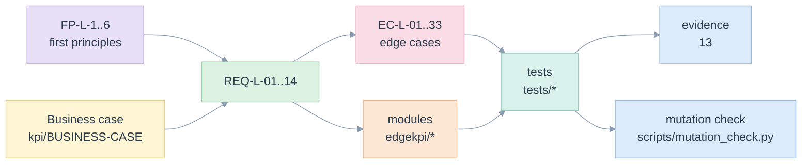

# 02. Requirements and traceability

> Fourteen requirements, each with the code that meets it, the tests that prove it and the edge cases it must survive. A requirement with no test is marked as such.

Related: [README](README.md) · [00 principles](00-five-whys-and-first-principles.md) · [10 edge cases](10-edge-cases-and-state-charts.md) · [11 tests](11-test-strategy-and-e2e.md) · [kpi/14 earlier traceability](../kpi/14-test-strategy-and-traceability.md)

## Requirements

Test references are `file::test`, relative to [/tests](../../tests). `tests/test_docs.py` fails if one does not exist.

| Id | Requirement | Code | Tests | Edge cases |
|---|---|---|---|---|
| REQ-L-01 | One definition model feeds all three backends | [model.py](../../edgekpi/model.py), [loader.py](../../edgekpi/loader.py), [backends/](../../edgekpi/backends/base.py) | `test_definitions.py::test_the_example_model_round_trips_through_yaml`, `test_e2e.py::test_backend_matches_the_independent_reference` | EC-L-27, EC-L-32 |
| REQ-L-02 | A definition is validated when built and fails closed with a stable code | [expr.py](../../edgekpi/expr.py), [model.py](../../edgekpi/model.py) | `test_definitions.py::test_invalid_definitions_name_their_reason`, `test_definitions.py::test_unsafe_or_unsupported_measures_are_refused_with_a_reason` | EC-L-05, EC-L-06, EC-L-10, EC-L-27 |
| REQ-L-03 | A request is validated before any backend sees it: known ids, typed parameters, version pin, published gate | [request.py](../../edgekpi/request.py) | `test_requests.py::test_invalid_requests_name_their_reason`, `test_requests.py::test_the_pinned_version_passes_and_unconfirmed_kpis_pass_when_not_published` | EC-L-04, EC-L-05, EC-L-08, EC-L-12, EC-L-16, EC-L-22, EC-L-29 |
| REQ-L-04 | Every requested scope is computed from the same measures, and a KPI is computed after aggregation | [scopes.py](../../edgekpi/scopes.py), [sql.py](../../edgekpi/backends/sql.py), [expr.py](../../edgekpi/expr.py) | `test_backend_text.py::test_the_grouping_sets_are_the_requested_lattice`, `test_requests.py::test_the_lattice_is_the_cross_product_of_two_rollups`, `test_requests.py::test_grouping_id_round_trips_and_follows_the_sql_bit_order` | EC-L-02, EC-L-03, EC-L-19, EC-L-26 |
| REQ-L-05 | Joins and keys keep the grain: one row per key | [grain.py](../../edgekpi/grain.py) | `test_engines_and_reconcile.py::test_a_fanout_join_is_refused_with_the_counts`, `test_engines_and_reconcile.py::test_a_non_unique_key_is_refused` | EC-L-09, EC-L-25 |
| REQ-L-06 | Parameters and optional filters are bound, never interpolated; filters apply at every scope | [sqlparts.py](../../edgekpi/backends/sqlparts.py), [request.py](../../edgekpi/request.py) | `test_backend_text.py::test_parameters_stay_bound_and_never_enter_the_sql_text`, `test_backend_text.py::test_where_values_are_bound_not_inlined`, `test_e2e.py::test_matrix_reaches_the_edge_cases_it_claims` | EC-L-07, EC-L-08, EC-L-17, EC-L-21 |
| REQ-L-07 | Every returned grid satisfies the arithmetic invariants, and a violation names the node | [reconcile.py](../../edgekpi/reconcile.py) | `test_engines_and_reconcile.py::test_a_wrong_part_is_caught_and_the_node_is_named`, `test_engines_and_reconcile.py::test_a_distinct_count_that_is_summed_is_caught_by_its_bound`, `test_engines_and_reconcile.py::test_run_can_raise_flag_or_skip_the_check` | EC-L-14, EC-L-15 |
| REQ-L-08 | An independent reference checks every backend; failures are reported per backend | [oracle.py](../../edgekpi/oracle.py), [conformance.py](../../edgekpi/conformance.py) | `test_e2e.py::test_backend_matches_the_independent_reference` (45 combinations with Databricks) | EC-L-01, EC-L-30 |
| REQ-L-09 | Measures and formulas are inferred from legacy templates, with refusals and a parity proof | [inference.py](../../edgekpi/inference.py), [parity.py](../../edgekpi/parity.py) | `test_inference_and_intent.py::test_six_kpis_become_five_measures_and_two_are_refused_with_reasons`, `test_inference_and_intent.py::test_parity_with_the_legacy_templates_on_every_value` | EC-L-09, EC-L-18, EC-L-33 |
| REQ-L-10 | Executable on DuckDB, a Malloy runtime and a Databricks SQL warehouse | [engines/sql.py](../../edgekpi/engines/sql.py), [engines/malloy.py](../../edgekpi/engines/malloy.py) | `test_e2e.py` (markers `malloy`, `databricks`), `test_inference_and_intent.py::test_the_migration_keeps_every_legacy_value_on_a_databricks_warehouse` | EC-L-11, EC-L-13 |
| REQ-L-11 | A reader sees a labelled pivot, and a command line drives the library | [render.py](../../edgekpi/render.py), [cli.py](../../edgekpi/cli.py) | `test_cli_and_scaling.py::test_run_prints_a_pivot_with_every_total_and_the_reconciliation`, `test_cli_and_scaling.py::test_a_library_error_is_printed_with_its_code_and_exits_one` | EC-L-03 |
| REQ-L-12 | An assistant can propose a report without being trusted | [intent.py](../../edgekpi/intent.py) | `test_inference_and_intent.py::test_ambiguity_becomes_a_question_not_a_guess`, `test_inference_and_intent.py::test_an_instruction_inside_a_proposal_is_data_not_a_command` | EC-L-28 |
| REQ-L-13 | Cost is predictable: statement size follows scopes, reconciliation is linear | [estimate.py](../../edgekpi/estimate.py), [reconcile.py](../../edgekpi/reconcile.py) | `test_cli_and_scaling.py::test_reconciliation_time_grows_linearly_with_the_nodes`, `test_cli_and_scaling.py::test_compilation_cost_is_independent_of_data_and_grows_with_scopes_not_rows` | EC-L-12 |
| REQ-L-14 | A failed step leaves no partial grid and names the state reached | [runner.py](../../edgekpi/runner.py) | `test_engines_and_reconcile.py::test_an_engine_failure_returns_no_partial_grid`, `test_engines_and_reconcile.py::test_a_failure_after_the_ddl_still_fails_the_whole_plan` | EC-L-13, EC-L-24 |

## Traceability in both directions

- **Requirement to proof**: the table above.
- **Edge case to proof**: the [register in 10](10-edge-cases-and-state-charts.md#register) gives the test for each `EC-L` identifier.
- **Test to requirement**: each test docstring or comment carries the `EC-L` identifiers it covers; the file headers list them.

## Which business-case scenarios the requirements serve

| Business-case scenario ([BUSINESS-CASE](../kpi/BUSINESS-CASE.md)) | Requirements | What the library demonstrates |
|---|---|---|
| Totals that stay right when the layout changes | REQ-L-04, REQ-L-07 | the `two-row-levels` and `pivot-with-params-and-where` requests, all totals reconciled |
| Rates averaged instead of recomputed | REQ-L-04, REQ-L-07 | C-RATE catches `0.5` written into a total |
| Unique clients cannot be added | REQ-L-07 | Reach: `HK 4, JP 0, SG 1` and a total of `4`, not `5` ([07](07-cli-and-ux.md#run-screen)) |
| Filters and date parameters on every KPI | REQ-L-06 | optional `start_date` and `end_date`, `where` on a dimension that is not on an axis |
| Migrating the registry | REQ-L-09 | 6 of 8 templates migrated and proved on every value; 2 refused with reasons |

## Not yet traced to a test

| Item | Status |
|---|---|
| A production registry | Not available; only the example templates of [06](06-inference-and-migration.md) are tested |
| Production volumes and cost | Not measured; [09](09-complexity-and-performance.md) gives the model and the bounds |
| Row-level permissions | Not modelled; the host's identity is used by the warehouse engine |
