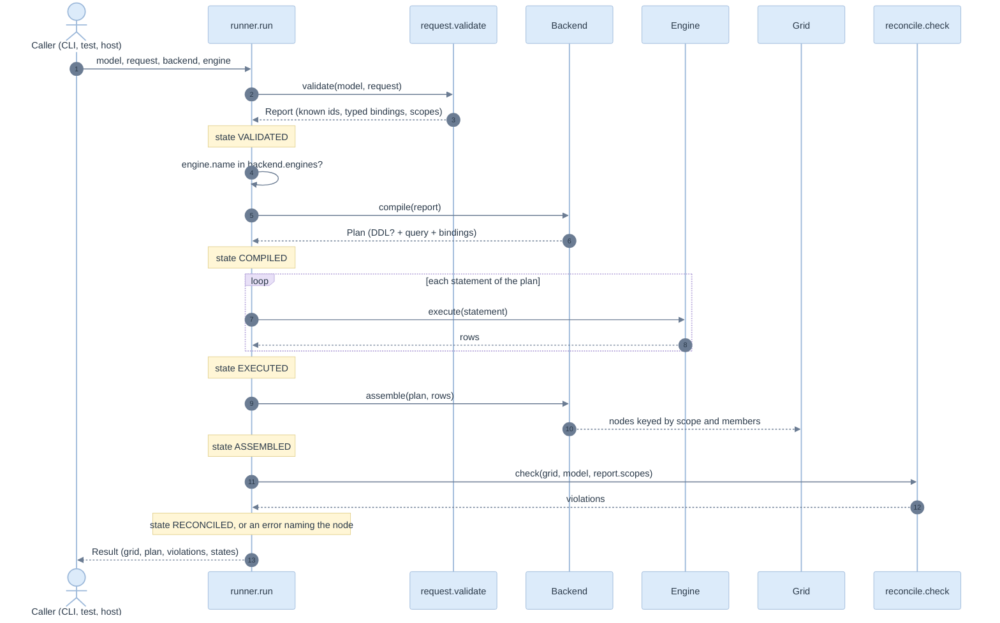

# 03. Architecture, SOLID and DRY

> Four layers, dependencies pointing inward, one interface per extension point. Every business rule is written once.

Related: [README](README.md) · [00 FP-L-6](00-five-whys-and-first-principles.md#first-principles) · [04 domain model](04-domain-model-and-definitions.md) · [05 backends](05-the-three-backends.md) · [kpi/07 planner](../kpi/07-planner-and-sql-generation.md)

## Layers

```mermaid
%%{init: {'theme':'base','themeVariables':{'primaryColor':'#DCEBFA','primaryBorderColor':'#9DB9DA','primaryTextColor':'#2B3A4A','lineColor':'#8A9BB0','fontFamily':'Inter, sans-serif'}}}%%
flowchart TB
  subgraph L4["Interfaces"]
    CLI["cli.py"]:::pink
    INT["intent.py<br/>assistant"]:::pink
    REN["render.py<br/>pivot text"]:::pink
  end
  subgraph L3["Use cases"]
    RUN["runner.py<br/>run()"]:::green
    CON["conformance.py"]:::green
    INF["inference.py<br/>parity.py"]:::green
    GRN["grain.py"]:::green
  end
  subgraph L2["Adapters"]
    BSQL["backends/sql.py"]:::peach
    BMV["backends/metric_view.py"]:::peach
    BML["backends/malloy.py"]:::peach
    ESQL["engines/sql.py<br/>DuckDB, Databricks"]:::yellow
    EML["engines/malloy.py<br/>+ run.js"]:::yellow
  end
  subgraph L1["Core, no I/O"]
    MOD["model.py"]:::blue
    EXP["expr.py"]:::blue
    REQ["request.py"]:::blue
    SCO["scopes.py"]:::blue
    GRD["grid.py"]:::blue
    REC["reconcile.py"]:::blue
    ORA["oracle.py"]:::blue
    ERR["errors.py"]:::lav
  end
  L4 --> L3 --> L2 --> L1
  L3 --> L1
  classDef blue fill:#DCEBFA,stroke:#9DB9DA,color:#2B3A4A
  classDef lav fill:#E8E0F7,stroke:#B9A9DC,color:#2B3A4A
  classDef green fill:#DDF2E3,stroke:#9CCDAA,color:#2B3A4A
  classDef peach fill:#FDE7D5,stroke:#E5B995,color:#2B3A4A
  classDef pink fill:#FADCE6,stroke:#E3A9BF,color:#2B3A4A
  classDef yellow fill:#FFF6D6,stroke:#E3D18F,color:#2B3A4A
  style L1 fill:#F5F9FE,stroke:#C7D9EE
  style L2 fill:#FFF8F1,stroke:#F0D5BC
  style L3 fill:#F4FBF6,stroke:#C5E4CD
  style L4 fill:#FEF6F9,stroke:#F1CFDB
```

**Dependency rule.** A module imports only from its own layer or below. The core imports nothing from adapters or interfaces. One deliberate exception: [oracle.py](../../edgekpi/oracle.py) reads the rendering of dimensions, joins and filters from [sqlparts.py](../../edgekpi/backends/sqlparts.py), so the reference and the backends read the model the same way. That is the one thing they share ([11](11-test-strategy-and-e2e.md#what-the-reference-shares)).

## Modules

| Module | Responsibility (one) | Lines |
|---|---|---|
| [errors.py](../../edgekpi/errors.py) | the named failures | 34 |
| [expr.py](../../edgekpi/expr.py) | parse, whitelist and rewrite expressions | 159 |
| [model.py](../../edgekpi/model.py) | typed definitions and their validation | 220 |
| [loader.py](../../edgekpi/loader.py) | YAML to model and back | 115 |
| [request.py](../../edgekpi/request.py) | validate a request into a `Report` | 184 |
| [scopes.py](../../edgekpi/scopes.py) | the lattice and `GROUPING_ID` | 33 |
| [grid.py](../../edgekpi/grid.py) | nodes, long result, member canonicalisation | 64 |
| [reconcile.py](../../edgekpi/reconcile.py) | the arithmetic invariants | 80 |
| [oracle.py](../../edgekpi/oracle.py) | the independent reference and the comparison | 62 |
| [backends/base.py](../../edgekpi/backends/base.py) | `Backend`, `Engine`, `Statement`, `Plan` | 70 |
| [backends/sqlparts.py](../../edgekpi/backends/sqlparts.py) | joins, filters, sets shared by the SQL-shaped backends | 69 |
| [backends/sql.py](../../edgekpi/backends/sql.py) | approach 3: generated SQL | 43 |
| [backends/metric_view.py](../../edgekpi/backends/metric_view.py) | approach 1: Databricks metric view | 85 |
| [backends/malloy.py](../../edgekpi/backends/malloy.py) | approach 2: Malloy | 213 |
| [engines/sql.py](../../edgekpi/engines/sql.py) | DuckDB and Databricks execution | 115 |
| [engines/malloy.py](../../edgekpi/engines/malloy.py) | Malloy execution through node | 46 |
| [runner.py](../../edgekpi/runner.py) | the lifecycle of one run | 62 |
| [conformance.py](../../edgekpi/conformance.py) | one request through several backends | 45 |
| [grain.py](../../edgekpi/grain.py) | key and join checks | 33 |
| [inference.py](../../edgekpi/inference.py) | templates to model | 258 |
| [parity.py](../../edgekpi/parity.py) | legacy versus migrated, value by value | 75 |
| [intent.py](../../edgekpi/intent.py) | catalogue, schema, resolver for an assistant | 86 |
| [render.py](../../edgekpi/render.py), [estimate.py](../../edgekpi/estimate.py), [cli.py](../../edgekpi/cli.py) | presentation, cost arithmetic, commands | 61, 25, 166 |

## SOLID, with the code that shows it

| Principle | How it is applied | Evidence |
|---|---|---|
| **S**ingle responsibility | Each module has one reason to change. Parsing rules change [expr.py](../../edgekpi/expr.py); the Malloy syntax changes [malloy.py](../../edgekpi/backends/malloy.py); neither touches [reconcile.py](../../edgekpi/reconcile.py) | module table above |
| **O**pen/closed | A fourth backend is a new class with `compile` and `assemble`; nothing else changes. A new engine is a new class with `execute` | [base.py](../../edgekpi/backends/base.py); `ScriptedEngine` in [test_engines_and_reconcile.py](../../tests/test_engines_and_reconcile.py) is an engine written without touching the library |
| **L**iskov substitution | Any backend can replace any other where the engine allows. One test body runs over five backend/engine pairs and asserts the same grid | `test_e2e.py::test_backend_matches_the_independent_reference` |
| **I**nterface segregation | `Backend` has two methods; `Engine` has one. A backend never sees an engine, and an engine never sees a model | [base.py](../../edgekpi/backends/base.py) |
| **D**ependency inversion | [runner.py](../../edgekpi/runner.py) depends on the `Backend` and `Engine` protocols. The concrete classes are chosen by the caller (the CLI, a test, a host system) | `run(model, request, backend, engine)` |

## DRY: one rule, one place

| Rule | The single home | Used by | If it were duplicated |
|---|---|---|---|
| Guard every division: `n * 1.0 / NULLIF(d, 0)` | `expr.guard_division` | [sql.py](../../edgekpi/backends/sql.py), [metric_view.py](../../edgekpi/backends/metric_view.py). Malloy's `_Translator.formula` is the one sanctioned second spelling, because Malloy syntax differs; `test_backend_text.py::test_every_division_is_guarded_in_every_backend` pins all three | a backend would forget the guard (Malloy returns NaN) |
| The lattice of scopes | `scopes.lattice` | request, every backend, oracle, reconcile | the oracle and a backend could disagree on which nodes exist |
| `GROUPING_ID` bit order | `scopes.gid`, `scopes.scope_of` | SQL-shaped backends, assembly | members attached to the wrong scope |
| Member and value canonical form | `grid.canon` | `Grid.add`, `Grid.get`, parity | a date from one engine never meets the same date from another |
| Dimension, join and filter rendering | `backends/sqlparts.py` | both SQL-shaped backends, oracle | the filter applied at detail but not at totals |
| Parameter typing and cast | `request._coerce`, `sqlparts._typed` | request, SQL, metric view | a date accepted by one path and refused by another |
| One data script for every engine | `engines/sql.split_script` | DuckDB, Databricks, Malloy engines | the engines would test different data |
| Expression whitelist | `expr._ROW`, `_AGG`, `_FORMULA` | model validation, inference | a construct allowed in a KPI but not in a measure |
| The request matrix | `tests/conftest.REQUESTS` | e2e, evidence script | the proof and the evidence would drift |

A counting test for DRY (for instance counting `NULLIF` literals) is not used: it measures spelling, not duplication. The mutation check ([11](11-test-strategy-and-e2e.md#mutation-check)) is the DRY test: removing a rule from its single home must fail the suite.

## One run, step by step

Any `KpiError` raised on the way is re-raised with `detail["states"]` ending in `FAILED`; any other exception is wrapped as `ENGINE_FAILED` the same way ([10](10-edge-cases-and-state-charts.md#request-lifecycle)).

## Decisions made here

| Id | Decision | Why |
|---|---|---|
| ADR-L-01 | Author definitions once in the Databricks dialect and transpile for DuckDB with sqlglot | one dialect to review; the cost is that a construct sqlglot cannot transpile fails at run time, which the e2e matrix exercises |
| ADR-L-02 | Expressions are whitelisted trees, not strings | FP-L-3 and FP-L-5 |
| ADR-L-03 | The result is long-form, keyed by scope and members; pivoting is presentation | a NULL member and a total can never collide |
| ADR-L-04 | Engines are separate from backends | the Malloy backend runs on a node runtime and the metric view on a warehouse; the pair is a runtime choice |

The complete register, with status, is in [12](12-implementation-plan.md#decisions).
