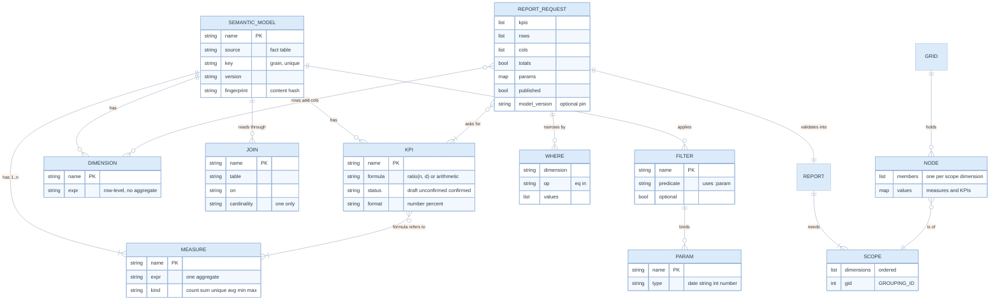
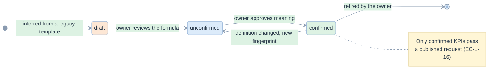

# 04. Domain model and definitions

> Five definition types, one request, one result. What a definition may say, what a request may ask, what comes back.

Related: [README](README.md) · [03 architecture](03-architecture-solid-dry.md) · [05 backends](05-the-three-backends.md) · [06 inference](06-inference-and-migration.md) · [kpi/06 semantic model](../kpi/06-semantic-model-and-dsl.md) · [kpi/09 data model](../kpi/09-data-model-and-databricks.md)

## Entities



Code: [model.py](../../edgekpi/model.py) (definitions), [request.py](../../edgekpi/request.py) (`ReportRequest`, `Report`), [scopes.py](../../edgekpi/scopes.py) (scopes), [grid.py](../../edgekpi/grid.py) (`Grid`, `Node`).

## The definition file

[examples/registry/model.yaml](../../examples/registry/model.yaml) is the model every test uses. Its shape:

```yaml
name: engagement
version: "1"
source: message              # one row per message sent
key: message_id              # the grain; joins must keep exactly one row per key
joins:
  client: {table: client, on: client_id = client.client_id}   # bare = fact column
dimensions:
  typology: client.typology
  market: market
  send_year: YEAR(send_date)
measures:
  n_sent: COUNT(*)
  n_delivered: COUNT(*) FILTER (WHERE is_delivered)
  n_reached: COUNT(DISTINCT client_id) FILTER (WHERE is_delivered)
kpis:
  delivery_rate: {formula: "ratio(n_delivered, n_sent)", status: confirmed, format: percent}
filters:
  from_date: {predicate: "CAST(send_date AS DATE) >= :start_date", params: {start_date: date}, optional: true}
```

| Rule | Why | Code |
|---|---|---|
| Bare column names are fact columns; joined columns are `<join>.<column>` | a model reads the same in every backend | `sqlparts.qualify` |
| A measure is **one** aggregate, optionally with `FILTER` | a ratio belongs to a KPI, so it is computed after aggregation | `expr.measure_expression` |
| A KPI formula is arithmetic over measure names; `ratio(n, d)` is the guarded division | FP-L-1 | `expr.formula` |
| Measure `kind` is read from the aggregate, never declared | it cannot disagree with the expression | `Measure.kind` |
| Dimensions, measures and KPIs share one namespace | they become columns of one result | `DEF_DUPLICATE_NAME` |
| `source`, `gid`, `edgekpi_rows` are reserved | they name the fact alias, the node identity and the row count | `DEF_RESERVED_NAME` |
| Unknown YAML fields are errors | a typo must not silently drop a rule | `DEF_UNKNOWN_FIELD` |
| `on:` is read as a string | YAML 1.1 would turn it into `True` | `loader._Loader` (EC-L-32) |

### Measure kinds and what they allow

| Kind | Example | Additive | Reconciliation applied |
|---|---|---|---|
| `count` | `COUNT(*)`, `COUNT_IF(p)`, `COUNT(*) FILTER (WHERE p)` | yes | C-PARTS |
| `sum` | `SUM(amount)` | yes | C-PARTS |
| `unique` | `COUNT(DISTINCT client_id)` | no | C-BOUND |
| `avg`, `min`, `max` | `AVG(x)` | no | none (their parts do not combine by addition) |

### Definition errors

Every error is a `DefinitionError` with one of these codes. Each is tested in [test_definitions.py](../../tests/test_definitions.py).

| Code | Raised when |
|---|---|
| `DEF_SYNTAX`, `DEF_EMPTY_EXPRESSION`, `DEF_YAML`, `DEF_BAD_SHAPE` | the text cannot be parsed |
| `DEF_UNSUPPORTED_CONSTRUCT` | a node outside the whitelist: subquery, window, unknown function |
| `DEF_NOT_AN_AGGREGATE`, `DEF_NESTED_AGGREGATE` | a measure is not exactly one aggregate |
| `DEF_UNKNOWN_MEASURE`, `DEF_QUALIFIED_REFERENCE`, `DEF_BAD_RATIO` | a formula refers to something that is not a measure, or misuses `ratio` |
| `DEF_BAD_IDENTIFIER`, `DEF_DUPLICATE_NAME`, `DEF_RESERVED_NAME` | a name is unsafe or collides |
| `DEF_UNKNOWN_QUALIFIER`, `DEF_JOIN_CARDINALITY` | an expression names a join that does not exist, or a join is not many-to-one |
| `DEF_BAD_STATUS`, `DEF_BAD_PARAM_TYPE`, `DEF_PARAM_MISMATCH` | status, parameter type or placeholders are wrong |
| `DEF_UNKNOWN_FIELD`, `DEF_MISSING_FIELD`, `DEF_NO_MEASURES` | the file shape is wrong |

## The request

```json
{
  "kpis": ["sent", "delivery_rate", "reached"],
  "rows": ["typology"], "cols": ["market"],
  "totals": {"rows": true, "cols": true},
  "params": {"start_date": "2026-01-01"},
  "where": [{"dim": "market", "in": ["HK", "SG"]}],
  "model_version": "d1480738f4b1",
  "published": false
}
```

Validation ([request.validate](../../edgekpi/request.py)) turns it into a `Report`: the dimensions, the **lattice of scopes**, the KPI objects, the measures behind them (each once), the filters with their bindings and whether an optional filter is skipped, and the `where` clauses with typed bindings. The `Report` is the only thing a backend reads.

| Code | Raised when |
|---|---|
| `REQ_UNKNOWN_FIELD`, `REQ_BAD_WHERE` | the request has a field or a `where` shape the library does not know |
| `REQ_NO_KPIS`, `REQ_DUPLICATE_KPI`, `REQ_UNKNOWN_KPI` | KPIs are missing, repeated or unknown (a measure is not a KPI) |
| `REQ_UNKNOWN_DIMENSION`, `REQ_DUPLICATE_DIMENSION`, `REQ_TOO_MANY_DIMENSIONS` | dimensions are unknown, repeated or more than 8 |
| `REQ_UNKNOWN_PARAM`, `REQ_MISSING_PARAM`, `REQ_PARTIAL_PARAMS`, `REQ_BAD_PARAM` | a parameter is undeclared, missing, half-set or not of its type |
| `REQ_NULL_IN_FILTER` | `where` contains NULL, which never matches `=` or `IN` |
| `REQ_VERSION_MISMATCH` | the pinned fingerprint is not the model's |
| `REQ_UNCONFIRMED_KPI` | `published` is true and a KPI is not `confirmed` |

### KPI status



The transitions are a governance process. The library enforces only the gate at the end (`REQ_UNCONFIRMED_KPI`); it does not record who approved what. Keeping that record is a host responsibility ([12 backlog](12-implementation-plan.md#not-built)).

## The result

A `Grid` ([grid.py](../../edgekpi/grid.py)) is a set of nodes. A node is `(scope, members)`:

- the **scope** is the tuple of dimensions it is grouped by, so a rolled-up dimension is *absent*;
- a **NULL member** is *present* with value `None`.

That difference is why the unknown-client group `(none)` and the `Total` row of the example never collide ([07](07-cli-and-ux.md#run-screen), EC-L-03). `Grid.long_rows()` gives one dictionary per node for a UI or an export; pivoting is presentation ([render.py](../../edgekpi/render.py)).
