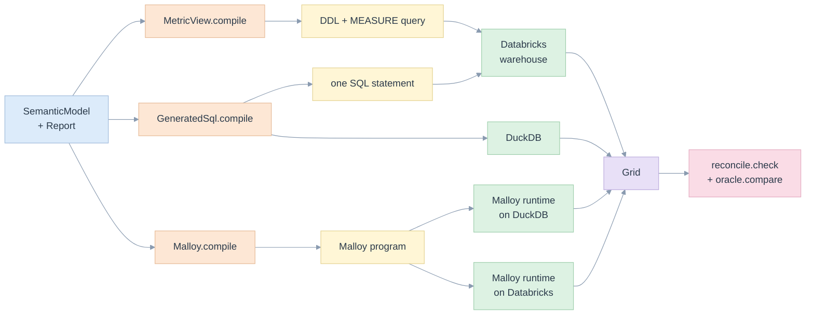
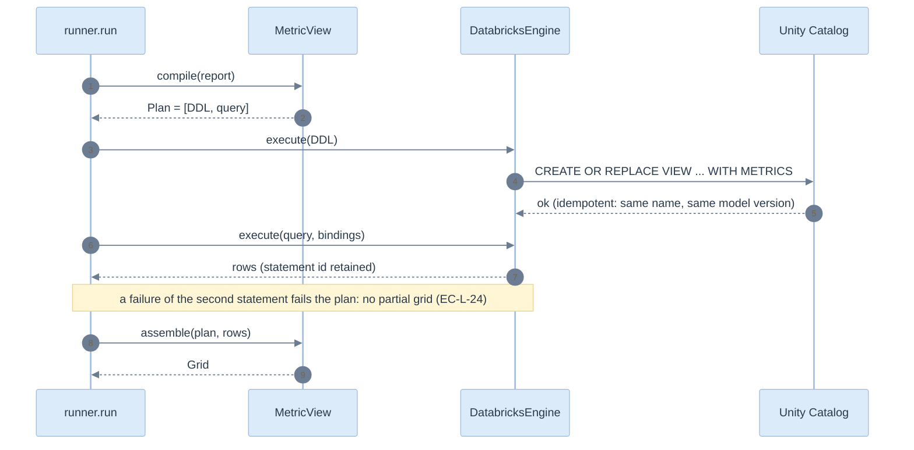
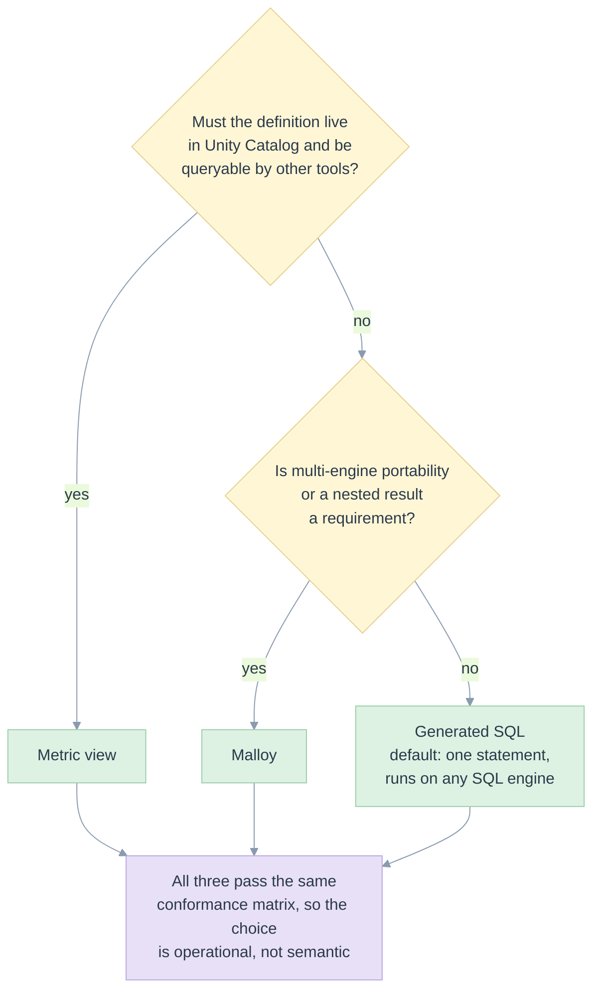

# 05. The three backends

> One `Report` in, three different statements out, the same grid back. This page shows what each backend writes, how it runs, and the places where the three genuinely differ.

Related: [README](README.md) · [03 architecture](03-architecture-solid-dry.md) · [04 domain model](04-domain-model-and-definitions.md) · [11 e2e](11-test-strategy-and-e2e.md) · [kpi/05 options A to F](../kpi/05-first-principles-solution.md) · [walkthrough examples](../../examples/walkthrough/README.md)

All statements below are the real output of `python -m edgekpi compile examples/registry/model.yaml examples/registry/request-small.json --backend <name>` for [request-small.json](../../examples/registry/request-small.json): three KPIs, `typology` down, `market` across, with totals and `start_date = 2026-01-01`.

## At a glance

| | Approach 1: metric view | Approach 2: Malloy | Approach 3: generated SQL |
|---|---|---|---|
| Class | [MetricView](../../edgekpi/backends/metric_view.py) | [Malloy](../../edgekpi/backends/malloy.py) | [GeneratedSql](../../edgekpi/backends/sql.py) |
| Where the definition lives | a Unity Catalog object, defined once per model version | a Malloy source, written per run | nowhere: the statement is the plan |
| Statements | 2: `CREATE OR REPLACE VIEW`, then a `MEASURE()` query | 1 Malloy program: source plus a query with one `nest` per scope | 1 SQL statement |
| Totals | `GROUPING SETS` over the view | one `nest` per grouping, the grand total is the top row | `GROUPING SETS`, one scan |
| KPI evaluation | inside the view, `MEASURE(x) * 1.0 / NULLIF(MEASURE(y), 0)` | inside the source, `x / nullif(y, 0)` | outer `SELECT` over the aggregated CTE |
| Runs on | Databricks SQL warehouse | Malloy runtime (via node) on DuckDB **and** on a Databricks SQL warehouse | DuckDB, Databricks SQL warehouse |
| Parameters | bound markers, filters read hidden dimensions | typed literals with an escaping renderer | bound markers |
| Verified here | on the warehouse, 9 of 9 requests | on DuckDB and on the warehouse, 9 of 9 each | on DuckDB and on the warehouse, 9 of 9 each |



## Approach 3: generated SQL

```sql
WITH agg AS (
  SELECT client.typology AS typology,
    source.market AS market,
    GROUPING_ID(client.typology, source.market) AS gid,
    COUNT(*) AS edgekpi_rows,
    COUNT(*) AS n_sent,
    COUNT(*) FILTER(WHERE source.is_delivered) AS n_delivered,
    COUNT(DISTINCT source.client_id) FILTER(WHERE source.is_delivered) AS n_reached
  FROM message AS source
  LEFT JOIN client AS client ON source.client_id = client.client_id
  WHERE (CAST(:start_date AS DATE) IS NULL OR CAST(source.send_date AS DATE) >= CAST(:start_date AS DATE))
    AND (CAST(:end_date AS DATE) IS NULL OR CAST(source.send_date AS DATE) < CAST(:end_date AS DATE))
  GROUP BY GROUPING SETS ((client.typology, source.market), (client.typology), (source.market), ())
  HAVING COUNT(*) > 0
)
SELECT typology, market, gid, edgekpi_rows, n_sent, n_delivered, n_reached,
       n_sent AS sent, n_delivered * 1.0 / NULLIF(n_sent, 0) AS delivery_rate, n_reached AS reached
FROM agg
```

How to read it:

- **Inner query**: one scan, four grouping sets (the lattice of [scopes.py](../../edgekpi/scopes.py)). Each distinct measure appears once even if several KPIs use it (EC-L-20).
- **`GROUPING_ID`** tells which dimensions were rolled up, so NULL members and totals cannot be confused (EC-L-03).
- **`HAVING COUNT(*) > 0`** removes the grand total of an empty input (EC-L-01).
- **Outer query**: KPIs are computed after aggregation, from the measures of the same row (FP-L-1). The division is guarded by `expr.guard_division`.
- **`:start_date`** is a bound marker. A `NULL` binding skips the filter (EC-L-08). The statement text is identical for every binding.
- The same text runs on Databricks as written, and on DuckDB after `sqlglot` transpilation ([engines/sql.py](../../edgekpi/engines/sql.py)).

## Approach 1: Databricks metric view

Definition, executed once per model version. The view name carries the model fingerprint, so a published report keeps the definition it was approved with:

```sql
CREATE OR REPLACE VIEW workspace.edgekpi_lib.edgekpi_engagement_d1480738f4b1
WITH METRICS LANGUAGE YAML AS $$
version: 1.1
source: message
joins:
- name: client
  source: client
  'on': source.client_id = client.client_id
dimensions:
- name: typology
  expr: client.typology
- name: market
  expr: market
- name: edgekpi_col_source_send_date      # hidden: a metric-view query can filter on dimensions only
  expr: send_date
measures:
- name: edgekpi_rows
  expr: COUNT(*)
- name: n_sent
  expr: COUNT(*)
- name: n_delivered
  expr: COUNT(*) FILTER(WHERE is_delivered)
- name: delivery_rate
  expr: MEASURE(n_delivered) * 1.0 / NULLIF(MEASURE(n_sent), 0)
# ... every dimension, measure and KPI of the model
$$
```

Query, per report:

```sql
SELECT typology, market, GROUPING_ID(typology, market) AS gid, MEASURE(edgekpi_rows) AS edgekpi_rows,
       MEASURE(n_sent) AS n_sent, MEASURE(n_delivered) AS n_delivered, MEASURE(n_reached) AS n_reached,
       MEASURE(sent) AS sent, MEASURE(delivery_rate) AS delivery_rate, MEASURE(reached) AS reached
FROM workspace.edgekpi_lib.edgekpi_engagement_d1480738f4b1
WHERE (CAST(:start_date AS DATE) IS NULL OR CAST(edgekpi_col_source_send_date AS DATE) >= CAST(:start_date AS DATE))
  AND (CAST(:end_date AS DATE) IS NULL OR CAST(edgekpi_col_source_send_date AS DATE) < CAST(:end_date AS DATE))
GROUP BY GROUPING SETS ((typology, market), (typology), (market), ())
```

- The **model is complete in the view**: all dimensions, measures and KPIs, so any report can query it.
- **Filters read dimensions.** A filter on `send_date` needs a dimension for `send_date`; the backend adds a hidden one (`edgekpi_col_<table>_<column>`) for each raw column a filter reads, unless a dimension already is exactly that column ([metric_view.py](../../edgekpi/backends/metric_view.py)).
- There is no `HAVING`. The hidden `edgekpi_rows` measure lets assembly drop an empty node ([base.assemble_flat](../../edgekpi/backends/base.py)).
- It runs **only** on Databricks; asking DuckDB for it is refused before anything executes (EC-L-11).



## Approach 2: Malloy

```malloy
source: engagement is duckdb.table('message') extend {
  join_one: client is duckdb.table('client') on client_id = client.client_id
  measure:
    edgekpi_rows is count()
    n_sent is count()
    n_delivered is count() { where: is_delivered }
    n_reached is count(client_id) { where: is_delivered }
    sent is n_sent
    delivery_rate is n_delivered / nullif(n_sent, 0)
    # ... every measure and KPI of the model
}

run: engagement -> {
  where: cast(send_date as date) >= @2026-01-01
  aggregate: edgekpi_rows, n_sent, n_delivered, n_reached, sent, delivery_rate, reached
  nest: s0 is {
    group_by: typology is client.typology, market
    aggregate: edgekpi_rows, n_sent, n_delivered, n_reached, sent, delivery_rate, reached
  }
  nest: s1 is { group_by: typology is client.typology  aggregate: ... }
  nest: s2 is { group_by: market  aggregate: ... }
}
```

- The **top-level aggregate is the grand total**; each `nest` is one other scope, named `s<k>`; assembly maps the nest back to its scope ([malloy.py](../../edgekpi/backends/malloy.py)).
- **`count(client_id)` is a distinct count** in Malloy, while SQL `COUNT(x)` counts non-null values. The translator writes each correctly (EC-L-31).
- **The optional `end_date` filter is absent**: with no value, it is removed when compiling, since Malloy has no bound parameters here. With a value it becomes a typed literal such as `@2026-01-01`.
- **Division is guarded with `nullif`**: Malloy returns `NaN` for an unguarded `x / 0`, observed in the [Malloy probe](../kpi/validation/2026-11-12-malloy/README.md) (EC-L-23).
- The runtime is the Node package in [backends/malloy_runtime](../../edgekpi/backends/malloy_runtime/package.json) (`@malloydata/malloy` 0.0.437). [engines/malloy.py](../../edgekpi/engines/malloy.py) feeds it the same data script as the other engines.

### Malloy on Databricks

The same Malloy text runs on a warehouse through Malloy's own connection, `@malloydata/db-databricks` 0.0.437 (`MalloyDatabricksEngine`):

- Tables are qualified for the warehouse: `Malloy(connection="databricks", table_prefix="workspace.edgekpi_lib.")` writes `databricks.table('workspace.edgekpi_lib.message')`.
- The connection uses the warehouse's HTTP path and the access token of the Databricks SDK session. The token reaches Node **only through the environment of the child process**, never through stdin or the command line (`test_backend_text.py::test_the_warehouse_token_reaches_node_through_the_environment_only`).
- Malloy writes its own Databricks SQL. For the pivot request it produces one scan with a `group_set` column and conditional aggregates such as `CASE WHEN group_set=0 THEN COUNT(1) END`, and keeps the `NULLIF` guard on each division. That SQL is Malloy's, not the library's; the library only checks the numbers that come back.
- The statements Malloy runs on the warehouse go through its own connection, so they are not in the library's list of statement ids ([13](13-verification-evidence.md)).

## Where the backends differ

| Topic | Generated SQL | Metric view | Malloy |
|---|---|---|---|
| Unsupported constructs | refused by the model whitelist | refused by the model whitelist | additionally refused when it has no Malloy form: `MALLOY_UNSUPPORTED`, naming the construct (e.g. `CASE x WHEN ...`) |
| Boolean predicate | native SQL | native SQL | translated by `_Translator`; `AND`, `OR`, `NOT`, `IN`, `BETWEEN`, `CASE` are tested (`test_backend_text.py::test_the_malloy_translator_keeps_the_meaning_of_boolean_logic`) |
| Literal values | bound | bound | escaped literals: quotes, backslashes, newlines (EC-L-07) |
| Optional filters | kept in the text, `IS NULL OR ...` | kept in the text | removed at compile time when unset |
| Empty input | `HAVING COUNT(*) > 0` plus `edgekpi_rows` | `edgekpi_rows` | `edgekpi_rows` of the top row |
| Name clash | none: measures are CTE columns | none: view columns | a measure or dimension named like a source column is an error Malloy raises at run time; not detectable without the schema |
| Concurrency of definitions | none | `CREATE OR REPLACE` with a versioned name | none |
| Other engines | any SQL engine sqlglot can write | Databricks only | DuckDB and Databricks, through Malloy's own connections (`@malloydata/db-duckdb`, `@malloydata/db-databricks`) |

## Choosing



This follows the decision rule of [kpi/05](../kpi/05-first-principles-solution.md): prefer native, hold Malloy for portability or nesting, generate SQL for the rest. What the library adds is the proof that the choice does not change a number: the same nine requests give the same grids on every pair ([13](13-verification-evidence.md)). Cost, latency and permissions on the owner's workload remain unmeasured ([09](09-complexity-and-performance.md)).
