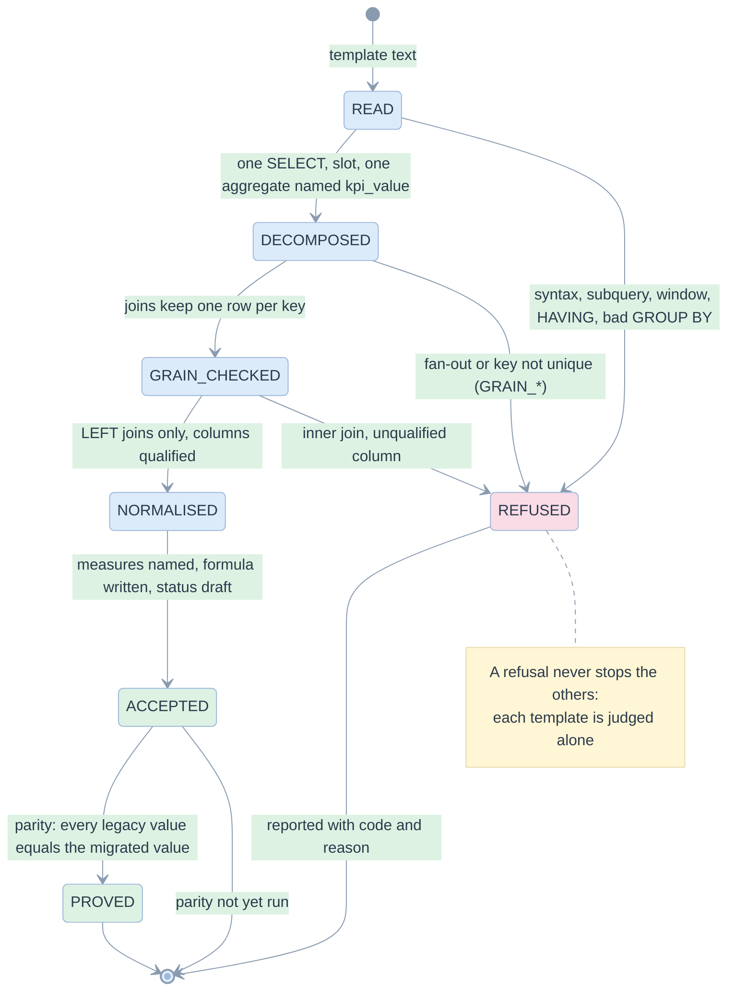

# 06. Inference and migration

> The registry holds KPIs as templated SQL. The library reads each template as relational algebra, keeps what it can prove, refuses the rest with a reason, and shows that the migrated model returns the same numbers.

Related: [README](README.md) · [04 domain model](04-domain-model-and-definitions.md) · [10 edge cases](10-edge-cases-and-state-charts.md) · [walkthrough examples](../../examples/walkthrough/README.md) · [Databricks migration run](../kpi/validation/2026-11-12-migration/README.md) · the [briefing](../kpi/briefing/why-a-sql-query-is-not-a-kpi.pdf), migration pages

Code: [inference.py](../../edgekpi/inference.py), [parity.py](../../edgekpi/parity.py), [grain.py](../../edgekpi/grain.py). Tests: [test_inference_and_intent.py](../../tests/test_inference_and_intent.py).

## Why inference works, and where it must stop

```mermaid
%%{init: {'theme':'base','themeVariables':{'primaryColor':'#DCEBFA','primaryBorderColor':'#9DB9DA','primaryTextColor':'#2B3A4A','lineColor':'#8A9BB0','fontFamily':'Inter, sans-serif'}}}%%
flowchart LR
  T["Legacy templates<br/>(registry rows)"]:::pink --> P["parse<br/>sqlglot, Databricks dialect"]:::blue
  P --> D["decompose<br/>source, joins, filters,<br/>one aggregate expression"]:::blue
  D --> G["grain check<br/>joins keep one row per key?<br/>(reads the data)"]:::yellow
  G --> N["normalise<br/>one spelling per conditional count<br/>try_divide to a guarded ratio"]:::peach
  N --> S["split filters<br/>shared by all KPIs: model filter<br/>own to one KPI: into its measure"]:::peach
  S --> M["model<br/>measures m1..mn, KPI formulas,<br/>filters with typed parameters"]:::green
  M --> V["parity<br/>run legacy and migrated<br/>compare every value"]:::mint
  D -. "cannot read" .-> X["refused<br/>with a code and a reason"]:::lav
  G -. "fan-out or key not unique" .-> X
  classDef blue fill:#DCEBFA,stroke:#9DB9DA,color:#2B3A4A
  classDef lav fill:#E8E0F7,stroke:#B9A9DC,color:#2B3A4A
  classDef green fill:#DDF2E3,stroke:#9CCDAA,color:#2B3A4A
  classDef peach fill:#FDE7D5,stroke:#E5B995,color:#2B3A4A
  classDef pink fill:#FADCE6,stroke:#E3A9BF,color:#2B3A4A
  classDef yellow fill:#FFF6D6,stroke:#E3D18F,color:#2B3A4A
  classDef mint fill:#D9F2EC,stroke:#95CFC2,color:#2B3A4A
```

Rewriting **on top of** an aggregated result does not work: aggregation loses the rows, so you cannot regroup. Rewriting **inside** the aggregation does: the template is `SELECT <slot>, <one aggregate expression> FROM <fact> [joins] WHERE ... GROUP BY <slot>`, and the aggregate expression, the joins and the row filters are all still visible. The inference reads those parts, names the aggregates as measures and writes the rest as a formula.



## State of one template



## What the example produces

Input: the eight templates of [templates.sql](../../examples/registry/templates.sql): six engagement KPIs plus two that must be refused. **They are written for this repository** to show the common shapes of a templated registry; they are not copied from a production system ([13 limits](13-verification-evidence.md#limits)).

```
python -m edgekpi infer ../../examples/registry/templates.sql --name registry --key message_id \
       --dim typology=client.typology --dim market=market --data ../../examples/registry/data.sql
```

Output, abridged:

```yaml
joins:   {client: {table: client, on: client.client_id = client_id}}
measures:
  m1: COUNT(*)
  m2: COUNT(DISTINCT client_id) FILTER(WHERE is_delivered)
  m3: COUNT(*) FILTER(WHERE is_delivered)
  m4: COUNT(*) FILTER(WHERE is_opened)
  m5: COUNT(*) FILTER(WHERE is_clicked)
kpis:    sent: m1 · reached: m2 · delivery_rate: m3 / m1 · open_rate: m4 / m3 · click_rate: m5 / m3 · ctor: m5 / m4   # all status: draft
filters: filter_start_date, filter_end_date                  # optional, typed date, half-open
# accepted 6, refused 2
# refused open-events: GRAIN_JOIN_FANOUT: a join changes the grain: 13 messages become 20 rows covering 13 messages
# refused messages-per-client: INFER_MORE_THAN_ONE_AGGREGATION: more than one aggregation
```

| What was inferred | From | Test |
|---|---|---|
| Six KPIs onto **five** measures | `COUNT_IF(is_delivered)`, `COUNT(*) FILTER (WHERE is_delivered)` and `SUM(CASE WHEN is_delivered THEN 1 ELSE 0 END)` are one measure `m3` (EC-L-18) | `test_three_spellings_of_a_conditional_count_become_one_measure` |
| `reached` counts delivered clients | the `C.is_delivered` filter that only this template has moves **into the measure** as `FILTER` | `test_a_row_filter_that_only_one_kpi_has_moves_into_that_kpis_measure` |
| Optional date filters | `(try_cast(:start_date AS DATE) IS NULL OR CAST(C.send_date AS DATE) >= try_cast(:start_date AS DATE))` becomes an optional `date` parameter | `test_optional_date_parameters_and_their_types_are_inferred` |
| Guarded ratios | `try_divide(a, b)` and `a * 1.0 / NULLIF(b, 0)` become `a / b`, which the library guards | note printed per KPI |
| Joins | `LEFT JOIN client D ON D.client_id = C.client_id`, proved one row per message | `grain` in the result |
| Refusals | fan-out join, nested aggregation | `test_six_kpis_become_five_measures_and_two_are_refused_with_reasons` |

## Refusal codes

| Code | The template has | Test |
|---|---|---|
| `INFER_SYNTAX`, `INFER_NOT_A_SELECT` | text that is not one parseable `SELECT` | `test_templates_outside_the_supported_shape_are_refused_with_a_code` |
| `INFER_MORE_THAN_ONE_AGGREGATION` | a subquery or a second aggregation level | same |
| `INFER_UNSUPPORTED_CLAUSE` | `HAVING`, `LIMIT`, `DISTINCT`, `QUALIFY` | same |
| `INFER_WINDOW` | a window function | same |
| `INFER_GROUP_BY`, `INFER_SELECT` | a `GROUP BY` that is not exactly the slot, or a `SELECT` that is not the slot plus `kpi_value` | same |
| `INFER_NO_AGGREGATE` | a `kpi_value` that is not an aggregate | same |
| `INFER_NOT_A_LEFT_JOIN` | an inner join, which would filter fact rows (EC-L-33) | `test_an_inner_join_is_refused_because_it_would_filter_fact_rows` |
| `INFER_UNQUALIFIED_COLUMN`, `INFER_UNKNOWN_ALIAS` | a column that could belong to the fact or to a join | same |
| `GRAIN_JOIN_FANOUT`, `GRAIN_KEY_NOT_UNIQUE` | a join that multiplies rows, or a key that is not unique (EC-L-09, EC-L-25) | [test_engines_and_reconcile.py](../../tests/test_engines_and_reconcile.py) |

## Proving a migration: parity

[parity.verify](../../edgekpi/parity.py) runs, for every accepted KPI:

1. the **legacy template** at every grouping of the lattice, with the grand total obtained by removing the slot and the `GROUP BY` from the parsed tree (a legacy template cannot express a grand total: an empty column list is a syntax error);
2. the **migrated model**, through the library, for the same bindings;
3. a value-by-value comparison, counting values compared, NULLs, differences, and nodes that exist only after migration.

Result on the example data, under three parameter bindings (none, start only, both):

| | DuckDB | Databricks warehouse |
|---|---|---|
| bindings | 3 | 3 |
| nodes in the migrated results | 34 | 34 |
| legacy values compared | 200 (18 NULL where a denominator is zero) | 200 (18 NULL) |
| values that differ | **0** | **0** |
| values only after migration | 4: Reach `0` for a group with no delivered message, where the legacy query returns no row | 4 |

The four extra values are the one deliberate difference: moving a `WHERE is_delivered` into `FILTER` turns "no row" into `0`. It is the empty-group policy of [kpi/16](../kpi/16-correctness-contract.md), visible instead of hidden.

## What a human must still do

- Review each **draft** KPI and move it to `unconfirmed`, then `confirmed` ([04](04-domain-model-and-definitions.md#kpi-status)). Inference proves equality with the legacy number, not that the legacy number was right.
- Supply the **dimension catalogue** (`--dim name=expr`): what the registry's `{{ group_by_list }}` may be replaced with. It is not in the templates.
- Read the printed **notes**: every guarded division changes "error on zero" into `NULL`.
- Decide the refused KPIs: rewrite them (for example as a second fact), or leave them as legacy queries.

## Limits

Types of template not read: several fact tables, `UNION`, correlated subqueries, window functions, nested aggregation. Dimensions that change over time (as-of joins) are not modelled. The grain check proves today's data only. Registries that keep joins and filters in separate JSON columns are not covered by the examples. See [13 limits](13-verification-evidence.md#limits) and [12 backlog](12-implementation-plan.md#not-built).
