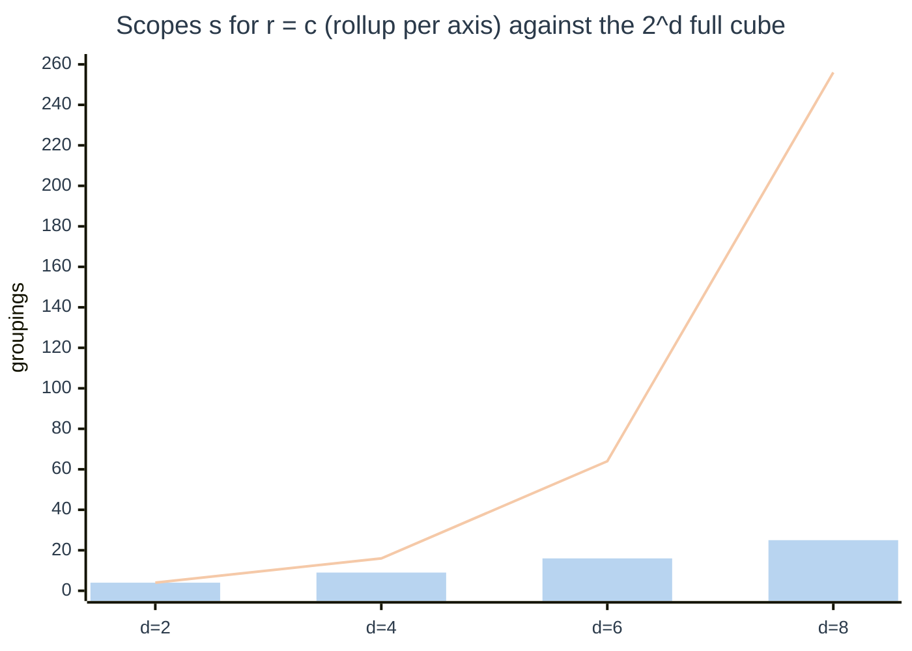

# 09. Complexity and performance

> What grows with what. The library's own work is linear and small; the expensive part is the warehouse's, and that is measured by the owner on a real workload, not assumed here.

Related: [README](README.md) · [01 O(n) lens](01-lenses.md#7-on-expert) · [03 architecture](03-architecture-solid-dry.md) · [05 backends](05-the-three-backends.md) · [10 EC-L-12](10-edge-cases-and-state-charts.md#register) · [kpi/08 complexity and performance](../kpi/08-complexity-and-performance.md)

Notation: `R` rows in the fact, `d` dimensions in a request, `r` row dimensions, `c` column dimensions (`d = r + c`), `s` scopes, `m` measures, `N` nodes in a result, `k` distinct members per dimension.

## The lattice

With totals, `s = (r + 1)(c + 1)`. The cap of 8 dimensions ([scopes.MAX_DIMS](../../edgekpi/scopes.py), EC-L-12) bounds it:

| `r` | `c` | `d` | `s` |
|---|---|---|---|
| 1 | 1 | 2 | 4 |
| 2 | 1 | 3 | 6 |
| 2 | 2 | 4 | 9 |
| 3 | 3 | 6 | 16 |
| 4 | 4 | 8 | 25 |
| 8 | 0 | 8 | 9 |

A rollup per axis keeps `s` quadratic in `d` at worst, not `2^d` as a full cube would be. That is the reason the model has two ordered axes and not a free set of dimensions.



The bars are `s`; the line is `2^d`.

## Costs, one by one

| Step | Time | Space | Notes | Evidence |
|---|---|---|---|---|
| Validate a model | `O(L)` in the definition text | `O(L)` | parsed once, cached by text | [model.py](../../edgekpi/model.py) |
| Validate a request | `O(d + k_w)` for `k_w` where-values | `O(s·d)` for the lattice | | [request.py](../../edgekpi/request.py) |
| Compile | `O(s·d + s·m)` | statement of the same size | independent of `R` | `test_compilation_cost_is_independent_of_data_and_grows_with_scopes_not_rows` |
| Execute (generated SQL, metric view) | one scan: `O(R)` plus aggregation work per group-key family, at worst `O(R·s)` | grows with groups × distinct-count state | measured by the owner | not measured here |
| Execute (Malloy) | the SQL Malloy generates; nests expand by cross join with a series, as observed in the [Malloy probe](../kpi/validation/2026-11-12-malloy/README.md) | | | not measured here |
| Assemble | `O(N·d)` | `O(N)` | one pass over rows | [base.assemble_flat](../../edgekpi/backends/base.py) |
| Reconcile | `O(N·d)` | `O(N)` | one pass to index children by parent, one to compare | `test_reconciliation_time_grows_linearly_with_the_nodes` |
| Oracle (verification only) | `s` queries, each `O(R)` | | never on the production path | [oracle.py](../../edgekpi/oracle.py) |
| Pivot text | `O(N log N)` sorting | `O(N)` | presentation only | [render.py](../../edgekpi/render.py) |

### Reconciliation, measured

One run on a developer machine (Python 3.12.7, no concurrent load); a synthetic grid of `members × 10` detail nodes with subtotals. Not a benchmark: a check that the growth is linear.

| Nodes `N` | Time | Time per node |
|---|---|---|
| 44,011 | 79 ms | 1.8 µs |
| 88,011 | 178 ms | 2.0 µs |
| 176,011 | 349 ms | 2.0 µs |
| 352,011 | 713 ms | 2.0 µs |

Time per node is flat, so growth is linear. The suite asserts the generous bound "four times the nodes take less than ten times as long" and leaves room for a noisy machine.

### Statement size, measured

Characters of the compiled statement for three KPIs (`sent`, `delivery_rate`, `reached`):

| `r` rows, `c` cols | `s` | Generated SQL | Metric view query | Malloy |
|---|---|---|---|---|
| 1, 0 | 2 | 838 | 600 | 904 |
| 1, 1 | 4 | 941 | 646 | 1,195 |
| 2, 1 | 6 | 1,064 | 702 | 1,549 |
| 2, 2 | 9 | 1,310 | 813 | 2,111 |

Generated SQL and the metric-view query grow slowly (one extra set per scope); Malloy grows faster because each scope repeats its `aggregate:` list inside a nest. The metric view's one-off `CREATE VIEW` is not counted.

## Where the real cost is

| Question | Reasoning | Status |
|---|---|---|
| Does one scan with `s` grouping sets beat `s` separate scans? | one scan reads `R` rows once; separate queries read them `s` times. Engines also share work between rollup sets | the claim of [kpi/08](../kpi/08-complexity-and-performance.md); not re-measured here |
| What do distinct counts cost? | each distinct measure keeps a state per group per scope; they cannot be combined by addition, which is the reason C-BOUND exists. In the example `n_reached` is the only one (`distinct_measures` in `estimate`) | `estimate(report).distinct_measures` |
| What is the effect of the filters? | filters sit in the `WHERE` of the single scan, before any grouping, so they reduce `R` for every scope at once | by construction |
| What does exact-distinct splitting or approximation buy? | possible savings; semantics change; owner decision | **not built**: [12 backlog](12-implementation-plan.md#not-built) |

`estimate(report)` gives the part that can be known without an engine:

```
4 scopes x 3 measures = 12 aggregate states, 1 of them distinct counts
```

## What would change these numbers

- Cardinality: `N` can reach `s · k^d` in the worst case (every combination present). A `k` of 1,000 across two dimensions is `10^6` detail nodes; the grid, the reconciliation and the pivot grow with it. A **cell limit** (refuse or sample above a bound) is a backlog item, not built.
- Warehouse caching and result reuse help repeated reports; the library holds no cache.
- Compile-time work is negligible against any warehouse round trip; do not optimise it.

## Decision

Do not choose a backend by statement size or by the count of statements. Choose it with [05](05-the-three-backends.md#choosing), then measure end-to-end latency and warehouse work on the owner's workload before promising a service level. Until then this page states the shape of the cost, not its level.
