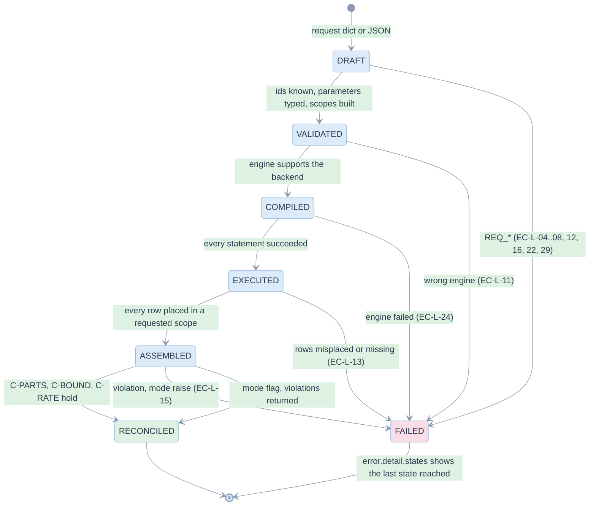
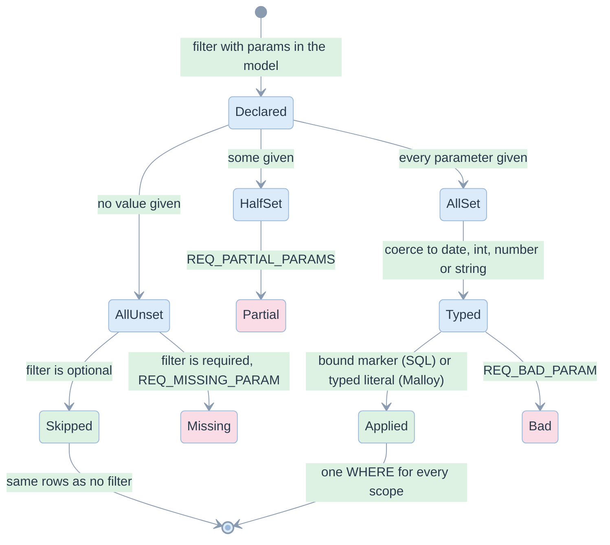
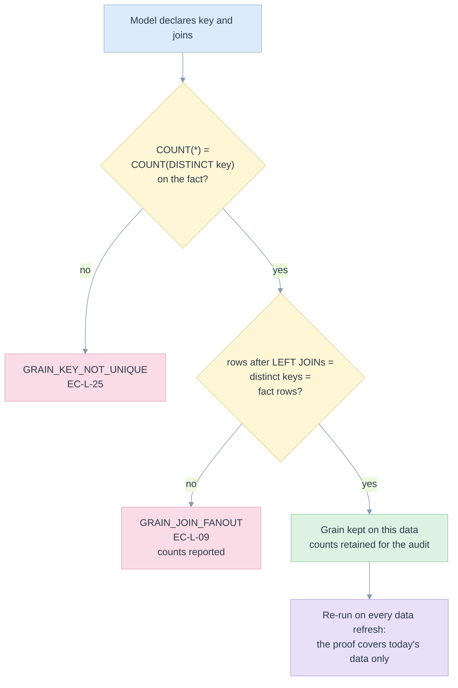

# 10. Edge cases and state charts

> Thirty-three edge cases, each with the risk, the place it is stopped and the test that proves it. State charts show the lifecycles where order matters. Cases not mitigated are listed as open, not hidden.

Related: [README](README.md) · [02 requirements](02-requirements-and-traceability.md) · [11 tests](11-test-strategy-and-e2e.md) · [kpi/15 edge cases](../kpi/15-edge-cases-and-state-charts.md) · [kpi/16 correctness contract](../kpi/16-correctness-contract.md)

Test references are `file::test` in [/tests](../../tests). Where the proof is the end-to-end matrix, the case names the request of [conftest.py](../../tests/conftest.py) that reaches it; `test_e2e.py::test_matrix_reaches_the_edge_cases_it_claims` asserts the data really contains the case, so a drifting fixture cannot make the proof vacuous.

## Register

### Data and arithmetic

| Id | Case | Risk if unhandled | Mitigation | Proof |
|---|---|---|---|---|
| EC-L-01 | No input rows | a zero grand total, or `0 / 0` | `HAVING COUNT(*) > 0` plus the hidden `edgekpi_rows` column: no node | `test_e2e.py::test_matrix_reaches_the_edge_cases_it_claims` (`empty-input`) |
| EC-L-02 | Zero denominator | error (ANSI), NaN (Malloy) or a wrong number | every division is `n * 1.0 / NULLIF(d, 0)`, result `None` | same (`zero-denominator-group`), `test_backend_text.py::test_every_division_is_guarded_in_every_backend` |
| EC-L-03 | NULL member next to a total | the unknown group merged into the total | scope says which dimensions are rolled up; NULL is a member value | `test_e2e.py::test_matrix_reaches_the_edge_cases_it_claims` (`two-row-levels`) |
| EC-L-14 | Distinct count summed | Reach of the whole larger than reality | C-BOUND: `max ≤ u ≤ Σ`; parts are not required to add | `test_engines_and_reconcile.py::test_a_distinct_count_that_is_summed_is_caught_by_its_bound`, `test_engines_and_reconcile.py::test_distinct_counts_are_not_required_to_add_up` |
| EC-L-15 | A returned node is arithmetically wrong | a published number that is not its own parts | C-PARTS, C-BOUND, C-RATE on every grid; violation names the node | `test_engines_and_reconcile.py::test_a_wrong_part_is_caught_and_the_node_is_named`, `test_engines_and_reconcile.py::test_a_rate_that_is_not_its_own_numerator_over_denominator_is_caught` |
| EC-L-17 | A filter not on an axis | applied at detail but forgotten at totals | one `WHERE` before any grouping | `test_e2e.py::test_matrix_reaches_the_edge_cases_it_claims` (`where-eq-off-axis`: total 9 of 13) |
| EC-L-19 | Totals switched off | totals computed and shown anyway | the lattice has the detail scope only | same (`totals-off`) |
| EC-L-20 | Two KPIs share a measure | the aggregate computed twice | atoms are deduplicated by name | `test_backend_text.py::test_measures_behind_several_kpis_are_computed_once` |
| EC-L-21 | A date on the boundary | an off-by-one day | the end date is excluded; message 12 sits on `2025-12-31` | `test_e2e.py::test_matrix_reaches_the_edge_cases_it_claims` (`end-date-only`, 4 of 13) |
| EC-L-26 | No dimensions at all | invalid `GROUPING_ID()` | `0 AS gid` and no `GROUP BY`: grand total only | same (`grand-total-only`) |
| EC-L-30 | Same member, different types across engines | one date counted as two nodes | one canonical form (`grid.canon`) | `test_engines_and_reconcile.py::test_members_and_values_have_one_representation_whatever_the_engine_returned` |

### Definitions and requests

| Id | Case | Risk if unhandled | Mitigation | Proof |
|---|---|---|---|---|
| EC-L-04 | Repeated dimension or KPI | a duplicate column, an ambiguous grouping | `REQ_DUPLICATE_DIMENSION`, `REQ_DUPLICATE_KPI` | `test_requests.py::test_invalid_requests_name_their_reason` |
| EC-L-05 | Unknown KPI, dimension or measure | a wrong or missing column | refused with the known ids | same, `test_definitions.py::test_invalid_definitions_name_their_reason` |
| EC-L-06 | A formula that refers to nothing, or misuses `ratio` | a KPI that cannot be computed | `DEF_UNKNOWN_MEASURE`, `DEF_BAD_RATIO`, `DEF_QUALIFIED_REFERENCE` | `test_definitions.py::test_invalid_definitions_name_their_reason` |
| EC-L-08 | Date wrong, missing, half-set, or unset when optional | wrong rows, or a filter applied to NULL | typed coercion; `REQ_MISSING_PARAM`, `REQ_PARTIAL_PARAMS`; optional unset means skipped | `test_requests.py::test_invalid_requests_name_their_reason`, `test_requests.py::test_optional_filters_skip_when_unset_and_missing_required_ones_fail`, `test_requests.py::test_a_required_filter_without_its_parameter_fails_and_a_partial_optional_one_too` |
| EC-L-10 | Subquery, window, nested aggregate, unknown function | a definition the backends cannot keep correct | whitelist; refused with the construct name | `test_definitions.py::test_unsafe_or_unsupported_measures_are_refused_with_a_reason` |
| EC-L-12 | More dimensions than a report | a cube request | `REQ_TOO_MANY_DIMENSIONS` at 9 | `test_requests.py::test_too_many_dimensions_is_refused` |
| EC-L-16 | An unconfirmed KPI on a published report | an unreviewed number published | `published=True` accepts `confirmed` only | `test_requests.py::test_the_pinned_version_passes_and_unconfirmed_kpis_pass_when_not_published` |
| EC-L-22 | `where` with NULL or an empty list | a filter that matches nothing, silently | `REQ_NULL_IN_FILTER`, `REQ_BAD_WHERE` | `test_requests.py::test_invalid_requests_name_their_reason` |
| EC-L-27 | Name collisions, reserved names | two columns with one name; a collision with `gid` | one namespace; `DEF_DUPLICATE_NAME`, `DEF_RESERVED_NAME` | `test_definitions.py::test_invalid_definitions_name_their_reason` |
| EC-L-29 | A model changed after a report was approved | a number from a different definition | `model_version` pin, fingerprint | `test_definitions.py::test_the_fingerprint_changes_with_any_definition_change`, `test_requests.py::test_invalid_requests_name_their_reason` |
| EC-L-32 | YAML `on:` read as `True`; a mistyped field | a join with no condition; a dropped rule | restricted loader; unknown fields refused | `test_definitions.py::test_yaml_on_key_is_not_read_as_a_boolean`, `test_definitions.py::test_invalid_definitions_name_their_reason` |

### Safety

| Id | Case | Risk if unhandled | Mitigation | Proof |
|---|---|---|---|---|
| EC-L-07 | SQL or Malloy injection through a name, a parameter, a `where` value, a label | arbitrary statements | identifiers checked against `[A-Za-z_][A-Za-z0-9_]*`; values bound (SQL) or escaped and typed (Malloy); only validated trees rendered | `test_definitions.py::test_names_that_could_carry_sql_are_refused`, `test_definitions.py::test_a_malicious_source_name_is_refused`, `test_backend_text.py::test_parameters_stay_bound_and_never_enter_the_sql_text`, `test_backend_text.py::test_where_values_are_bound_not_inlined`, `test_backend_text.py::test_malloy_literals_escape_quotes_backslashes_and_newlines` |
| EC-L-28 | An assistant guesses, or obeys text hidden in a label | a different KPI, or an injected instruction | unknown or weak names become questions; labels are data | `test_inference_and_intent.py::test_ambiguity_becomes_a_question_not_a_guess`, `test_inference_and_intent.py::test_an_instruction_inside_a_proposal_is_data_not_a_command` |

### Grain and joins

| Id | Case | Risk if unhandled | Mitigation | Proof |
|---|---|---|---|---|
| EC-L-09 | A join multiplies fact rows | every count inflated | `check_joins` compares rows and distinct keys; to-many joins cannot be declared | `test_engines_and_reconcile.py::test_a_fanout_join_is_refused_with_the_counts`, `test_engines_and_reconcile.py::test_a_dimension_table_with_a_duplicated_row_is_caught_as_fanout` |
| EC-L-25 | The key is not unique | double counting at the source | `GRAIN_KEY_NOT_UNIQUE` | `test_engines_and_reconcile.py::test_a_non_unique_key_is_refused` |
| EC-L-33 | An inner join in a legacy template | fact rows silently removed | `INFER_NOT_A_LEFT_JOIN` | `test_inference_and_intent.py::test_an_inner_join_is_refused_because_it_would_filter_fact_rows` |
| EC-L-18 | Three spellings of one conditional count | three measures, three scans | normalised to `COUNT(*) FILTER (WHERE p)` | `test_inference_and_intent.py::test_three_spellings_of_a_conditional_count_become_one_measure` |

### Backends and engines

| Id | Case | Risk if unhandled | Mitigation | Proof |
|---|---|---|---|---|
| EC-L-11 | A metric view asked to run on DuckDB | a late, confusing failure | `ENGINE_MISMATCH` before anything executes | `test_engines_and_reconcile.py::test_a_backend_cannot_run_on_an_engine_it_does_not_support` |
| EC-L-13 | The engine returns a row or a nest nobody asked for, or too few | a partial or misplaced grid | `ENGINE_UNEXPECTED_SCOPE`, `ENGINE_INCOMPLETE_RESULT`; truncated Databricks results refused | `test_engines_and_reconcile.py::test_an_engine_returning_a_scope_nobody_asked_for_is_refused`, `test_engines_and_reconcile.py::test_a_malloy_result_with_a_missing_nest_is_refused` |
| EC-L-23 | Malloy returns NaN for `x / 0` | NaN in a published report | `nullif` on every division in Malloy | `test_backend_text.py::test_every_division_is_guarded_in_every_backend` |
| EC-L-24 | The DDL succeeds and the query fails | a half-defined state treated as a result | the plan fails as a whole; the DDL is idempotent | `test_engines_and_reconcile.py::test_a_failure_after_the_ddl_still_fails_the_whole_plan`, `test_engines_and_reconcile.py::test_an_engine_failure_returns_no_partial_grid` |
| EC-L-31 | Malloy `count(x)` is distinct, SQL `COUNT(x)` counts non-null | a count that differs by backend | the translator writes each correctly | `test_backend_text.py::test_count_of_a_column_is_not_confused_with_a_distinct_count_in_malloy` |

## Request lifecycle

Implemented in [runner.run](../../edgekpi/runner.py); the trace is `Result.states`, and on failure `error.detail["states"]`. Tests: [test_engines_and_reconcile.py](../../tests/test_engines_and_reconcile.py).

## Node identity: NULL member versus rolled-up total

```mermaid
%%{init: {'theme':'base','themeVariables':{'primaryColor':'#DCEBFA','primaryBorderColor':'#9DB9DA','primaryTextColor':'#2B3A4A','secondaryColor':'#DDF2E3','tertiaryColor':'#FDE7D5','lineColor':'#8A9BB0','noteBkgColor':'#FFF6D6','noteTextColor':'#2B3A4A','fontFamily':'Inter, sans-serif'}}}%%
stateDiagram-v2
  direction LR
  [*] --> Row: engine row with gid and member columns
  Row --> Scope: scope_of(gid) lists the dimensions NOT rolled up
  Scope --> Check: scope in the requested lattice?
  Check --> Rejected: no, ENGINE_UNEXPECTED_SCOPE
  Check --> Members: yes, read members for scope dimensions only
  Members --> NullMember: value is None, a real member (EC-L-03)
  Members --> Total: dimension absent from scope, a rolled-up total
  NullMember --> Node
  Total --> Node
  Node --> Canon: grid.canon on every member and value (EC-L-30)
  Canon --> [*]: one Node per (scope, members)
  classDef pastelPink fill:#FADCE6,color:#2B3A4A
  classDef pastelGreen fill:#DDF2E3,color:#2B3A4A
  classDef pastelYellow fill:#FFF6D6,color:#2B3A4A
  class Rejected pastelPink
  class Node,Canon pastelGreen
  class NullMember,Total pastelYellow
```

## Filter and parameter states

## Join grain decision

The inference template lifecycle is in [06](06-inference-and-migration.md#state-of-one-template); the KPI status lifecycle is in [04](04-domain-model-and-definitions.md#kpi-status).

## Envisioned and not mitigated (open)

These were considered. They are not handled in code; each has an owner and a next step in [12](12-implementation-plan.md#not-built).

| Case | Why it matters | Present behaviour |
|---|---|---|
| Dimension that changes over time (type 2) | a message must join the typology valid when it was sent | not modelled; joins are current-state |
| More than one fact table | cross-fact KPIs need drill-across | one fact per model; a different source is a different model (`INFER_DIFFERENT_SOURCES`) |
| Row-level permissions | a user must see only their rows | the warehouse identity decides; the library adds nothing |
| Time zone of a date | a message near midnight lands on another day | dates are dates; no time zone handling |
| Data changing between two statements | a metric-view run has two statements; a report with several facts could mix snapshots | one query returns the grid; a multi-statement report is not built |
| Very high cardinality | millions of nodes | no cell limit; `estimate` warns of scopes, not of members |
| Concurrent `CREATE OR REPLACE` of the same view | two writers | the name carries the fingerprint, so concurrent writers write the same text |
| Warehouse cold start longer than 600 s | a timeout | `ENGINE_TIMEOUT` after 600 s |
| Result larger than one chunk | silent truncation | refused: `ENGINE_INCOMPLETE_RESULT` (mitigated, not exercised by a test: no large result was produced) |
| A Malloy measure named like a source column | a Malloy compile error | surfaces as `ENGINE_FAILED`; not detectable without the schema |
| Decimal precision of `* 1.0` on different engines | a rate differing in the 15th digit | comparison tolerance `1e-9` relative; exact bits are not promised |
