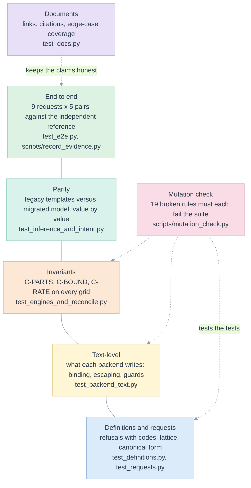

# 11. Test strategy and end-to-end tests

> One request matrix, five backend/engine pairs, one independent reference, nineteen mutants and a documentation check. A test earns its place by failing when a rule is broken.

Related: [README](README.md) · [02 traceability](02-requirements-and-traceability.md) · [10 edge cases](10-edge-cases-and-state-charts.md) · [13 evidence](13-verification-evidence.md) · [kpi/14 earlier test strategy](../kpi/14-test-strategy-and-traceability.md)

## Layers of proof



| File | Tests | What it proves |
|---|---|---|
| [test_definitions.py](../../tests/test_definitions.py) | 38 | the model refuses what it cannot guarantee, each with its code |
| [test_requests.py](../../tests/test_requests.py) | 32 | request validation, typed parameters, the lattice, `GROUPING_ID` |
| [test_backend_text.py](../../tests/test_backend_text.py) | 14 | bound parameters, escaping, guards, the metric view definition, Malloy translation |
| [test_engines_and_reconcile.py](../../tests/test_engines_and_reconcile.py) | 19 | invariants, lifecycle and failure states, grain, canonical form |
| [test_inference_and_intent.py](../../tests/test_inference_and_intent.py) | 21 | inference, refusals, parity (also on the warehouse), the assistant resolver |
| [test_e2e.py](../../tests/test_e2e.py) | 46 | every request through every pair against the reference, plus a guard that the data contains the edge cases |
| [test_cli_and_scaling.py](../../tests/test_cli_and_scaling.py) | 14 | the commands, linear reconciliation, statement size |
| [test_docs.py](../../tests/test_docs.py) | 23 | the documents of this folder |

## The end-to-end matrix

The nine requests are in [conftest.py](../../tests/conftest.py) as `REQUESTS`. Each is run through every pair; the result is compared with the reference ([oracle.py](../../edgekpi/oracle.py)) and must pass the invariants.

| Request | What it exercises | Edge cases |
|---|---|---|
| `pivot-with-params-and-where` | six KPIs, rows × columns, both date parameters, `where` on an axis dimension | EC-L-08, EC-L-17 |
| `grand-total-only` | no dimensions | EC-L-26 |
| `two-row-levels` | two row dimensions and a column: six scopes; the unknown client as a NULL member | EC-L-03 |
| `year-function-no-params` | a Databricks function (`YEAR`) as a dimension; no parameters at all | EC-L-08 |
| `totals-off` | the detail scope only | EC-L-19 |
| `empty-input` | `where` matching nothing | EC-L-01 |
| `where-eq-off-axis` | a filter on a dimension that is not on an axis; checked at the grand total | EC-L-17 |
| `end-date-only` | one optional parameter set, the other unset; boundary day excluded | EC-L-21 |
| `zero-denominator-group` | a group with no delivered message | EC-L-02 |

| Pair | Engine | Marker |
|---|---|---|
| `sql-duckdb` | DuckDB in memory | none: always runs |
| `malloy-duckdb` | Malloy on DuckDB, through node | `malloy` |
| `sql-databricks` | SQL warehouse | `databricks` |
| `metric-view-databricks` | SQL warehouse | `databricks` |
| `malloy-databricks` | Malloy's Databricks connection on the same warehouse | `databricks` and `malloy` |

The test body is one function over `PAIRS` × `REQUESTS`. That is Liskov substitution as a test: there is no per-backend expected value anywhere. A request added to `REQUESTS` is automatically run on every pair and enters the evidence file.

### What the reference shares

The reference ([oracle.py](../../edgekpi/oracle.py)) shares with the backends only the **rendering of dimensions, joins and filters** (`sqlparts`). It does not share the grouping (`GROUPING SETS`, `MEASURE`, nests) or the KPI arithmetic: it runs one plain `GROUP BY` per node and evaluates each KPI in Python with `expr.evaluate`. A bug in the shared rendering would affect both; that residual risk is why the example data has a join, a function and a NULL member, and why the invariants (which use no SQL at all) run as a second line.

## Running the tests

```
pip install -e .[dev]
(cd edgekpi/backends/malloy_runtime && npm install)

pytest                                          # everything that can run here; skips what lacks a runtime
pytest -m "not databricks and not malloy"       # no node, no warehouse
EDGEKPI_DBX_WAREHOUSE=<id> DATABRICKS_CONFIG_PROFILE=<profile> pytest      # also the warehouse pairs
python scripts/mutation_check.py                # 19 mutants
python scripts/record_evidence.py --databricks  # writes specs/library/evidence/run-<date>-databricks.json
```

A missing runtime **skips** its pairs with a reason; it never fails or silently passes them. Tests marked `databricks` create or replace three small tables in `workspace.edgekpi_lib` and, for the metric view, one view per model version.

## Mutation check

[scripts/mutation_check.py](../../scripts/mutation_check.py) copies the library, breaks one rule in the copy and runs the local suite. A surviving mutant is a rule with no test.

| # | Broken rule | Where | Edge case | Result |
|---|---|---|---|---|
| 1 | zero denominator no longer guarded | `expr.py` | EC-L-02, EC-L-23 | killed |
| 2 | `GROUPING_ID` bit order reversed | `scopes.py` | EC-L-03 | killed |
| 3 | reconciliation compares nothing | `reconcile.py` | EC-L-15 | killed |
| 4 | dates not checked before they travel | `request.py` | EC-L-08 | killed |
| 5 | optional filters become required | `sqlparts.py` | EC-L-08 | killed |
| 6 | empty input yields a zero node (both defences removed) | `sql.py`, `base.py` | EC-L-01 | killed |
| 7 | duplicate keys accepted | `grain.py` | EC-L-25 | killed |
| 8 | join fan-out accepted | `grain.py` | EC-L-09 | killed |
| 9 | `COUNT_IF` spelling not unified | `inference.py` | EC-L-18 | killed |
| 10 | totals dropped | `scopes.py` | EC-L-19 | killed |
| 11 | unconfirmed KPI published | `request.py` | EC-L-16 | killed |
| 12 | to-many join declared | `model.py` | EC-L-09 | killed |
| 13 | backend runs on the wrong engine | `runner.py` | EC-L-11 | killed |
| 14 | `AND` translated as `OR` in Malloy | `malloy.py` | EC-L-07 | killed |
| 15 | Malloy literal does not escape backslashes | `malloy.py` | EC-L-07 | killed |
| 16 | the assistant guesses on weak matches | `intent.py` | EC-L-28 | killed |
| 17 | the explanation picks a split where the tempting answer is right | `explain.py` | [ux-demo EC-D-11](../ux-demo/06-edge-cases-and-state-charts.md#register) | killed |
| 18 | an oversized request body is read instead of refused | `server.py` | ux-demo EC-D-22 | killed |
| 19 | an unavailable backend is reported as a client error | `service.py` | ux-demo EC-D-06 | killed |

First run of the check: four mutants survived. Two were real gaps (`"20260101"` was not tested as a bad date; the Malloy translator had no test for connectives). Two (empty input) survived because the library has **two independent defences**, `HAVING` and the row-count column; the mutant was changed to remove both. After adding the two tests, 16 of 16 were killed; three mutants for the service layer were added later, and one of them (the oversized body) is killed by a **hang**, which the harness counts as a kill after a timeout. 19 of 19 are killed. The mutants run on the local suite without node or a warehouse, so the Malloy and warehouse paths are protected by their text-level tests, not by the end-to-end matrix.

## The documents are tested

[test_docs.py](../../tests/test_docs.py) checks that:

- every relative link and anchor in this folder resolves;
- every `file::test` reference names a test that exists;
- the register holds 33 distinct `EC-L` identifiers, each appearing in a test;
- every `EC-L` and `REQ-L` identifier cited anywhere is defined, and every requirement names a test;
- every Mermaid diagram carries the pastel theme, and the ASCII wireframes are present.

## Gates

| Gate | Condition |
|---|---|
| Merge | local suite passes; mutation check kills every mutant; documents check passes |
| Publish a definition | the e2e matrix passes on the target engine; parity passes if the definition was inferred; the owner has set `confirmed` |
| Release the library | the matrix passes on every pair the release supports; the evidence file is regenerated and committed |

## Not tested

Production volume, latency and cost; concurrency; permissions; a production registry; a graphical interface; an assistant model in the loop. Each is listed in [12](12-implementation-plan.md#not-built).
