# 12. Implementation plan

> What is built, in what order it was built, what is next, and the rules every change must keep. Phases describe dependencies, not dates.

Related: [README](README.md) · [02 requirements](02-requirements-and-traceability.md) · [11 gates](11-test-strategy-and-e2e.md#gates) · [13 evidence](13-verification-evidence.md) · [kpi/13 earlier plan](../kpi/13-implementation-plan.md)

## Phases

```mermaid
%%{init: {'theme':'base','themeVariables':{'primaryColor':'#DCEBFA','primaryBorderColor':'#9DB9DA','primaryTextColor':'#2B3A4A','lineColor':'#8A9BB0','fontFamily':'Inter, sans-serif'}}}%%
flowchart LR
  P0["P0 Contract<br/>model, request, scopes, grid, errors"]:::green
  P1["P1 Backends and engines<br/>SQL, metric view, Malloy<br/>DuckDB, Databricks"]:::green
  P2["P2 Proof<br/>oracle, invariants, e2e matrix,<br/>mutation check"]:::green
  P3["P3 Migration<br/>inference, grain, parity"]:::green
  P4["P4 Interfaces<br/>CLI, pivot, assistant resolver"]:::green
  P5["P5 Adoption<br/>real registry, owner review,<br/>host integration"]:::yellow
  P6["P6 Scale and governance<br/>volume, permissions, history,<br/>approximation"]:::peach
  P0 --> P1 --> P2 --> P3 --> P4 --> P5 --> P6
  P2 --> P5
  classDef green fill:#DDF2E3,stroke:#9CCDAA,color:#2B3A4A
  classDef yellow fill:#FFF6D6,stroke:#E3D18F,color:#2B3A4A
  classDef peach fill:#FDE7D5,stroke:#E5B995,color:#2B3A4A
```

| Phase | Outcome | Modules | Exit evidence | Status |
|---|---|---|---|---|
| P0 Contract | A definition, a request, a scope and a result exist as typed, validated objects with stable error codes | [model.py](../../edgekpi/model.py), [expr.py](../../edgekpi/expr.py), [loader.py](../../edgekpi/loader.py), [request.py](../../edgekpi/request.py), [scopes.py](../../edgekpi/scopes.py), [grid.py](../../edgekpi/grid.py), [errors.py](../../edgekpi/errors.py) | `test_definitions.py`, `test_requests.py` | done |
| P1 Backends and engines | One report compiles to a metric view, Malloy and SQL, and runs on DuckDB and Databricks | [backends/](../../edgekpi/backends/base.py), [engines/](../../edgekpi/engines/sql.py), [runner.py](../../edgekpi/runner.py) | `test_e2e.py` on five pairs | done |
| P2 Proof | An independent reference and the arithmetic invariants check every backend; the suite is itself tested | [oracle.py](../../edgekpi/oracle.py), [reconcile.py](../../edgekpi/reconcile.py), [conformance.py](../../edgekpi/conformance.py), [scripts/](../../scripts/mutation_check.py) | 45 comparisons, 0 differences; 19 of 19 mutants killed | done |
| P3 Migration | Measures and formulas are inferred from templates, refused with reasons, and proved equal to the legacy values | [inference.py](../../edgekpi/inference.py), [grain.py](../../edgekpi/grain.py), [parity.py](../../edgekpi/parity.py) | 200 legacy values, 0 different, on DuckDB and the warehouse | done on reconstructed templates |
| P4 Interfaces | A person can drive it, and an assistant can propose a request safely | [cli.py](../../edgekpi/cli.py), [render.py](../../edgekpi/render.py), [intent.py](../../edgekpi/intent.py), [estimate.py](../../edgekpi/estimate.py) | `test_cli_and_scaling.py`, the resolver tests | done (no graphical interface) |
| P5 Adoption | A production registry is read, owners confirm definitions, a host exposes the library | n/a | see below | **not started** |
| P6 Scale and governance | Behaviour on production volume; permissions; history; approximation | n/a | see the backlog | **not started** |

### P5, the next work, in order

| Step | Done when |
|---|---|
| 1. Export `registry.published_kpis` and run `edgekpi infer` on it | the accepted, refused and notes lists exist for the real rows; the shapes the example templates did not contain are known |
| 2. Fix the dimension catalogue (`--dim`) with the data owner | each dimension has an owner-approved expression |
| 3. Run `check-grain` on the real fact and dimensions | counts retained; any fan-out decided |
| 4. Run parity on the real data | zero differences, or each difference explained and signed by the owner |
| 5. Owners move each KPI from `draft` to `unconfirmed` to `confirmed` | the status is in the model file under review |
| 6. A host service exposes the calls of [08](08-ai-and-integration.md#integration-shape) | contract tests on the host pass the matrix |
| 7. Choose the backend with [05](05-the-three-backends.md#choosing) and measure it on a representative workload | latency and cost accepted by the platform owner |

## Rules every change must keep

| Rule | How it is enforced |
|---|---|
| **DRY**: one rule, one home ([03](03-architecture-solid-dry.md#dry-one-rule-one-place)) | the mutation check: moving a rule out of its home must fail a test; review of the table |
| **SOLID**: a backend and an engine are added without editing another module | `ScriptedEngine` in the tests is an engine added from outside; the e2e test body has no per-backend code |
| **First principles** ([00](00-five-whys-and-first-principles.md#first-principles)) | each FP has a named test; a change that breaks one fails it |
| **E2E**: a new request shape enters `REQUESTS` and runs on every pair | `conftest.REQUESTS` is the only list; the evidence script reads it |
| **Edge cases**: a new failure mode gets an `EC-L` row, a mitigation and a test | `test_docs.py` fails if a registered case has no test or a cited case is undefined |
| **Fail closed**: an unsupported case is refused with a code | `test_definitions.py`, `test_requests.py` |
| **No claim beyond the evidence** | [13](13-verification-evidence.md) states what ran; [10](10-edge-cases-and-state-charts.md#envisioned-and-not-mitigated-open) lists what did not |

## Decisions

| Id | Decision | Status |
|---|---|---|
| ADR-L-01 | Author in the Databricks dialect; transpile for DuckDB with sqlglot | accepted; limit: constructs sqlglot cannot transpile fail at run time |
| ADR-L-02 | Expressions are whitelisted trees, never concatenated strings | accepted |
| ADR-L-03 | The result is long-form keyed by scope and members | accepted |
| ADR-L-04 | Backends and engines are separate abstractions | accepted |
| ADR-L-05 | A model's metric view is named with its fingerprint | accepted; old views are not deleted by the library |
| ADR-L-06 | Malloy parameters are typed, escaped literals because Malloy has no bound parameters at this layer | accepted; listed as a backend difference |
| ADR-L-07 | The oracle shares only the rendering of dimensions, joins and filters | accepted; residual risk named in [11](11-test-strategy-and-e2e.md#what-the-reference-shares) |
| ADR-L-08 | An inferred KPI is `draft`; only an owner raises it | accepted |
| ADR-L-09 | Reconciliation runs on every grid, mode `raise` by default | accepted |
| ADR-L-10 | The assistant resolves only on a strong match (0.8) and otherwise asks | accepted; cutoff to be tuned on an evaluation set |
| ADR-L-11 | The Databricks access token reaches Malloy's Node runtime through the process environment only | accepted |
| ADR-L-12 | Statement count is not an objective; end-to-end cost on the owner's workload is | accepted, from [kpi/13](../kpi/13-implementation-plan.md) |

## Not built

| Item | Why it matters | Where it would go |
|---|---|---|
| A production registry, including JSON join and filter columns | the shapes of real templates | P5 steps 1 to 4 |
| Dimensions that change over time (type 2) | correct history | a join kind with an as-of condition, a new grain check |
| Several fact tables, drill-across | cross-fact KPIs | a model-level list of facts and a conformed-dimension check; see [kpi/07](../kpi/07-planner-and-sql-generation.md) |
| Row-level permissions | who sees which rows | host identity plus a policy-equivalence test for any cache |
| Cell limit on very large results | memory and time | `Report` validation using an estimate of members |
| Result cache and stored rollups | repeated reports | host side; must preserve snapshot and policy |
| Approximate distinct counts (HLL) | cost of distinct measures | an explicit, owner-approved measure kind |
| Record of who confirmed a KPI and when | audit | host; the library exposes status and fingerprint |
| A product graphical interface | everyday use | the [UX demo](../ux-demo/README.md) shows the shape (React, six screens, tested end to end); a product needs authentication, persistence and volume handling |
| Assistant evaluation set | tune the cutoff | [08](08-ai-and-integration.md#evaluating-an-assistant-proposed) |
| Malloy name-clash detection | clearer errors | needs the table schema; a pre-flight `DESCRIBE` |
| Locked environment and a CI workflow | reproducibility | `pyproject.toml` pins the critical packages; no lock file or CI definition exists |

## Definition of done for a change

1. A requirement or an edge case names it ([02](02-requirements-and-traceability.md), [10](10-edge-cases-and-state-charts.md)).
2. It has a test that fails without the change.
3. `pytest` passes; `python scripts/mutation_check.py` kills every mutant, with a new mutant added if the change adds a rule.
4. If behaviour on a warehouse changed, `scripts/record_evidence.py --databricks` is re-run and the file committed.
5. The documents that cite the changed behaviour are updated; `tests/test_docs.py` passes.
6. Any limitation that remains is written in terms the report user can understand.
