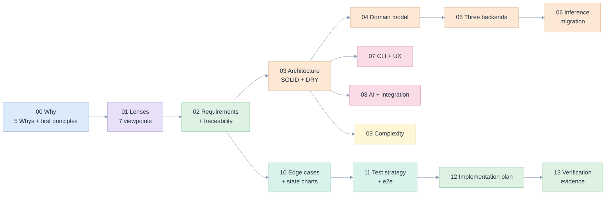

# edgekpi library: specification and implementation plan

> One KPI definition, three backends (Databricks metric views, Malloy, generated SQL), and a migration front-end that infers the definition from the registry's templated SQL. This folder specifies the library in [/edgekpi](../../edgekpi), plans its delivery, and ties every claim to code, a test or a retained run.

Author: Raphael MANSUY. Date: 2026-11-12. The business case, the problem catalogue and the backend comparison live in [specs/kpi](../kpi/README.md); this folder does not repeat them. It answers a narrower question: **what is built, how is it built, and how do we know it is right?**

## Read in this order

| # | Document | Question it answers | Main lens |
|---|---|---|---|
| 00 | [Five Whys and first principles](00-five-whys-and-first-principles.md) | Why does this library exist, and what must always be true? | Product Owner |
| 01 | [Seven lenses](01-lenses.md) | What does each discipline require of it? | all seven |
| 02 | [Requirements and traceability](02-requirements-and-traceability.md) | Which requirement is met by which code and test? | Product Owner |
| 03 | [Architecture, SOLID and DRY](03-architecture-solid-dry.md) | How is it organised so one rule lives in one place? | System Design |
| 04 | [Domain model and definitions](04-domain-model-and-definitions.md) | What does a definition look like, and what does a report ask for? | Database Expert |
| 05 | [The three backends](05-the-three-backends.md) | How does one definition become a metric view, Malloy and SQL? | Full Stack |
| 06 | [Inference and migration](06-inference-and-migration.md) | How are measures and formulas inferred from legacy SQL? | Database Expert |
| 07 | [CLI and UX](07-cli-and-ux.md) | What does a person see and do? | UX/UI |
| 08 | [AI and integration](08-ai-and-integration.md) | How can an assistant use it without being trusted? | AI Engineer |
| 09 | [Complexity and performance](09-complexity-and-performance.md) | What does it cost as the report grows? | O(n) expert |
| 10 | [Edge cases and state charts](10-edge-cases-and-state-charts.md) | What can go wrong, and where is each case stopped and tested? | all |
| 11 | [Test strategy and e2e](11-test-strategy-and-e2e.md) | How is correctness proved? | Full Stack |
| 12 | [Implementation plan](12-implementation-plan.md) | What is done, what is next, in what order? | Product Owner |
| 13 | [Verification evidence](13-verification-evidence.md) | What ran, where, and what are the limits? | all |

## Reading paths

- **Product owner**: 00, 02, 12, 13.
- **Engineer adopting the library**: 03, 04, 05, then run the commands in [07](07-cli-and-ux.md#commands).
- **Migrating the registry**: 06, 10 (EC-L-09, EC-L-18, EC-L-33), 13.
- **Reviewing correctness**: 10, 11, 13, then the [correctness contract](../kpi/16-correctness-contract.md).

## Identifiers used everywhere

| Prefix | Meaning | Defined in |
|---|---|---|
| `FP-L-n` | first principle | [00](00-five-whys-and-first-principles.md#first-principles) |
| `REQ-L-nn` | requirement | [02](02-requirements-and-traceability.md#requirements) |
| `ADR-L-nn` | decision | [12](12-implementation-plan.md#decisions) |
| `EC-L-nn` | edge case, with mitigation and test | [10](10-edge-cases-and-state-charts.md#register) |
| `P0` to `P5` | delivery phase | [12](12-implementation-plan.md#phases) |

`tests/test_docs.py` checks that every `EC-L` identifier of the register appears in a test, that every test or file cited by these documents exists, and that every relative link resolves. A reference that rots fails the suite.

## Where things are

| What | Where |
|---|---|
| Library | [/edgekpi](../../edgekpi) (about 2,500 lines of Python plus a 28-line Node runner) |
| Tests | [/tests](../../tests), run with `pytest` |
| Example model, requests | [/examples/registry](../../examples/registry) |
| Scripts: evidence, mutation check | [/scripts](../../scripts) |
| Retained run record | [evidence/](evidence/run-2026-11-12-databricks.json) |
| Service layer, React demo, its specification and screenshots | [edgekpi/service.py](../../edgekpi/service.py), [demo/web](../../demo/web), [specs/ux-demo](../ux-demo/README.md) |
| Problem analysis, design study, validation runs, illustrated briefing | [specs/kpi](../kpi/README.md) |

## Cross-links into the earlier specification

| This folder | Builds on |
|---|---|
| [00](00-five-whys-and-first-principles.md) | [kpi/00 Five Whys](../kpi/00-five-whys.md), [kpi/05 first-principles solution](../kpi/05-first-principles-solution.md) |
| [04](04-domain-model-and-definitions.md) | [kpi/06 semantic model](../kpi/06-semantic-model-and-dsl.md), [kpi/09 data model](../kpi/09-data-model-and-databricks.md) |
| [05](05-the-three-backends.md) | [kpi/07 planner](../kpi/07-planner-and-sql-generation.md), [Malloy probe](../kpi/validation/2026-11-12-malloy/README.md), [native run](../kpi/validation/2026-11-12/README.md) |
| [06](06-inference-and-migration.md) | [walkthrough examples](../../examples/walkthrough/README.md), [Databricks migration run](../kpi/validation/2026-11-12-migration/README.md) |
| [07](07-cli-and-ux.md) | [kpi/12 UX and wireframes](../kpi/12-ux-and-wireframes.md) |
| [10](10-edge-cases-and-state-charts.md) | [kpi/15 edge cases](../kpi/15-edge-cases-and-state-charts.md), [kpi/16 correctness contract](../kpi/16-correctness-contract.md) |
| [11](11-test-strategy-and-e2e.md) | [kpi/14 test strategy](../kpi/14-test-strategy-and-traceability.md) |
| [12](12-implementation-plan.md) | [kpi/13 implementation plan](../kpi/13-implementation-plan.md) |
