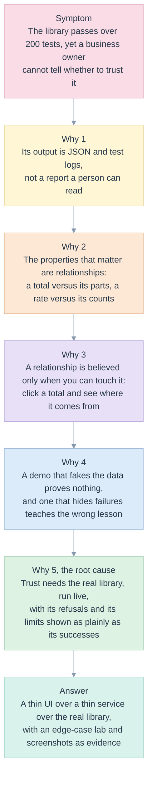

# 00. Five Whys and first principles

> The library is correct, tested and invisible. A reader cannot see that a total is recomputed rather than averaged, that Reach does not add up, or that three backends agree. The demo exists to make those facts visible, without ever making them up.

Related: [README](README.md) · [library 00](../library/00-five-whys-and-first-principles.md) · next: [01 lenses](01-lenses.md), [02 requirements](02-requirements-and-traceability.md)

## The five whys

| Why | Evidence |
|---|---|
| 1. Output is not readable | the library's only presentation is [render.py](../../edgekpi/render.py), a text pivot; [library 07](../library/07-cli-and-ux.md#wireframes-for-a-graphical-interface-proposed-not-built) drew the screens and marked them "proposed, not built" |
| 2. The properties are relationships | invariants C-PARTS, C-BOUND, C-RATE of [reconcile.py](../../edgekpi/reconcile.py) compare a node with its children |
| 3. Touch to believe | [explain.py](../../edgekpi/explain.py) computes the measures of a node and the tempting wrong answer; the Explain panel shows 76.9% beside 81.9% |
| 4. A faked demo proves nothing | the service calls `run()` of the library; `ENGINE_UNAVAILABLE` is returned honestly for the metric view |
| 5. Show refusals as plainly | the Edge-case lab runs twelve cases live and turns each green only if the service answered as it should |

## First principles

| Id | Principle | Kept by | Fails in |
|---|---|---|---|
| FP-D-1 | **Nothing is mocked.** Every value on screen is computed by the library at request time. A backend that cannot run here is shown as unavailable, with the reason | [service.py](../../edgekpi/service.py) `_pick`, [BackendsScreen.tsx](../../demo/web/src/screens/BackendsScreen.tsx) | `report.spec.ts::EC-D-06`, `test_service.py::test_domain_errors_carry_a_code_and_a_status` |
| FP-D-2 | **The screen never computes a KPI.** It formats and arranges what the service returns; a rate is not recomputed in the browser | [pivot.ts](../../demo/web/src/domain/pivot.ts) has no arithmetic on values; the explanation comes from the library | `pivot.test.ts::keeps the NULL member` |
| FP-D-3 | **Every failure is a state with a name.** Unreachable, refused, malformed, slow, stale, empty: each has its own screen, never a blank page or a stack trace | [asyncState.ts](../../demo/web/src/state/asyncState.ts), [ErrorBanner.tsx](../../demo/web/src/components/ErrorBanner.tsx) | `resilience.spec.ts::EC-D-01`, `resilience.spec.ts::EC-D-02` |
| FP-D-4 | **The newest request wins.** A slow answer to an older request can never overwrite a newer one | `asyncReducer`, `useLatest` | `state.test.ts::ignores the answer of an older call`, `resilience.spec.ts::EC-D-04` |
| FP-D-5 | **Meaning is never colour alone.** Status is a word, a violation is a word and an icon | [ui.tsx](../../demo/web/src/components/ui.tsx) `StatusPill` | `screens.spec.ts::EC-D-15` |
| FP-D-6 | **One rule, one place.** Formatting, the pivot, request edits and the contract each have a single module | [03 DRY table](03-architecture-solid-dry.md#dry-one-rule-one-place) | the unit tests of each module |
| FP-D-7 | **Evidence is kept.** Screenshots are saved with the specification, inspected, and the inspection is recorded | [09](09-visual-inspection-log.md) | `test_ux_demo_docs.py::test_every_cited_screenshot_exists_and_none_is_orphaned` |

## What the demo deliberately does not do

- **It does not call a language model.** The Assistant screen shows the resolver that would stand behind one ([library 08](../library/08-ai-and-integration.md)).
- **It does not connect to Databricks live.** The metric view and the warehouse pairs are shown from the compiled statements and from the [recorded run](../library/evidence/run-2026-11-12-databricks.json), labelled as recorded.
- **It does not edit definitions or confirm KPIs.** Status is read; governance belongs to a host ([library 12](../library/12-implementation-plan.md#not-built)).
- **It does not claim performance.** Numbers are from thirteen synthetic messages.
