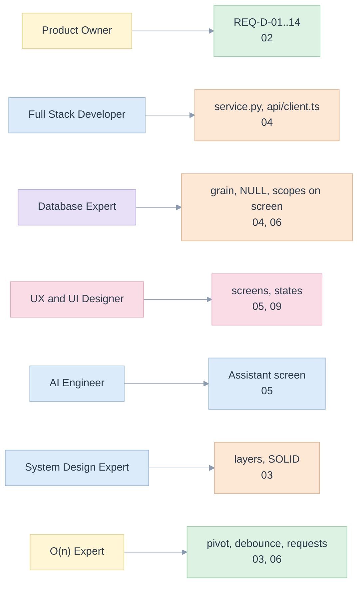

# 01. Seven lenses

> The demo read seven times. Each lens asks its own question of the code and the screens; every finding points at a module, a test or a screenshot.

Related: [README](README.md) · [00 principles](00-five-whys-and-first-principles.md) · [02 requirements](02-requirements-and-traceability.md) · [library 01](../library/01-lenses.md)

## 1. Product Owner

**Question.** Does a visitor leave believing the right things, and not believing the wrong ones?

| What the visitor should take away | Where it is shown | Proof |
|---|---|---|
| A total is recomputed from its own counts, not averaged | Explain panel: 76.9% beside 81.9% | `report.spec.ts::a rate total is its own counts divided` |
| A unique count does not add up | Explain panel on Reach: 6 beside 9 | `report.spec.ts::a distinct count total is below the sum of its cells` |
| Three backends agree, and a reference checks them | Backends: "Do they agree?", plus the recorded 45 of 45 | `screens.spec.ts::verify compares each connected backend` |
| What cannot be proved is refused with a reason | Migration: 2 of 8 refused; Lab: 12 of 12 as expected | `screens.spec.ts::a refused template shows its reason` |
| What this demo does **not** show | the notices on Assistant, Backends and in [00](00-five-whys-and-first-principles.md#what-the-demo-deliberately-does-not-do) | `screens.spec.ts::EC-D-23` |

**Success measure.** A person who has never seen the library can, in five minutes, state why Reach is not summed and why a rate is not averaged.

## 2. Full Stack Developer

**Question.** Can the front end change without touching the service, and the reverse?

- The contract is one file on each side: [types.ts](../../demo/web/src/api/types.ts) and [service.py](../../edgekpi/service.py). The only other place that knows an address is [client.ts](../../demo/web/src/api/client.ts).
- Screens depend on the `EdgeKpiApi` interface, never on `fetch`. Tests inject a fake fetch; Playwright intercepts the real one.
- The service holds no logic of its own: each call is one library call plus a mapping to JSON ([04](04-data-contract-and-api.md)).
- Errors keep their library `code` across the wire, so the UI branches on `SERVICE_UNREACHABLE` versus `REQ_*` without parsing messages.

## 3. Database Expert

**Question.** Does the screen keep the meaning of a node?

- **NULL is a member.** The unknown group reads `(none)` and is a different row from `Total` ([pivot.ts](../../demo/web/src/domain/pivot.ts), EC-D-05).
- **Grain is shown, not asserted.** The Catalogue prints 13, 13, 13: rows in the fact, rows after the join, distinct keys, from `check_grain` on the data.
- **Distinct counts carry a warning.** `n_reached · distinct` and `⚠ unique` appear wherever the measure does ([CatalogueScreen.tsx](../../demo/web/src/screens/CatalogueScreen.tsx)).
- **Filters stay at the grand total**: with a filter on Market = HK the Total row is 5, not 13 ([07 screenshot](e2e/screenshots/07-report-filtered.png)).
- **Parameters are not in the statement**: the Statement card shows `:start_date` and lists the bound value beside it (EC-L-07 on screen).

## 4. UX and UI Designer

**Question.** Is it clear what happened, what is wrong, and what to do next?

- One primary action per screen; the report runs as you change it, with a visible "running" state and the last good result dimmed (EC-D-03).
- Errors say what to do: a refused request says "Change the report and it runs again"; only a failing service offers **Retry** (EC-D-02).
- A pastel palette with a text label for every state; blue is "information", green "checked", peach "attention", pink "refused or failed" ([09](09-visual-inspection-log.md)).
- Wireframes first, then screenshots, then a log of what changed after looking ([05](05-screens-and-navigation.md), [09](09-visual-inspection-log.md)).

## 5. AI Engineer

**Question.** Can a person see what an assistant would be allowed to do?

- The Assistant screen sends loose names to the real resolver and shows its three outputs: **read as** notes, **questions**, and the validated request.
- Hostile text (``) is echoed as text and does nothing (EC-D-17).
- A banner says that no language model is called, so the demo cannot be mistaken for one.
- The rules table on the same screen is the resolver's contract in six rows ([library 08](../library/08-ai-and-integration.md#resolution-rules)).

## 6. System Design Expert

**Question.** Are the boundaries where change happens?

- Four layers: contract (`api/`), domain (pure functions), state (reducers and hooks), UI (components and screens). Dependencies point down ([03](03-architecture-solid-dry.md#the-stack)).
- State that must survive navigation lives above the screens (request, backend, catalogue); everything else is local.
- The service serialises calls to the shared DuckDB connection with a lock; Malloy runs in a child process. One failing call cannot corrupt another.
- No build-time coupling to Python: the front end is built and served on its own; `/api` is proxied.

## 7. O(n) Expert

**Question.** What does the browser do as the result grows?

| Work | Cost | Note |
|---|---|---|
| Build a pivot | `O(N log N)` for `N` nodes (sorting row and column keys) | memoised on the result and the KPI, so switching tabs rebuilds one KPI |
| Render a pivot | `O(rows × columns)` cells | no virtualisation; the demo's results are at most a few dozen rows. A cell limit belongs to the service ([library 09](../library/09-complexity-and-performance.md)) |
| Requests while typing | at most one in flight that matters | a 250 ms pause, and latest wins (EC-D-04, EC-D-19) |
| Explain a cell | one library run, no extra query | the service re-runs the report to keep the call stateless |

**Not measured:** browser performance on thousands of nodes. See [08 backlog](08-implementation-plan.md#not-built).
