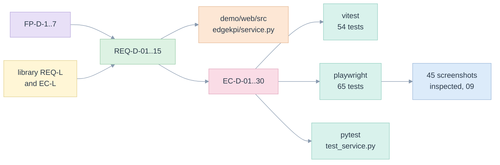

# 02. Requirements and traceability

> Fifteen requirements, each with the code that meets it, the tests that prove it, the screenshot that shows it and the edge cases it must survive.

Related: [README](README.md) · [00 principles](00-five-whys-and-first-principles.md) · [06 edge cases](06-edge-cases-and-state-charts.md) · [07 tests](07-test-strategy-and-e2e.md) · [library 02](../library/02-requirements-and-traceability.md)

Test references are `file::fragment`: the fragment appears in the title of a test of that file. Python tests are `file::test_name`. `tests/test_ux_demo_docs.py` fails if one does not exist.

## Requirements

| Id | Requirement | Code | Tests | Screenshot | Edge cases |
|---|---|---|---|---|---|
| REQ-D-01 | Build a report from the catalogue: KPIs, rows, columns, totals, dates, a filter, a backend | [Builder.tsx](../../demo/web/src/components/Builder.tsx), [request.ts](../../demo/web/src/domain/request.ts) | `request.test.ts::does not add a KPI twice`, `report.spec.ts::removing and adding a KPI changes the tabs` | [01](e2e/screenshots/01-report-default.png) | EC-D-07, EC-D-08, EC-D-20 |
| REQ-D-02 | Show the result as a pivot with every total labelled; NULL is not Total; a blank is a dash | [pivot.ts](../../demo/web/src/domain/pivot.ts), [Pivot.tsx](../../demo/web/src/components/Pivot.tsx), [format.ts](../../demo/web/src/domain/format.ts) | `pivot.test.ts::orders children first`, `report.spec.ts::EC-D-05`, `report.spec.ts::EC-D-10` | [03](e2e/screenshots/03-report-two-row-levels.png) | EC-D-05, EC-D-09, EC-D-10, EC-D-16 |
| REQ-D-03 | Show the check: the five-step lifecycle and the reconciliation result | [Stepper.tsx](../../demo/web/src/components/Stepper.tsx), [ReportScreen.tsx](../../demo/web/src/screens/ReportScreen.tsx) | `report.spec.ts::a default report is computed, checked and shown` | [01](e2e/screenshots/01-report-default.png) | EC-D-03, EC-D-21 |
| REQ-D-04 | Explain a number: its measures, its formula and the tempting wrong answer | [explain.py](../../edgekpi/explain.py), [Explain.tsx](../../demo/web/src/components/Explain.tsx) | `test_service.py::test_explain_shows_the_measures_and_the_tempting_wrong_answer`, `report.spec.ts::a rate total is its own counts divided`, `report.spec.ts::a distinct count total is below the sum of its cells` | [05](e2e/screenshots/05-explain-rate-total.png), [06](e2e/screenshots/06-explain-distinct.png) | EC-D-11, EC-D-12 |
| REQ-D-05 | Show the statement a backend runs; parameters stay bound | [ReportScreen.tsx](../../demo/web/src/screens/ReportScreen.tsx), [service.py](../../edgekpi/service.py) `plan` | `report.spec.ts::EC-L-07`, `test_service.py::test_a_metric_view_plan_can_be_shown_without_a_warehouse` | [11](e2e/screenshots/11-report-statement.png) | EC-D-06 |
| REQ-D-06 | Compare the backends: three statements, a verification against the reference, the recorded warehouse run | [BackendsScreen.tsx](../../demo/web/src/screens/BackendsScreen.tsx), [service.py](../../edgekpi/service.py) `verify`, `evidence` | `screens.spec.ts::one report, three statements`, `screens.spec.ts::verify compares each connected backend`, `screens.spec.ts::the recorded warehouse run is shown as recorded` | [21](e2e/screenshots/21-backends.png), [22](e2e/screenshots/22-backends-verified.png) | EC-D-06, EC-D-18, EC-D-23 |
| REQ-D-07 | Show a migration: templates accepted or refused with reasons, the inferred model, the parity proof | [MigrationScreen.tsx](../../demo/web/src/screens/MigrationScreen.tsx), [service.py](../../edgekpi/service.py) `inference` | `screens.spec.ts::six templates accepted, two refused`, `test_service.py::test_the_inference_payload_carries_the_parity_proof` | [23](e2e/screenshots/23-migration.png), [24](e2e/screenshots/24-migration-refused.png) | EC-D-24 |
| REQ-D-08 | Resolve an assistant's loose proposal: notes, questions, a validated request that opens in the Report | [AssistantScreen.tsx](../../demo/web/src/screens/AssistantScreen.tsx), [intent.py](../../edgekpi/intent.py) | `screens.spec.ts::an ambiguous word becomes a question`, `screens.spec.ts::a resolved proposal opens in the Report screen` | [26](e2e/screenshots/26-assistant-resolved.png), [27](e2e/screenshots/27-assistant-question.png) | EC-D-17 |
| REQ-D-09 | Run the library's edge cases live and judge each against what a correct service answers | [LabScreen.tsx](../../demo/web/src/screens/LabScreen.tsx), [scenarios.ts](../../demo/web/src/domain/scenarios.ts) | `screens.spec.ts::every case is answered as a correct service should`, `request.test.ts::have unique ids` | [29](e2e/screenshots/29-lab-all-pass.png) | EC-L-01 to EC-L-22 (twelve cases) |
| REQ-D-10 | Fail honestly: unreachable, refused, malformed, slow, stale, empty | [client.ts](../../demo/web/src/api/client.ts), [asyncState.ts](../../demo/web/src/state/asyncState.ts), [ErrorBanner.tsx](../../demo/web/src/components/ErrorBanner.tsx) | `resilience.spec.ts::EC-D-01`, `resilience.spec.ts::EC-D-03`, `resilience.spec.ts::EC-D-04`, `state.test.ts::turns a network failure into SERVICE_UNREACHABLE` | [12](e2e/screenshots/12-service-down.png), [13](e2e/screenshots/13-report-loading.png) | EC-D-01 to EC-D-04, EC-D-19 |
| REQ-D-11 | Be operable by keyboard, never rely on colour alone, and fit a narrow window | [Pivot.tsx](../../demo/web/src/components/Pivot.tsx), [ui.tsx](../../demo/web/src/components/ui.tsx), [styles.css](../../demo/web/src/styles.css) | `report.spec.ts::EC-D-12`, `screens.spec.ts::EC-D-15`, `resilience.spec.ts::EC-D-16` | [14](e2e/screenshots/14-report-narrow.png) | EC-D-12, EC-D-15, EC-D-16 |
| REQ-D-12 | A service layer with a stable JSON contract and an error mapping | [service.py](../../edgekpi/service.py), [server.py](../../edgekpi/server.py) | `test_service.py::test_domain_errors_carry_a_code_and_a_status`, `test_service.py::test_malformed_input_is_a_400_not_a_crash`, `test_service.py::test_an_oversized_body_is_refused` | n/a | EC-D-22 |
| REQ-D-13 | Nothing is mocked; what cannot run here says so | [service.py](../../edgekpi/service.py) `backend_status` | `report.spec.ts::EC-D-06`, `test_service.py::test_a_service_without_evidence_or_templates_says_so` | [01](e2e/screenshots/01-report-default.png) | EC-D-06, EC-D-23, EC-D-24 |
| REQ-D-14 | Keep evidence: screenshots saved, inspected, and the inspection recorded | [helpers.ts](../../demo/web/e2e/helpers.ts), [09](09-visual-inspection-log.md) | `test_ux_demo_docs.py::test_every_cited_screenshot_exists_and_none_is_orphaned` | all 45 | n/a |
| REQ-D-15 | Teach: a twelve-step tutorial on the problem, the three ways to write a KPI (Databricks metric view, Malloy on DuckDB and on Databricks, generated SQL), how a KPI is expressed and how saved queries are moved over, every number computed live | [TutorialScreen.tsx](../../demo/web/src/screens/TutorialScreen.tsx), [tutorial/](../../demo/web/src/screens/tutorial), [tutorial.ts](../../demo/web/src/domain/tutorial.ts), [service.py](../../edgekpi/service.py) `messages`, `plan` | `tutorial.spec.ts::step 7 explains the three ways`, `tutorial.spec.ts::step 8 teaches the SQL`, `tutorial.spec.ts::step 9 shows the five stages`, `test_service.py::test_the_same_malloy_model_is_written_for_duckdb_and_for_databricks`, `tutorial.test.ts::grows one idea at a time` | [37](e2e/screenshots/37-tutorial-7-metric-view.png), [3j](e2e/screenshots/3j-tutorial-7-malloy-databricks.png), [3a](e2e/screenshots/3a-tutorial-8-recipes.png), [3h](e2e/screenshots/3h-tutorial-9-before-after.png) | EC-D-25 to EC-D-30 |

## Traceability in both directions

## Not yet traced

| Item | Status |
|---|---|
| Browsers other than Chrome | Playwright runs the installed Chrome only; Firefox and Safari are untested |
| Screen readers | roles, labels and live regions are in place and checked by locators, not by a screen-reader run |
| A result of thousands of nodes | not generated; no virtualisation |
