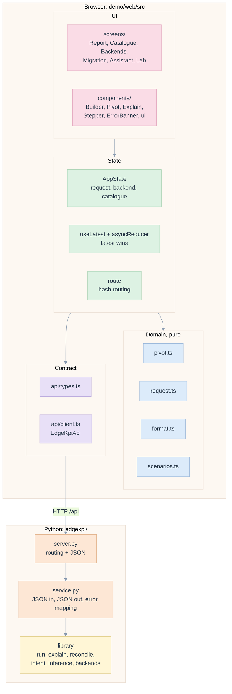
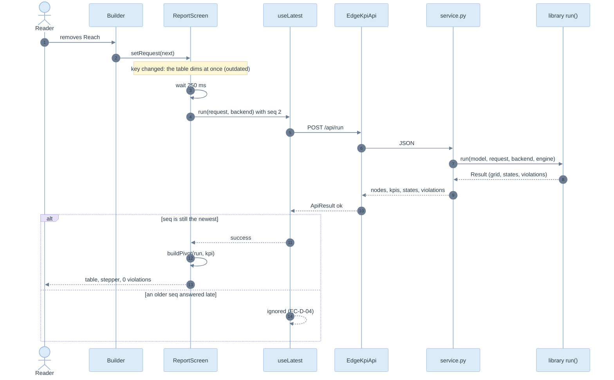

# 03. Architecture, SOLID and DRY

> Four layers on the front end, a thin service behind it, the real library behind that. Dependencies point down; every rule has one home.

Related: [README](README.md) · [02 requirements](02-requirements-and-traceability.md) · [04 data contract](04-data-contract-and-api.md) · [library 03](../library/03-architecture-solid-dry.md)

## The stack

**Dependency rule.** A module imports from its own layer or below. `domain/` imports nothing from `state/`, `components/` or `api/` except types. `components/` never imports `fetch`; only [client.ts](../../demo/web/src/api/client.ts) does. [scenarios.ts](../../demo/web/src/domain/scenarios.ts) is data plus predicates: the lab reads it, the tests read it.

## Modules

| Layer | Module | One responsibility | Lines |
|---|---|---|---|
| Contract | [types.ts](../../demo/web/src/api/types.ts) | the shapes that cross the wire | 191 |
| Contract | [client.ts](../../demo/web/src/api/client.ts) | `EdgeKpiApi` and its HTTP implementation, error normalisation | 55 |
| Domain | [format.ts](../../demo/web/src/domain/format.ts) | how a value, a member and an id are written | 22 |
| Domain | [pivot.ts](../../demo/web/src/domain/pivot.ts) | long result to a table, ordered, with labels | 72 |
| Domain | [request.ts](../../demo/web/src/domain/request.ts) | edits of a request and the hints they need | 86 |
| Domain | [scenarios.ts](../../demo/web/src/domain/scenarios.ts) | the lab's cases and what a correct answer is | 87 |
| State | [asyncState.ts](../../demo/web/src/state/asyncState.ts) | a pure reducer: idle, loading, success, error, latest wins | 27 |
| State | [useLatest.ts](../../demo/web/src/state/useLatest.ts) | the hook around the reducer | 28 |
| State | [AppState.tsx](../../demo/web/src/state/AppState.tsx) | what survives navigation | 46 |
| State | [route.ts](../../demo/web/src/state/route.ts) | hash routes and the fallback | 34 |
| UI | [components/](../../demo/web/src/components/ui.tsx) | seven files: ui, Builder, Pivot, Explain, Stepper, ErrorBanner, CodeBlock | about 530 |
| UI | [screens/](../../demo/web/src/screens/ReportScreen.tsx) | one per route, each composing components | about 670 |
| Service | [service.py](../../edgekpi/service.py), [server.py](../../edgekpi/server.py) | JSON in and out; routing | 177, 98 |

The whole front end is about 2,400 lines of TypeScript and CSS, tests included.

## SOLID, with the code that shows it

| Principle | How it is applied | Evidence |
|---|---|---|
| **S**ingle responsibility | `pivot.ts` arranges; `format.ts` writes; `request.ts` edits; `asyncState.ts` sequences. A change of number format touches one file | module table |
| **O**pen/closed | A new screen is a route entry and a component; a new lab case is one object in `SCENARIOS`; a new backend appears in the Backends screen as soon as the service lists it | [route.ts](../../demo/web/src/state/route.ts) `ROUTES`, [scenarios.ts](../../demo/web/src/domain/scenarios.ts) |
| **L**iskov substitution | Any `EdgeKpiApi` can stand in for the HTTP one: unit tests give it a fake `fetch`, e2e tests intercept the real one, and the screens cannot tell | `state.test.ts::http api` |
| **I**nterface segregation | `EdgeKpiApi` has eight narrow calls; a screen uses two or three. `Builder` receives the catalogue and the request, never the whole app state | [client.ts](../../demo/web/src/api/client.ts), [Builder.tsx](../../demo/web/src/components/Builder.tsx) |
| **D**ependency inversion | `AppProvider` takes an `api` prop; `main.tsx` is the only place that builds the HTTP one | [App.tsx](../../demo/web/src/App.tsx), [main.tsx](../../demo/web/src/main.tsx) |

## DRY: one rule, one place

| Rule | Single home | Used by | If it were duplicated |
|---|---|---|---|
| A NULL member reads `(none)` | `format.memberLabel` | pivot, explain, filter picker | `(none)` in one table and blank in another |
| A missing value reads `–` | `format.formatValue` | pivot cells, explain terms | `NaN` or `null` leaking onto a screen |
| Rows before their subtotal, grand total last | `pivot.compareKeys` | pivot rows and columns | rows and columns ordered differently |
| A dimension sits on one axis once | `request.addDimension`, `freeDimensions` | Builder | the service refusing what the UI offered |
| Latest answer wins | `asyncReducer` | every screen that calls the service | a slow answer overwriting a newer one, screen by screen |
| An error is `{code, message, states}` | `client.ts` normalisation, `ErrorBanner` | every screen | each screen inventing its own error text |
| Which codes are retriable | `ErrorBanner` `DOMAIN` pattern | every error shown | a Retry button on a refusal |
| Readable ids (`send_year` to `Send year`) | `format.titleCase` | Builder, Pivot, Explain, Catalogue | two spellings of one dimension |
| The request key | `request.requestKey` | Report (when to run), Backends (when to compile) | screens disagreeing on "has it changed" |
| Mapping a library error to a status | `service.error_payload` | `server.py` | statuses drifting from codes |

## A report, end to end

