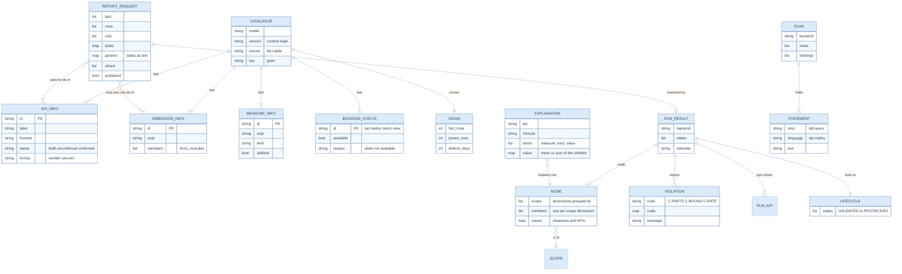
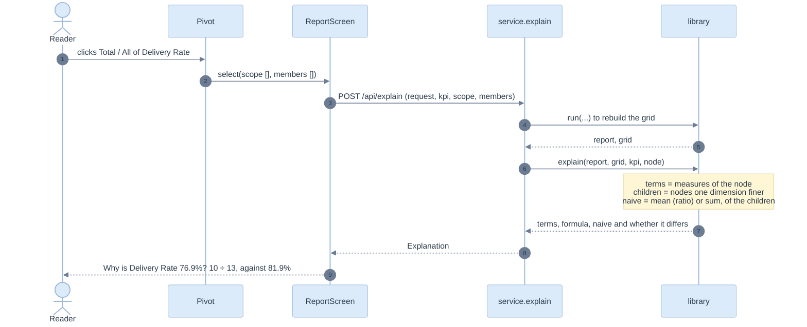
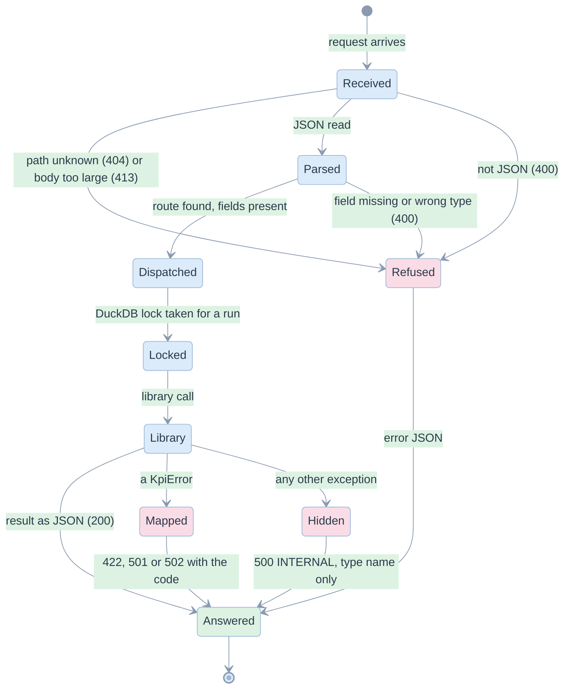

# 04. Data contract and API

> Eight calls, one error shape, and a status for every library failure. The browser sees only JSON; the library never leaves Python.

Related: [README](README.md) · [03 architecture](03-architecture-solid-dry.md) · [06 edge cases](06-edge-cases-and-state-charts.md) · [library 08](../library/08-ai-and-integration.md#integration-shape)

Code: [service.py](../../edgekpi/service.py) (the calls), [server.py](../../edgekpi/server.py) (routing, size limit), [types.ts](../../demo/web/src/api/types.ts) (the same shapes in TypeScript), [client.ts](../../demo/web/src/api/client.ts). Tests: [test_service.py](../../tests/test_service.py).

## Entities on the wire



## The calls

| Call | Library behind it | Returns | Used by |
|---|---|---|---|
| `GET /api/catalogue` | `catalog`, `request_json_schema`, `check_grain`, members of each dimension | model, KPIs, measures, dimensions with members, filters, grain proof, backend availability | every screen, once |
| `POST /api/run` `{request, backend}` | `runner.run` with reconciliation in `flag` mode | states, KPIs, nodes (long form), violations, estimate | Report, Lab |
| `POST /api/plan` `{request, backend}` | `validate`, `backend.compile`, `estimate` | statements, notes, bindings, scopes | Report (Statement), Backends |
| `POST /api/explain` `{request, kpi, scope, members, backend}` | `run`, then `explain.explain` | measures of the node, formula, the mean or sum of the children | Report (click a cell) |
| `POST /api/verify` `{request}` | `conformance.conformance` over every connected backend, against `oracle.reference` | one outcome per backend, and what was skipped | Backends |
| `POST /api/resolve` `{proposal}` | `intent.resolve` | a validated request, or questions, and notes | Assistant |
| `GET /api/evidence` | reads the latest recorded warehouse run | pairs, requests, per-request outcomes, warehouse | Backends |
| `GET /api/inference` | `inference.infer` then `parity.verify`, computed once and cached | templates with reasons, measures, KPIs, parity counts, YAML | Migration |

The nodes are the library's long form: a rolled-up dimension is absent from `scope`; a NULL member is `null` in `members`. Pivoting is the browser's job ([pivot.ts](../../demo/web/src/domain/pivot.ts)).

## Errors

Every failure has one shape, `{ ok: false, error: { code, message, states } }`, and a status that follows the kind of failure.

| Library error | HTTP status | Typical codes | What the UI does |
|---|---|---|---|
| `RequestError`, `DefinitionError`, other `KpiError` | 422 | `REQ_UNKNOWN_KPI`, `REQ_BAD_PARAM`, `REQ_UNCONFIRMED_KPI`, `REQ_UNKNOWN_NODE` | banner with the code and "Change the report and it runs again"; no Retry |
| `UnsupportedError` | 501 | `ENGINE_UNAVAILABLE`, `MALLOY_UNSUPPORTED` | banner; the backend is disabled up front where known |
| `EngineError` | 502 | `ENGINE_FAILED`, `ENGINE_INCOMPLETE_RESULT` | banner with Retry |
| malformed JSON, missing field, wrong type | 400 | `BAD_REQUEST` | banner with Retry |
| body above 1,000,000 bytes | 413 | `BODY_TOO_LARGE` | banner |
| unknown path | 404 | `NOT_FOUND` | banner |
| anything else | 500 | `INTERNAL` | banner; the message is only the exception's type name, never its text or a path |
| network failure | none | `SERVICE_UNREACHABLE` (made by the client) | banner with Retry and the command that starts the service |
| a body that is not JSON | any | `BAD_RESPONSE` (made by the client) | banner with Retry |

`states` carries the lifecycle reached before the failure (`["VALIDATED", "FAILED"]`), so the Stepper can show where it stopped.

## What a call looks like

```
POST /api/run
{ "request": { "kpis": ["sent", "delivery_rate"], "rows": ["typology"], "cols": ["market"],
               "totals": {"rows": true, "cols": true}, "params": {"start_date": "2026-01-01"},
               "where": [], "published": false },
  "backend": "sql" }

200 { "ok": true, "backend": "sql",
      "states": ["VALIDATED", "COMPILED", "EXECUTED", "ASSEMBLED", "RECONCILED"],
      "dims": ["typology", "market"], "rows": ["typology"], "cols": ["market"],
      "kpis": [{"id": "sent", "label": "Message Sent", "format": "number", "status": "confirmed", "measures": ["n_sent"]}, ...],
      "nodes": [{"scope": ["typology", "market"], "members": ["New", "HK"], "values": {"n_sent": 3, "sent": 3, ...}},
                {"scope": [], "members": [], "values": {"n_sent": 8, ...}}, ...],
      "violations": [], "estimate": "4 scopes x 2 measures = 8 aggregate states, 0 of them distinct counts" }

422 { "ok": false, "error": { "code": "REQ_UNKNOWN_KPI", "message": "unknown KPI 'ghost'; known: [...]", "states": ["FAILED"] } }
```

## The explain call



`explain` prefers the split in which the tempting answer is actually wrong. For Reach, splitting by typology happens to add up (3 + 2 + 1 = 6), but by market it gives 9; the panel shows the market split. The service re-runs the report to stay stateless; a cache is on the [backlog](08-implementation-plan.md#not-built).

## The service in one picture


