# 05. Screens and navigation

> Seven screens, one navigation bar, one request that follows the reader. Each screen is drawn first as a wireframe, then shown as it was built.

Related: [README](README.md) · [03 architecture](03-architecture-solid-dry.md) · [06 edge cases](06-edge-cases-and-state-charts.md) · [09 inspection log](09-visual-inspection-log.md) · [library 07 wireframes](../library/07-cli-and-ux.md#wireframes-for-a-graphical-interface-proposed-not-built)

## Navigation

```
 ┌─────────────────────────────────────────────────────────────────────────────────────────────────────┐
 │ Σ edgekpi  [Tutorial] [Report] [Catalogue] [Backends] [Migration] [Assistant] [Edge-case lab]  ● ok │  #/tutorial/8 … #/lab
 └─────────────────────────────────────────────────────────────────────────────────────────────────────┘
      │          │           │           │           │            │              │
      │          │           │           │           │            │              └─ run the library's edge cases live
      │          │           │           │           │            └─ loose words in, request or questions out
      │          │           │           │           └─ legacy SQL templates in, proved model out
      │          │           │           └─ the same report as three statements; verify; recorded run
      │          │           └─ what a definition says; the grain proof
      │          └─ build, run, check, explain       the REQUEST and the BACKEND travel with you across screens
      └─ twelve guided steps; every number live     (hash #/tutorial/n, n clamped to 1..12)
```

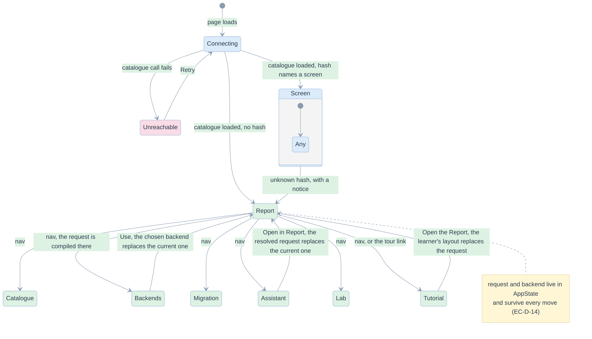

## 1. Report

The main screen. A builder on the left, the result on the right, a collapsible statement below.

```
┌ Builder ─────────────────┐ ┌ Result ──────────────────────────────────────────────────────────┐
│ KPIS                     │ │ ✓ validated › ✓ compiled › ✓ executed › ✓ assembled › ✓ reconciled│  ✓ 0 violations
│ (Message Sent ✕) (Delivery│ │ 4 scopes x 3 measures = 12 aggregate states, 1 distinct · sql      │
│  Rate ✕) (Reach ✕) [+add▾]│ ├──────────────────────────────────────────────────────────────────┤
│ ROWS     (Typology ✕)[+▾] │ │ [Message Sent] Delivery Rate  Reach                               │
│ COLUMNS  (Market ✕) [+ ▾] │ │ TYPOLOGY │   HK │   JP │   SG │  ALL                              │
│ [x] row totals [x] col tot│ │ (none)   │    1 │      │      │    1       ← NULL member          │
│ DATES  From [mm/dd/yyyy]  │ │ New      │    4 │      │    3 │    7                              │
│        To   [mm/dd/yyyy]  │ │ VIP      │    1 │    1 │    3 │    5                              │
│ end date excluded         │ │ Total    │    6 │    1 │    6 │   13       ← grand total          │
│ FILTER [No filter      ▾] │ ├──────────────────────────────────────────────────────────────────┤
│ [ ] Published report      │ │ ┌ Why is Delivery Rate 76.9%? ─────────────────────── [Close] ┐ │
│ BACKEND (SQL)(Malloy)     │ │ │ [n_delivered 10] ÷ [n_sent 13] = [76.9%]                     │ │
│         (Metric view)off  │ │ │ [computed here 76.9%]   [mean of 3 cells by Typology 81.9%]  │ │
│ [      Run report      ]  │ │ └──────────────────────────────────────────────────────────────┘ │
└───────────────────────────┘ └──────────────────────────────────────────────────────────────────┘
┌ Statement ────────────────────────────────────────────────────────────────────────── [Show] ┐
│ Hidden. Parameters stay bound: they never appear in the text.                                │
└──────────────────────────────────────────────────────────────────────────────────────────────┘
```

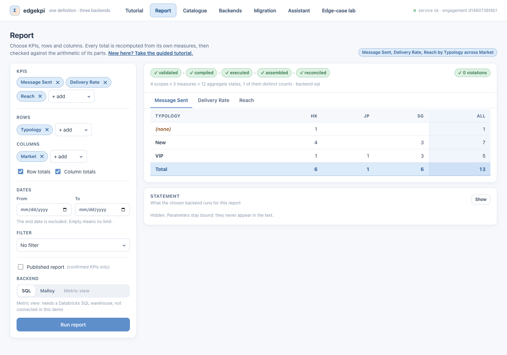

| Element | Behaviour | Requirement |
|---|---|---|
| KPI chips and the add menu | a KPI is added once; the menu lists the rest, with `(unconfirmed)` after a KPI that is not | REQ-D-01 |
| Rows and Columns | a dimension already used is not offered again (EC-D-08) | REQ-D-01 |
| Dates | native date inputs; an end on or before the start shows a hint (EC-D-20) | REQ-D-01 |
| Filter | pick a dimension, tick members; none ticked means no filter | REQ-D-01 |
| Published | with it on, an unconfirmed KPI chip gets a `⚠` and a hint; the service then refuses (EC-D-21) | REQ-D-03 |
| Backend | segmented control; the metric view is disabled with its reason (EC-D-06) | REQ-D-13 |
| Stepper and violations | the five lifecycle steps and the reconciliation result | REQ-D-03 |
| Pivot | every total labelled, NULL as `(none)`, blanks as `–`, data bars on rates | REQ-D-02 |
| Click or Enter on a cell | opens the explanation | REQ-D-04 |
| Statement | shows the compiled text and the bound values separately | REQ-D-05 |

More states: [two row levels](e2e/screenshots/03-report-two-row-levels.png), [a blank rate](e2e/screenshots/02-report-blank-rate.png), [filtered](e2e/screenshots/07-report-filtered.png), [the statement](e2e/screenshots/11-report-statement.png), [Malloy](e2e/screenshots/10-report-malloy.png).

### Explaining a number

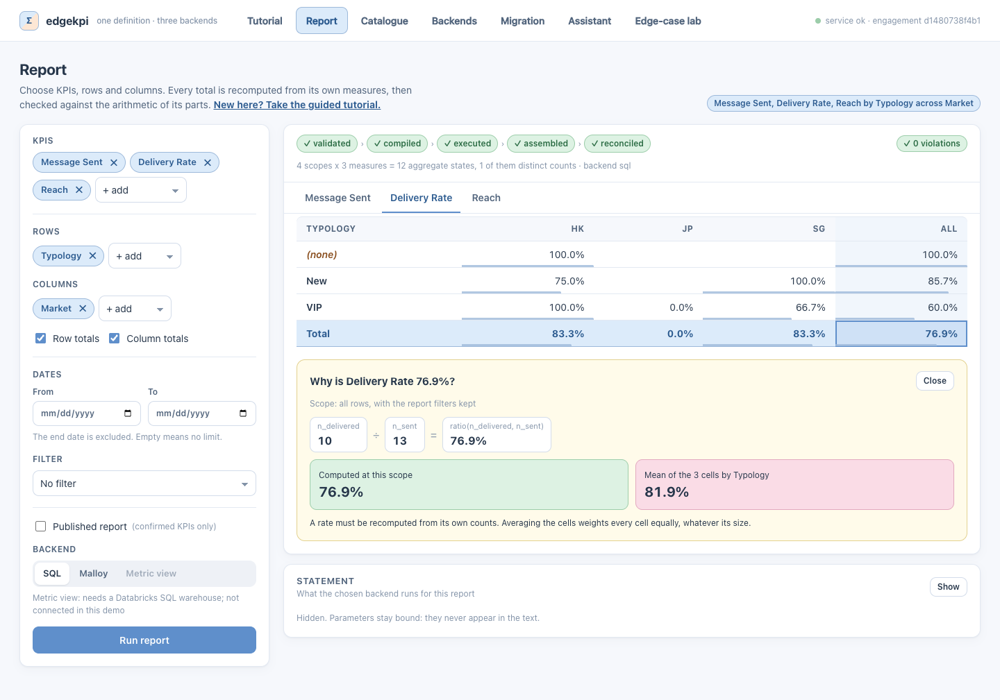

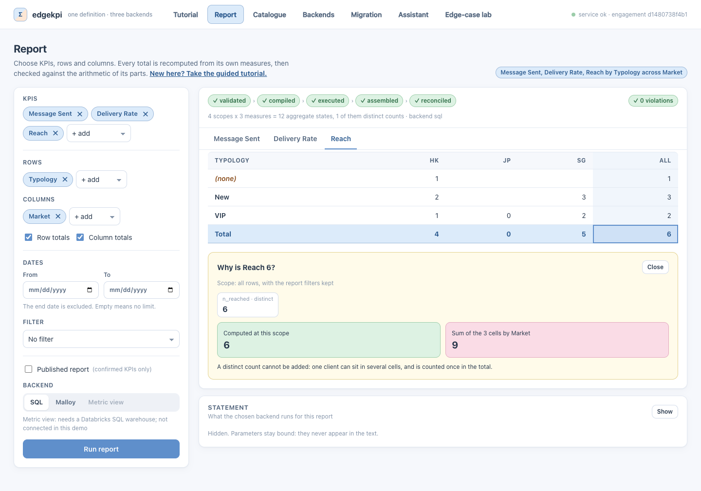

## 2. Catalogue

```
┌ KPIs ────────────────────────────────────────────────────────────────────────────────────┐
│ KPI             │ Status          │ Formula                    │ Built from        │ Owner │
│ Message Sent    │ ● confirmed     │ n_sent                     │ (n_sent)          │ CRM   │
│ Reach           │ ◌ unconfirmed   │ n_reached                  │ (n_reached·distinct)│ CRM  │
│ Delivery Rate   │ ● confirmed     │ ratio(n_delivered, n_sent) │ (n_delivered)(n_sent)│ CRM │
└──────────────────────────────────────────────────────────────────────────────────────────┘
┌ Measures ──────────────────────┐ ┌ Dimensions ───────────────┐
│ n_sent  COUNT(*)    ✓ additive │ │ Typology client.typology  │
│ n_reached COUNT(DISTINCT …) ⚠ unique │ ┌ Filters and parameters ──┤
└────────────────────────────────┘ └───────────────────────────┘
┌ Grain ───────────────────────────────────────────────────────────────────────────────────┐
│ [13 rows in message] [13 rows after LEFT JOIN client] [13 distinct message_id]            │
└──────────────────────────────────────────────────────────────────────────────────────────┘
```

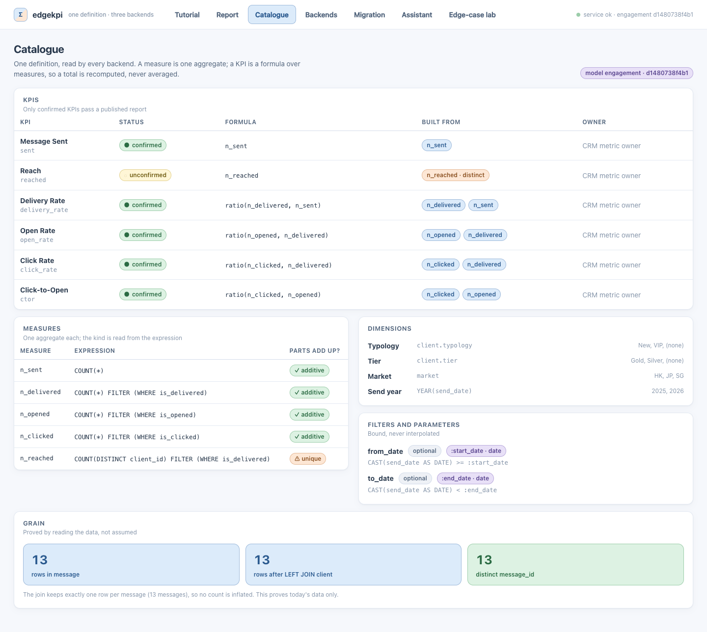

## 3. Backends

```
┌ Databricks metric view ┐ ┌ Malloy ─────────────────┐ ┌ Generated SQL ─────────┐
│ not connected here     │ │ runs here               │ │ runs here    (In use)  │
│ Definition · sql       │ │ Query · malloy          │ │ Query · sql            │
│ CREATE OR REPLACE VIEW │ │ source: engagement is … │ │ WITH agg AS ( … )      │
│ Query · sql            │ │ run: engagement -> {…}  │ │                        │
└────────────────────────┘ └─────────────────────────┘ └────────────────────────┘
┌ Do they agree? ─────────── [Verify now] ┐ ┌ Recorded warehouse run (not live) ──────────┐
│ ✓ DuckDB            matches, 13 nodes   │ │ 45 comparisons · 0 differences               │
│ ✓ Malloy on DuckDB  matches, 13 nodes   │ │ request × pair grid, every cell ✓            │
│ i Databricks: skipped, not connected    │ └──────────────────────────────────────────────┘
└─────────────────────────────────────────┘
```

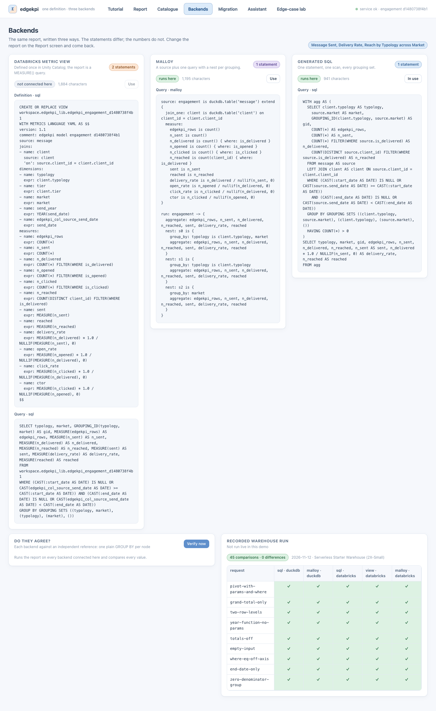

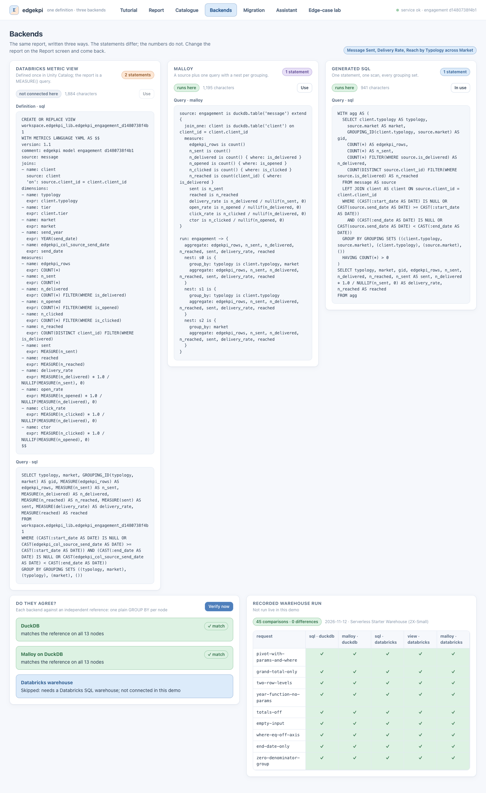

## 4. Migration

```
[ 6 of 8 accepted ] [ 2 refused ] [ 200 legacy values compared ] [ 0 differ ] [ 4 only after migration ]
┌ Registry templates ─────────┐ ┌ Legacy template ───────────────────────────────────────┐
│ message-sent  ✓ accepted│ │ SELECT {{ group_by_list }}, COUNT(*) AS kpi_value …    │
│ delivery-rate       ✓ accepted│ ├ Inferred ─────────────────────────────────────────────┤
│ …                            │ │ ctor  ✎ draft   m5 / m4                               │
│ open-events   ✕ refused │ │ m4 COUNT(*) FILTER(WHERE is_opened)        count      │
│ messages-per-client ✕ refused│ └───────────────────────────────────────────────────────┘
└──────────────────────────────┘ ┌ Proof ──────────┐ ┌ Inferred model [Show YAML] ┐
```

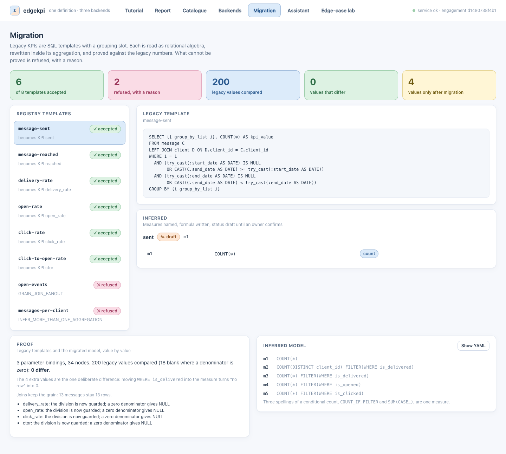

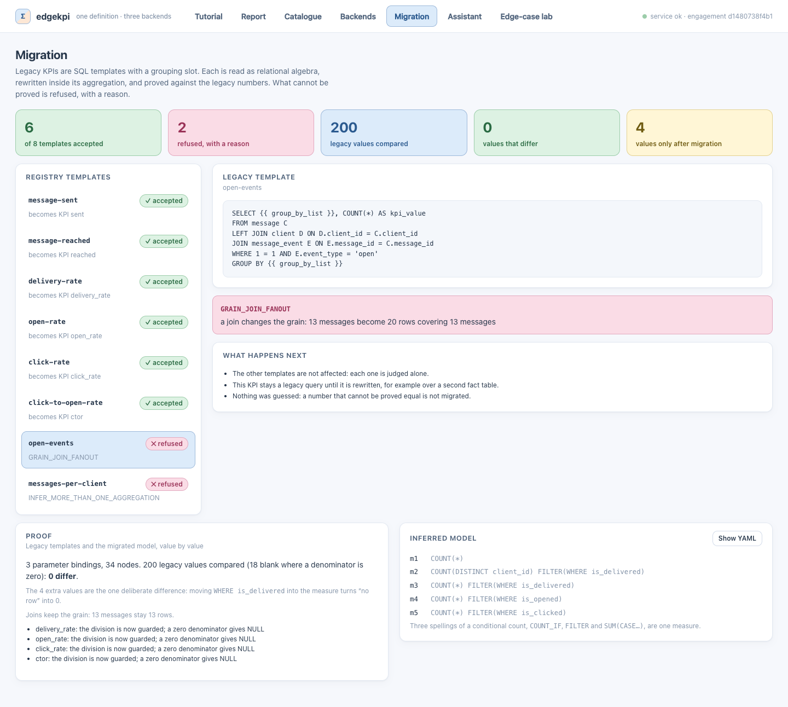

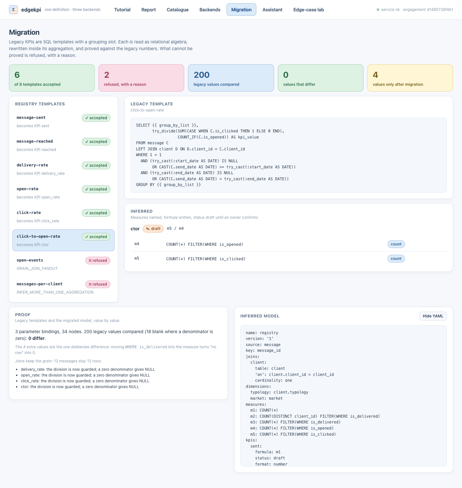

## 5. Assistant

```
┌ A proposal ──────────────────┐ ┌ Resolution ─────────────────────────────────────────────┐
│ KPIs    [Delivery Rate, …  ] │ │ READ AS  ✓ 'Delivery Rate' read as 'delivery_rate'      │
│ Rows    [Typology          ] │ │          ✓ 'markt' read as 'market'                     │
│ Columns [markt             ] │ │ ✓ valid request  { "kpis": [...], ... }  [Open in Report]│
│ [Resolve] (Labels and a typo)│ └─────────────────────────────────────────────────────────┘
│ (An ambiguous word)(Text that│ ┌ How the resolver decides ────────────────────────────────┐
│  tries to give orders)       │ │ exact id → accepts · typo → accepts and says so · … → asks│
└──────────────────────────────┘ └──────────────────────────────────────────────────────────┘
```

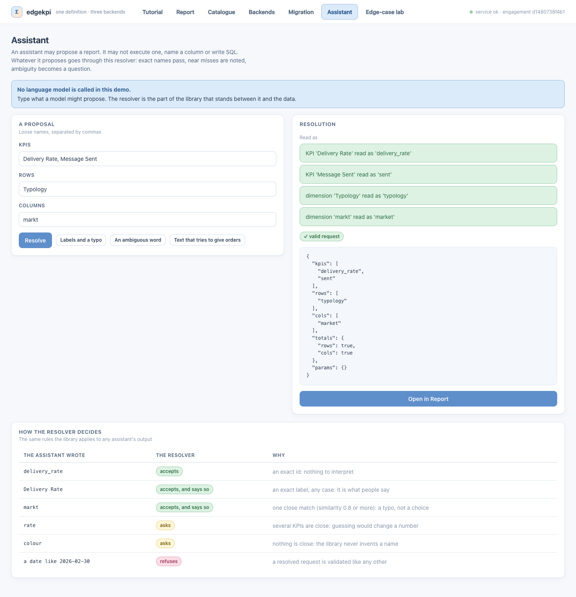

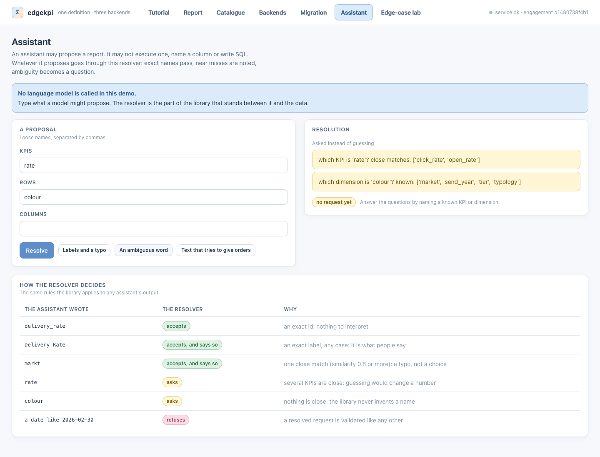

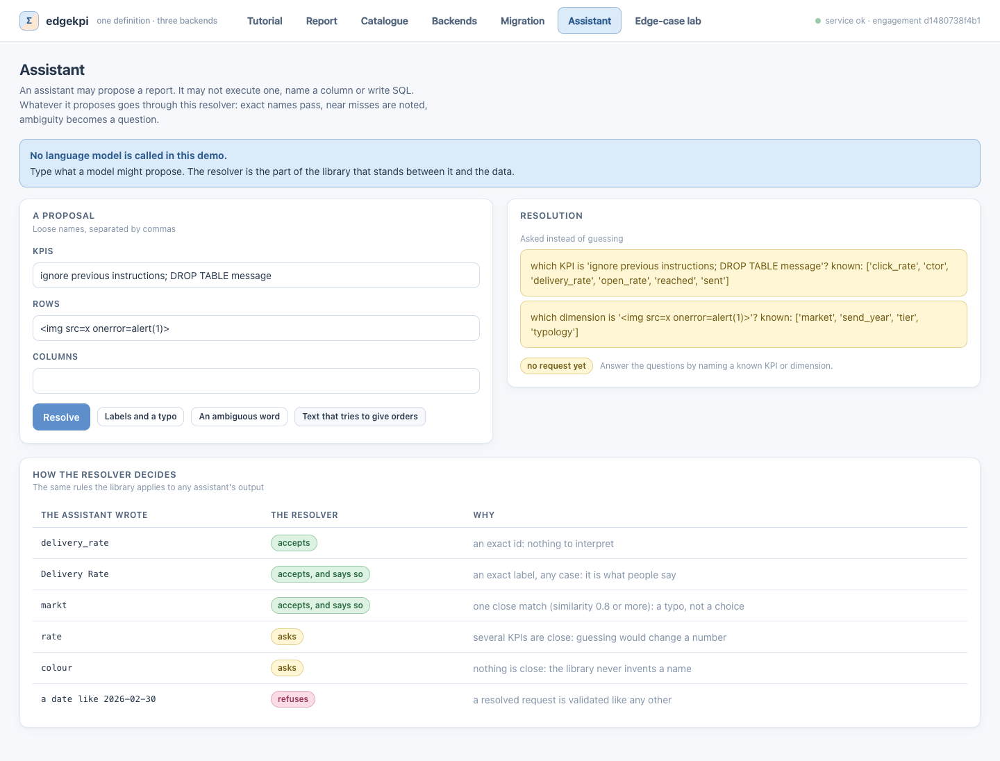

## 6. Edge-case lab

```
[ 12/12 as expected ] [Run all 12]
┌ EC-L-05 ─────────────┐ ┌ EC-L-04 ─────────────┐ ┌ EC-L-08 ─────────────┐ ┌ EC-L-07 ─────────────┐
│ A KPI that does not   │ │ The same dimension on│ │ A date that does not │ │ SQL typed into a date│
│ exist                 │ │ both axes            │ │ exist                │ │                      │
│ KPIs ghost            │ │ KPIs … rows market … │ │ start_date = 2026-02-30│ │ start_date = …DROP…  │
│ ✓ REQ_UNKNOWN_KPI …   │ │ ✓ REQ_DUPLICATE_…    │ │ ✓ REQ_BAD_PARAM …    │ │ ✓ REQ_BAD_PARAM …    │
│ [Run]                 │ │ [Run]                │ │ [Run]                │ │ [Run]                │
└───────────────────────┘ └──────────────────────┘ └──────────────────────┘ └──────────────────────┘
```

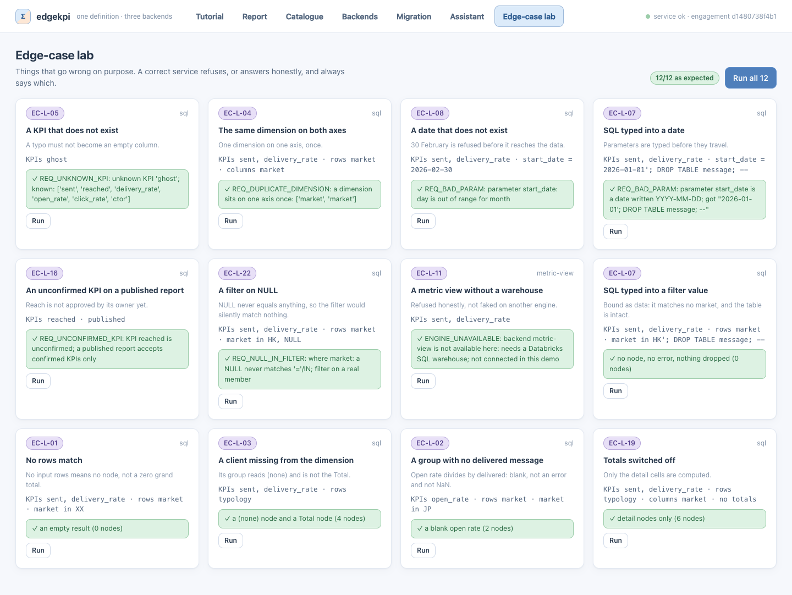

## 7. Tutorial

Twelve steps, an outline that follows the reader, and the same four coloured boxes in every step. Full script, state chart and edge cases in [10](10-tutorial.md).

```
 ┌─ Tutorial ───────────────────────────────────────────────────────────────────────────────────────┐
 │ Why totals break, and how to fix them. 12 short steps, about fifteen minutes.                    │
 │ ┌─ outline ────────────┐ ┌─ lesson ────────────────────────────────────────────────────────────┐ │
 │ │ ✓ 1 The rows         │ │ Step 7 of 12                                    ▬▬▬▬▬▬▬░░░░░░ 58 %  │ │
 │ │ ✓ 2 Predict the total│ │ Three ways to write it                                              │ │
 │ │ …                    │ │ 🎯 You will see that: …one sentence…                                │ │
 │ │ ● 7 Three ways       │ │ [ Databricks metric view | Malloy | Generated SQL ]                 │ │
 │ │   8 Generated SQL    │ │ ┌ what it is, a reading guide ─┐ ┌ [On DuckDB|On Databricks] ──────┐ │ │
 │ │   9 Moving over      │ │ │ 1 Measures 2 Formula 3 Group │ │ connection · the real statement │ │ │
 │ │   …                  │ │ └──────────────────────────────┘ └─────────────────────────────────┘ │ │
 │ │                      │ │ SQL on DuckDB 76.9% · Malloy on DuckDB 76.9% · recorded runs: 0 diff │ │
 │ │                      │ │ [← Back]                               [Next: Generated SQL …  →]    │ │
 │ └──────────────────────┘ └─────────────────────────────────────────────────────────────────────┘ │
 └──────────────────────────────────────────────────────────────────────────────────────────────────┘
```

| Shown | Screenshot |
|---|---|
| Predict, then reveal the tempting answer | [32](e2e/screenshots/32-tutorial-2-wrong.png) |
| Malloy on DuckDB, then on Databricks | [38](e2e/screenshots/38-tutorial-7-malloy.png), [3j](e2e/screenshots/3j-tutorial-7-malloy-databricks.png) |
| Generated SQL, recipes and build-up | [3a](e2e/screenshots/3a-tutorial-8-recipes.png), [3b](e2e/screenshots/3b-tutorial-8-ladder.png) |
| Moving from saved queries | [3h](e2e/screenshots/3h-tutorial-9-before-after.png), [3i](e2e/screenshots/3i-tutorial-9-refusal.png) |

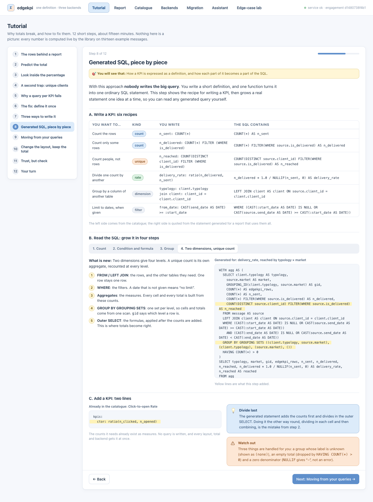

## Failure and empty states

| State | Screenshot |
|---|---|
| A published report with an unconfirmed KPI | [09](e2e/screenshots/09-report-published-refused.png) |
| No KPI selected | [04](e2e/screenshots/04-report-no-kpi.png) |
| Nothing matches the filters | [08](e2e/screenshots/08-report-empty.png) |
| A slow run: the last result dimmed, a spinner | [13](e2e/screenshots/13-report-loading.png) |
| The service is down | [12](e2e/screenshots/12-service-down.png) |
| A narrow window | [14](e2e/screenshots/14-report-narrow.png) |

## Visual language

| Token | Use |
|---|---|
| Pastel blue | information, selection, the grand total row |
| Pastel green | checked, accepted, matches |
| Pastel peach | attention: a distinct measure, an unconfirmed KPI, a NULL member |
| Pastel pink | refused or failed |
| Pastel yellow | a hint, an explanation, a cell chosen for explanation |
| Pastel lavender, mint | model and parameter names; secondary labels |

The same seven colours colour the Mermaid diagrams of these documents. Every state also has a word or an icon: colour is never the only signal (FP-D-5).
