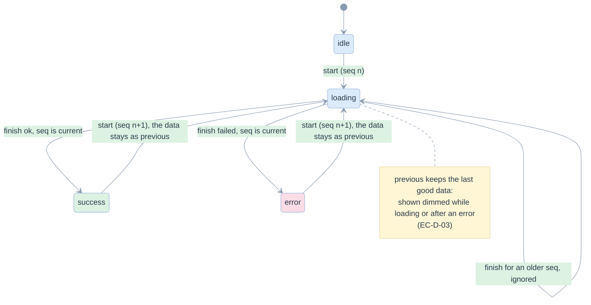
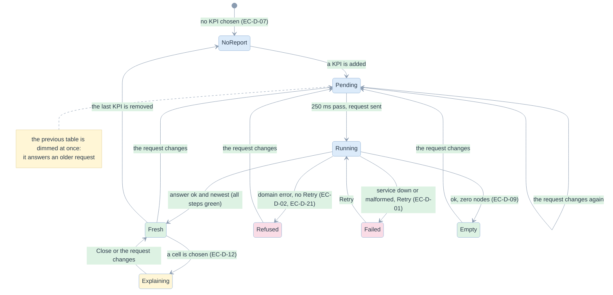
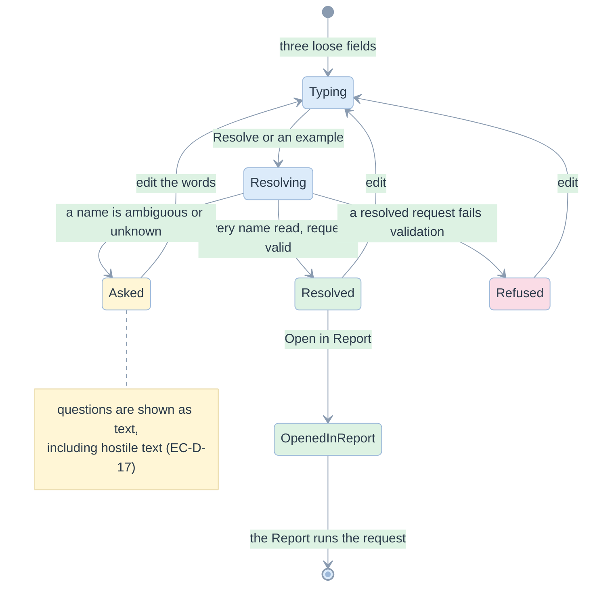

# 06. Edge cases and state charts

> Thirty edge cases on screen and in the service, each with the risk, the mitigation and the test that proves it. State charts show the lifecycles where order matters. Cases that are not mitigated are listed as open.

Related: [README](README.md) · [02 requirements](02-requirements-and-traceability.md) · [07 tests](07-test-strategy-and-e2e.md) · [library 10](../library/10-edge-cases-and-state-charts.md)

The library's own edge cases (`EC-L`) are run live in the Edge-case lab. This register covers what the demo adds: the screen and the service layer.

## Register

### The service is not there, slow, or wrong

| Id | Case | Risk if unhandled | Mitigation | Proof |
|---|---|---|---|---|
| EC-D-01 | The service is not running | a blank page, or a spinner forever | the client turns a network failure into `SERVICE_UNREACHABLE`; the shell shows the banner, the command that starts it, and Retry that recovers | `resilience.spec.ts::EC-D-01`, `state.test.ts::turns a network failure into SERVICE_UNREACHABLE` |
| EC-D-02 | The service answers with an error or with something that is not JSON | a stack trace, a crash, or a retry that cannot help | one error shape; domain errors (`REQ_*`, `DEF_*`) offer no Retry and say what to change; `BAD_RESPONSE` and `HTTP_<n>` are retriable | `resilience.spec.ts::EC-D-02`, `report.spec.ts::EC-D-21`, `state.test.ts::keeps the code and the message of a domain error` |
| EC-D-03 | A run takes long (Malloy, a cold start) | the screen looks frozen, or the old table looks current | the old result stays, dimmed, with a spinner; Run is disabled; the lifecycle steps dim | `resilience.spec.ts::EC-D-03`, `state.test.ts::keeps the last good data` |
| EC-D-04 | A slow answer to an older request arrives after a newer one | the table shows a report nobody asked for | each call has a sequence number; an answer for an older number is ignored | `state.test.ts::ignores the answer of an older call`, `resilience.spec.ts::EC-D-04` |
| EC-D-19 | Rapid changes or a double click | several runs in flight, flicker, wasted work | a 250 ms pause before a run; latest wins | `resilience.spec.ts::EC-D-04, EC-D-19` |
| EC-D-22 | A request body that is not JSON, lacks a field, or is far too large | a crash of the service, or memory exhaustion | 400 `BAD_REQUEST`; 413 above 1,000,000 bytes, answered before the body is read | `test_service.py::test_malformed_input_is_a_400_not_a_crash`, `test_service.py::test_an_oversized_body_is_refused` |

### What the data really contains

| Id | Case | Risk if unhandled | Mitigation | Proof |
|---|---|---|---|---|
| EC-D-05 | A NULL member beside a grand total | the unknown group merged into, or hidden by, the Total | `(none)` is a row of its own; the library's scope says which dimension is rolled up | `pivot.test.ts::keeps the NULL member`, `report.spec.ts::EC-D-05`, `test_service.py::test_run_returns_long_form_nodes_the_ui_can_pivot` |
| EC-D-09 | Nothing matches the filters | an empty table that looks broken, or a zero grand total | "No rows match", stated as the correct answer; the check still passes | `pivot.test.ts::is empty, not broken`, `report.spec.ts::EC-D-09` |
| EC-D-10 | A rate with a zero denominator | `NaN`, `null` or `Infinity` on screen | a dash, never a number; no data bar | `pivot.test.ts::EC-D-10`, `report.spec.ts::EC-D-10` |
| EC-D-11 | Explaining a detail cell, an unknown node, or a KPI not in the result | a misleading comparison, or an unhandled error | a detail cell says there is nothing finer; the service answers `REQ_UNKNOWN_NODE` or `REQ_UNKNOWN_KPI` | `report.spec.ts::EC-D-11`, `test_service.py::test_explain_a_leaf_has_nothing_to_compare`, `test_service.py::test_explain_refuses_an_unknown_node_or_kpi` |
| EC-D-16 | A wide table in a narrow window | the page scrolls sideways, the layout breaks | the table scrolls inside its own container; the header wraps | `resilience.spec.ts::EC-D-16` |

### What the reader can do

| Id | Case | Risk if unhandled | Mitigation | Proof |
|---|---|---|---|---|
| EC-D-07 | No KPI selected | an old table answers a question nobody asks any more | Run is disabled with a hint; the result area says "No report yet" | `request.test.ts::will not run without a KPI`, `report.spec.ts::EC-D-07` |
| EC-D-08 | The same dimension on two axes | the service refuses what the UI offered | the picker lists only unused dimensions | `request.test.ts::refuses to put a dimension on two axes`, `report.spec.ts::EC-D-08` |
| EC-D-20 | An end date on or before the start date | a silent empty report | a hint before the service is asked | `request.test.ts::warns when the end date`, `report.spec.ts::EC-D-20` |
| EC-D-21 | Published report with an unconfirmed KPI | the reader discovers the refusal only after running | the chip gets `⚠` and a hint names the KPI; the service refuses; removing the KPI recovers | `request.test.ts::names the KPIs a published report would refuse`, `report.spec.ts::EC-D-21` |
| EC-D-06 | A backend that cannot run here | a fake result, or a confusing failure | disabled in the control with its reason; a direct call returns 501 `ENGINE_UNAVAILABLE`; its statements can still be shown | `report.spec.ts::EC-D-06`, `test_service.py::test_a_metric_view_plan_can_be_shown_without_a_warehouse` |
| EC-D-18 | A slower backend (Malloy) | a different answer, or no feedback | the same totals as SQL; the same pending state | `report.spec.ts::EC-D-18` |
| EC-D-17 | Hostile text typed into the Assistant | script execution, markup injection | React renders text as text; the library echoes unknown names as quoted questions | `screens.spec.ts::EC-D-17` |

### Navigation and accessibility

| Id | Case | Risk if unhandled | Mitigation | Proof |
|---|---|---|---|---|
| EC-D-12 | Keyboard-only use | cells reachable only by mouse | cells are focusable, Enter or Space opens the explanation, chips have labelled remove buttons | `report.spec.ts::EC-D-12` |
| EC-D-13 | A deep link to an unknown screen | a blank page | falls back to the Report with a notice naming the unknown screen | `state.test.ts::falls back to the report`, `resilience.spec.ts::EC-D-13` |
| EC-D-14 | Moving between screens | the report the reader built is lost | request, backend and catalogue live above the screens | `resilience.spec.ts::EC-D-14` |
| EC-D-15 | Status shown by colour only | unreadable for colour-blind readers, lost in print | status is a word with an icon; unique measures say "distinct" | `screens.spec.ts::EC-D-15` |

### Optional data

| Id | Case | Risk if unhandled | Mitigation | Proof |
|---|---|---|---|---|
| EC-D-23 | No recorded warehouse run | an empty grid that looks like a failure | "No recorded run" with how to create one | `screens.spec.ts::EC-D-23`, `test_service.py::test_a_service_without_evidence_or_templates_says_so` |
| EC-D-24 | No templates configured for the migration | a broken screen | "No templates configured" | `screens.spec.ts::EC-D-24` |

### The tutorial

| Id | Case | Risk if unhandled | Mitigation | Proof |
|---|---|---|---|---|
| EC-D-25 | A tutorial step that does not exist, or a hash that is not a number or carries markup | a blank page, or markup run from the address bar | `parseStep` clamps to 1..12 and says "There is no step …"; the text is shown as text | `tutorial.spec.ts::EC-D-25`, `tutorial.test.ts::starts at the first step` |
| EC-D-26 | The raw rows behind the first step cannot be fetched | an empty table that looks like "no data" | the step shows the error code and Retry; the rest of the tutorial still works | `tutorial.spec.ts::EC-D-26`, `test_service.py::test_the_raw_messages_are_served_for_the_tutorial` |
| EC-D-27 | A learner answers, moves on, comes back, or wants to try again | the answer is lost, or the reveal cannot be replayed | answers live in the app state, not in the step; Try again clears one answer | `tutorial.spec.ts::EC-D-27` |
| EC-D-28 | A step's call fails | the whole tutorial is stuck | the step shows its banner; the outline, Back and Next are outside it and still work; the step recovers when revisited | `tutorial.spec.ts::EC-D-28` |
| EC-D-29 | No legacy templates configured | an example that is silently missing, or an invented one | steps 5 and 9 say "No templates here" and keep the explanation and the stages | `tutorial.spec.ts::EC-D-29` |
| EC-D-30 | Malloy asked for an unknown engine, or an engine asked for another backend; the Databricks connection shown | a wrong statement, or a secret in the page | `REQ_UNKNOWN_ENGINE` and `REQ_ENGINE_NOT_APPLICABLE`; the connection is placeholders and reads the token from the environment | `test_service.py::test_an_engine_is_chosen_only_for_malloy_and_only_among_the_known`, `test_service.py::test_the_same_malloy_model_is_written_for_duckdb_and_for_databricks` |

## A call from the screen

Implemented in [asyncState.ts](../../demo/web/src/state/asyncState.ts); tested as a pure reducer in `state.test.ts::asyncReducer`.

## What the Report screen shows

## The Assistant

## Open: considered, not mitigated

| Case | Why it matters | Present behaviour |
|---|---|---|
| A result of thousands of nodes | table rendering time and memory | no virtualisation and no cell limit; the demo data has at most 26 nodes |
| Concurrent users | one DuckDB connection, serialised by a lock | correct, not fast; the service is a demo service |
| A browser other than Chrome | untested | standard HTML and CSS; not verified |
| Screen-reader behaviour | roles and labels exist | checked by locators, not by a screen reader |
| Persisting the request across a reload | the request is held in memory | a reload resets it; a deep link carries the screen, not the request |
| Authentication, rate limiting | the service listens on `127.0.0.1` | not applicable to a local demo; required before any other use |
| Clipboard copy of a statement | convenience | not offered |
