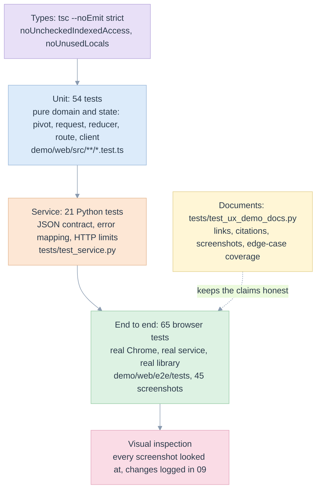
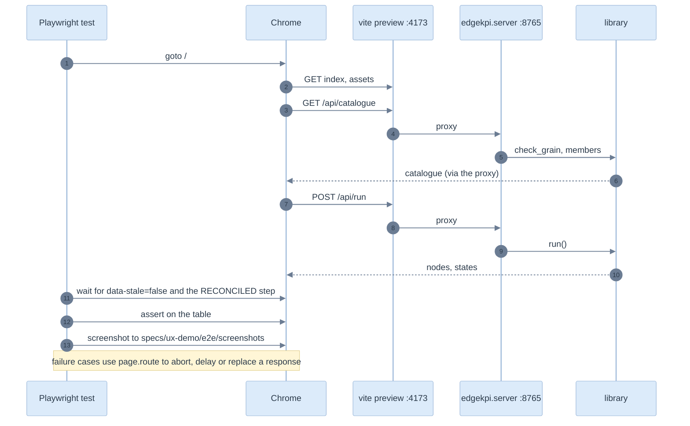

# 07. Test strategy and end-to-end tests

> Three kinds of test, each at the cheapest level that can fail for the right reason. The end-to-end tests drive a real browser against the real service and the real library, and save a screenshot at every state worth showing.

Related: [README](README.md) · [02 traceability](02-requirements-and-traceability.md) · [06 edge cases](06-edge-cases-and-state-charts.md) · [09 inspection log](09-visual-inspection-log.md) · [library 11](../library/11-test-strategy-and-e2e.md)

## Layers of proof



| Layer | Files | What it can fail on |
|---|---|---|
| Types | [tsconfig.json](../../demo/web/tsconfig.json) | a shape that drifted from [types.ts](../../demo/web/src/api/types.ts); an unused or unsafe access |
| Unit | [pivot.test.ts](../../demo/web/src/domain/pivot.test.ts), [request.test.ts](../../demo/web/src/domain/request.test.ts), [state.test.ts](../../demo/web/src/state/state.test.ts) | ordering, NULL versus Total, formatting, request edits and hints, the reducer, routes, the client's error normalisation |
| Service | [test_service.py](../../tests/test_service.py) | payload shapes, error codes and statuses, 400, 413, 404, explanation numbers, parity numbers, honest empties |
| End to end | [report.spec.ts](../../demo/web/e2e/tests/report.spec.ts), [resilience.spec.ts](../../demo/web/e2e/tests/resilience.spec.ts), [screens.spec.ts](../../demo/web/e2e/tests/screens.spec.ts), [tutorial.spec.ts](../../demo/web/e2e/tests/tutorial.spec.ts) | what a person would see and do, in a real browser |
| Documents | [test_ux_demo_docs.py](../../tests/test_ux_demo_docs.py) | a reference that rots |

## End to end: how it runs

[playwright.config.ts](../../demo/web/playwright.config.ts) starts both servers itself and reuses them if they are up:

1. the **service**: `python -m edgekpi.server --port 8765` (the interpreter comes from `EDGEKPI_PYTHON`, defaulting to `.venv/bin/python`);
2. the **front end**: `npm run build && npm run preview` on port 4173, with `/api` proxied to the service. The tests run against the production build, not the dev server.

Chrome is the installed Chrome (`channel: 'chrome'`), so no browser download is needed. One worker, no parallelism: the service shares one DuckDB connection. `reducedMotion: 'reduce'` removes animation so screenshots are stable.



### Waiting without sleeping

The report is debounced and asynchronous, so a test never sleeps for a fixed time. [helpers.ts](../../demo/web/e2e/helpers.ts) `reportReady` waits for the state the screen exposes: `data-stale="false"` on the result body and the `RECONCILED` step reached. The screen marks the result outdated **the moment the request changes**, so `reportReady` cannot return on the old table. This was a bug the first run found ([09](09-visual-inspection-log.md#iteration-2)).

### Failure paths without a broken service

| To provoke | How the test does it |
|---|---|
| service down | `page.route('**/api/**', abort)` before the first load |
| slow answer | `page.route('**/api/run', wait, then continue)` |
| stale answer overtaking | delay only the first of two calls, change the request, wait, assert the newer table is still there |
| a proxy returning HTML | `route.fulfill` with `text/html` |
| no recorded run, no templates | `route.fulfill` with `{ok: true, available: false}` |

The real service is used everywhere else. Nothing about a successful report is faked.

## The e2e tests

| File | Tests | Covers |
|---|---|---|
| [report.spec.ts](../../demo/web/e2e/tests/report.spec.ts) | 18 | the main flow, explanations, filters, dates, publishing, backends and the statement |
| [resilience.spec.ts](../../demo/web/e2e/tests/resilience.spec.ts) | 7 | unreachable, slow, stale, malformed, navigation, deep links, narrow |
| [screens.spec.ts](../../demo/web/e2e/tests/screens.spec.ts) | 17 | Catalogue, Backends, Migration, Assistant, Edge-case lab |

Each screenshot is named by a number and a state (`05-explain-rate-total.png`); the numbering groups them: 01 to 14 Report, 20 to 22 Catalogue and Backends, 23 to 25 Migration, 26 to 28 Assistant, 29 Lab. The full list with captions is in [09](09-visual-inspection-log.md#the-screenshots).

## Running

```bash
pytest tests/test_service.py                       # service layer, no browser
cd demo/web
npm run typecheck                                  # tsc --noEmit
npm test                                           # vitest, 54 tests
EDGEKPI_PYTHON=../../.venv/bin/python npm run e2e  # builds, starts both servers, 65 tests, 45 screenshots
pytest ../../tests/test_ux_demo_docs.py            # the documents
```

## Gates

| Gate | Condition |
|---|---|
| Merge | types clean; unit, service and e2e tests pass; documents check passes |
| A new screen or state | it has a wireframe in [05](05-screens-and-navigation.md), an `EC-D` row if it can fail, an e2e test and a screenshot that has been looked at |
| A new library error shown on screen | a `scenario` in the lab and a service test |
| A change of look | screenshots regenerated, re-inspected, and the log updated |

## What is not tested

Other browsers; a screen reader; thousands of nodes; a real Databricks warehouse behind the service (the recorded run is displayed, not re-run); touch input; print layout.
