# 08. Implementation plan

> What is built, in what order, what is next, and the rules every change keeps. Phases describe dependencies, not dates.

Related: [README](README.md) · [02 requirements](02-requirements-and-traceability.md) · [07 gates](07-test-strategy-and-e2e.md#gates) · [library 12](../library/12-implementation-plan.md)

## Phases

```mermaid
%%{init: {'theme':'base','themeVariables':{'primaryColor':'#DCEBFA','primaryBorderColor':'#9DB9DA','primaryTextColor':'#2B3A4A','lineColor':'#8A9BB0','fontFamily':'Inter, sans-serif'}}}%%
flowchart LR
  D0["D0 Service layer<br/>service.py, server.py, explain.py"]:::green
  D1["D1 Contract + domain<br/>types, client, pivot, request, format"]:::green
  D2["D2 State<br/>reducer, hooks, route, AppState"]:::green
  D3["D3 Screens<br/>Report, Catalogue, Backends,<br/>Migration, Assistant, Lab"]:::green
  D4["D4 Proof<br/>unit, service, e2e, screenshots"]:::green
  D5["D5 Inspect and refine<br/>look, change, re-run, log"]:::green
  D6["D6 Hardening<br/>more browsers, volume,<br/>auth, persistence"]:::yellow
  D0 --> D1 --> D2 --> D3 --> D4 --> D5 --> D6
  classDef green fill:#DDF2E3,stroke:#9CCDAA,color:#2B3A4A
  classDef yellow fill:#FFF6D6,stroke:#E3D18F,color:#2B3A4A
```

| Phase | Outcome | Modules | Exit evidence | Status |
|---|---|---|---|---|
| D0 Service layer | The library's calls as JSON, with an error mapping and limits | [service.py](../../edgekpi/service.py), [server.py](../../edgekpi/server.py), [explain.py](../../edgekpi/explain.py) | `test_service.py` | done |
| D1 Contract and domain | One set of shapes; pure functions for the pivot, request edits, formatting | [types.ts](../../demo/web/src/api/types.ts), [client.ts](../../demo/web/src/api/client.ts), [pivot.ts](../../demo/web/src/domain/pivot.ts), [request.ts](../../demo/web/src/domain/request.ts), [format.ts](../../demo/web/src/domain/format.ts) | 34 unit tests | done |
| D2 State | Latest wins; state that survives navigation; hash routes | [asyncState.ts](../../demo/web/src/state/asyncState.ts), [useLatest.ts](../../demo/web/src/state/useLatest.ts), [AppState.tsx](../../demo/web/src/state/AppState.tsx), [route.ts](../../demo/web/src/state/route.ts) | reducer and route tests | done |
| D3 Screens | Six screens composed from seven components | [screens/](../../demo/web/src/screens/ReportScreen.tsx), [components/](../../demo/web/src/components/ui.tsx) | the wireframes of [05](05-screens-and-navigation.md) | done |
| D4 Proof | Browser tests against the real service, with screenshots | [e2e/](../../demo/web/e2e/helpers.ts) | 42 tests, 24 screenshots, later 65 tests, 45 screenshots | done |
| D5 Inspect and refine | Every screenshot looked at; what was wrong was changed and re-run | [09](09-visual-inspection-log.md) | four iterations, logged | done |
| D5b Tutorial | A twelve-step guided path: the problem, the three ways to write a KPI (Malloy on DuckDB and on Databricks), the SQL recipe, the migration | [tutorial/](../../demo/web/src/screens/tutorial), [tutorial.ts](../../demo/web/src/domain/tutorial.ts), [10](10-tutorial.md) | `tutorial.spec.ts` (23 tests), `tutorial.test.ts`, `test_service.py` | done |
| D6 Hardening | Browsers, volume, persistence, authentication | n/a | see the backlog | **not started** |

## Rules every change keeps

| Rule | How it is enforced |
|---|---|
| **DRY**: one rule, one home ([03](03-architecture-solid-dry.md#dry-one-rule-one-place)) | review of the table; the unit tests of each module |
| **SOLID**: a screen, a lab case or a backend is added without editing another module | `ROUTES`, `SCENARIOS` and the service's backend list are data; screens take `EdgeKpiApi` |
| **First principles** ([00](00-five-whys-and-first-principles.md#first-principles)) | each FP has a named test |
| **E2E**: a new state gets a browser test and a screenshot | [07 gates](07-test-strategy-and-e2e.md#gates) |
| **Edge cases**: a new way to fail gets an `EC-D` row, a mitigation and a test | `tests/test_ux_demo_docs.py` fails otherwise |
| **Nothing mocked**: a value on screen comes from the library | the e2e tests use the real service; only failure paths are intercepted |
| **Inspect before you finish** | the log in [09](09-visual-inspection-log.md) is part of the definition of done |

## Decisions

| Id | Decision | Status |
|---|---|---|
| ADR-D-01 | A service layer in the library package (`service.py`), with an HTTP wrapper using only the standard library | accepted: the host integration proposed in [library 08](../library/08-ai-and-integration.md#integration-shape), made real |
| ADR-D-02 | Vite, React and TypeScript with no UI kit, no router and no state library | accepted: the app is small enough that each would cost more than the code it replaces |
| ADR-D-03 | The browser formats and arranges; it never computes a KPI | accepted (FP-D-2) |
| ADR-D-04 | `EdgeKpiApi` is an interface; `fetch` appears once | accepted |
| ADR-D-05 | Hash routing | accepted: no server configuration, deep links work from a static file |
| ADR-D-06 | The report runs as you change it, after 250 ms, latest wins | accepted: fewer clicks; the cost is more calls, bounded by the pause |
| ADR-D-07 | The result is marked outdated as soon as the request changes, not when the call starts | accepted after the first e2e run ([09](09-visual-inspection-log.md#iteration-2)) |
| ADR-D-08 | Retry is offered only for failures a retry can fix | accepted (EC-D-02) |
| ADR-D-09 | The explanation re-runs the report to stay stateless | accepted; a cache is on the backlog |
| ADR-D-10 | e2e tests run against the production build, on the installed Chrome, with one worker | accepted: one shared DuckDB connection |
| ADR-D-11 | Screenshots are saved with the specification and re-generated by the tests | accepted: they cannot drift from the code |

## Not built

| Item | Why it matters | Where it would go |
|---|---|---|
| Firefox and Safari runs | cross-browser confidence | add projects to [playwright.config.ts](../../demo/web/playwright.config.ts) |
| A cell limit and table virtualisation | very large results | service refuses above a bound; `Pivot` windows its rows |
| Keeping the request across a reload | convenience | store the request in the hash or local storage |
| A cache for explanations | avoids re-running a report per click | the service keeps the last grid per request key |
| A live Databricks connection in the demo | showing the metric view run, not only compiled | `Service(warehouse=...)` already accepts an engine; credentials and consent are the open points |
| Editing definitions, confirming KPIs | governance | a host concern ([library 12](../library/12-implementation-plan.md#not-built)) |
| Authentication and rate limiting | any use beyond localhost | in front of `server.py` |
| A language model behind the Assistant | the real flow | out of scope; the resolver is what it would call |
| A screen-reader pass | accessibility confidence | manual test with VoiceOver |
| A locked environment and CI | reproducibility | `package-lock.json` exists; there is no workflow file |

## Definition of done for a change

1. A requirement or an edge case names it ([02](02-requirements-and-traceability.md), [06](06-edge-cases-and-state-charts.md)).
2. A test fails without it, at the lowest layer that can.
3. Types are clean; unit, service and e2e tests pass.
4. If the look changed, the screenshots are regenerated and **looked at**, and [09](09-visual-inspection-log.md) says what was seen.
5. The documents that cite the change are updated; `tests/test_ux_demo_docs.py` passes.
6. Any remaining limit is written in words the reader of the screen can understand.
