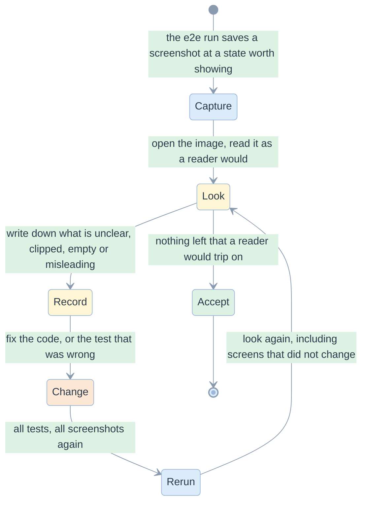
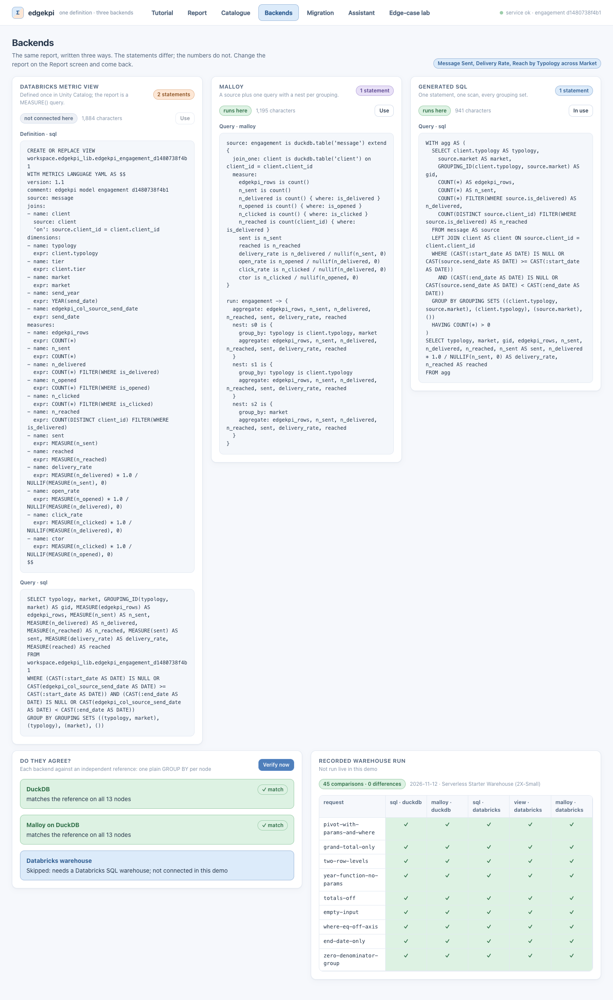
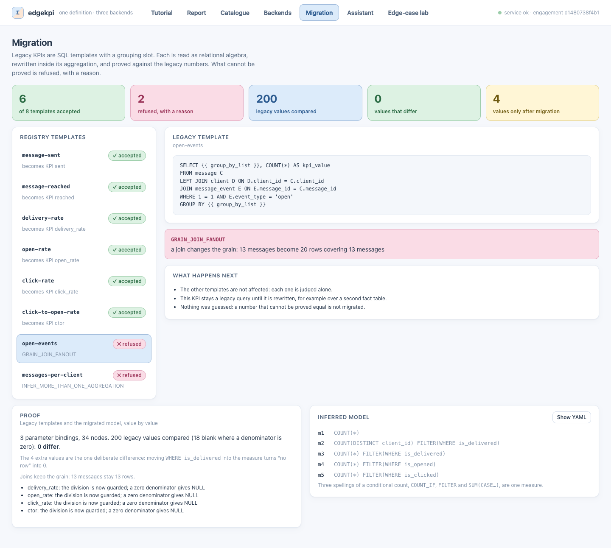

# 09. Visual inspection log

> Every screenshot was looked at, not only saved. What was seen, what was changed because of it, and what was left, in the order it happened.

Related: [README](README.md) · [05 screens](05-screens-and-navigation.md) · [07 test strategy](07-test-strategy-and-e2e.md) · [08 plan](08-implementation-plan.md)

## The method

The screenshots are regenerated by every e2e run, so the "before" images were overwritten. This log records what was seen; the images in this folder show the state after the last iteration.

## Iteration 1

First look at the six screens, before any browser test existed.

| Screen | What was seen | Change |
|---|---|---|
| Report | The Rows and Columns chips read `typology` and `market` in lower case while KPI chips read `Message Sent`: two voices | `titleCase` in [format.ts](../../demo/web/src/domain/format.ts), used wherever a dimension is named |
| Report | The From and To date inputs sat on separate lines, their labels beside them, wasting the narrow column | a two-column `.dates` grid with the label above each input |
| Backends | Code blocks were clipped at the right edge; the reader sees half a line | `white-space: pre-wrap` with `overflow-wrap: anywhere` |
| Backends | The "Do they agree?" card stretched to the height of the card beside it and stayed mostly empty | `align-items: start` on the two-column grids |
| Edge-case lab | Each card showed the request as raw JSON with leftovers such as `"totals":{"rows":true,"cols":true},` | `summarise()` in [scenarios.ts](../../demo/web/src/domain/scenarios.ts): one readable line |
| Assistant | Arriving on the screen showed an empty right half | a default proposal is resolved on arrival |
| Migration | Table cells were top-aligned, so a measure id and its expression sat on different lines | `vertical-align: middle` |

## Iteration 2

The first run of the browser tests: 40 tests, 6 failed. Both the failures and the screenshots were informative.

| Found by | What was wrong | Change |
|---|---|---|
| a failing test | after changing the request, the helper returned at once: the screen still showed the **old table** as current during the 250 ms pause | the result is marked outdated the moment the request changes (ADR-D-07); `reportReady` waits for it |
| a failing test | choosing a filter dimension lost the choice, because it was derived from a request that, with nothing ticked, has no filter | the Builder keeps the chosen dimension in its own state and syncs from the request |
| a failing test | at 760 px the page scrolled sideways by 81 px: the top bar did not wrap | the bar wraps below 900 px; the table scrolls inside its own container |
| a failing test | clicking a disabled radio waited forever, as it should; the test was wrong | `click({ force: true })` to prove the click does nothing |
| a failing test | two selectors matched `<option>` text and a second element with the same test id | selectors on chips only; the test id renamed |
| screenshot | full-page captures stitched the sticky header into the middle of the page | the helper freezes sticky elements while capturing |
| screenshot | a refused published report offered **Retry**, which cannot help, and still showed the old estimate | domain errors offer no Retry and say what to change; the estimate is hidden; a note says the table is the last good one (EC-D-02) |
| screenshot | with the service down, the screen was one banner and a blank page | a "Start the service" card with the command |
| screenshot | while a run was pending, the stepper still showed five green steps and "0 violations" | the stepper dims and the violations pill hides while pending |
| screenshot | explaining Reach showed `n_reached = n_reached`: an equation of one term | a single-measure explanation omits the equation |
| screenshot | with no KPI chosen, the old table and "0 violations" remained | "No report yet" replaces the result (EC-D-07) |
| screenshot | the empty result was a sentence with nothing to anchor it | a large `∅` glyph |

## Iteration 3

A second pass over every screenshot after the changes above, including screens that had not changed.

| Screen | What was seen | Change |
|---|---|---|
| Migration, a refused template | the right half under the refusal was blank | a "What happens next" card: the others are unaffected, the KPI stays a legacy query, nothing was guessed |
| Assistant | the lower half of the page was blank under both cards | a "How the resolver decides" table: six rows, the resolver's contract |
| Backends | the Malloy and SQL blocks were cut at 440 px while the metric view ran on | `max-height: none` in the three-column grid |

Then every screenshot was read once more. **Accepted as they are**, with the reason:

- Empty cells of the pivot are blank, while a rate with no value is a dash. A blank means "no such node", a dash means "the node exists and has no value". The two are different, and the table labels (`aria-label="no data"`) keep them apart.
- The three cards on Backends have different heights. They show different amounts of text; equal heights would add empty space.
- Date inputs show the browser's locale format (`mm/dd/yyyy`). The value sent is always `YYYY-MM-DD`.
- The pivot's data bars are thin. They are a hint, not a chart: the number is the truth.

## The screenshots

| File | State | Produced by |
|---|---|---|
| [01-report-default](e2e/screenshots/01-report-default.png) | the default report, all totals, five steps green | `report.spec.ts::a default report is computed, checked and shown` |
| [02-report-blank-rate](e2e/screenshots/02-report-blank-rate.png) | a rate with no value shown as a dash | `report.spec.ts::EC-D-10` |
| [03-report-two-row-levels](e2e/screenshots/03-report-two-row-levels.png) | subtotals labelled with their path | `report.spec.ts::two row dimensions give subtotals` |
| [04-report-no-kpi](e2e/screenshots/04-report-no-kpi.png) | no KPI: Run disabled, "No report yet" | `report.spec.ts::EC-D-07` |
| [05-explain-rate-total](e2e/screenshots/05-explain-rate-total.png) | 76.9% beside the mean of its cells, 81.9% | `report.spec.ts::a rate total is its own counts divided` |
| [06-explain-distinct](e2e/screenshots/06-explain-distinct.png) | Reach 6 beside the sum of its cells, 9 | `report.spec.ts::a distinct count total is below the sum of its cells` |
| [07-report-filtered](e2e/screenshots/07-report-filtered.png) | a date and a market filter, the Total follows | `report.spec.ts::a date range narrows every total` |
| [08-report-empty](e2e/screenshots/08-report-empty.png) | no rows match | `report.spec.ts::EC-D-09` |
| [09-report-published-refused](e2e/screenshots/09-report-published-refused.png) | a refusal with its code, the last table dimmed | `report.spec.ts::EC-D-21` |
| [10-report-malloy](e2e/screenshots/10-report-malloy.png) | the same totals through Malloy | `report.spec.ts::EC-D-18` |
| [11-report-statement](e2e/screenshots/11-report-statement.png) | the statement, the bound value beside it | `report.spec.ts::EC-L-07` |
| [12-service-down](e2e/screenshots/12-service-down.png) | the service is not running | `resilience.spec.ts::EC-D-01` |
| [13-report-loading](e2e/screenshots/13-report-loading.png) | a slow run, last result dimmed | `resilience.spec.ts::EC-D-03` |
| [14-report-narrow](e2e/screenshots/14-report-narrow.png) | a 760 px window | `resilience.spec.ts::EC-D-16` |
| [20-catalogue](e2e/screenshots/20-catalogue.png) | KPIs, measures, dimensions, filters, grain | `screens.spec.ts::EC-D-15` |
| [21-backends](e2e/screenshots/21-backends.png) | one report, three statements, the recorded run | `screens.spec.ts::one report, three statements` |
| [22-backends-verified](e2e/screenshots/22-backends-verified.png) | verified against the reference | `screens.spec.ts::verify compares each connected backend` |
| [23-migration](e2e/screenshots/23-migration.png) | 6 accepted, 2 refused, 200 values, 0 differ | `screens.spec.ts::six templates accepted, two refused` |
| [24-migration-refused](e2e/screenshots/24-migration-refused.png) | a refusal and its reason | `screens.spec.ts::a refused template shows its reason` |
| [25-migration-inferred](e2e/screenshots/25-migration-inferred.png) | an inferred KPI, its measures, the YAML | `screens.spec.ts::an accepted template shows its inferred measures` |
| [26-assistant-resolved](e2e/screenshots/26-assistant-resolved.png) | a label and a typo read, the request valid | `screens.spec.ts::a label and a typo are read` |
| [27-assistant-question](e2e/screenshots/27-assistant-question.png) | an ambiguous word becomes a question | `screens.spec.ts::an ambiguous word becomes a question` |
| [28-assistant-hostile](e2e/screenshots/28-assistant-hostile.png) | hostile text shown as text | `screens.spec.ts::EC-D-17` |
| [29-lab-all-pass](e2e/screenshots/29-lab-all-pass.png) | twelve cases, 12 of 12 as expected | `screens.spec.ts::every case is answered as a correct service should` |

## Iteration 4: the tutorial

Every tutorial screenshot was opened and read as a newcomer would, step by step. The first nine steps were read after the SQL and migration steps and the Malloy engines were added.

| Screen | What was seen | Change |
|---|---|---|
| Step 7, metric view | a spinner sat in the "same grand total" panel: the picture was taken before the answers had arrived | the test waits for the panel before it captures, here and in the narrow capture |
| Step 8 | the "SQL contains" cell of the rate row quoted the whole outer `SELECT` line, eight columns long, instead of the formula | `excerpt` quotes the matching expression only: `n_delivered * 1.0 / NULLIF(n_sent, 0) AS delivery_rate` |
| Step 8 | the sticky outline was stitched into the middle of the full-page capture | the helper freezes the outline like the header |
| Step 9 | "The status is **draft** until its owner confirms" broke onto three lines: bold text inside a box was a block | only the title of a box is a block; bold inside the text stays in the line |
| Step 7, Malloy | the engine was not visible: DuckDB only | an "On DuckDB / On Databricks" switch, the connection above the program, the two table lines highlighted, a pill per engine with its recorded run |
| Step 7, SQL | only DuckDB was named | the pills say SQL on DuckDB and on Databricks, each with its source: live, or the recorded run |
| Step 9 | only a one-time migration was explained; a reader asked whether people could keep writing templates and have the definition inferred | a route switch: A migrate once, B keep templates and infer; B shows the contract, the shared measures, the command and a table of when to use which; read in full, no clipping |
| Header | "12 short steps, about ten minutes" after twelve steps were written | "about fifteen minutes" |
| Error banner | the service message shows its backticks literally | left: the text comes from the client and is shown as text on purpose (EC-D-17) |
| Steps 1 to 6, 10 to 12 | read in full: tables aligned, the tempting answer in pink and the right one in green, the boxes consistent, nothing clipped | none |

One finding came from the tests, not from a picture: a stale service started from older code was still on the port and answered 404 to the new route, so the first tutorial run failed on steps 1, 4 and 9. The stale process was stopped; the run is repeatable because the configuration reuses a running service, so a developer who changes the service must stop the old one (`make stop`).

| Screenshot | What it shows | Proof |
|---|---|---|
| [30-tutorial-1-data](e2e/screenshots/30-tutorial-1-data.png) | the thirteen rows, the one with an unknown typology tinted | `tutorial.spec.ts::step 1 shows the thirteen rows` |
| [31-tutorial-2-predict](e2e/screenshots/31-tutorial-2-predict.png) | the question, the total hidden | `tutorial.spec.ts::step 2 hides the total until you commit` |
| [32-tutorial-2-wrong](e2e/screenshots/32-tutorial-2-wrong.png) | the tempting answer in pink, the right one in green, why | `tutorial.spec.ts::step 2 hides the total until you commit` |
| [33-tutorial-3-inside](e2e/screenshots/33-tutorial-3-inside.png) | delivered and sent behind each rate | `tutorial.spec.ts::step 3 opens the percentages` |
| [34-tutorial-4-reach](e2e/screenshots/34-tutorial-4-reach.png) | 9 against 6, clients counted in two cells | `tutorial.spec.ts::step 4: unique clients` |
| [35-tutorial-5-old](e2e/screenshots/35-tutorial-5-old.png) | the saved query with its habits marked | `tutorial.spec.ts::step 5 shows the saved query` |
| [36-tutorial-6-define](e2e/screenshots/36-tutorial-6-define.png) | the definition and the three kinds of number | `tutorial.spec.ts::step 6 shows the definition` |
| [37-tutorial-7-metric-view](e2e/screenshots/37-tutorial-7-metric-view.png) | the metric view and its query, compiled only | `tutorial.spec.ts::step 7 explains the three ways` |
| [38-tutorial-7-malloy](e2e/screenshots/38-tutorial-7-malloy.png) | Malloy on DuckDB: the connection and the program | `tutorial.spec.ts::step 7 explains the three ways` |
| [3j-tutorial-7-malloy-databricks](e2e/screenshots/3j-tutorial-7-malloy-databricks.png) | the same program on Databricks, the connection with placeholders | `tutorial.spec.ts::step 7 explains the three ways` |
| [39-tutorial-7-sql](e2e/screenshots/39-tutorial-7-sql.png) | generated SQL and the four pills of agreement | `tutorial.spec.ts::step 7 explains the three ways` |
| [3a-tutorial-8-recipes](e2e/screenshots/3a-tutorial-8-recipes.png) | six recipes: what you write, what the SQL contains | `tutorial.spec.ts::step 8 teaches the SQL` |
| [3b-tutorial-8-ladder](e2e/screenshots/3b-tutorial-8-ladder.png) | the statement grown to two dimensions and a unique count | `tutorial.spec.ts::step 8 teaches the SQL` |
| [3h-tutorial-9-before-after](e2e/screenshots/3h-tutorial-9-before-after.png) | the saved query and its proposed definition | `tutorial.spec.ts::step 9 shows the five stages` |
| [3k-tutorial-9-route-b](e2e/screenshots/3k-tutorial-9-route-b.png) | route B: the loop, the template contract, six templates on five measures, the command, the choice of route | `tutorial.spec.ts::step 9 route B` |
| [3i-tutorial-9-refusal](e2e/screenshots/3i-tutorial-9-refusal.png) | a refusal, its reason and what to do | `tutorial.spec.ts::step 9 shows the five stages` |
| [3c-tutorial-10-layout](e2e/screenshots/3c-tutorial-10-layout.png) | the total stays, the average moves | `tutorial.spec.ts::step 10: four layouts` |
| [3d-tutorial-11-verify](e2e/screenshots/3d-tutorial-11-verify.png) | the checks and the independent reference | `tutorial.spec.ts::step 11: the arithmetic` |
| [3e-tutorial-12-yours](e2e/screenshots/3e-tutorial-12-yours.png) | where to go next, the three rules | `tutorial.spec.ts::step 12 opens the Report` |
| [3f-tutorial-error](e2e/screenshots/3f-tutorial-error.png) | a failing step: its banner, Retry, the outline still usable | `tutorial.spec.ts::EC-D-28` |
| [3g-tutorial-narrow](e2e/screenshots/3g-tutorial-narrow.png) | a 760 px window: the outline becomes numbered pills | `tutorial.spec.ts::EC-D-16` |

## Limits of this inspection

One viewport at 1440 by 900 and one at 760 by 900; one browser; one reader. A real usability test with people from the business would find things this did not; it is the next step before showing the demo outside the team.
