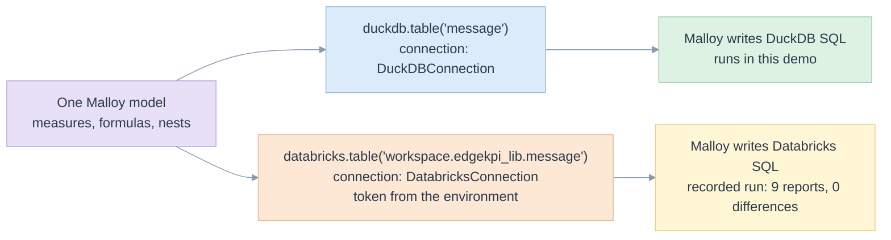
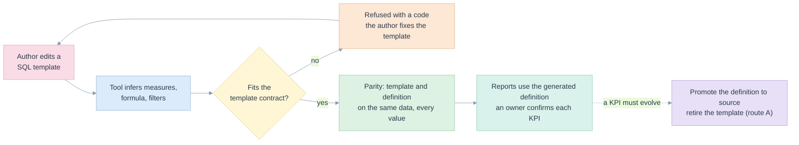
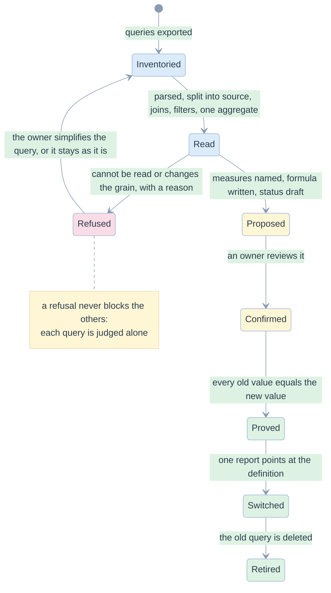
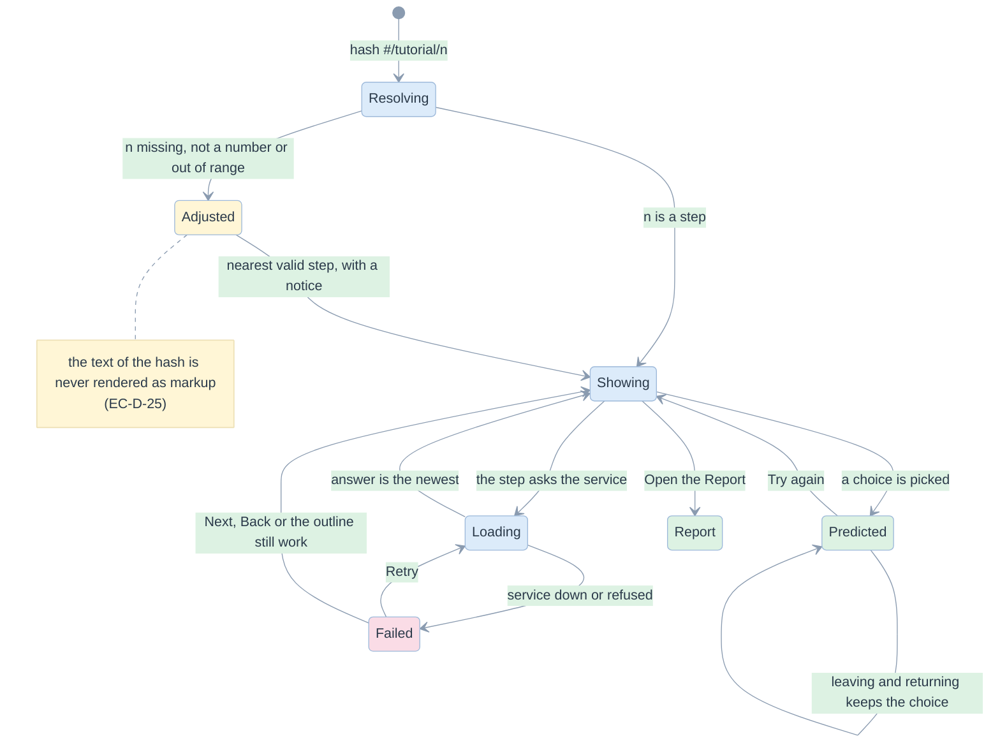

# 10. The tutorial

> Twelve short steps that teach the problem and the fix with the real library: why a total cannot be averaged, how one definition is written, how it becomes a Databricks metric view, Malloy (on DuckDB and on Databricks) and generated SQL, how a KPI is expressed, and how saved queries are moved over. Every number is computed live on thirteen example messages.

Related: [README](README.md) · [00 principles](00-five-whys-and-first-principles.md) · [02 requirements](02-requirements-and-traceability.md) · [05 screens](05-screens-and-navigation.md) · [06 edge cases](06-edge-cases-and-state-charts.md) · [09 inspection log](09-visual-inspection-log.md) · [library 05 backends](../library/05-the-three-backends.md) · [library 06 migration](../library/06-inference-and-migration.md)

Code: [TutorialScreen.tsx](../../demo/web/src/screens/TutorialScreen.tsx), [tutorial/](../../demo/web/src/screens/tutorial), [tutorial.ts](../../demo/web/src/domain/tutorial.ts). Tests: [tutorial.spec.ts](../../demo/web/e2e/tests/tutorial.spec.ts), [tutorial.test.ts](../../demo/web/src/domain/tutorial.test.ts).

## Why a tutorial

The Report screen assumes the reader already knows why a total is hard. Most readers do not. The five whys of [00](00-five-whys-and-first-principles.md) end at "a number must carry what it is made of"; the tutorial lets a reader find that out in ten minutes, by predicting a number, being wrong, and opening the number.

| Principle | What it means for the tutorial |
|---|---|
| FP-D-2 the browser never computes a KPI | each step asks the service; the only thing read from the rows is which client sits in two cells |
| Nothing is mocked | a step that cannot show a real thing says so (EC-D-29) rather than drawing one |
| One idea per step | each step opens with one sentence, "You will see that:", and ends with one sentence to remember |
| Predict, then reveal | the two traps are questions first; the wrong answer is shown as wrong, with the reason |

## The path

```mermaid
%%{init: {'theme':'base','themeVariables':{'primaryColor':'#DCEBFA','primaryBorderColor':'#9DB9DA','primaryTextColor':'#2B3A4A','lineColor':'#8A9BB0','fontFamily':'Inter, sans-serif'}}}%%
flowchart LR
  subgraph P["The problem"]
    S1["1 The rows"]:::blue --> S2["2 Predict<br/>the total"]:::pink --> S3["3 Inside<br/>a percentage"]:::pink --> S4["4 Unique<br/>clients"]:::pink
  end
  subgraph F["The fix"]
    S5["5 Why a query<br/>per KPI fails"]:::peach --> S6["6 Define<br/>it once"]:::green --> S7["7 Three ways<br/>to write it"]:::lav
    S7 --> S8["8 Generated SQL<br/>piece by piece"]:::lav --> S9["9 Moving from<br/>your queries"]:::yellow
  end
  subgraph T["Trust"]
    S10["10 Change the layout"]:::green --> S11["11 Check"]:::mint --> S12["12 Your turn"]:::blue
  end
  S4 --> S5
  S9 --> S10
  classDef blue fill:#DCEBFA,stroke:#9DB9DA,color:#2B3A4A
  classDef lav fill:#E8E0F7,stroke:#B9A9DC,color:#2B3A4A
  classDef green fill:#DDF2E3,stroke:#9CCDAA,color:#2B3A4A
  classDef peach fill:#FDE7D5,stroke:#E5B995,color:#2B3A4A
  classDef pink fill:#FADCE6,stroke:#E3A9BF,color:#2B3A4A
  classDef yellow fill:#FFF6D6,stroke:#E3D18F,color:#2B3A4A
  classDef mint fill:#D9F2EC,stroke:#95CFC2,color:#2B3A4A
```



| Step | Title | The reader does | The service supplies | Proof |
|---|---|---|---|---|
| 1 | The rows behind a report | reads thirteen messages; sees the one with an unknown typology | `GET /api/messages` | `tutorial.spec.ts::step 1 shows the thirteen rows` |
| 2 | Predict the total | picks 81.9% or 76.9%; sees why | `run` and `explain` | `tutorial.spec.ts::step 2 hides the total until you commit` |
| 3 | Look inside the percentage | reads delivered and sent behind each rate | `run` | `tutorial.spec.ts::step 3 opens the percentages` |
| 4 | A second trap: unique clients | picks 9 or 6; sees client c1 counted in HK and SG | `run`, `explain`, the raw rows | `tutorial.spec.ts::step 4: unique clients` |
| 5 | Why a query per KPI fails | reads the saved query, with its three habits marked | `inference` | `tutorial.spec.ts::step 5 shows the saved query` |
| 6 | The fix: define it once | reads the definition and the three kinds of number | `catalogue` | `tutorial.spec.ts::step 6 shows the definition` |
| 7 | Three ways to write it | switches between metric view, Malloy (DuckDB or Databricks) and SQL | `plan`, `run`, `evidence` | `tutorial.spec.ts::step 7 explains the three ways` |
| 8 | Generated SQL, piece by piece | reads six recipes, then grows a statement in four steps | `plan` | `tutorial.spec.ts::step 8 teaches the SQL` |
| 9 | Moving from your queries | chooses a route: migrate once, or keep writing templates and let a tool infer the definition; compares a saved query with its definition; reads a refusal | `inference` | `tutorial.spec.ts::step 9 shows the five stages`, `tutorial.spec.ts::step 9 route B` |
| 10 | Change the layout, keep the total | switches four layouts; watches the average move and the total stay | `run`, `explain`, `plan` | `tutorial.spec.ts::step 10: four layouts` |
| 11 | Trust, but check | sees the arithmetic checks; runs the independent reference | `run`, `verify` | `tutorial.spec.ts::step 11: the arithmetic` |
| 12 | Your turn | opens the Report with the layout learned | none | `tutorial.spec.ts::step 12 opens the Report` |

## Layout

```
 ┌──────────────────────────────────────────────────────────────────────────────────────────┐
 │ Σ edgekpi  [Tutorial] [Report] [Catalogue] [Backends] [Migration] [Assistant] [Lab]  ● ok │
 ├──────────────────────────────────────────────────────────────────────────────────────────┤
 │ Tutorial                                                                                  │
 │ ┌─ outline ──────┐ ┌─ lesson ───────────────────────────────────────────────────────────┐ │
 │ │ ✓ 1 The rows   │ │ Step 8 of 12                                  ▬▬▬▬▬▬▬▬▬░░░░ 67 %  │ │
 │ │ ✓ 2 Predict    │ │ Generated SQL, piece by piece                                      │ │
 │ │ …              │ │ 🎯 You will see that: how a KPI is written, and how it becomes SQL │ │
 │ │ ● 8 Gen. SQL   │ │ ┌ A. six recipes: you write │ the SQL contains ─────────────────┐  │ │
 │ │   9 Moving     │ │ └───────────────────────────────────────────────────────────────┘  │ │
 │ │   …            │ │ ┌ B. [1 Count][2 Condition][3 Group][4 Two dimensions] ─────────┐  │ │
 │ │ (sticky)       │ │ │ what is new │ real statement, new lines highlighted           │  │ │
 │ │                │ │ └───────────────────────────────────────────────────────────────┘  │ │
 │ │                │ │ [← Back]                          [Next: Moving from your queries →]│ │
 │ └────────────────┘ └────────────────────────────────────────────────────────────────────┘ │
 └──────────────────────────────────────────────────────────────────────────────────────────┘
   below 1100 px the outline becomes a row of numbered pills above the lesson
```

Four boxes with a fixed role are used in every step, so a reader learns to read them: **The idea** (blue), **Try it** (yellow), **Remember** (green), **Watch out** (peach).

## How each way of writing the definition is taught

Step 7 gives each way the same four things: what it is in a sentence, an analogy, a three-part reading guide (where the measures live, where the formula lives, how the grouping is asked), and the real statement generated now, with the lines the guide points at highlighted.

| | Databricks metric view | Malloy | Generated SQL |
|---|---|---|---|
| Idea | the warehouse stores the measures; a query says `MEASURE(name)` | a source declares measures; a `nest:` per grouping level | one statement; `GROUPING SETS`, formula in an outer `SELECT` |
| Measures live in | the `CREATE VIEW … WITH METRICS` definition | the `measure:` block of the source | the aggregates of the inner query |
| Formula lives in | the `delivery_rate` measure | `delivery_rate is n_delivered / nullif(n_sent, 0)` | the outer `SELECT` |
| Grouping is asked by | `GROUP BY GROUPING SETS` of the query | one `nest:` per level, `aggregate:` is the total | `GROUP BY GROUPING SETS (…)` |
| Engines | Databricks | **DuckDB** and **Databricks** | DuckDB and Databricks |
| In this demo | compiled and shown; the recorded warehouse run matched | runs on DuckDB; Databricks compiled and shown, recorded run matched | runs on DuckDB; recorded run on Databricks matched |

### Malloy on two engines

A Malloy model does not contain engine SQL. Only two things name the engine: the `.table(…)` lines of the source and the connection that is set up outside the model. The tutorial shows both.



- The service takes an optional `engine` (`duckdb` or `databricks`) on `plan`, only for Malloy. The Databricks text is the same program with the table paths of the recorded run (`workspace.edgekpi_lib.`), or the stated default when none is recorded.
- The connection shown is made of **placeholders** (`<workspace-host>`, `<warehouse-id>`) and reads the token from `process.env.EDGEKPI_DBX_TOKEN`; no secret is in the model or in the page (EC-D-30).
- The Databricks side is "compiled only, not connected" in the page, with the recorded run as evidence: `pairSummary` adds up the requests of the pair `malloy on databricks` from the evidence file; it never invents a result.
- Proof: `test_service.py::test_the_same_malloy_model_is_written_for_duckdb_and_for_databricks`, `tutorial.spec.ts::step 7 explains the three ways`.

## Step 8: generated SQL, in detail

**A. Six recipes.** One table: what you want, the kind of number, what you write, what the SQL contains. The left column is read from the catalogue; the right column is quoted from the statement generated for a report that uses all six, so it cannot drift from the library.

| You want to… | You write | The SQL contains |
|---|---|---|
| count the rows | `n_sent: COUNT(*)` | `COUNT(*) AS n_sent` |
| count only some rows | `n_delivered: COUNT(*) FILTER (WHERE is_delivered)` | `COUNT(*) FILTER(WHERE source.is_delivered) AS n_delivered` |
| count people | `n_reached: COUNT(DISTINCT client_id) FILTER (…)` | `COUNT(DISTINCT source.client_id) FILTER(…) AS n_reached` |
| divide one count by another | `delivery_rate: ratio(n_delivered, n_sent)` | `n_delivered * 1.0 / NULLIF(n_sent, 0) AS delivery_rate` |
| group by a column of another table | `typology: client.typology` and a `join` | `LEFT JOIN client AS client ON …` |
| limit to dates, when given | `from_date: CAST(send_date AS DATE) >= :start_date` | `(CAST(:start_date AS DATE) IS NULL OR …)` |

If a fragment cannot be found in the statement, its cell shows a dash; it never shows text the library did not write.

**B. A statement grown in four steps.** Each step is a real request; the lines it adds are highlighted.

| Step | Request | New in the statement |
|---|---|---|
| 1 Count | `sent` | `COUNT(*) AS n_sent` |
| 2 Condition and formula | `delivery_rate` | `FILTER(WHERE …)` and, in the outer `SELECT`, `NULLIF` |
| 3 Group | `delivery_rate` by typology | `GROUPING_ID`, `GROUP BY GROUPING SETS ((client.typology), ())` |
| 4 Two dimensions, unique count | `delivery_rate`, `reached` by typology × market | four grouping sets, `COUNT(DISTINCT …)` |

A fixed reading order is shown beside it: FROM and JOIN, WHERE, aggregates, GROUP BY GROUPING SETS, outer SELECT. The last is where totals become right: the counts are added first, then the formula is applied.

**C. Add a KPI: two lines.** The Click-to-open Rate is read from the catalogue: `ctor: ratio(n_clicked, n_opened)`. The counts already exist as measures, so no query is written and every layout and backend gets the KPI. Three things are handled for the writer: an unknown group label (`(none)`), an empty total (`HAVING COUNT(*) > 0`) and a zero denominator (`NULLIF`).

## Step 9: moving from the saved queries

Two routes, shown side by side, because they answer two different questions: *where do people edit?* and *what is the source of truth?*

| | A. Migrate once | B. Keep writing templates, infer the definition |
|---|---|---|
| People edit | the definition | the SQL template, as today |
| The definition is | the source of truth | generated and checked; a hand edit would be overwritten |
| Day-one effort | learn the definition format | none for authors |
| What can be expressed | anything the model allows | only what the template contract allows |
| Risk | a one-time review of every KPI | two sources side by side for as long as it lasts |

The page recommends **B as a bridge and A as the destination**: start with B so nothing stops and every KPI gets a checked definition; when a KPI needs to evolve, promote its generated definition to be the source and retire its template.

### Route B: the loop



The page shows, for route B:

- the **template contract**, five rules, each with the refusal a breach produces (`INFER_SELECT`, `INFER_GROUP_BY`, `INFER_NOT_A_LEFT_JOIN`, `INFER_UNSUPPORTED_CLAUSE`, `GRAIN_JOIN_FANOUT`, …): the refusals act as a linter for templates;
- the **live result on the example registry**: 6 templates became 5 measures, and a table says which KPIs share each measure (`m1`, `COUNT(*)`, is used by `sent` and `delivery_rate`), whatever the spelling in the template; the two refusals with their advice; the proof line;
- the **real command** (`python -m edgekpi infer … --dim typology=client.typology …`) and an honest note: it prints the model, `accepted N, refused M` and one line per refusal and exits 0; the comparison with the old numbers is `parity.verify`, which the demo's service runs; a gate that fails a change on a refusal or a difference is not built.

### Route A: the stages



The page shows five stages (inventory, read, review, prove, switch). Each says what the reader does, what the tool does and when it is done. Under them it shows the real example registry:

- a **before and after**: the saved query on the left with its three habits marked (`{{ group_by_list }}`, `try_divide`, `COUNT_IF`, and for Reach the `AND C.is_delivered` in the `WHERE`), the proposed definition on the right (`m3: COUNT(*) FILTER(WHERE is_delivered)`, `delivery_rate: m3 / m1`, status draft);
- **two refusals**, each with the library's reason and a plain next step: `GRAIN_JOIN_FANOUT` ("13 messages become 20 rows": a join multiplies the rows) and `INFER_MORE_THAN_ONE_AGGREGATION` (two numbers in one query: split it);
- the **proof line**: 6 of 8 accepted, 2 refused, 200 old values compared, 0 differ, 4 that exist only after migration (the totals the old queries could not give);
- a **translation table** of six habits of the saved queries and what each becomes.

The advice for a refusal is chosen by `advice(reason)` from the code at the start of the reason; an unknown code gets a safe default ("keep this query as it is for now"), so a reader always has a next move.

## State chart of the tutorial



## Edge cases of the tutorial

| Id | In short | Proof |
|---|---|---|
| EC-D-25 | a step that does not exist is clamped, with a notice; markup in the hash is not rendered | `tutorial.spec.ts::EC-D-25`, `tutorial.test.ts::starts at the first step` |
| EC-D-26 | the raw rows are unavailable: the step says why and can retry | `tutorial.spec.ts::EC-D-26`, `test_service.py::test_the_raw_messages_are_served_for_the_tutorial` |
| EC-D-27 | a prediction survives moving on and back; Try again clears it | `tutorial.spec.ts::EC-D-27` |
| EC-D-28 | a failing step shows its error; the outline and Next still work; it recovers | `tutorial.spec.ts::EC-D-28` |
| EC-D-29 | no templates configured: steps 5 and 9 say so and still teach | `tutorial.spec.ts::EC-D-29` |
| EC-D-30 | an unknown Malloy engine, or an engine for another backend, is refused; no secret in the connection | `test_service.py::test_an_engine_is_chosen_only_for_malloy_and_only_among_the_known` |

The full rows, with risk and mitigation, are in the [register](06-edge-cases-and-state-charts.md#register).

## Screenshots

| Step | Screenshot |
|---|---|
| 1 | [30](e2e/screenshots/30-tutorial-1-data.png) |
| 2 | [31](e2e/screenshots/31-tutorial-2-predict.png), [32](e2e/screenshots/32-tutorial-2-wrong.png) |
| 3 | [33](e2e/screenshots/33-tutorial-3-inside.png) |
| 4 | [34](e2e/screenshots/34-tutorial-4-reach.png) |
| 5 | [35](e2e/screenshots/35-tutorial-5-old.png) |
| 6 | [36](e2e/screenshots/36-tutorial-6-define.png) |
| 7 | [37 metric view](e2e/screenshots/37-tutorial-7-metric-view.png), [38 Malloy on DuckDB](e2e/screenshots/38-tutorial-7-malloy.png), [3j Malloy on Databricks](e2e/screenshots/3j-tutorial-7-malloy-databricks.png), [39 SQL](e2e/screenshots/39-tutorial-7-sql.png) |
| 8 | [3a recipes](e2e/screenshots/3a-tutorial-8-recipes.png), [3b build-up](e2e/screenshots/3b-tutorial-8-ladder.png) |
| 9 | [3h before and after](e2e/screenshots/3h-tutorial-9-before-after.png), [3i refusal](e2e/screenshots/3i-tutorial-9-refusal.png) |
| 10 | [3c](e2e/screenshots/3c-tutorial-10-layout.png) |
| 11 | [3d](e2e/screenshots/3d-tutorial-11-verify.png) |
| 12 | [3e](e2e/screenshots/3e-tutorial-12-yours.png) |
| failure, narrow | [3f](e2e/screenshots/3f-tutorial-error.png), [3g](e2e/screenshots/3g-tutorial-narrow.png) |

## Limits

- The tutorial teaches on thirteen synthetic messages; the real registry rows are not in the repository.
- The Databricks metric view and Malloy on Databricks are shown as compiled statements plus a recorded run, not executed from the page.
- The Malloy-generated engine SQL is not shown: Malloy writes it at run time ([library 05](../library/05-the-three-backends.md#malloy-on-databricks)).
- Chrome only; no screen-reader run.
