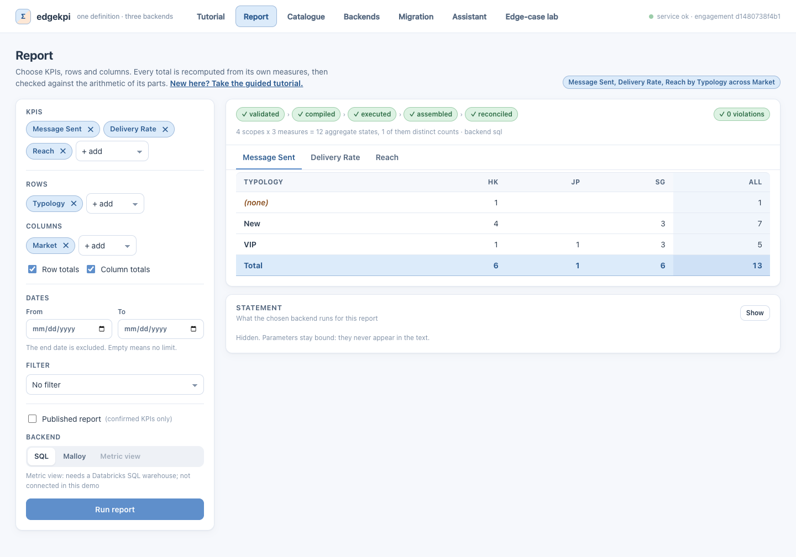
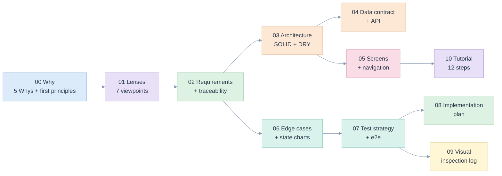

# UX demo: specification, plan and evidence

> A React demo of the [edgekpi library](../library/README.md): build a report, see every total checked, compare the three backends, review a migration. Nothing is mocked: every number on screen comes from the library running on DuckDB and Malloy. A twelve-step [tutorial](10-tutorial.md) teaches the problem, the Databricks metric view, Malloy (on DuckDB and on Databricks) and generated SQL, and how to move saved queries over.

Author: Raphael MANSUY. Date: 2026-11-12. Code: [demo/web](../../demo/web) (Vite, React, TypeScript) and [edgekpi/service.py](../../edgekpi/service.py), [edgekpi/server.py](../../edgekpi/server.py). Screenshots: [e2e/screenshots](e2e/screenshots).



## Read in this order



| # | Document | Question it answers | Main lens |
|---|---|---|---|
| 00 | [Five Whys and first principles](00-five-whys-and-first-principles.md) | Why a demo, and what must it never do? | Product Owner |
| 01 | [Seven lenses](01-lenses.md) | What does each discipline require of it? | all seven |
| 02 | [Requirements and traceability](02-requirements-and-traceability.md) | Which requirement is met by which code and test? | Product Owner |
| 03 | [Architecture, SOLID and DRY](03-architecture-solid-dry.md) | How is the front end organised? | System Design |
| 04 | [Data contract and API](04-data-contract-and-api.md) | What crosses the wire, and what happens on an error? | Full Stack, Database |
| 05 | [Screens and navigation](05-screens-and-navigation.md) | What does each screen look like and do? | UX and UI |
| 06 | [Edge cases and state charts](06-edge-cases-and-state-charts.md) | What can go wrong on screen, and where is it stopped? | all |
| 07 | [Test strategy and e2e](07-test-strategy-and-e2e.md) | How is it proved? | Full Stack |
| 08 | [Implementation plan](08-implementation-plan.md) | What is built, what is next? | Product Owner |
| 09 | [Visual inspection log](09-visual-inspection-log.md) | What was seen in the screenshots, and what was changed? | UX and UI |
| 10 | [The tutorial](10-tutorial.md) | How does a newcomer learn the problem, the three ways to write a KPI and the migration? | UX and UI, Product Owner |

## Run it

The [Makefile](../../Makefile) is the front door. `make` lists every target.

```bash
make doctor      # python 3.10+, node 18+, npm, curl, Chrome (for the browser tests), free ports
make install     # .venv, the library, the Malloy runtime, the demo's packages; skipped when up to date
make demo        # service + demo, http://localhost:5173, Ctrl-C stops both   (OPEN=1 opens the browser)

make test        # 222 Python tests (28 skip without a warehouse) + 54 unit tests, no browser
make e2e         # 65 browser tests, 45 screenshots in specs/ux-demo/e2e/screenshots
make check       # everything: types, unit, service, documents, browser
make stop        # a demo left running
```

Without `make`: `python -m edgekpi.server --port 8765` and, in `demo/web`, `npm run dev`; see the [root README](../../README.md#command-line-and-library).

## Identifiers

| Prefix | Meaning | Defined in |
|---|---|---|
| `FP-D-n` | first principle | [00](00-five-whys-and-first-principles.md#first-principles) |
| `REQ-D-nn` | requirement | [02](02-requirements-and-traceability.md#requirements) |
| `ADR-D-nn` | decision | [08](08-implementation-plan.md#decisions) |
| `EC-D-nn` | edge case on screen or in the service, with mitigation and test | [06](06-edge-cases-and-state-charts.md#register) |
| `EC-L-nn` | edge case of the library, run from the lab | [library 10](../library/10-edge-cases-and-state-charts.md#register) |

`tests/test_ux_demo_docs.py` checks that every `EC-D` identifier of the register appears in a test, that every cited test and screenshot exists, and that every link and anchor resolves.

## Where this fits

| This folder | Builds on |
|---|---|
| [04 data contract](04-data-contract-and-api.md) | the proposed HTTP mapping of [library 08](../library/08-ai-and-integration.md#integration-shape), now implemented |
| [05 screens](05-screens-and-navigation.md) | the wireframes of [library 07](../library/07-cli-and-ux.md#wireframes-for-a-graphical-interface-proposed-not-built) |
| [06 edge cases](06-edge-cases-and-state-charts.md) | the library register: the lab runs its cases live |
| [07 tests](07-test-strategy-and-e2e.md) | [library 11](../library/11-test-strategy-and-e2e.md) |
